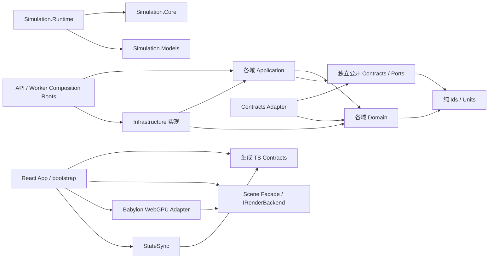

# 11 — 模块依赖、Ports/Adapters、事务与事件规范

## 1. 正向依赖图



箭头表示编译依赖；Web bootstrap 注入 GPU 实现，Scene 只调用自身定义的 IRenderBackend。严禁 Domain → Infrastructure/生成协议/其它域 Application，Contracts → Domain，Application → 其它域 Application，Simulation.Core → EF/网络，FAB Domain → Site UI 状态，Babylon Mesh → 生产主数据，OT Gateway → 直接修改 FAB 数据库表。业务协作的双向消息不等于双向项目引用。

## 2. Bounded Context 与跨域交互

- **Site** 拥有 Fab 归属、模板发布、组织配置；通过 `IFabRegistryReader` 发布不可变引用；不拥有 Lot/Equipment 状态。
- **Manufacturing** 拥有生产单/批次/工步进度；通过 `IEquipmentCapabilityReader` 获取可用加工能力，向 Scheduling 提交派工意图。
- **Equipment** 拥有设备/Chamber/Port 状态机；接收 `StartOperation` 命令，发布 `OperationStarted/Completed/EquipmentDown` 事件。
- **MaterialHandling** 拥有任务/车辆/路段/Stocker；向 Equipment 发送交接命令，不能直接改 Lot 的工艺状态。
- **Maintenance** 拥有故障/维修计划与操作；通过 Equipment 公开维护控制 Port 改变设备可用性。
- **Quality** 拥有质量判定/检测结果；可建议 Hold、Scrap、Rework，最终由 Manufacturing 命令校验并执行。
- **ProcessEngineering** 拥有不可变 Route/Recipe 与工艺能力要求；Equipment 拥有具体设备资格。
- **Simulation (M07)** 拥有 Run 执行域中的 Time、Queue、RNG、内存状态与 Checkpoint 内容；不拥有编排数据库中的 Run/Lease 生命周期，不依赖 `Fab.Api` 或业务 Application/Infrastructure。
- **Orchestration (M09)** 拥有 Scenario 冻结、Run/Job/Lease、执行记录及 Checkpoint/Artifact 目录提交；M07 通过 Ports 提供执行与恢复，不反向调用编排实体。
- **SiteResources (M08)** 拥有跨 FAB 资源定义/账本/授权；其 SiteCoordinator 使用 M07 确定性事件循环，不另建竞争的调度循环，只有共享运行域可申请权威分配。
- **Analytics** 消费事实与指标流，维护可重建读模型与比较结果；不得写入业务聚合或 M09 的 Artifact 目录。
- **EAP (M14)** 拥有标准语义 Profile 与 GEM 投影；**OT (M15)** 拥有端点连接/采集游标，只通过公开 Ports 投递遥测或经审批控制，二者通过独立契约解耦。
- **Identity/Security (M16)** 拥有授权、审批及 audit schema 的追加写入；其它模块提交审计事实，不获得审计修改权限。

## 3. Ports/Adapters 约束

跨域公开 DTO/Ports 位于独立 `Fab.Contracts`（按领域命名空间/版本分组），不返回领域实体；仓储等私有 Ports 留在所属 Application。若需要拆为 `Fab.X.Contracts`，仍须独立且无 Domain 依赖，由明确 ADR 和项目矩阵同步，不能用对方 Application 代替公开契约。

公开 Port 接口尽可能描述业务意图与语义，禁止暴露 `DbContext`、`NpgsqlConnection`、`ChannelReader<T>` 或 `Babylon.Scene` 给 Domain。读接口返回不可变快照 DTO；写接口返回明确结果码、EntityVersion、EventId。外部 I/O 必须接收 `CancellationToken`，但 DES Event Handler 热路径不得 `await` 外部网络。

```csharp
public interface IRouteReader
{
    ValueTask<PublishedRouteDto?> GetPublishedAsync(
        RouteVersionId versionId, CancellationToken cancellationToken);
}

public interface IRunArtifactStore
{
    Task<ArtifactReceipt> UploadAsync(
        RunId runId, Stream source, ArtifactMetadata metadata,
        CancellationToken cancellationToken);
}
```

示例的 `PublishedRouteDto`、`ArtifactMetadata`、`ArtifactReceipt` 是公开不可变契约类型；具体 Route Aggregate/EF Entity 在 Adapter 映射，不能因共享接口反向放入 Contracts。

## 4. 事务、Outbox、幂等

- 持久化业务聚合及其所属 Outbox 在同一 PostgreSQL 事务提交；即使 Outbox 物理表在 integration schema，也必须保持原业务事务与 owner 作用域，不经远程 Integration service 才写入。DES EventLog/Checkpoint 与 Parquet 使用独立可恢复提交协议，不逐事件开启 DB 事务。
- 对 HTTP 创建/变更操作要求 `Idempotency-Key + caller scope + endpoint fingerprint`，返回相同结果，冲突请求拒绝。
- `Outbox` 消费使用 `event_id`/`consumer_id` 唯一键去重，按聚合键排序保证**局部**顺序，不宣称跨聚合的分布式全局顺序。
- 并发业务命令使用 `expected_version`；业务并发冲突返回 409。使用 HTTP `If-Match` 的端点缺失必需前置条件返回 428，不匹配返回 412，并要求重新读取。
- 禁止跨 bounded context 的多个 DbContext 对象模拟“自动分布式事务”；通过流程状态机、Outbox 与补偿事件保证可恢复性。
- Site 共享资源是例外：必须在**单个确定性仿真授权域**内保证容量排他，而不是依赖 Outbox 的最终一致发布时序。

## 5. DI 与启动校验

Composition Root 用 `AddSiteModule()`、`AddManufacturingModule()`、`AddSimulationWorker()` 等扩展注册；模块不得在静态构造函数读取配置或建立外部连接。各 Host 检查适用的 DatabaseVersion、ContractsVersion、ScenarioSchema；GPU FeaturePolicy 仅由浏览器渲染初始化检查，Worker/API 不因无 GPU 而无法运行。未知共享模式或不兼容 schema 明确拒绝启动/提交。

## 6. 事件类型分类

| 类型 | 语义 | 例子 | 作用域 |
|---|---|---|---|
| DomainEvent | 业务状态变化事实 | LotHeld | FAB 内 |
| SimulationEvent | DES 时间线事件 | OperationCompleted | Run + FAB |
| IntegrationEvent | 发布给其他系统的事实 | JobCompletedV1 | 版本化接口 |
| ViewDelta | 只供 UI 消费的合并状态 | EquipmentColorChanged | 可重建投影 |
| SiteResourceEvent | 权威资源请求/授予/释放 | CapacityGranted | Site 协调域 |
| TelemetrySample | 现场观测 | SVValueObserved | source/time 双标识 |

业务事件与仿真事件可互相映射，但不能在所有存储系统里共享一个未经定义的单表/通用 JSON blob。事件必须显式 owner、schema、时间、因果、单位、统计影响和日志保留策略。
