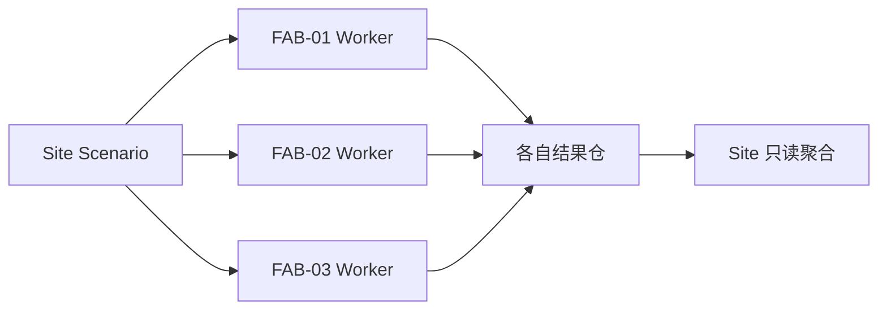

# 12 — 执行拓扑、仿真编排与跨 FAB 共享资源

## 1. 进程与权限划分

| 进程 | 数量 | 所有数据 | 允许的外部依赖 | 崩溃影响 |
|---|---|---|---|---|
| Web SPA | 多实例 | 只读投影/交互缓存 | API/Realtime | 仅浏览器 |
| Fab.Api | 初期 1–2 | 业务事务、Job、鉴权 | DB、ObjectStore | 不得中断已运行 DES |
| Fab.Worker | 可按负载伸缩 | 一个或多个隔离执行域的权威 DES 状态 | Job API、ObjectStore | 按执行域 Lease/Checkpoint 恢复 |
| SiteCoordinator（共享） | 每共享 Run 1 个逻辑主域 | 该 Run 内 SiteResource 授权的单一真相 | 首版在 Worker 内同步调用 FAB 分区 | 全域暂停并恢复，不能双主；此行是逻辑角色，不要求独立进程 |
| Realtime Host | 可水平扩展 | 非权威状态投影 | 状态流、授权 API | 客户端重连/重新订阅 |
| OT Gateway | 独立安全区 | 现场采集缓存、协议会话 | 审批设备地址 | 与纯仿真隔离 |

## 2. `INDEPENDENT` 模式（默认）

同一个 Site 下 3 个相同 `FabTemplateVersion`，独立实例 `FabId`。一个 `SiteScenario` 可以包含三个互不相依的 `FabScenario`。调度器将 FAB-01/02/03 派给各 Worker；**每个 FAB 的逻辑时钟、队列、RNG 都独立**。Site 的 Global Timeline 是展示聚合概念，不强迫三个 Worker 同步步进。

一次提交创建一个 Run 及其冻结 FAB 绑定；每个成员对应独立执行域 `(site_id, run_id, fab_id)`，各有 `execution_id`、Job、LeaseEpoch、CheckpointEpoch 与持久化水位。Run 级请求 Pause/Stop 是向全部成员分发并汇总生效状态；指定 FAB 的控制仅影响该成员。共享模式只创建一个 `(site_id, run_id)` 执行域，其 `fab_id` 为空并验证冻结成员集合，不能再给各成员签发独立执行租约。



边界测试：暂停 FAB-02、改变 FAB-02 Seed/Policy 或注入异常，不应改变另外两个 FAB 的权威事件哈希。Site 汇总可以随成员完成进度发生变化，但不能改写 FAB 状态。

## 3. `SHARED_CAPACITY` 模式（共享设施待确认）

共享资源需要 `SiteResourceDefinition`（版本+来源+单位+容量日历）、`ResourceContract`（持久化授权映射为 `ResourceEntitlement`）、`Demand`、`Grant`、`AllocationPolicy` 和可重放的 GrantVersion。Worker 提交另携带 M09 LeaseEpoch，不与模型账本版本混用。只允许经 Schema 验证的资源图启用，缺省 **无 SiteResource 实例**，不推断 UPW/电力/物流是否实际共享。

建议首版共享实现：**单进程的 Site Simulation Coordinator 持有统一 `(time,priority,sequence)` 队列、三个 FAB State Partition 和一个 SiteResource Authority**。它仍可在一个物理 Worker 进程执行多 FAB；CPU 密集、可纯函数化的局部计算允许并行，但事件状态提交由协调器串行决定。

`sequence` 在此为 05 定义的入队序号；已处理日志使用另一连续 `event_seq`。M07 运行时拥有执行循环/分区/Checkpoint，M08 的 `Fab.Simulation.SiteCoordinator` 提供共享协调装配与资源仲裁实现，M09 负责宿主调度、唯一租约和目录提交。每个 Run 都有自己的 ResourceLedger，多个实验不能因同属 Site 而共享账本。并行纯计算只返回候选值，由执行器按确定顺序接纳；不得从计算线程直接改 RNG、队列或分区状态。

```text
SiteRunCoordinator
  ├─ SiteClock / SiteEventQueue / DeterministicGrantArbiter
  ├─ FabPartition(FAB-01: entities + RNG streams)
  ├─ FabPartition(FAB-02: entities + RNG streams)
  ├─ FabPartition(FAB-03: entities + RNG streams)
  └─ ResourceLedger(shared capacity + grants + releases)
```

### 授予流程

1. FabPartition 在 `T=sim_time_us` 产生 `CapacityDemand`，确定资源、量纲、数量、占用时长、优先级与 causation。
2. Coordinator 按冻结阶段先产生请求，再显式关闭该批请求集合；按冻结业务优先级与稳定 FAB/Demand 身份仲裁 Grant/Reject/Queue。不得用网络超时收齐同时间请求，后续因果需求不得插回已经关闭的阶段。
3. 对所有活动 Grant 断言：`sum(active_grants_units) <= capacity_at(t)`，保证单位/时间窗口吻合。
4. 通过 `SiteResourceAllocated` 事件向各 FAB 投递成功事件，只有获得授权的加工/搬运步骤可启动。
5. 工序完成/取消、授予到期在仿真时间释放 Grant；重试通过执行域内 `DemandId` 去重，释放通过 `AllocationId` 和 GrantVersion 只生效一次，快照保留活动与终态记录。多资源需求全有或全无；降额及依赖工序中断在一个原子事件边界生效，详见 06。

**禁止**：三个独立 Worker 各自按 wall clock 在 Redis/Postgres 做普通 `GET/SET` 来证明 DES 容量正确；这只得到竞争访问的实时顺序，不是已定义的虚拟时间因果顺序。

### 分布式扩展路线

未来满足测量门槛后，考虑 Conservative PDES 的 lookahead/time window 或逻辑时间 barrier。批准前需提交数学前提、安全推进证明、消息排序、恢复与死锁测试。严禁默认将 Kafka 到达次序作为仿真事件因果序。

## 4. 工作任务生命周期

Scenario 的 Draft/Validating/Published 与 Run 生命周期分开。执行域持久化状态为 `QUEUED -> CLAIMED -> RUNNING -> COMPLETED`，暂停为 `RUNNING -> PAUSED -> RUNNING`；取消经 `STOPPING -> CANCELLED`，不可恢复错误进入 `FAILED`。`Initializing/Pausing/Resuming/Completing/Recovering` 只作为进度阶段，不另建同义持久化状态。终态不可复活；完成条件（观测终点/排空）冻结于 Scenario，等待资源或 WIP 尚未解决时不能仅以队列空宣称完成。

Run 级状态汇总独立成员：只有全部成员 `COMPLETED` 且产物目录均提交才为 `COMPLETED`；Pause 只有全部目标安全点生效才报告 `PAUSED`；取消只有全部目标停止并提交取消摘要后为 `CANCELLED`。成员失败的重试上限及其余成员继续/停止策略冻结于编排策略；有未解决失败不能汇总成成功。共享 Run 的状态等于唯一执行域状态。

成员级控制回执与 Run 汇总状态分开：仅暂停 FAB-02 时，该成员为 `PAUSED`，其他成员仍运行则 Run 仍为 `RUNNING`，同时返回各成员状态。Run 级 `PAUSED` 要求该 Run 全部非终态成员均已暂停；仅取消部分成员也不能把仍有活动成员的 Run 报为 `CANCELLED`。成员混合状态及部分进度通过成员明细/phase 表达，不新增第二套持久状态枚举。

状态转换通过持久化 CAS；每个**执行域**至多一个当前有效租约。Claim 在短事务中递增 `lease_epoch` 并登记 owner/到期时间，事务提交成功后才可执行；Heartbeat 只可续租仍有效的同 epoch/owner，过期不能复活。租约使用数据库真实时间，不能由 DES Clock 推进。失租 Worker 在下个安全边界停止发布/执行；即便未及时停止，所有命令 ACK、日志/Checkpoint 元数据、状态/结果提交都必须核验 scope、owner、当前未过期 epoch，服务端拒绝旧主。仅靠 Worker 自律或 Heartbeat 不足以 fencing。

过期任务由协调服务按策略恢复/重新排队并签发新 epoch。只采纳当前已提交 Checkpoint/日志连续前缀；尚无 Checkpoint 时，仅在冻结输入与接纳日志可完整重建的条件下从初始状态重跑，否则明确失败。暂停期间 Worker 可续租，或提交完整 Checkpoint 后显式释放；恢复不能凭已过期租约继续。命令包含执行域、CommandId、ExpectedVersion、请求序号；`Accepted` 仅为持久化接纳，最终 `Applied` 回执带实际事件边界。共享 Run 不支持对单 FAB 单独 Pause/Step/Stop。

**必存运行 Manifest**：engine git sha、schema 版本、OS/CPU、Scenario version+hash、各 FAB 模板 hash、mode、RNG 算法/种子/流布局、浮点策略、模型选项、统计预热与观测窗、resource graph hash、策略版本、Artifact/Checkpoint hash。

## 5. Checkpoint 提交协议

1. Engine 在事件原子边界冻结整个执行域：Clock、Queue/next enqueue sequence、last processed key、RNG streams、FAB 分区、等待请求/ResourceLedger/终态去重、KPI、输入/控制命令接纳与应用位置、last processed EventSeq。共享域不可分 FAB 轮流拍照后拼接。
2. 采用 `execution_id/lease_epoch/unique_upload_id` 不可变对象名写入并完成 checksum/size 校验。元数据提交之前对象不可作为“最新恢复点”；旧主的孤立上传只可回收，不可覆盖新主对象。
3. 由 M09 在事务中验证 scope、owner、未过期 LeaseEpoch 与前一 CheckpointEpoch，提交 `checkpoint_manifest`/Artifact refs，推进该执行域 CheckpointEpoch 与最高连续 durable EventSeq。快照边界不得超过已提交或本事务一同提交的完整连续权威日志前缀；若另行提交其后的日志，则所引用分块同样必须完整且连续，不能用快照掩盖日志缺口。CheckpointEpoch 不等于 LeaseEpoch。
4. 恢复仅采纳已提交 manifest；验证 checksum、引擎/Schema/冻结图版本、执行域及成员集合，再按 05 的确定性重新执行方式重放快照后的连续已提交日志。禁止重复应用结果 Delta、重复消耗 RNG 或重发外部效果；未提交尾部允许重新计算，不承诺精确到任意崩溃瞬间。
5. 新 Worker 保留 Checkpoint 的模型 GrantVersion 和已消费资源状态，以新 LeaseEpoch 取得发布权。旧 epoch 的状态、Checkpoint、事件分块与最终结果登记一律拒绝；对象存储上传本身不代表持久化提交。
6. `COMPLETED` 的状态变更、最终结果 Manifest 引用与对应 Outbox 在同一有效租约事务中完成；对象不完整、提交失败或只上传未登记时不得报告成功。实时投影与权威水位分开，恢复后使用新流代际触发客户端重同步。

## 6. 双模式切换限制

运行中的 Run 不允许从 Independent 热切为 Shared；改动需新建 ScenarioVersion，再生成新 Run。独立 Run 的三个 FAB Seed 可以相同但流派生必须使用稳定的 FAB Identity；共享 Run 的同时间申请排序不能受线程抢占、网络时延或 DB 查询顺序影响。
