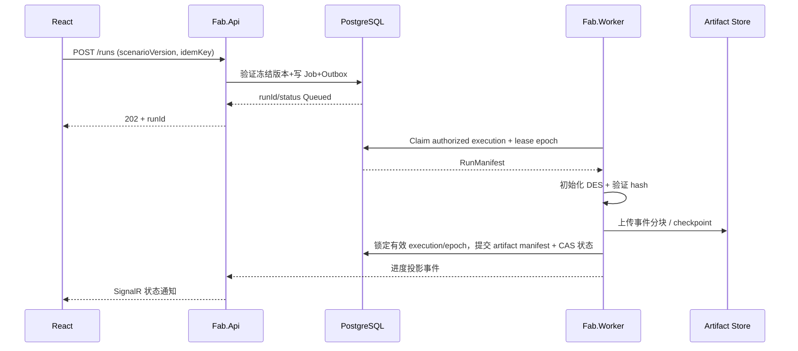
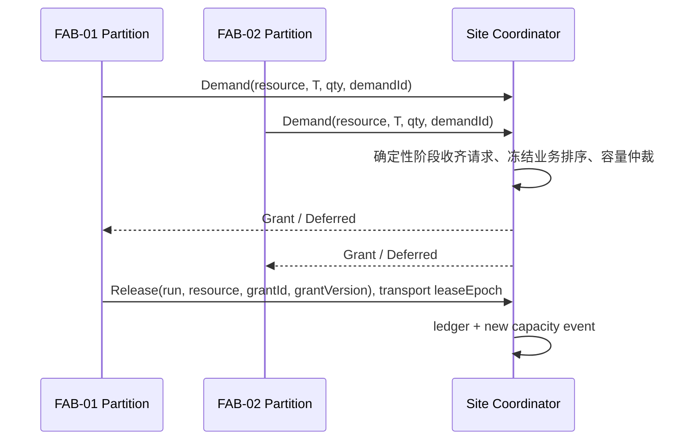

# 14 — API、二进制协议、实时状态与业务时序

## 1. 协议与存储边界

| 场景 | 传输 | 所有权 | 可否丢弃 |
|---|---|---|---|
| 业务操作/版本发布/Run 控制 | HTTPS REST + OpenAPI | Application | 不可，HTTP 幂等重试 |
| API 与 Worker/Coordinator 管理 | 内部 gRPC + Protobuf | Orchestration | 不可，带 epoch/超时/幂等 |
| 用户通知及作业提示 | SignalR | UI BFF | 可重读，不保证业务权威性 |
| 3D 大规模状态广播 | Binary WebSocket + Protobuf | Realtime | 可合并非权威 Delta；有 Gap 则重同步 |
| 完整 DES 追踪 | 本地 Append Log → 对象存储 | Simulation Runtime | 不可丢失已提交范围 |

## 2. REST 资源与 Endpoint 项目位置

| Endpoint | Command/Query | Application owner |
|---|---|---|
| `GET /api/v1/sites/{siteId}/fabs` | GetFabDirectory | Site |
| `POST /api/v1/site-templates/{id}/versions:publish` | PublishTemplate | Site/ProcessEngineering |
| `POST /api/v1/scenarios` | CreateScenarioDraft | Simulation |
| `POST /api/v1/scenarios/{id}/versions/{version}:publish` | FreezeScenarioVersion | Simulation |
| `POST /api/v1/runs` | SubmitRun (Idempotency-Key) | Orchestration |
| `GET /api/v1/runs/{id}` | GetRunState | Orchestration |
| `POST /api/v1/runs/{id}:pause|resume|stop` | RunControl (If-Match + Idempotency-Key) | Orchestration |
| `GET /api/v1/runs/{id}/snapshots/latest` | SnapshotManifest/Blob | Realtime |
| `GET /api/v1/sites/{siteId}/kpi` | SiteAggregates | Analytics |
| `GET /api/v1/fabs/{fabId}/equipment` | EquipmentDirectory | Equipment |
| `POST /api/v1/fabs/{fabId}/lots/{lotId}:hold` | HoldLot | Manufacturing |

REST 写接口应返回 `ProblemDetails` 错误含 `errorCode, traceId, retryable, currentVersion`；不应通过 HTTP 200 + `success:false` 混淆错误语义。所有 FAB 资源都在服务器端执行 Site/FAB scope 授权。

08 为规范路由表；单步是受权调试能力，首版未定义公开 step 路由。幂等键范围为 `(site,principal,operation,key)`；请求哈希含目标、规范化内容及 If-Match，记录与副作用同事务，同键异内容 409。If-Match 缺失 428、版本过期 412；同键重试先授权再返回原始结果，不能用重试绕过状态版本。长操作返回 202 和可查询状态，不把接收命令等同于执行完成。

## 3. Envelope 最低字段

以 `contracts/fab_events.proto` 的字段为准，不另造 major/minor/message_id 命名：`EventEnvelope` 含 `contract_version / identity(site_id,fab_id,run_id) / event_id / correlation_id / causation_id / simulation_time_us / sequence / wall_produced_unix_ms / producer_build / oneof body`，可选现场 `observed_at_unix_ms`。ScenarioVersion 与具体资源/单位版本从不可变 Run Manifest 解析。控制消息使用自己的结构，不要求虚构事件 envelope。

权威 EventSeq 是执行后的连续日志序号：Independent 范围 `(site,run,fab)`，SharedCapacity 范围 `(site,run)`；共享模式所有 FAB 事件与 SiteResource 事件共用同一协调序号，内层 site_sequence 等于外层 sequence。FAB 事件仍携带 fab_id，Site-owned 事件允许为空。排队 `enqueue_sequence`、Outbox `aggregate_sequence` 与投影 `stream_sequence` 均不同，不能互换或跨范围比较。event_id 在重投中不变；语义回放哈希按冻结字段规范计算，不混入随机传输 ID、租约或墙钟。

`simulation_time_us` 为非负 Run 虚拟时间，`wall_produced_unix_ms` 为服务器产生时间，`observed_at_unix_ms` 仅为现场观测时间。三者不互相替代。共享资源量使用已发布单位的整数基准量；proto 已保留旧浮点 field 4，不再用于仲裁。共享消息必须校验 demand/resource/allocation/Run/FAB 范围、有效区间及 grant_version，控制传输另校验当前 execution 的 lease_epoch；后者不进入模型/语义哈希，换租约不重置有效资源授权。重复请求/释放不产生第二份容量。

## 4. protobuf 兼容性策略

- 编号永不复用；删除 field 使用 `reserved`；枚举 value 0 为 `UNSPECIFIED`；未知 enum 必须显式处理。
- 添加字段可按兼容约定演进；删除语义字段或改变单位必须引入新消息版本。
- `SimTimeUs` 使用 `sint64`/`int64`，不使用 float；数量值使用强单位定义（例如毫升/秒、千瓦）或小数定点。
- Protobuf 生成代码不进入 Domain 模型；在 `Fab.Contracts.Adapters` 边界映射。
- `buf lint`/`buf breaking` 与兼容性测试由 CI 阻断破坏性修改。

## 5. 实时同步链路

`Auth -> Subscribe(run, authorized scope, frustum, LOD, maxHz) -> StateSnapshot(stream_id, stream_sequence=0) -> ACK(0) -> DeltaBatch(1) -> ...`。Snapshot 仅为一致展示投影，不是恢复 Checkpoint。proto v1 是单条完整快照，超过协商大小时缩小订阅或拒绝；未定义分片协议前不宣称支持 SnapshotChunks。原子批次的 sequence_start=end 为该流的一个投影序号，权威 changes[].sequence 可因过滤而稀疏。客户端完整应用后 ACK；重复忽略、缺口停止应用并补发或重同步。删除必须携带 tombstone 版本，不从“本帧未出现”推断实体删除。

发送端按客户端订阅范围、LOD 和更新频率 coalesce `EquipmentState/Transform/Alarm`，但**不得**压缩或丢失权威 DES EventLog；有界 Channel 满时舍弃非权威陈旧 Delta 并进行快照重同步，不无限排队。

coalesce 发生在投影编号前，已编号批次不可静默丢弃。建立快照时冻结权威边界并有界缓存后继批次，溢出则失效整个 stream；新订阅/视图范围或权限变更/重连/重同步均创建新 stream_id，迟到旧包丢弃。独立 FAB 只比较各自日志边界，Site 总览不能为多个独立 EventSeq 虚构一个全局序号。服务端冻结队列字节/批数、帧大小、ACK 超时和 maxHz 上限；控制消息不能送出时关闭连接，避免 RESYNC_REQUIRED 也被堵在已满队列。Snapshot/投影哈希须定义稳定字段排序与数值编码，不对未规范化 Protobuf 字节直接作确定性语义证明。

Protobuf 即使开启 deterministic serialization 也不是跨版本规范化编码；语义哈希显式冻结字段、排序和数值规则，文件 SHA-256 仅证明该文件的字节完整性，依据 [Proto Serialization Is Not Canonical](https://protobuf.dev/programming-guides/serialization-not-canonical/)。

## 6. 关键时序 — 提交仿真

## 7. 关键时序 — 共享资源

## 8. 工作流控制中的边界

- `Pause` 在事件安全点生效，不意味着前端发包即已暂停；响应 `Accepted` 与异步状态 `Paused` 分开。
- `Stop` 的语义需要选择 Graceful/Force，Force 仅由管理员并有审计；取消可导致部分 Artifact，但不允许假成功。
- 实时页断线不影响仿真运行；API 重新连接根据 Run Manifest 与最新 Snapshot 恢复。
- Independent 的控制目标必须列出授权成员执行及每项 state_version/应答状态；只有全部目标到达安全点才宣告全 Run 暂停/停止。SharedCapacity 控制整个 Site execution，不允许单独暂停某 FAB 时让共享时间线继续。
- 可靠业务通知使用事务 Outbox/Inbox 的至少一次投递与幂等消费；可丢展示流的 ACK 不能替代这一事务语义。
