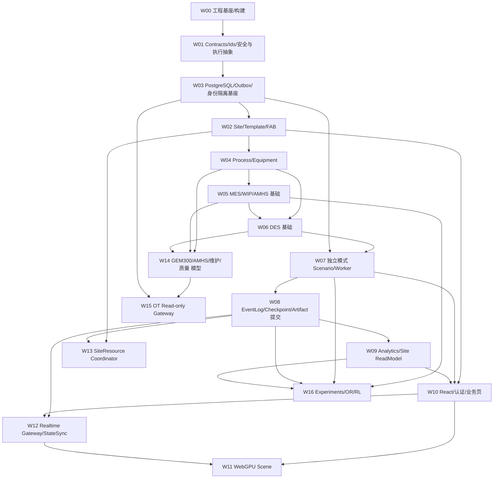

# 19 — 详细开发工作包与任务依赖（适合 Agent/团队执行）

## 1. 每个工作包必须包含

工作包 ID、领域 Owner、上下游依赖、输入 Schema/状态机、输出 API/Event/DDL、数据安全级、仿真确定性要求、异常/取消语义、单测/集成测试、性能基准、验收证据。没有这些属性的任务只是功能描述，不具备开工条件。

## 2. 优先级与前置图

箭头表示该工作包完整验收的前置条件。契约/脚手架可提前并行，但不得因页面已完成而跳过持久化、身份或运行服务的集成验收。

W07/W08 先验收 INDEPENDENT；W13 完成后再验收共享模式的 W07/W08，不能把 W13 当作独立模式的阻塞前置而形成循环。W06 使用声明的最小加工/运输模型；W14 扩展维护/质量/GEM 模型后，必须重跑受影响的冻结、确定性、守恒和恢复门禁。若 W16 实验使用这些扩展模型，其验收还依赖 W14。

## 3. 迭代工作包

| Work ID | 主要工作 | 所属模块 | 完整验收前置 | 阻断验收 |
|---|---|---|---|---|
| W00 | monorepo、CI、依赖锁定、VS Solution、运行配置 | M18 | 无 | clean checkout 下可重复 build |
| W01 | Strong IDs、Unit、Time、proto/OpenAPI、schema check、公开安全/执行/策略 Ports | 基础/M16 | W00 | 跨语言兼容、依赖 DAG 和破坏性更改阻断 |
| W02 | Site/FabTemplate/FabUnit、三实例克隆与发布 | M01 | W03 | 3 FAB 模板相同，实例 ID 不重用；引用版本存在 |
| W03 | PostgreSQL migrations、RLS、Outbox、对象存储、基础身份/范围授权 | M16/M18及表 owner | W01 | 未授权 FAB 访问被拒绝；迁移与事务/Outbox 可恢复 |
| W04 | Route/Recipe/Equipment/Chamber StateMachine | M03/M04 | W02 | 工艺要求、设备资格、状态与配方验证通过 |
| W05 | Lot/WIP/Carrier、TrackIn/TrackOut、基础运输/交接 | M02/M05 | W04 | 物料、位置与工步守恒 |
| W06 | DES Scheduler、RNG、Replication、FIFO/SPT/EDD/CR、模型装配 | M07 | W04/W05 | event hash、seed reproducibility；无外部 I/O 热路径 |
| W07 | Scenario Freeze、Run、Lease、Worker，先独立模式 | M09 | W03/W06 | 冻结引用完整、重复领取与旧 epoch 提交被拒绝 |
| W08 | Authoritative Log、Checkpoint、Restore、Artifact 目录提交 | M07/M09 | W07 | 恢复后事件 hash 一致；目录提交前不标 COMPLETED |
| W09 | KPI、统计/置信区间、Site 汇总与重建 | M10 | W08 | 共同观察窗、加权口径及授权 Site 汇总正确 |
| W10 | React 工作台、认证、Scenario/Run/KPI 页 | M11/M16 | W02/W07/W09 | 页面、鉴权、scope 切换与命令生效状态测试 |
| W11 | Babylon WebGPU Site/FAB/Equipment View | M12 | W10/W12 | WebGPU-only、device loss、资源释放与声明硬件上的 FPS |
| W12 | Snapshot/Delta、Binary WS、Resync、浏览器 state-sync | M09/M12 | W08/W10 | 丢包重连、背压、订阅授权、scope/stream_id/generation 隔离 |
| W13 | SiteResourceDefinition/Coordinator、共享模式装配 | M08/M07/M09 | W02/W08 | 同时间容量分配、容量变化与联合故障恢复；回归共享 W07/W08 |
| W14 | GEM300 模拟 EAP、细化 AMHS/维护/质量模型 | M05/M06/M13/M14 | W04/W05/W06 | 逐状态机模拟用例；受影响模型重跑 W06/W08 |
| W15 | OT Gateway、安全审批/审计、只读现场采集 | M15/M16 | W03/W14 | 默认禁控，未审批命令在出口前拒绝；采集重复/缺口可见 |
| W16 | 实验矩阵、优化策略、RL step、报告 | M17 | W05/W07/W08/W09；使用扩展模型时加 W14 | 合法 action 实际推进到决策/终止边界，非法 action 不改状态；统计与复现证据齐全 |

W12 服务端订阅/授权/投影发布由 M09 装配，M12 负责浏览器重组/缓存/重同步；可独立进程部署 RealtimeHost。运维、安全、审计与 CI 是各工作包共同门禁，不能延后到 W15 才保护已上线的 API/Worker。

## 4. 交付切片

**Slice A：** 模板发布 → 实例化三个 FAB → 静态业务查询。**Slice B：** 单 FAB Lot→Tool→Complete 的确定性 DES → 扩展到三 FAB 并行 → Site KPI。**Slice C：** React/SignalR/WS/完整快照/增量 → Site/FAB 3D 可视化。**Slice D：** 合成资源共享 → Site Coordinator → 确定性竞争和故障恢复。**Slice E：** 工业协议模拟器、质量、维护、优化算法。**Slice F：** 现场 OT 只读接入及符合性验收（受单独授权约束）。

## 5. 拒绝技术债的工程门禁

每个 Slice 必须在 API、Domain、DES、DB、Front-End、GPU 六维中明确未实现/已实现；“UI 展示”不能替代“引擎模拟已实现”。不得从演示数据中反推实际设备能力、洁净室等级或工业协议合规性。对存在的 P0 风险（串 Fab、超容量、权威日志损坏、OT 写权限越界）一票否决发布。
