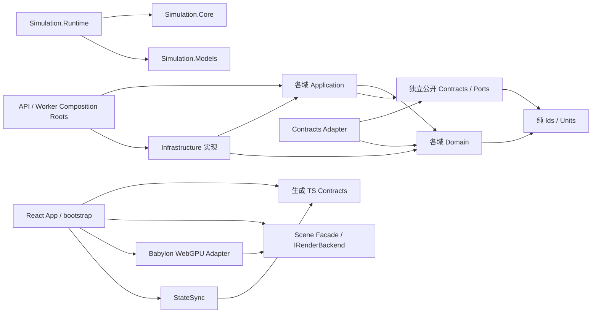
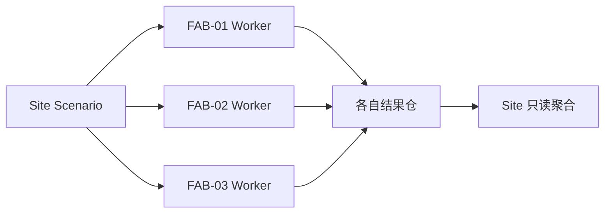
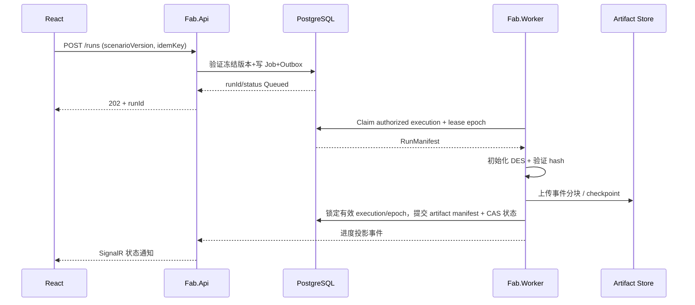
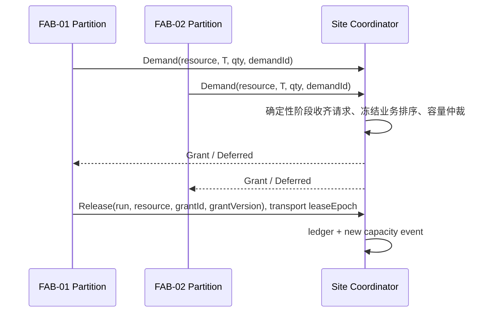
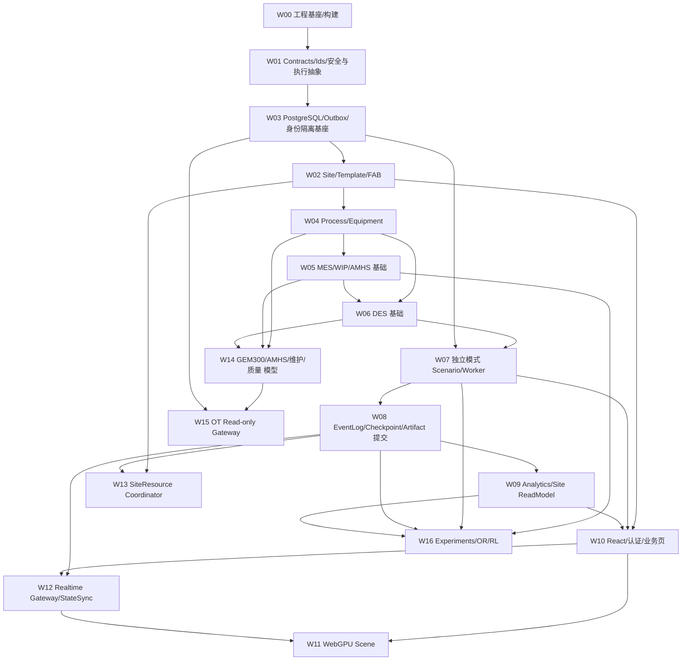

# SemiconFab Next — v1.1 完整架构与工程规范（合并版）

> 自动生成；逐文件规范为编辑源。包含全部规范、审阅记录及参考工件；不代表应用已实现或通过工业认证。
> 更新：2026-10-23；运行 `python tools/maintain_docs.py --write` 同步。

## 目录

- [README.md](#bundle-001)
- [01-SCOPE-REQUIREMENTS.md](#bundle-002)
- [02-INDUSTRY-STANDARDS.md](#bundle-003)
- [03-SYSTEM-ARCHITECTURE.md](#bundle-004)
- [04-FAB-DOMAIN-MODEL.md](#bundle-005)
- [05-DETERMINISTIC-DES.md](#bundle-006)
- [06-SHARED-RESOURCE-MODES.md](#bundle-007)
- [07-DATA-STORAGE.md](#bundle-008)
- [08-API-EVENT-CONTRACTS.md](#bundle-009)
- [09-WEBGPU-RENDERING.md](#bundle-010)
- [10-INDUSTRIAL-INTERFACES.md](#bundle-011)
- [11-SECURITY-OPERATIONS.md](#bundle-012)
- [12-VERIFICATION-ACCEPTANCE.md](#bundle-013)
- [13-IMPLEMENTATION-PLAN.md](#bundle-014)
- [14-TRACEABILITY-REGISTER.md](#bundle-015)
- [engineering/00-ENGINEERING-INDEX.md](#bundle-016)
- [engineering/10-REPOSITORY-SOLUTION-LAYOUT.md](#bundle-017)
- [engineering/11-DEPENDENCY-RULES-AND-DI.md](#bundle-018)
- [engineering/12-EXECUTION-TOPOLOGY.md](#bundle-019)
- [engineering/13-DATABASE-DETAIL-DESIGN.md](#bundle-020)
- [engineering/14-CONTRACTS-AND-EVENT-FLOWS.md](#bundle-021)
- [engineering/15-FRONTEND-AND-WEBGPU-PROJECTS.md](#bundle-022)
- [engineering/16-QUALITY-AND-DELIVERY.md](#bundle-023)
- [engineering/17-INDUSTRY-COMPLIANCE-PROFILES.md](#bundle-024)
- [engineering/18-TECHNICAL-CONTRACT-EXAMPLES.md](#bundle-025)
- [engineering/19-DELIVERY-WORKPACKAGES.md](#bundle-026)
- [engineering/20-WINDOWS-DEV-SETUP.md](#bundle-027)
- [engineering/21-PROJECT-REFERENCE-MATRIX.md](#bundle-028)
- [engineering/90-DECISIONS-AND-OPEN-ITEMS.md](#bundle-029)
- [engineering/modules/M01-site-governance.md](#bundle-030)
- [engineering/modules/M02-manufacturing-mes.md](#bundle-031)
- [engineering/modules/M03-equipment.md](#bundle-032)
- [engineering/modules/M04-process-engineering.md](#bundle-033)
- [engineering/modules/M05-material-handling.md](#bundle-034)
- [engineering/modules/M06-maintenance.md](#bundle-035)
- [engineering/modules/M07-simulation-des.md](#bundle-036)
- [engineering/modules/M08-site-resources.md](#bundle-037)
- [engineering/modules/M09-orchestration.md](#bundle-038)
- [engineering/modules/M10-analytics.md](#bundle-039)
- [engineering/modules/M11-react-workbench.md](#bundle-040)
- [engineering/modules/M12-webgpu-renderer.md](#bundle-041)
- [engineering/modules/M13-quality-fdc-spc.md](#bundle-042)
- [engineering/modules/M14-eap-gem300.md](#bundle-043)
- [engineering/modules/M15-ot-gateway.md](#bundle-044)
- [engineering/modules/M16-identity-security.md](#bundle-045)
- [engineering/modules/M17-experiments-optimization.md](#bundle-046)
- [engineering/modules/M18-operations-platform.md](#bundle-047)
- [REVIEW-2026-10-23.md](#bundle-048)
- [contracts/fab_events.proto](#bundle-049)
- [engineering/MODULE-MATRIX.csv](#bundle-050)
- [examples/scenarios/site_independent.json](#bundle-051)
- [examples/scenarios/site_shared_capacity.json](#bundle-052)
- [examples/sql/001_initial.sql](#bundle-053)
- [examples/ts/webgpu-only.ts](#bundle-054)

---

<a id="bundle-001"></a>

<!-- Source: README.md -->

# 文件：`README.md`

# SemiconFab Next — 工业级多 FAB 数字孪生与仿真平台规范包

> 基线日期：2026-10-23　|　规范包：1.1（架构基线 1.0 + 工程细化）　|　状态：**架构设计基线 / 待业务与标准符合性审查**
>
> 适用：1 个 Site，当前 3 个结构完全相同的 FAB Unit；初始运行互不影响；Site 统一管理与监控；共享设施的实际存在与边界尚未明确，设计必须支持独立与共享两种运行模式。


## V1.1 详细工程设计增补（本版新增）

在原 V1.0 规范基础上新增 `engineering/` 工程落地规范：

- **18 份独立模块开发规范**：`engineering/modules/M01`—`M18`，逐个说明职责、C# 项目/前端 package、命令与查询 API、领域事件、数据表、三 FAB 约束、测试与 DoD。
- **14 份横向工程文档**：工程目录、依赖规则、Worker/共享容量、数据库、协议、React/WebGPU、CI/发布、行业标准、类型与实现示例、任务工作包、Windows 环境、项目引用矩阵、待确认事项等。
- **机器可读模块清单**：`engineering/MODULE-MATRIX.csv`，用于项目管理与职责分配。
- 推荐阅读路径：`engineering/00-ENGINEERING-INDEX.md` → `engineering/10-REPOSITORY-SOLUTION-LAYOUT.md` → `engineering/11-DEPENDENCY-RULES-AND-DI.md` → 各自模块 → `engineering/16-QUALITY-AND-DELIVERY.md`。

**文件性质**：本版交付的是正式工程设计规范和参考片段，并不包含已构建、运行、测试通过的完整应用源码。工业协议/标准的模型映射也不等于符合性认证。

**维护入口**：逐文件规范是编辑源；[合并版规范](合并版规范.md)是自动生成的完整阅读副本。[本次审阅记录](REVIEW-2026-10-23.md)说明修正、清理和未决事项。修改后执行 `python tools/maintain_docs.py --write`，再执行 `python tools/maintain_docs.py --check`，同步合并版与当前清单；`BASELINE-MANIFEST-v1.0.json` 只记录历史基线，不用于校验现有文件。

## 0. 先读此页

本规范包为研发与技术验收提供可执行约束，而**非**任何标准组织的授权标准全文、第三方认证或已完成的设备符合性声明。SEMI 标准通常需要获取正版文本以逐条形成合规证据。标准编号及公开介绍见 `02-INDUSTRY-STANDARDS.md`。

### 基线技术

- 前端：React + 最新经过 CI 验证的稳定 TypeScript（目标 TS 7）+ Vite + Babylon.js，**WebGPU Only，无 WebGL fallback**。
- 后端：ASP.NET Core / .NET 11 目标线；正式版与全部第三方依赖兼容之后才进入生产版本。
- DES：C# 确定性离散事件内核；C++/MSVC 性能热点可选加速；不得牺牲跨语言语义一致性。
- 数据：PostgreSQL、对象存储、Arrow/Parquet；OpenAPI + Protobuf；REST 控制面、SignalR 业务通知、Binary WebSocket 3D 状态流、gRPC 服务内部通信。
- 工程：Windows x64 首发；服务器应用层保留跨平台能力。pnpm monorepo；VS 2026 Enterprise + MSVC；CI 锁定依赖版本。

### 编号规范文件

| 文件 | 内容 | 主要验收输出 |
|---|---|---|
| `01-SCOPE-REQUIREMENTS.md` | 场景、边界、分级业务需求 | 需求追踪矩阵 |
| `02-INDUSTRY-STANDARDS.md` | SEMI、ISA-95、IEC、ISO 标准适用性 | 逐标准能力与证据矩阵 |
| `03-SYSTEM-ARCHITECTURE.md` | 控制面、仿真面、数据面及 ADR | 系统拓扑与部署约束 |
| `04-FAB-DOMAIN-MODEL.md` | Site–FAB–Tool–Lot–Carrier 模型 | 强类型聚合及不变量 |
| `05-DETERMINISTIC-DES.md` | 时间、事件、种子、并行、快照 | 确定性与统计测试 |
| `06-SHARED-RESOURCE-MODES.md` | 无共享、共享容量、强耦合模式 | 独立隔离及共享仲裁测试 |
| `07-DATA-STORAGE.md` | PostgreSQL、事件与资产存储 | 数据结构、约束、RLS、迁移 |
| `08-API-EVENT-CONTRACTS.md` | REST、Protobuf、实时状态同步 | 版本兼容、重放与背压 |
| `09-WEBGPU-RENDERING.md` | React + Babylon WebGPU 专用规范 | 兼容性、GPU 退化与性能 |
| `10-INDUSTRIAL-INTERFACES.md` | EAP、MES、GEM300、AMHS、OPC UA | 模拟器与协议符合性矩阵 |
| `11-SECURITY-OPERATIONS.md` | 网络安全、RBAC、运维与观测 | 威胁模型与灾难恢复演练 |
| `12-VERIFICATION-ACCEPTANCE.md` | 功能、性能、统计及行业验收 | 可追溯测试报告 |
| `13-IMPLEMENTATION-PLAN.md` | 工作包、质量门禁、架构治理 | 版本化交付计划 |
| `14-TRACEABILITY-REGISTER.md` | 需求、设计、标准与测试映射 | 证据登记和未评估状态 |

### 示例工件

- `contracts/fab_events.proto`：二进制事件 / 快照契约示例。
- `examples/sql/001_initial.sql`：最小可执行 PostgreSQL 基础模型示例。
- `examples/scenarios/site_independent.json` 与 `site_shared_capacity.json`：两种模式示例配置（示例容量仅作说明）。
- `examples/ts/webgpu-only.ts`：Babylon.js WebGPU-only 启动模板。

### 标准用语

- **MUST/必须**：评审通过的强制性工程约束。
- **SHOULD/宜**：强烈建议；偏离须记录原因。
- **MAY/可**：扩展能力。
- **标准适配**：按标准概念建模，不自动构成符合性声明。
- **合规**：只有逐标准版本/条款实施、测试、留存证据后才能声明。
- **FabTemplate**：不可变版本化物理与工艺蓝图；**FabUnit**：对蓝图的实际实例化。
- **Run**：输入、版本和种子冻结的一次仿真执行，运行状态按生命周期迁移；**Scenario**：初始条件与策略配置。
- **Site**：基地；**SiteResource**：跨 FAB 可被授权共享的资源。

### 最关键的五项不可变原则

1. `FAB-01`、`FAB-02`、`FAB-03` **相同模板、不共享运行状态**，任何模块不硬编码数量 3。
2. 初始配置必须是 `INDEPENDENT`；基地汇总只读；共享资源按版本化配置显式启用。
3. 若一个资源受多个 FAB 同步竞争，必须由权威逻辑时钟/协调器决定分配，不允许仅靠最终一致数据库模拟物理约束。
4. **权威仿真状态只在服务端**；WebGPU 场景是派生投影；断线可按快照恢复。
5. 对外不得将示意性工艺、3D 洁净室、模拟协议直接宣称为已通过 SEMI/ISO/IEC 认证。

### 初步假设登记（必须在现场调研中关闭）

| ID | 未确认项 | 处理策略 |
|---|---|---|
| ASSUMP-001 | 三 FAB 是否共享 UPW / CDA / HVAC / 电力 / 特气等公用工程 | 只建能力，默认不共享 |
| ASSUMP-002 | 是否存在跨 FAB Lot/FOUP 搬运 | 默认不允许；需独立工艺许可与路线模型 |
| ASSUMP-003 | 每 FAB 机台数、Chamber 数、Lot 数 | 根据规模验收表确定，不凭空写入固定值 |
| ASSUMP-004 | 真实设备对接范围与 SECS/GEM 设备清单 | 先使用协议模拟器、再基于厂商接口文件签约 |
| ASSUMP-005 | 部署在 OT、IT 还是仿真隔离网络 | 按 IEC 62443 风险评估决定 |
| ASSUMP-006 | 具体法规、厂商授权与采购标准版次 | 上线前由合规负责人确认 |

改变架构原则、领域语义、时间或安全边界时提交 ADR（架构决策记录），并同步受影响的契约、迁移和验收用例。文字勘误、索引修复和已有规则的一致性修正记录在修订说明中，无需为每项建立 ADR。未经审批不得改变上文五项原则。

---

<a id="bundle-002"></a>

<!-- Source: 01-SCOPE-REQUIREMENTS.md -->

# 文件：`01-SCOPE-REQUIREMENTS.md`

# 01 — 范围、需求与运行边界

## 1. 工程目标

建立面向 300 mm 前道晶圆厂的可扩展 FAB Site 数字孪生平台。一个 Site 初始部署三个完全一致的 FabTemplate 实例。首版实现离线生产离散事件仿真、单 FAB/基地级观察与 KPI 聚合；后续实现 AMHS、MES/EAP 协议模拟、可选真实数据接入与共享资源容量约束。

### 系统边界

- **数据域**：Site 基础信息、FabTemplate、FabUnit、Equipment/Chamber、ProcessRoute/Recipe、Lot/Wafer/Carrier、Transport、Maintenance、Scenario/Run、KPI、用户审计。
- **控制域**：场景创建、版本冻结、任务调度、暂停/继续/终止/重放、授权操作。
- **实时域**：快照、增量事件、事件批处理、可视化时间轴、运行状态与告警。
- **工业接入**：隔离的接口适配层，绝不默认连接生产设备；真实写命令单独授权。
- **非目标**：初期不承诺工艺物理级 TCAD、设备安全联锁控制、对真实产线做闭环自动优化与合规认证。

## 2. 业务需求（需求 ID）

| ID | 强制要求 | 验收逻辑 |
|---|---|---|
| REQ-001 | 系统支持一个 Site 下 N 个 FabUnit（N >= 3） | 创建第 4 个 FAB 无核心源码修改 |
| REQ-002 | 初始三个 FabUnit 引用同一不可变 Template 版本 | 模板哈希一致，实例 ID 各不相同 |
| REQ-003 | 独立模式下三 FAB 的事件队列、随机流、故障、Lot、WIP 互不影响 | 停止 FAB-02 不改变 FAB-01/03 结果 |
| REQ-004 | Site 可只读聚合 KPI 和设备运行状态 | 基地视图能钻取到 FAB 与设备 |
| REQ-005 | 共享物理资源默认禁用但可通过配置启用 | 无业务源码变更切换两种模式 |
| REQ-006 | 共享资源配置版本不可在运行中原地修改 | 运行创建时冻结场景与拓扑 |
| REQ-007 | Lot、FOUP、Wafer、Equipment 有独立生命周期及状态机 | 非法转换拒绝并审计 |
| REQ-008 | 同一输入、引擎构建与 RNG 规则产生可重现的事件轨迹 | 权威离散事件与整数/定点状态哈希完全一致；容差只适用于声明为非权威的展示或数值分析结果 |
| REQ-009 | 每次运行支持快照、恢复、审计及 KPI 计算 | 崩溃恢复不双处理 |
| REQ-010 | 3D 只允许 WebGPU | 失败时提示不支持，绝不创建 WebGL |
| REQ-011 | MES/EAP/AMHS 协议模型与渲染层解耦 | 无 GUI 可运行协议与仿真测试 |
| REQ-012 | 只读现场接入与模拟接入严格分离 | 模拟命令不可能写入真实 PLC/设备 |
| REQ-013 | 资源共享不隐含跨 FAB 物流 | 未授权的跨 FAB Lot 搬运被拒绝 |
| REQ-014 | 全部关键 API/事件/状态含版本字段 | 兼容性测试阻断破坏性变更 |

## 3. 功能分期（不改变终态模型）

- **F1**：FAB 定义、Lot 路由、Equipment 工具组与故障、FIFO/SPT/EDD/CR、设备状态、主数据、可视化回放。
- **F2**：Chamber、Recipe 约束、Carrier/FOUP、PM、Rework、Yield、基准统计、场景比较、EAP/MES 行为模拟。
- **F3**：AMHS/OHT/Stocker/Load Port/跨 Bay 运输、设备 GEM300 状态模型、共享公用工程容量。
- **F4**：现场网关、FDC/SPC、联合 Site 容量研究、优化/强化学习、跨节点可扩展运行。

所有分期必须使用相同 ID、时间模型与 Schema，不允许另起数据模型。

## 4. 质量属性

- **正确性**：不违反材料守恒、容量约束、设备互斥、路由条件、仿真时间单调性。
- **重现性**：完整记录代码版本、模板、场景版本、种子、运行参数、依赖哈希、工艺配置。
- **隔离性**：跨 FAB 数据授权必须校验 `site_id`/`fab_id`；共享资源调用受 ACL 和模式控制。
- **安全性**：按 IEC 62443 安全区域/通道设计，默认只读现场接入。
- **性能**：在 `12-VERIFICATION-ACCEPTANCE.md` 的目标硬件上测量；禁止把估计值当作已达指标。
- **可靠性**：Worker 失败后从最新完整、已提交的检查点及持久化日志恢复；已确认提交的历史不丢失，未提交尾部按恢复水位重算，不得提前向外确认完成。

## 5. 发布验收

每项 REQ 必须映射至少一条自动化测试；任何 P0 违规阻断发布。凡需真实工厂证据而当前尚未取得的事项标为 `NOT_ASSESSED`，不可填 `PASS`。

---

<a id="bundle-003"></a>

<!-- Source: 02-INDUSTRY-STANDARDS.md -->

# 文件：`02-INDUSTRY-STANDARDS.md`

# 02 — FAB 行业标准映射与合规边界

## 1. 解释规则

本文件将**领域适配要求**与**正式协议/产品符合性要求**分离。SEMI、IEC、ISO 标准版本与条款可能需要付费获取；本文件只引用公开范围、标准标识及内部设计规则，不再现非公开规范正文。不具备正版规范、专属 PICS/厂商接口文件及测试证据时不得作符合性声明。

## 2. 标准适用矩阵

| 标准/标准族 | 适用位置 | 内部实现要求 | 合规状态规则 |
|---|---|---|---|
| SEMI E5 | SECS-II 结构化消息 | 类型、SxFy、编码与版本化适配器 | 标准版次确认及互操作测试后方可声明 |
| SEMI E37 / E37.1 | HSMS 传输 | 会话、超时、重连、控制消息状态机 | 实际设备测试 |
| SEMI E30 GEM | Equipment Host Interface | 通信、控制、事件上报、报警、配方相关接口抽象 | 按设备 Profile 验收 |
| SEMI E39 | 设备对象模型 | ObjectId / 属性 / 状态及事件关联 | 按实际功能采用 |
| SEMI E40 | Process Job Management | ProcessJob、材料/Recipe 绑定与状态机 | 需逐条验证 |
| SEMI E87 | Carrier Management | Carrier、LoadPort、占用/访问状态 | 需逐条验证 |
| SEMI E90 | Substrate Tracking | Wafer 位置、搬移历史、载体关系 | 需逐条验证 |
| SEMI E94 | Control Job Management | ControlJob、ProcessJob 编排与状态机 | 需逐条验证 |
| SEMI E84 | Carrier Handoff | AMHS/LoadPort 交接抽象、超时/互锁模拟 | 物理 I/O 对接时单独验收 |
| SEMI E116 / E157 | 设备/模块过程追踪 | 可订阅设备追踪数据与模块加工事件 | 需逐条验证 |
| SEMI E10 / E79 | 设备可靠性与 OEE | 时间状态核算、设备生产力指标与分母口径 | 统计指标需标准版次和厂规复核 |
| SEMI E187 | FAB 设备网络安全 | 真实设备接入安全要求矩阵 | 根据集成范围审查 |
| ISA-95 / IEC 62264 | Enterprise—MOM—Control | Site/FAB 层级、制造操作语义与边界 | 不宣称产品认证 |
| IEC 62443（尤其 3-2、4-1） | OT 分区和安全开发流程 | Zone/Conduit、威胁模型、SL-T、SDL、安全补丁 | 项目级评估证据 |
| OPC UA / IEC 62541 | 可选设备或设施集成 | 信息模型、证书、Session、Subscription、安全策略 | 仅启用并测试时声明 |
| ISO 14644-1 | 洁净室布局与环境数据 | 清洁度等级作为有来源的可配置属性 | 3D 标注不构成环境认证 |
| SEMI S2/S8/S22 | 真实设备 EHS、人体工学、电气设计 | 可视化标注与危险信息的参考边界 | 不替代物理设备安全评估 |

### 特别注意

- **SEMI E116** 是 Equipment Performance Tracking，不是 Equipment Terminal Services。设备终端服务不得误用此编号。
- E10 的设备基本状态与工程内部设备微观状态不能简单等同；内部状态需映射至经版本批准的 E10 状态分类，并明确定义所有时间归属。
- E79/OEE 各指标必须确定时间窗、计划时间、有效生产时间、良率、重新加工与停机分类口径；未经定义不得跨 FAB 简单求算术平均。
- 标准要求的完整消息流程、数据字典、设备角色、可选项与时序，不以本项目示例代替。

## 3. 实施级别（每个标准单独评价）

统一使用以下三个独立字段，工程文档和 UI 不得另建同义状态枚举：

- `applicability`：`UNDECIDED | APPLICABLE | NOT_APPLICABLE`。
- `implementation_state`：`NOT_ASSESSED | PLANNED | MODEL_ONLY | SIMULATED | IMPLEMENTED_UNVERIFIED | TESTED_INTEROPERABLE | COMPLIANCE_EVIDENCED`。
- `test_result`：`NOT_ASSESSED | PASS | FAIL | NOT_APPLICABLE`，附实际测试范围；模拟器测试通过只表明该模拟用例通过。

`COMPLIANCE_EVIDENCED` 仅覆盖已登记版次、Profile 和条款，不自动扩大到整个标准、产品或其他设备。`NOT_APPLICABLE` 必须填写适用性判断依据与审查人。

每条符合性记录必须包含：`standard_id`、`edition`、`clause_reference`、`feature_profile`、`applicability`、`implementation_state`、`implementation_id`、`test_case_id`、`test_result`、`evidence_uri`、`reviewer`、`review_date`。禁止将 `MODEL_ONLY` 显示成 `COMPLIANCE_EVIDENCED`。

## 4. 最少行业测试

- GEM / HSMS：建立、断开、重连、T3/T5/T6/T7/T8 等超时按实际标准版次验收；错误消息与断线恢复。
- GEM300：Carrier、Process Job、Control Job、Wafer 映射与合法转换、拒绝错误命令、去重及异常恢复。
- AMHS：载体 handoff、状态超时、目标负载口占用、任务取消和运输恢复。
- E10/E79：内部累计统一使用半开区间 `[t0,t1)`，相邻窗口不重复计时；一台机器某时刻恰属于规定的一个顶级统计状态，状态映射按获批版次复核；产出与在制品守恒。
- ISA-95：Site/FAB/Area/WorkCenter/Equipment 层级映射，订单/作业/资源管理边界清楚。
- 安全：区域和通道隔离、最小权限、TLS、审计、威胁模型、补丁流程。

## 5. 官方参考入口（访问时复核现行版次）

- SEMI Information & Control：https://www.semi.org/en/products-services/standards/information_and_control
- SEMI E10：https://www.semi.org/en/Standards/CTR_031244
- SEMI Safety：https://www.semi.org/en/products-services/standards/safety
- SEMI 常见标准：https://www.semi.org/en/products-services/standards/top-10-standards
- ISA-95：https://www.isa.org/standards-and-publications/isa-standards/isa-95-standard
- IEC 62443-3-2：https://webstore.iec.ch/en/publication/30727
- IEC 62443-4-1：https://webstore.iec.ch/en/publication/33615
- ISO 14644-1：https://www.iso.org/standard/53394.html
- OPC UA：https://opcfoundation.org/about/opc-technologies/opc-ua/ua-companion-specifications/

**采购/法务门禁**：正式接口验收前取得适用 SEMI/IEC/ISO 版本以及供应商接口协议；审阅引入的第三方商业许可及原始 SemiconFab 代码 PolyForm Noncommercial 使用限制。

---

<a id="bundle-004"></a>

<!-- Source: 03-SYSTEM-ARCHITECTURE.md -->

# 文件：`03-SYSTEM-ARCHITECTURE.md`

# 03 — 系统架构与架构决策记录（ADR）

## 1. 物理边界、逻辑边界

```
Site Control Plane (tenant/security/config/API/monitoring/read models)
  ├── FAB-01 Simulation Domain (own state, clock, RNG, jobs)
  ├── FAB-02 Simulation Domain (own state, clock, RNG, jobs)
  ├── FAB-03 Simulation Domain (own state, clock, RNG, jobs)
  └── Site Resource Authority [disabled in independent mode]
        └── shared electric/UPW/CDA/gas/HVAC/... only when configured
```

当前默认 `INDEPENDENT`：FAB-01/02/03 共用**模板**，不共用设备实例、Lot、事件队列、持久化轨迹、时钟或命令执行权。共享模式仍隔离 FAB 可变实体，但由协调域统一持有队列和时钟。Site 控制面具有全局读取和治理能力，但不得直接修改 FAB 引擎内部对象。

`RunId` 标识一次冻结 Scenario 的执行，可包含多个 FAB。权威**执行域**在 `INDEPENDENT` 下为 `(site_id, run_id, fab_id)`，每个成员各有 Worker 租约、时钟、队列与恢复点；在 `SHARED_CAPACITY` 下为 `(site_id, run_id)`，全部 FAB 分区和资源账本由同一协调域提交、暂停和恢复。Run 级状态是成员状态的编排汇总，不得用一个 Run 级 Lease 排斥独立成员的合法并行执行。详见 `engineering/12`。

## 2. 三个逻辑平面

1. **Control Plane**：ASP.NET Core API、身份认证、Scenario 管理、Job 编排、Site 级查询聚合、版本发布。
2. **Simulation Plane**：一个或多个 .NET Worker 执行 C# DES，装载冻结 Scenario；可扩展 C++ 计算模块；同次运行中不与数据库做逐事件 RPC。
3. **Data Plane**：WebSocket/Protobuf 实时状态、快照/Delta、Parquet 轨迹、场景资产、可观测性；为多客户端订阅提供独立扩容点。

初版推荐模块化单体 API + 单独 Worker + 独立浏览器前端 + PostgreSQL + 文件/对象存储。逻辑边界稳定但进程部署可以在以后拆开；禁止按照模块数量强制微服务化。

## 3. 部署拓扑

- Web SPA：React/TypeScript/Vite，HTTPS 静态资源托管。
- API：ASP.NET Core 进程；不承载长时间 DES 核心循环。
- Worker：Windows Service 或容器中 Generic Host，按冻结的执行域启动；共享协调器是 Worker 内的可选逻辑角色，首版不另设独立权威进程。
- Database：PostgreSQL 元数据、任务/授权/发布事件、低频状态投影；对象存储管理大轨迹与快照。
- Realtime Gateway：初期同 API 进程，独立协议与租户空间；未来可单独部署。
- OT Gateway：**独立网络隔离进程**；默认完全禁用写入真实设备。

## 4. 核心调用边界

| 来源 | 目标 | 机制 | 一致性 |
|---|---|---|---|
| React | API | HTTPS/OpenAPI | 事务命令 + 幂等键 |
| WebGPU 客户端 | State Gateway | Binary WebSocket + Protobuf | 序列、快照、增量、背压 |
| API | Job Table | PostgreSQL 事务 + Outbox | 可恢复的持久化命令 |
| Worker | Frozen Scenario | 数据库读取、版本校验 | 不可变读 |
| Worker | Result Store | Parquet/快照 + 元数据提交 | 先对象再提交索引 |
| Site Monitor | FAB Read Projections | 授权聚合视图 | 只读最终一致性 |
| Site Coordinator | 共享运行域 | 权威资源仲裁事件 | 确定性逻辑时钟 |

## 5. ADR 固化

- **ADR-001**：采用模块化单体控制面 + 独立 Worker，而非一开始微服务。
- **ADR-002**：源域状态归属 FAB；Site 仅持有 Site 配置、共享资源真相与只读聚合。
- **ADR-003**：独立和共享两种 Mode 采用相同业务对象和工艺事件契约。
- **ADR-004**：共享资源竞争时，执行协调级全局确定性事件模型，**不**以异步最终一致消息直接实现排他容量。
- **ADR-005**：Babylon.js **WebGPU Only**；渲染进程不具有工艺权威。
- **ADR-006**：协议与存储采用版本化契约，滚动升级遵守兼容矩阵。
- **ADR-007**：版本更新通过依赖锁定与 CI 门禁，最新稳定版优先；候选版不可直接替代生产验收。
- **ADR-008**：采用证据驱动的性能优化，C++ 仅通过稳定接口替换热点。
- **ADR-009**：运行态、队列、资源授权与产物均按 Run 和执行域隔离；同一 Site 的不同实验 Run 共享不可变定义，分别实例化资源账本，彼此不竞争模拟容量。

## 6. 数据一致性

- 强一致边界：独立模式为**同一 FAB 执行域内**的物料、设备、事件队列；共享模式为**同一共享 Run 协调域**内全部 FAB 转移及共享容量授予。
- 最终一致边界：Site KPI 聚合、搜索、UI 缩略状态、只读监控投影。
- 对写操作实行 CAS/版本号和幂等请求；消息重复可重放；不可把网络到达顺序当作事件时间顺序。
- 所有外部效果（数据库/通知/导出）通过 Outbox 或可幂等处理机制，避免“事件已处理但回执未到”产生重复生产行为。
- 事件在内存中的原子处理和持久化提交是不同水位。只有完整、校验通过并被当前 LeaseEpoch 事务引用的日志/快照可作为恢复依据；投影 ACK、对象上传成功和失联 Worker 本地文件均不能推进权威持久化水位。
- M07 持有事件执行、队列与运行态；M08 提供被该执行器同步调用的资源模型和仲裁策略；M09 唯一拥有 Job/Lease/Run 元数据的事务写入及产物目录提交。共享协调器的进程宿主不改变这三个责任边界。

## 7. 未来扩展门禁

扩展 N 个 FAB 只需增添实例与资源映射，无需重编代码。共享资源扩展为多 Site 时需新增显式 Site-to-Site Contract，不允许直接开放任意跨 Site 数据库写权限。分布式 DES 必须证明因果顺序、死锁自由以及跨节点延迟预算，不得仅凭并行 Worker 宣称支持精确联合仿真。

---

<a id="bundle-005"></a>

<!-- Source: 04-FAB-DOMAIN-MODEL.md -->

# 文件：`04-FAB-DOMAIN-MODEL.md`

# 04 — 多 FAB 领域模型与不变量

## 1. 层级与对象身份

```
Enterprise [optional]
  └─ Site (1)
      ├─ FabTemplateVersion (shared, immutable)
      ├─ FabUnit (FAB-01 / 02 / 03; N extensible)
      │   ├─ Area / Bay / WorkCenter / ToolGroup
      │   ├─ Equipment / Chamber / LoadPort
      │   ├─ ProcessRouteVersion / Operation / RecipeVersion
      │   ├─ Product / WorkOrder / Lot / Wafer / Carrier
      │   ├─ AMHS Network / OHT / Stocker / TransportJob
      │   ├─ Maintenance / Alarm / Measurement
      │   └─ Scenario / SimulationRun / KPI
      └─ SiteResource (optional and centrally owned)
```

**身份规则**：所有可变对象有不可变 ID；`EntityId` 使用 UUID 或有明确命名空间的 ID，业务显示号允许重复但必须以 `(site_id, fab_id, external_id, source)` 联合辨识。定义实体的稳定 ID 可在不同 Run 中复用，运行态实例的完整身份为 `(site_id, run_id, fab_id, entity_id)`；缓存、事件去重、资源账本、结果和投影不得省略运行作用域。FAB 所属运行实体绑定且仅绑定一个 `FabUnitId`；SiteResource 运行态、Run/Lease 等协调对象属于显式 Site/执行域，不伪造 FAB 归属。

## 2. 核心聚合

| Aggregate | 主键 | 核心字段 | 唯一责任 |
|---|---|---|---|
| Site | SiteId | Name, Version, Policy | 基地治理，不拥有机台状态 |
| FabTemplateVersion | TemplateId, Version | Layout, Routes, Capabilities, BaseConfig, Hash | 不可变参考定义 |
| FabUnit | FabId | SiteId, TemplateVersion, Code, Parameters | 绑定蓝图，拥有实例命名空间 |
| Equipment | EquipmentId | FabId, GroupId, Model, State, Version | 设备加工/故障资源归属 |
| Chamber | ChamberId | EquipmentId, RecipeCapability, State | 多腔室加工与互斥 |
| Carrier | CarrierId | FabId, Location, Contents, State | 载体占用与晶圆装载 |
| Lot | LotId | FabId, RouteVersion, Step, Qty, Priority | 批次业务生命周期 |
| Wafer | WaferId | LotId, CarrierId?, State, History | 单片追踪与质量 |
| ProcessJob / ControlJob | JobId | EquipmentId, Recipe, MaterialSet, State | 与 GEM300 语义对应的工作项 |
| ScenarioVersion | ScenarioId, Version | TemplateHash, InitialState, RNGPlan, Mode | 不可变仿真输入 |
| SimulationRun | RunId | ScenarioVersion, EngineBuild, Seed, Status, FabBindings | 一次执行与产物；独立成员或共享协调域见 03/engineering/12 |
| SiteResource | ResourceId；运行态为 (SiteId, RunId, ResourceId) | OwnerSiteId, Kind, Capacity, Unit, Policy | 冻结资源定义及按 Run 实例化的唯一授权账本 |

## 3. 冻结与克隆策略

`FabTemplateVersion` 发布后禁止原地修改，调整时创建新版本；FabUnit 可以在新建 Scenario 时绑定新模板版本。三 FAB 可使用同一个模板及相同缺省值，但独立模式分别建立 state store、queue、RNG stream；共享模式保留分区实体/RNG 隔离，由同一执行器持有全域 queue/clock。发布新 Template 不得影响已启动运行。

冻结对象图包含模板、路线/配方、资源图/合同、策略、日历、单位精度、事件优先级和 RNG 派生规则的具体版本与内容哈希；不能只保留会指向最新版本的可变外键。Run 内对象和初始状态不能引用可变模板实例。业务发布新定义只供后续 ScenarioVersion 使用。

## 4. 必须执行的不变量

- `LOT-001`：Lot 的 fab_id 在整个生命周期不可变；跨 FAB 业务流转必须使用显式 Transfer API 与来源/目标追踪（缺省禁止）。
- `LOT-001a`：预留跨 FAB Transfer 不得原地改写已有 Lot 的 fab_id；若未来获批实现，必须以来源移出和目标新身份/谱系映射守恒记账。当前版本不因此开放跨 FAB 流转。
- `LOT-002`：Lot 数量与 Wafer 集合必须守恒；Scrap/Rework/Ship/Receive 为显式记账事件。
- `EQP-001`：单 Chamber 同时只加工符合配方与容量约束的任务；设备状态变化必须来自状态机转换。
- `CAR-001`：Carrier 同一时刻只能拥有一个权威位置及归属；占用 LoadPort 时与 Equipment 关系一致。
- `ROUTE-001`：Lot 引用已发布且冻结的 RouteVersion；工序跳转需明确条件。
- `TIME-001`：所有工艺事件具有有效仿真时刻；现场事件还需独立 wall_time。
- `FAB-001`：任意 fab_id 都不能读取/修改其他 FAB 的状态聚合，除具备专门授权的 Site 只读投影或共享资源协调接口。
- `SITE-001`：Site KPI 是聚合计算结果，不得成为各 FAB 状态的反向控制来源。
- `SHARED-001`：只有定义为 `SiteResource` 且配置允许的资源才可以跨 FAB 竞争。
- `RUN-001`：两个 Run 即使引用同一 FAB、设备或 SiteResource 定义，也没有共享的可变实例、RNG、去重记录或容量竞争；只有同一共享 Run 内声明的成员可以竞争其资源账本。

## 5. 设备状态与 SEMI 映射

内部具体状态例如：`Idle/Setup/Processing/Blocked/Starved/DownUnscheduled/DownScheduled/Engineering/Offline`，这是工程内部概念；必须通过 `EquipmentStateMapping` 映射到当前采用版本的 SEMI E10 统计分类，维护完整性与冲突检查；**不得将内部状态枚举直接等同于 E10 官方定义**。

## 6. 可扩展的工作域

域边界：`Manufacturing`（订单、WIP、Lot）、`Equipment`（机台、Recipe）、`MaterialHandling`（Carrier/OHT/Stocker）、`Maintenance`、`Quality`、`Simulation`、`SiteResources`、`Analytics`、`Identity`。以事件与契约交互；避免互相直接访问对方的数据库表。

## 7. 三 FAB 示例

`FAB-01.EQP-001` 与 `FAB-02.EQP-001` 可用相同显示号，但逻辑 ID 不同。独立 Run 中任何一次机台故障、Lot 释放或随机数消耗都不能影响另一个 FAB 的轨迹和随机流；若共享容量模式启用，允许仅通过共享资源授予影响其生产延迟，且所有影响必须可追溯。

---

<a id="bundle-006"></a>

<!-- Source: 05-DETERMINISTIC-DES.md -->

# 文件：`05-DETERMINISTIC-DES.md`

# 05 — 确定性离散事件仿真内核规范

## 1. 时钟与队列

- 内部主时钟为 `int64 simulation_time_us`，基于每个 Run 的虚拟零点；统一微秒单位，并对溢出、负值和单位转换执行校验。
- Event Order Key：`(simulation_time_us, semantic_priority, enqueue_sequence)`；按字典序排序。优先级枚举及同时间处理阶段版本化且冻结在 Run Manifest。
- 禁止依赖 `Task.Delay`、真实时钟、线程到达次序或网络消息顺序推进事件。
- 稳定事件队列初始可用 4-ary heap/二叉堆；其他队列优化须通过重复负载基准决定。
- 每个 FAB Run 的默认执行器为单逻辑线程确定性引擎；并行优先用于独立运行实例与 Replication。

### 1.1. 顺序、因果与序号作用域

- `enqueue_sequence` 是执行域内唯一、递增的**入队序号**；`event_seq` 是执行域内从 1 连续递增的**已处理日志序号**。较早入队的远期事件可晚执行，因此二者不能混用。分配器的 next value、最后处理键、日志持久化水位都纳入 Checkpoint，溢出明确失败。
- 独立模式序号作用域为 `(site_id, run_id, fab_id)`；共享模式为 `(site_id, run_id)`。不同独立成员的序号没有大小关系。共享资源通知须引用协调域的因果 `event_seq`，不能以另一个自增 Site 序号取代全域因果位置。
- 初始事件按冻结的稳定 FAB/实体 ID、事件种类与模型定义的局部序号枚举；处理器生成的子事件先按固定规则排序，再由唯一执行器分配入队序号。哈希表遍历、随机 UUID、并行任务完成顺序和网络到达次序不得参与排序。
- 新事件完整键必须严格大于当前已处理键：不得调度过去时间；同时间子事件优先级不得回到已关闭的较早阶段。模型必须声明请求产生、仲裁、启动/释放等阶段关系，不能靠随意加 1 微秒掩盖因果冲突。同时间事件链的上限/无进展检测冻结于模型，超限以诊断错误终止，避免零时间死循环。
- 外部业务输入先经范围校验与持久化接纳，再在安全事件边界赋予生效时间、阶段和稳定输入序号；记录 payload、causation 和应用边界。迟到输入不得倒灌已提交时间。纯离线复现实验使用相同冻结输入记录；交互输入的接纳边界是记录的一部分，不能宣称随意改变网络顺序仍得到同一轨迹。

## 2. 事件类别

`LotReleased`、`RouteStepEntered`、`OperationStarted`、`OperationCompleted`、`ReworkScheduled`、`LotScrapped`、`EquipmentStateChanged`、`FailureStarted`、`RepairCompleted`、`PMStarted`、`PMCompleted`、`CarrierMoved`、`TransportRequested`、`TransportCompleted`、`SharedCapacityRequested`、`SharedCapacityGranted`、`SharedCapacityReleased`、`WipSampled`、`KpiWindowClosed`。

每种事件必须定义：数据 Schema、所有者 FAB/Site、触发先决条件、状态转移、幂等行为、因果来源、相同时间优先级、统计影响及测试。

## 3. 事件处理契约（伪代码）

```
while queue has next event and !stop_applied_at_boundary:
    next = queue.peek_min()
    candidate = stage_transition(next, state, queue, rng, statistics)
    validate_preconditions_invariants_and_child_order(candidate)
    commit_in_memory_atomically(candidate, checked(event_seq + 1))  // 原子安装新序号、出队、Clock、RNG、子事件和日志
    flush_complete_prefix_when_required()               // 独立持久化水位
    emit_optional_read_projection(event_seq, durable_event_seq)
```

权威事件日志可周期分块，不要求每个事件同步访问 PostgreSQL；但同一 Checkpoint 的队列、RNG、状态及日志提交点必须可一致恢复。

失败的处理器不得留下部分实体变化、已消费 RNG、丢失的队列项或半条日志。可使用暂存转移或等价的原子处理方式；无法回滚时立即停止执行域并从有效恢复点重建，不能在受污染内存上重试。预期的取消/过期事件须有明确 no-op/终态处理契约；不应把合法重复消息等同于断言崩溃。读投影可以显示尚未持久化的进度，但须标注持久化水位，故障后按新流代际重同步。

## 4. 随机数与实验设计

- PRNG 算法和具体实现版本必须固定、跨平台测试、支持显式状态序列化；禁止依赖未冻结的 .NET 随机数内部实现。
- `run_master_seed` 为 UInt64；每个独立流由 `(run_master_seed, fab_stable_id, equipment_stable_id / event_domain, stream_kind)` 派生；稳定 ID 对应字节序列独立于容器遍历顺序。
- 流派生的哈希/KDF、字段编码、字节序、分隔/长度前缀与种子截取规则必须版本化；不得使用进程随机化的 `GetHashCode`。Site 资源故障使用独立 `site_resource_stable_id` 流，不借用某个 FAB 的 RNG。
- 不同 FAB 的随机调用数量不能相互扰动。策略对比时使用分层 Common Random Numbers，记录相关性限制。
- Replication 记录每条流的种子方案、调度策略版本、Scenario 哈希、模型构建版本、依赖与浮点模式。
- 相同 seed 的复现沿用稳定模型 ID；新 `run_id`、随机生成的请求 ID、LeaseEpoch、真实时间和追踪 ID 不参与模型随机流或语义轨迹哈希。

## 5. 执行模式

| 模式 | 时间与并行 | 要求 |
|---|---|---|
| `INDEPENDENT` | 各 FAB 有独立逻辑时钟/Worker | 三 FAB 之间无业务事件依赖 |
| `SHARED_CAPACITY` | 统一 Site 授权的权威时序 | 共享配额争用不能超容量 |
| `COUPLED_FLOW`（保留） | 统一因果模型 + 显式跨 FAB 运输 | 仅审批后可启用，不得隐含 Lot 转移 |

`SHARED_CAPACITY` 初始采用一个确定性协调执行域（可以是一个进程中的多 FAB 组件）；在证明分布式时间同步/安全时间边界之前，不允许三个独立 Worker 无序直接抢共享资源。参见 06。

## 6. 暂停、单步、快照、恢复

- `Pause` 在合法事件边界生效；仅 `PAUSED` 状态的 `StepOneEvent` 执行恰好一个队列事件后仍为 `PAUSED`，空队列返回 `NoEvent`，不得暗中排空同时间批次。`Stop` 经 `STOPPING` 在安全边界产生 `CANCELLED` 终态和部分结果摘要，不记为成功；强制终止按最后持久化水位记录中断原因并按编排策略取消/恢复/失败，不新增第二套持久化状态。
- 快照包括：clock、queue（完整顺序键与 payload）、last_processed_key、next_enqueue_sequence、last_processed_event_seq、durable_event_seq、entity state、RNG state、resource ledger（含等待/授予/释放终态）、statistics accumulators、输入/命令去重状态、schema/version、artifact checksums。
- 恢复时检查模板版本、引擎版本和快照 Schema；不兼容时明确拒绝，或通过版本化迁移工具处理。
- 重复消费外部事件使用执行域内的 `event_id` / `idempotency_key` 去重，同键不同 payload 拒绝冲突。去重状态与其已应用事件一起恢复，不能只在进程缓存去重。
- Checkpoint 只发布事件边界的完整状态；共享模式同时包含全部 FAB 分区和资源账本，不得拼接不同时间/水位的 FAB 快照。对象及推进到该边界所需的完整权威日志先写成不可变对象并校验，再由当前租约事务提交引用；不能用一个快照掩盖尚未持久化的日志缺口。CheckpointEpoch 与 Worker LeaseEpoch 是不同计数器。
- 快照后的日志只可重放到**已提交的最高连续持久化水位**；未上传、半写、本地孤立或未登记分块不保证恢复，不能声称恢复至任意崩溃瞬间。恢复允许重算其后的未提交尾部，投影按新流代际重同步。
- 本内核采用确定性重新执行：加载快照后，按记录的外部输入及已执行事件顺序运行同版本处理器，校验事件/状态/RNG 摘要和子事件。不能同时应用日志的结果 Delta 再执行处理器；重放期间不得重发通知或重复提交外部效果。日志缺块、重叠冲突、摘要不符或版本不兼容均应拒绝继续恢复。

Pause/Resume/Step/Stop 由 M09 持久化接纳，M07 在边界记录命令 ID、版本及实际应用的 `event_seq`；`Accepted` 与 `Applied` 区分。共享模式的暂停、单步、停止、恢复覆盖整个协调域；不支持只暂停一个 FAB 并让其他分区跨越它的潜在因果事件。

## 7. 统计正确性

- 采样窗口明确是否包含预热；每个指标须记录单位、时间窗和分母。
- Lot 守恒、设备忙闲排他、搬运资源互斥、容量守恒和时钟单调性为每场景 P0 断言。
- 95% 均值区间使用相应自由度的 t 临界值（小样本不得固定 2.0/2.045）；跨策略差异优先采用配对设计与有效统计方法。
- KPI Site 汇总按全局观测量重新推导，不能平均各 FAB 的 OEE / 产出率百分比。
- 权威事件、运行状态及其语义哈希要求完全一致，包括进入权威状态的数值字段；冻结并记录浮点环境。浮点容差只适用于不参与权威执行或语义哈希的数值分析/展示，记录其容差与适用边界，不能以此放宽权威复现验收。
- 语义状态/轨迹哈希采用版本化的规范字段编码、排序与摘要算法，排除真实时间、租约及传输元数据。成员级哈希还排除整体 Run/Scenario/Manifest 的标识与根哈希，仅比较本成员的语义事件/状态；实际冻结输入依赖哈希另行记录，避免只改变 FAB-02 输入就因整体 Scenario 版本变化而误判 FAB-01 轨迹受扰。参与权威状态、事件时间、仲裁、路由选择和阈值分支的数值计算必须在声明的执行环境内完全一致；浮点容差仅用于上述非权威数值分析/展示，不能容许权威字段、事件顺序或容量判断漂移。无法保证时拒绝该跨环境复现配置。

## 8. 未来性能优化

测量事件吞吐、峰值内存、p95/p99 单事件 CPU 耗时、快照暂停时间和恢复速度；采用对象池、值类型、Span、ArrayPool 与压缩列式存储。C++ 通过固定 C ABI 或大粒度批处理协议替换纯计算热点，严禁将带 C++ 异常/虚表/所有权不明确的对象直接泄漏给 C#。

---

<a id="bundle-007"></a>

<!-- Source: 06-SHARED-RESOURCE-MODES.md -->

# 文件：`06-SHARED-RESOURCE-MODES.md`

# 06 — Site 共享资源与多 FAB 运行模式规范

## 1. 正式业务结论

**当前确认**：三个 FAB 结构一致，运行实例完全独立，Site 仅统一管理和监控。**未确认**：有无共享 UPW、CDA、压缩空气、真空、特气、厂务供电、HVAC、废气处理、配送设施等。共享设施必须被配置驱动，禁止通过设备名称或 Site 关联推断存在共享关系。

## 2. 三种模式

| Mode | 资源域 | 调度时钟 | 跨 FAB 物料 | 首版 |
|---|---|---|---|---|
| `INDEPENDENT` | 独立 FAB 资源 | 每 FAB 独立时钟 | 禁止 | 默认 |
| `SHARED_CAPACITY` | SiteResource + FAB 本地 | 共享授权使用统一确定性 Site 时间轴 | 禁止 | 架构必须支持，功能阶段实现 |
| `COUPLED_FLOW` | 共享容量+运输/物流 | 全局因果时间轴 | 只在显式许可/路线存在时可用 | 预留；不假定业务需求 |

Mode 和所有能力都冻结于 `ScenarioVersion`，正在执行的 Run 不得热更模式或资源图。应创建新 Run 做 What-if 对比。

SiteResourceDefinition 是可共享的不可变定义；资源账本、请求、授予和资源故障 RNG 必须按 `(site_id, run_id)` 实例化。同一 Site 下两个共享实验 Run 不竞争彼此的模拟容量，不得用 Site 级单例账本把实验耦合。这里的“一个权威协调器”指每个共享 Run 一个权威执行域，并不限制 Site 同时执行多个隔离实验。

## 3. SiteResource 强类型模型

```
SiteResourceDefinition {
  ResourceId, SiteId, ResourceKind,
  CapacityValue, CapacityUnit, TimeGranularity,
  AvailabilityCalendar, FailureModel?, RecoveryModel?,
  AllocationPolicy, PriorityPolicy,
  EligibleFabIds[], Contracts[], Version, ModelConfidence
}
ResourceContract {
  FabId, ResourceId, MaxShare?, Reservation?, Priority,
  MinGuaranteed?, ValidFromSimulationTime, ValidToSimulationTime?
}
Allocation { RunId, AllocationId, ResourceId, FabId, DemandId, RequestedUnits,
             GrantedUnits, StartTime, EndTime?, State, GrantVersion }
```

ResourceKind 示例：`UPW_FLOW`, `ELECTRIC_POWER`, `CDA_FLOW`, `EXHAUST_FLOW`, `GAS_FLOW`, `HVAC_LOAD`, `TRANSPORT_CAPACITY`。不同资源具有不同量纲，必须显式表示单位和周期；不能用同一个整数“车位数”模型抽象所有资源。持续流量与离散排他对象分别采用适合的 CapacityModel。

- 数量、容量和日历值使用已冻结的基准单位、定点精度/舍入与溢出规则；非正需求、负容量、非法区间、单位不匹配和精度无法表示的请求在入队前拒绝。授予有效区间为 `[StartTime, EndTime)`；`EndTime=null` 表示持续到显式释放/撤销。相同时间的到期/释放与新授予顺序必须冻结。
- `Reservation`、`MaxShare`、`MinGuaranteed` 的量纲、适用区间及是否可借用须由发布策略定义；校验可行性，不能把相互冲突的保证量发布成有效配置。不可分工艺步骤须全量授予；只有模型声明可分割并定义降额加工行为时才允许部分授予。
- 一项工序同时依赖多个容量时，提交一个资源需求集合，由同一协调事件全有或全无地校验/授予，按稳定 ResourceId 锁定逻辑顺序；任一资源不足则整个集合排队，不得持有部分授权等待另一资源而造成循环等待。资源请求本身不授权占用本地 Equipment/Carrier，启动转移仍须校验本地状态。

## 4. 权威仲裁与时钟

共享资源满足：

`∀ resource, t : Σ active_grants(resource,t) <= resource.available_capacity(t)`

在 `SHARED_CAPACITY` 模式，一个权威 Site Coordinator 负责接收需求、决定授予、处理释放、执行失效/故障重算；FAB 各自的仿真事件由同一确定性时间轴驱动，**禁止不同 Worker 仅靠实时消息抢占共享容量**。多个物理进程可以执行计算，但仲裁与提交的因果顺序必须被权威 Site Run Engine 确认。

明确顺序：
1. `SharedCapacityRequested` 进入该 Run 的协调队列，带 Run/FAB ID、稳定 DemandId、需求量/区间、工艺原因和冻结资源版本；DemandId 从稳定因果标识派生，不以网络到达或随机 GUID 决定先后。
2. 队列按 05 的 `(sim_time, semantic_priority, enqueue_sequence)` 执行。模型保证同批请求的产生阶段早于仲裁阶段，并显式关闭该时间/阶段的请求集合后，再按冻结业务优先级与稳定 `(fab_id, demand_id)` 规则仲裁（或明确选择确定性先入队策略）；必要时整单排队/拒绝，部分授予仅按已声明模型。批次关闭不能依赖 wall clock、网络超时或当前队列暂空。子事件不能倒回已关闭阶段；同时间产生的新因果需求必须属于后续已定义阶段。
3. `Granted` 或 `Queued/Rejected` 反馈给对应 FAB 的确定性状态机。
4. 工序完成或中断产生 `Released`；若资源故障，按冻结策略生成 `Reduced/Revoked` 并对依赖任务施加显式处理。
5. 每次分配可按 AllocationId 追溯到请求、资源容量版本和上游制造事件。

容量日历/故障在 T 降额时，容量变化、受影响 Grant 的确定性降额/撤销及依赖任务的阻塞/中断转移必须作为同一原子边界提交，使 T 时刻提交后的有效授予不超新容量；不能先公布较低容量再异步等待 FAB 释放。若工艺无法中断，模型必须事先定义可行的降载策略，否则拒绝该资源模型，不能以“仍在处理中”豁免守恒。恢复容量触发按冻结策略重新仲裁，不自动复活旧 Grant。已有 Grant 到期的释放事件与手动释放/取消相遇时只能释放一次。

等待请求须保持可恢复的排队状态；释放、到期、故障恢复等容量变化触发重新仲裁，旧请求的更新/取消通过 DemandId 和版本校验。过期/取消请求不得在恢复后重新授予。仿真授予的到期使用仿真时间，Worker 租约到期使用真实时间，二者没有换算关系。

`GrantVersion` 是可重放的模型账本版本，Worker `LeaseEpoch` 是 M09 的提交 fencing。恢复时保留有效 Grant 的模型身份/区间，同时以新的执行域租约校验发布权；不得因租约轮换清空 Grant 或把旧 Worker 的资源通知当作新需求。所有跨进程请求/授予/释放需校验 scope、当前 LeaseEpoch、Demand/Allocation 所属者与版本；同键同 payload 重试返回原结果，同键异 payload 拒绝。释放只按有效 AllocationId 改变一次账本，不能相信调用方提交的“释放数量”。

共享 Checkpoint 必须在同一事件边界包含全部 FAB、时钟/队列、等待请求、Grant 终态去重记录、资源故障 RNG 和统计；故障恢复整体回到同一持久化水位。不能只恢复协调器、单个 FAB 或授权表。暂停/单步/停止以整个共享执行域为范围。

若物理资源调度可建模为纯事先分配的固定容量配额，可令三个 FAB 独立运行但各自只消费冻结配额；此实验标记称 `FIXED_ALLOCATION_EXPERIMENT`，仍使用 `INDEPENDENT` Mode，不新增运行模式枚举。发布时验证每个区间冻结配额总和不超过建模容量；它不能模拟动态故障后的跨 FAB 再分配，禁止与动态共享仲裁混称。

## 5. 安全边界

- 资源账本是唯一跨 FAB 共享的可变业务状态；Site 控制面不得直接修改 FAB 的 `Equipment`/`Lot` 对象。单进程共享执行器可持有各分区，但只通过对应分区的正式确定性处理器提交状态转移。
- Site 共享资源故障可以通过正式事件对多个 FAB 产生影响，默认纯独立模式则必须证明这种影响不存在。
- 跨 FAB TransferJob 必须单独授权、定义来源/目标、物料主权移交及 Route 许可；默认 `cross_fab_material_flow=false`。
- 未确定设施用 `UNCONFIRMED`，不能默认填“无限容量”并伪装成真实共享系统；可在沙盒演示配置中使用 `synthetic=true`。
- 所有场景支持 Resource Policy A/B Compare，附带参数来源、敏感性分析和置信区间。

## 6. 必须通过的测试

| 用例 | 方法 | 通过标准 |
|---|---|---|
| SHARED-001 | 在 INDEPENDENT 模式对 FAB-02 插入机台故障 | FAB-01/03 轨迹哈希不变 |
| SHARED-002 | 三 FAB 同时争用一个容量 100 的共享资源，各申请 60 | 任意时刻授予总数 <= 100；等待/拒绝可解释 |
| SHARED-003 | 相同时刻、不同消息到达顺序重复运行 | 资源授予事件顺序与结果一致 |
| SHARED-004 | 恢复时注入重复资源申请/释放 | 不发生双重授予或负容量 |
| SHARED-005 | 共享资源故障减少容量，后续恢复 | 故障影响范围、恢复策略与事件时间可追溯 |
| SHARED-006 | 未授权跨 FAB Lot 运输 | 拒绝，记录审计 |
| SHARED-007 | 从 3 FAB 新增第 4 FAB | 无核心重编译且资源权限明确 |
| SHARED-008 | Site 仅读 KPI 用户尝试 FAB 状态写入 | 拒绝并审计 |
| SHARED-009 | 同一 Site 并行执行两个引用相同资源定义的 Run | 授权/随机流/等待队列完全隔离；任一 Run 控制不影响另一 Run |
| SHARED-010 | 多资源原子需求、重复到期/释放和容量降额同时间发生 | 无部分持有循环等待；只释放一次；每个提交边界满足容量约束 |
| SHARED-011 | 有活动授权和等待请求时崩溃并整体恢复 | FAB/资源账本/队列及语义结果一致，旧租约提交被拒绝 |

## 7. 对开发和运维的含义

Site 共享协调器是**可选计算逻辑模块**，可以初期与 DES 部署在同一 Worker；配置和领域 API 必须一开始存在。用户切换模式时创建新的 ScenarioVersion/Run；系统为共享模式明确展示“结果受共享约束影响”，不能拿独立模式绩效直接作为共享模式真实预测。

---

<a id="bundle-008"></a>

<!-- Source: 07-DATA-STORAGE.md -->

# 文件：`07-DATA-STORAGE.md`

# 07 — PostgreSQL 数据架构与文件存储规范

## 1. 总体原则

PostgreSQL 保存 Site、Fab、模板、场景、授权、作业、结果目录与审计；仿真 Worker 在内存中执行热路径；高频权威事件与快照保存为压缩分块/Parquet/版本化二进制对象。**不得每个 DES 事件进行一次数据库事务**。

## 2. 概念关系

```
site 1 -> N fab_unit
fab_template_version 1 -> N fab_unit
fab_unit 1 -> N equipment_instance
scenario_version 1 -> N scenario_fab_binding
scenario_version 1 -> N simulation_run
simulation_run 1 -> N simulation_run_fab
site 1 -> N site_resource_definition (optional)
site_resource_definition 1 -> N resource_entitlement(fab_id)
simulation_run 1 -> N run_artifact
```

禁止设计 `fab1_equipment/fab2_equipment/fab3_equipment` 三套表；不允许固定 `fab_count=3` 进入数据库约束。

## 3. 关键表与字段

| 表 | 必填字段 | 约束 |
|---|---|---|
| `sites` | id, code, name | code 唯一 |
| `fab_template_versions` | id, template_code, version, sha256, definition | 已发布不可变；版本唯一 |
| `fab_units` | id, site_id, code, fab_template_version_id, lifecycle | (site_id,code) 唯一 |
| `equipment_instances` | id, site_id, fab_id, local_code, model_reference | (site_id,fab_id,local_code) 唯一，复合 FK 防止跨 FAB 错配 |
| `scenario_versions` | id, site_id, mode, version, sha256, frozen_config | 一次执行的参数冻结 |
| `scenario_fab_bindings` | site_id, scenario_id, fab_id, template_version_id | scenario_id 指已发布 ScenarioVersion；绑定同 Site 的 FAB，模板版本冻结 |
| `simulation_runs` | id, site_id, scenario_id, mode, engine_build, run_seed, status, state_version, created_at | mode 与冻结版本一致；Run 状态是成员执行的聚合 |
| `simulation_run_fabs` | site_id, run_id, scenario_id, fab_id, template_version_id, output_prefix | 复合 FK 同时约束 Run 的场景与场景 FAB/模板绑定，不能仅检查 FAB 属于同 Site |
| `simulation_run_executions` | id, site_id, run_id, fab_id?, mode, status, state_version, lease_owner, lease_epoch, lease_until_utc | Independent 每个 Run/FAB 一个执行；SharedCapacity 每 Run 一个 Site 执行，fab_id 为空 |
| `site_resources` | id, site_id, resource_kind, capacity_in_base_unit, unit, revision, config | 当前默认无实例，整数基准量及冻结单位 |
| `resource_entitlements` | site_id, resource_id, fab_id, max_share_in_base_unit, priority | Eligible FAB 与 Site 一致 |
| `run_artifacts` | site_id, run_id, fab_id?, execution_id?, lease_epoch?, kind, uri, checksum, size | FAB 资产必须属于 Run 成员；Worker 提交按当前 execution lease fencing |
| `outbox_events` | event_id, site_id, aggregate_key, aggregate_sequence, payload, published_at | 与业务变更同事务；消息 ID 在重试中保持不变 |
| `inbox_dedup` | site_id, consumer, event_id | 与消费副作用同事务；投递至少一次 |
| `idempotency_requests` | site_id, principal_id, operation, key, request_hash, response | 作用域唯一，和 Run 创建/控制事务原子提交 |

`examples/sql/001_initial.sql` 提供基础建表与隔离示例；它是架构种子，不是全部生产 DDL。

## 4. 数据隔离

- 高权限 Site 监控角色拥有按权限筛选的 Site 聚合读权限；FAB 操作员只能访问授权 FabUnit。
- API 必须按 `site_id`/`fab_id` 授权并限制过滤；数据库采用复合外键、唯一键，敏感表按风险开启 PostgreSQL RLS，不能只依赖前端选择器。
- RLS 会话上下文必须在受控数据库事务中由服务器验证后的身份映射设置 `app.site_id` 与 `app.fab_id`；不得直接转用请求中的 scope。缺少任一必需上下文时零行可见且拒绝写入；示例不把空 fab_id 解释成 Site 管理员。事务结束恢复会话设置，连接池不得预置租户会话默认值。
- 普通运行时角色须为非表所有者、非超级用户且无 `BYPASSRLS`，不得获授 `TRUNCATE` 或修改策略权限；示例同时开启 `FORCE ROW LEVEL SECURITY`。Site 聚合使用另行授权的只读投影，不借放宽 FAB 写策略实现。
- 自定义会话变量本身不能认证身份；有能力直接发 SQL 的客户端不能靠该示例获得安全隔离，必须限制数据库入口。RLS 不替代对象存储、API、缓存与订阅的同范围授权。
- Worker 绑定明确的执行范围：Independent 为 `(site_id,run_id,fab_id)`；SharedCapacity 为 `(site_id,run_id)` 的独立 SiteCoordinator 身份。Run 级聚合不能让某 FAB Worker 自动访问其他成员资产。
- 正式现场对接另设安全数据区和只读身份，不与仿真数据混表或复用生产凭据。

## 5. 数据生命周期与资产存储

- `FabTemplateVersion`、`RouteVersion` 与运行 manifest 永久保留版本哈希；删除前检查引用。
- 状态快照写入临时对象，计算 SHA-256，成功后通过元数据事务提交到 `run_artifacts`。断点恢复仅使用已提交且完整校验的对象。
- `Parquet` 默认用于批量分析事件/事实表；EventLog 必须有明确排序键，单个文件不允许因压缩/并行写入而模糊原有因果顺序。
- EventLog 的 `sequence` 作用域见 08：Independent 每 Run/FAB 连续；共享模式每 Site Run 连续。Manifest 记录执行范围、已提交序号区间、checkpoint 边界和内容哈希；恢复后延续序号，废弃的未提交尾部不得进入正式目录。投影 `stream_sequence` 不用于权威 Replay。
- `Arrow` 是运行时交换/分析内存格式，不是所有数据都应直接作为 Arrow 序列化。
- 数据保留时间、冷热分层、删除/匿名化策略由法规和现场要求确定；不能假设可无限保留生产数据。

## 6. 数据版本迁移

- Schema 迁移使用受控工具执行，具备升级路径、回滚策略或前向补偿。
- API 采用 expand/contract：先增加新字段与双读/双写，客户端升级后移除旧字段。
- 已产生的旧事件与快照不允许原地覆盖；必须通过版本化 reader/migrator 读取。
- PostgreSQL 分区按业务查询与数据量引入，不强制每张表分区；避免以过早分区复杂化约束。

## 7. 报表聚合口径

Site throughput = 同一时间窗所有 FAB 合格产出的总和；设备/工厂利用率需以工时或容量为权重；Cycle Time 可以通过合格完成 Lot 的全集求均值或按相应样本权重汇总。记录计算窗口、时区、样本、舍入规则、是否含预热和无产出 FAB 的处理。

## 8. 参考工件边界

SQL 种子使用无 schema 前缀的物理名；工程 schema 映射以 engineering/13 为准。它演示约束与单表 RLS，不包含完整授权、不可变版本触发器、租约提交存储过程或全部业务表，不能直接宣称生产隔离完成。发布服务必须在同事务冻结完整 FAB/资源/版本绑定；首版拒绝 `COUPLED_FLOW`。Seed 为无符号 64 位整数，JSON 使用十进制字符串，PostgreSQL 使用受范围约束的 `numeric(20,0)`。

PostgreSQL 行策略的角色绕过与事务上下文语义依据 [Row Security Policies](https://www.postgresql.org/docs/18/ddl-rowsecurity.html) 和 [SET](https://www.postgresql.org/docs/18/sql-set.html)；约束设计依据 [Constraints](https://www.postgresql.org/docs/18/ddl-constraints.html)。

---

<a id="bundle-009"></a>

<!-- Source: 08-API-EVENT-CONTRACTS.md -->

# 文件：`08-API-EVENT-CONTRACTS.md`

# 08 — API、事件契约与实时状态流规范

## 1. 通信分层

| 用途 | 协议 | 权威性 |
|---|---|---|
| 业务命令、场景 CRUD、审计 | HTTPS REST + OpenAPI | 强一致命令 |
| 任务状态、普通通知 | SignalR / JSON | 非权威实时提示 |
| 高频 3D 状态流 | Binary WebSocket + Protobuf | 快照/增量投影 |
| 内部控制面—Worker | gRPC/Protobuf | 签名/认证的内部 RPC |
| 离线结果导出 | HTTPS / Parquet | 最终冻结数据 |
| 真实设备入口 | 隔离 Gateway/SECS-GEM/OPC UA | 仅按批准配置开放 |

**不**允许把浏览器推送顺序等同于仿真因果顺序；Worker 按冻结顺序产生权威日志，Gateway 可降采样用于 3D。

## 2. REST 资源设计示例

```
GET    /api/v1/sites/{siteId}
GET    /api/v1/sites/{siteId}/fabs
GET    /api/v1/sites/{siteId}/resources
POST   /api/v1/scenarios
POST   /api/v1/scenarios/{scenarioId}/versions/{version}:publish
POST   /api/v1/runs                 # Idempotency-Key header required
GET    /api/v1/runs/{runId}
POST   /api/v1/runs/{runId}:pause
POST   /api/v1/runs/{runId}:resume
POST   /api/v1/runs/{runId}:stop
GET    /api/v1/runs/{runId}/snapshots/latest
GET    /api/v1/runs/{runId}/artifacts
GET    /api/v1/sites/{siteId}/kpi?from=...&to=...
```

返回标准错误：`application/problem+json`，包含 `type/title/status/detail/traceId/errorCode`。业务冲突与幂等键请求内容不一致用 409，身份未认证用 401、已认证但无权限用 403；状态版本条件缺失用 428、`If-Match` 不匹配用 412。控制 Run 的接口必须带 `If-Match` 和 `Idempotency-Key`，条件检查、持久控制意图和 Outbox 同事务；202 表示已接收，只有安全点确认后才更新为目标状态。

幂等键按 `(site_id, authenticated_principal_id, operation, key)` 唯一，其中 operation 包含方法与目标资源。先执行身份/范围授权，再对规范化请求体、目标与版本条件计算 request_hash；同键同内容返回原始 status/body/location，同键异内容返回 409。记录与创建 Run/控制意图原子提交，并发重试只能产生一个结果；事务回滚不留下“已成功”记录。保留期须覆盖允许的重试窗口，过期键拒绝重放并提示刷新，不静默创建第二个 Run。幂等记录不能代替运行时命令去重和状态 CAS。

过期后可按策略清除响应正文，但须保留键作用域、请求哈希和原操作/Run 关联的 tombstone 以拒绝复用；不能仅 TTL 删除整条记录后把旧键当新键。保留/归档边界必须在上线前冻结，种子未实现自动清理。Independent 的 `snapshots/latest` 返回经授权成员的快照 Manifest 集合（每项含 fab_id 与各自权威边界），或通过显式 fabId 只取单成员；不得伪造一个跨独立 FAB 的 last_applied_sequence。SharedCapacity 可返回同一 Site execution 的一致边界投影，但详情仍按身份授权。

## 3. Protobuf 与消息语义

版本化参考原型见 `contracts/fab_events.proto`，尚不是覆盖全部业务事件的可投产契约。权威 `EventEnvelope` 使用 `contract_version`、`identity(site_id,fab_id,run_id)`、`simulation_time_us`、`sequence`、`event_id`、`correlation_id`、`causation_id`、`producer_build`；管理/实时控制消息按各自结构携带范围，不要求虚构业务事件 ID 或仿真时间。`oneof` 为不同业务事件；禁止将整个 FAB 对象作为无界 JSON blob 每帧发送。

权威序号从 1 开始；0 表示尚未应用事件。Independent 的范围为 `(site_id,run_id,fab_id)`，仅比较同一 FAB 的序号；SharedCapacity 的范围为 `(site_id,run_id)`，所有 FAB 与 SiteResource 共用协调器序号，Site 事件的 fab_id 为空，FAB 事件仍须携带成员 fab_id。`SharedCapacityAllocation.site_sequence` 必须等于外层 `sequence`，不是第二个可独立递增计数器。队列调度的插入序号与执行后 EventLog 序号是不同字段，不能混用；恢复已提交日志后不得重置或复用序号。

- Snapshot：一致边界的展示投影，携带 `last_applied_sequence`（权威边界）、`projection_hash_sha256`、`snapshot_version`、`stream_id`、`stream_sequence`。不是包含 RNG/Queue 的恢复 Checkpoint。参考 proto 传输单条完整快照；超出协商字节/实体上限时拒绝该流或要求更小订阅，分片协议须另行版本化，不能擅自拆同一消息。
- Delta：`StateDeltaBatch.sequence_start/end` 是该 `stream_id` 的连续投影序号，一批占一个序号（start=end）；`changes[].sequence` 才是权威事件序号。过滤、LOD 或降采样可以使后者稀疏，不作为展示 gap；批内包含版本化变化与显式删除项。投影变化禁止写回权威 EventLog。
- Client ACK：客户端已完整校验并应用的最高连续 `stream_sequence`；仅用于流控，不证明权威业务提交。重复批次忽略，缺失投影批次停止应用并重同步。
- Gap：客户端发现缺口时请求新的快照或允许的补发窗口，不猜测缺失状态。
- Throttle：GPU 渲染与后端仿真完全解耦；合并设备状态、发送最近状态，保留完整权威日志。

展示实体按 `(site_id,run_id,fab_id,entity_id)` 标识；Site 流中的每个 FAB 实体/删除项必须填写自身 fab_id，不得用相同模板的 local entity_id 互相覆盖。`upserted_entities` 表示包含 Transform 的完整实体展示更新，`removed_entities` 表示带版本的删除；一批同一实体只能出现一种最终变更，整体校验/应用后再 ACK。单 FAB 流的内层 FAB 必须与外层匹配，Site 流仍须逐项验证授权；哈希按冻结的完整实体键排序，不把展示版本与权威序号混为一谈。

## 4. 实时订阅与背压

客户端按 `(run_id, fab_id, view_frustum, LOD, topic)` 订阅，并限制最高更新速率。服务端按用户权限过滤信息、给每个连接设有界缓冲区；缓冲积压应优先合并非关键展示增量，并发送 `RESYNC_REQUIRED`，不可无界累积。

订阅建立/范围变更/权限变更/重连均签发新的不透明 `stream_id`，快照从 `stream_sequence=0` 建立基线；旧流迟到消息必须丢弃。构建快照时在一致权威边界冻结投影并缓存后继增量，收到 ACK 后再发送；缓冲溢出立即废弃该流。生成投影序号前可合并，已编号的批次不得静默删除或改写。`RESYNC_REQUIRED` 应通过独立受限控制通道发送，发送不出则关闭连接并重建；gap 补发仅在同流保留窗口内，否则新流快照。服务端须冻结最大帧字节、实体数、连接队列字节/批数、ACK 超时与重同步频率，客户端提交的 maxHz 不得突破上限。Site 总览的多 FAB 详情可拆为多个独立授权流；参考单流 Identity 不以空 fab_id 暗示拥有所有 FAB。

时钟区分：proto `simulation_time_us` 是 Run 非负仿真时钟；`wall_produced_unix_ms` 是服务器产生时间；可选 `observed_at_unix_ms` 是现场真实观测时间，仅用于相应现场数据，不得替代仿真时间。对同一设备同时呈现 Live 与 Simulation 必须强制标记不同数据源。

## 5. 合约演进

- Protobuf 字段编号永不复用，删除字段使用 `reserved`；支持 tolerant reader。
- 不兼容事件 Schema 必须版本化新增类型或新通道，旧 Run 仍可被历史 reader 回放。
- OpenAPI 破坏性改动由契约 diff 与客户端构建阻断。
- `fab_id` 与 `site_id` 不得在任意跨租户订阅或 RPC 中由未经身份验证的客户端自行提升权限。

## 6. 共用 Site 与隔离 FAB

Site 只读订阅可以收到授权 FAB 的聚合值，不限制固定数量；实时设备详情始终带 FAB 身份。共享事件除 `resource_id` 还必须带 Run 范围、`demand_id`、`allocation_id`、有效时间区间及 `grant_version`；数量使用已发布资源单位的整数基准量，禁止用 `double` 仲裁。`lease_epoch` 仅用于当前执行发布/提交的 fencing，不进入可重放模型状态/语义哈希；换租约保留有效 GrantVersion 与容量占用。共享资源只能由该 Site Run 当前租约的 Coordinator 写入，普通 FAB Topic 无权修改配额。跨资源/跨 Run 的请求或释放必须拒绝；同 demand_id 内容相同为重试、不同为冲突，Release 校验 GrantVersion 并从 ledger 读释放量，重复释放无额外副作用。

Protobuf 编号及删除字段保留规则依据 [Proto3 Language Guide](https://protobuf.dev/programming-guides/proto3/)。外层版本不匹配、未知状态改变事件或必需语义缺失应拒绝执行/重同步；保留未知字段的 tolerant reader 不能猜测业务语义。

---

<a id="bundle-010"></a>

<!-- Source: 09-WEBGPU-RENDERING.md -->

# 文件：`09-WEBGPU-RENDERING.md`

# 09 — WebGPU-only 3D 渲染与 React 前端规范

## 1. 强制渲染约束

- **只能创建 Babylon.js `WebGPUEngine`**；禁止使用 Babylon `Engine`/`ThinEngine` WebGL 上下文作为运行路径；没有 WebGL fallback。
- 不得请求 `canvas.getContext('webgl'|'webgl2'|'experimental-webgl')`，构建扫描和运行时监测将其视为失败。
- 启动检查 secure context、WebGPU 实际支持、GPU 设备创建、所需 limits/features、设备丢失恢复能力；不满足显示明确错误与系统需求，不降级到 WebGL。
- WebGPU 仅允许通过现代 Babylon.js 官方引擎 API 与经过验证的 WGSL Shader/Compute 使用；未来切换 Babylon Lite 仍须保持上层数据契约不变。
- 非 3D 的普通 React 管理界面可以独立显示“3D 不可用”提示，但不得伪装为 3D 正常加载。

示例引擎启动：`examples/ts/webgpu-only.ts`。目标环境：最新稳定 Edge/Chrome、HTTPS 或 localhost、GPU/驱动准入清单；Windows Server/RDP/虚拟 GPU 需单独验证。

## 2. 前端模块

```text
apps/web/src/                         React 路由、权限、页面与 Composition Root
frontend/packages/
  ├── contracts/                     生成的协议类型
  ├── api-client/                    REST 客户端
  ├── realtime-sync/                 快照、增量与重同步
  ├── fab-scene/                     引擎无关场景、实体与渲染 Port
  ├── babylon-webgpu/                WebGPUEngine 及 Port 实现
  ├── app-ui/                        通用控件与设计 tokens
  ├── widgets/                       工作台组件
  └── charting/                      KPI 图表
```

具体目录和 package 名以 `engineering/10-REPOSITORY-SOLUTION-LAYOUT.md` 与 `engineering/15-FRONTEND-AND-WEBGPU-PROJECTS.md` 为准；不再维护第二套同义目录。

React 仅持有应用状态/选中实体/仪表盘视图，**不**直接存储数千 Babylon Mesh 或每条设备事件触发 React 组件树重渲染。场景管理对象生命周期独立于 React 状态生命周期。

## 3. 坐标与模型标准

- 3D 场景采用右手坐标，`+Y` 向上；1 单位 = 1 米。Babylon 场景创建时显式设置 `scene.useRightHandedSystem = true`；原始厂区坐标系、模型坐标转换和测量单位要在资产元数据声明，避免导入与实例化时重复转换。
- 模型交换统一 glTF 2.0 / GLB；GPU 材质应显式兼容当前 Babylon WebGPU 管线和物理材质。可选 KTX2/Basis、Draco、meshopt 压缩须纳入浏览器/引擎测试。
- `FabTemplateVersion` 包含可复用静态几何、建筑布局与设备插槽；`FabUnit` 实例化独立根 Transform、EntityId 与动态状态缓存。
- Site View 仅加载低 LOD 建筑/关键路径/汇总告警；Fab View 加载可见 Bay；设备 View 按需加载 Chamber/Port 细节，不默认同时加载三个 FAB 的全部细节。
- 共享设备 GLB/材质/纹理的 GPU 资源，实例 ID 与业务状态不得共享；避免跨 FAB 渲染状态串扰。

## 4. 高性能管线

- 分层 LOD、视锥裁剪、空间索引、可见集、批量动态实例属性更新（按实体变化合并）。
- 大量同类设备优先普通 Instancing 或 Thin Instances；需要单对象复杂动画时退化为独立 Mesh，按测量选用。
- 采用 GPU picking / ID buffer 或可测量的 CPU picking；禁止全场景每帧遍历所有设备复杂几何。
- GPU Shader 使用 WGSL；Compute Shader 仅用于可证明能加速的可视化计算，不承载权威生产状态。
- 分离 RenderClock / SimulationClock；回放时间线插值只能影响展示，不得写回权威 DES。
- 提供 GPU 资源监控、纹理压缩、内存与 draw-call 分析，GPU 设备丢失后重新创建资源并请求最新快照。

## 5. 性能指标与验收方式

建议首批候选目标（待目标硬件冻结后升级为合同指标）：目标基线 GPU/浏览器下 Site View 稳定 60 FPS，首屏 p95 < 5 s，典型操作响应 p95 < 100 ms；高密度单 FAB 与三 FAB 同屏应分别单独压测，明确分辨率、像素比、设备数、活跃实体比例、纹理预算及事件更新率。未指定硬件时这些只是目标而不是事实。

CI：TypeScript strict/ESLint/Vitest/Playwright；自托管真实 GPU Windows Runner 执行 WebGPU 可用性、帧率、资源泄漏、Device Lost 和禁用 WebGL 断言。使用普通无 GPU 云 Runner 的结果不能代替性能验收。

---

<a id="bundle-011"></a>

<!-- Source: 10-INDUSTRIAL-INTERFACES.md -->

# 文件：`10-INDUSTRIAL-INTERFACES.md`

# 10 — MES/EAP/GEM300/AMHS/厂务接口规范

## 1. 边界

`Fab.Domain` 处理制造语义；`Industrial.Adapters` 处理厂商/物理协议。真实生产设备接入默认禁止写操作，只有批准的专用 OT Gateway 可以连接 OT Zone。模拟器、测试驱动和实机适配器必须实现相同接口但采用独立身份与 endpoint；禁止用一个布尔值将仿真服务变成真实设备控制器。

## 2. 协议接口组

```
IEquipmentTelemetrySource  -> State, Alarm, Variable, Trace
IEquipmentCommandPort      -> SetRemote, Start/Stop, DownloadRecipe [授权]
ICarrierPort               -> Arrive, Identify, Dock, Undock, Depart
IProcessJobPort            -> Create, Select, Start, Pause, Abort, Complete
IControlJobPort            -> Create, Assign, Execute, Complete
ISubstrateTrackingPort     -> wafer location/history
ITransportDispatcher       -> TransportJob, assignment, handoff, timeout
IUtilityTelemetrySource    -> site resource capacity/availability
```

以上是内部 C# 接口建议，并不是对 SEMI 方法名或状态机的逐字转写。每个 Adapter 必须声明 `mode=SIMULATED | READ_ONLY | CONTROL_ENABLED`，而 `CONTROL_ENABLED` 只能通过独立的审批/身份/网络部署获得。

## 3. GEM300 领域与协议映射

- E5/E37：SECS-II/HSMS 传输编解码与会话层。
- E30：GEM 设备通信、远程控制、事件/报警/配方及宿主状态模型。
- E39/E40/E87/E90/E94：对象、ProcessJob、Carrier/LoadPort、Substrate、ControlJob 的模型及接口。
- E84：AMHS handoff 状态；物理 PIO 与模拟交接必须区分。
- E116/E157：设备追踪、模块/工艺过程数据。

必须定义 per-equipment Profile：制造商、型号、接口文件版本、支持的消息/变量/事件/报警、选项、超时、重试、相关通信依赖、符合性测试记录。不能因为 GEM300 总表列出能力就默认所有设备都支持。

## 4. MES 模拟器与调度

- WorkOrder → Product/Route/Recipe → Lot/Carrier → Operation → Equipment/Chamber。
- 明确 Dispatch Rule 与 Schedule Plan 区别：Dispatch Rule 选当前可加工 Lot；Schedule Plan 涉及跨时间与资源的生产计划。
- MES 仿真模拟 Hold/Release、Rework、Scrap、Split/Merge、TrackIn/TrackOut；每个操作有命令审计、工艺条件、权限与计量口径。
- 批次拆并、Wafer 状态、载具搬运要维护守恒；跨 FAB 默认禁用。

## 5. AMHS

每 FAB 独立 `TransportNetwork/Vehicle/Stocker/CarrierRoute`；共享物流 `SiteTransportNetwork` 只有现场确认且在 `COUPLED_FLOW` 显式启用才建模。固定运输时间可作为早期简化，但必须标记 `approximation=FIXED_DELAY`，不能宣称真实拥堵仿真。

车辆/资源抢占、单轨占用、安全距离、LoadPort/Stocker 交接状态、失效恢复在专用 AMHS 模型中实现。移动轨迹生成与 Babylon.js 动画不构成运输调度正确性证据。

## 6. 厂务共享容量

公用工程接口仅映射经审核的容量、动态折减、可用窗口及故障事件。若数据源未确认，可创建 `synthetic=true` 的实验性资源，不可显示为实际厂务状态。

## 7. 验收门禁

每个厂商/设备型号建立通信验收用例、版本锁定测试、模拟器对照测试、异常场景和真实生产安全审批。真实设备的远程操作不仅是协议问题，还需要明确安全联锁、失控风险及变更授权边界；此平台不代替安全控制器。

---

<a id="bundle-012"></a>

<!-- Source: 11-SECURITY-OPERATIONS.md -->

# 文件：`11-SECURITY-OPERATIONS.md`

# 11 — 安全架构、部署与运维规范

## 1. 安全域与角色

- IT 管理域：用户/租户/审批/研发环境。
- 仿真域：Fab Worker、Site 共享协调器、仿真 PostgreSQL、对象存储。
- 展示域：浏览器与只读实时网关。
- OT Gateway 域：仅在获批连接真实设备后启用，单独风险评估及安全通道。

设计按 IEC 62443-3-2 的 Zone/Conduit 方法做风险分析，并采用 IEC 62443-4-1 安全开发生命周期；**本规范不能代替正式安全等级评定**。

## 2. 身份与权限

- OIDC/OAuth 2.0；与企业 AD/IdP 集成但不依赖明文域管理员密码。
- RBAC 基础角色：SiteAdmin、SiteObserver、FabEngineer、FabOperator、SimulationResearcher、Auditor、OTGatewayOperator。
- 服务端验证 Token 的签发方、受众、有效期，并从可信 Claim 或服务端授权目录解析租户/Site/FAB 权限；不能相信浏览器传入的 fab_id 即可取得权限。权限变更和 Token 过期同样适用于既有订阅与 Artifact 下载授权。
- 功能权限：ViewSite、ViewFab、EditTemplate、PublishScenario、RunSimulation、AccessArtifacts、ManageResourceContracts、ControlRealEquipment。
- 真实设备写操作要求独立审批、操作日志、双人复核（依据厂规）、网络白名单；最小权限设计。

## 3. 网络与传输

- 统一 HTTPS/TLS，内部 RPC 使用身份验证与 TLS（需要时 mTLS）。
- PostgreSQL 不暴露公网；对象存储的读写通过受控身份及短期签名地址。
- WebSocket 连接前鉴权，订阅时再次校验 Site/FAB 范围；不得开放任意资源 ID 查询。
- 工业协议 Gateway 与 API 分网络分权限；现场只读模式不能调用写命令。

## 4. 审计与可观测性

- OpenTelemetry Trace/Metrics/Logs；统一 `trace_id`、`run_id`、`fab_id`、`site_id`、`equipment_id`。
- 安全审计包括登录、权限变化、场景发布、共享配额修改、真实设备命令与导出。
- 日志不得含凭据、私钥、员工个人敏感信息；对商业机台/Recipe 参数应按保密策略分类。
- 指标：API p95/p99、Worker 吞吐和内存、任务失败率、队列长度、事件同步积压、GPU 设备丢失率、快照恢复时间、权限拒绝次数。

## 5. 高可用与灾难恢复

- Worker 按执行域持有租约与 fencing token：`INDEPENDENT` 为 `(site_id, run_id, fab_id)`，`SHARED_CAPACITY` 为 `(site_id, run_id)` 的完整协调域。失联旧 Worker 不得继续提交检查点、发布结果或推送权威增量；存储与发布端均校验有效租约和 epoch。
- Run 持久状态统一为 `QUEUED/CLAIMED/RUNNING/PAUSED/STOPPING/COMPLETED/FAILED/CANCELLED`，合法迁移及多执行域汇总以 `engineering/12-EXECUTION-TOPOLOGY.md` 为准；初始化、恢复、完成提交作为运行阶段记录，不再定义第二套状态名称。
- PostgreSQL 备份、WAL/PITR；对象存储版本化与不可变校验；定期进行 DB + Artifact 的一致性恢复演练。
- 定义并演练 RPO/RTO；它们在未完成容量和业务评估前**不预填为承诺指标**。
- Site 网络暂时中断时，独立 FAB 只有在输入已冻结且仍满足租约有效性规则时才能继续提交；租约过期后停止发布，未提交的本地推演不能算已接受结果。Site 监控显示数据水位与过期状态；共享模式丢失权威 Coordinator 时暂停整个协调域，不能降级成无约束独立运行。

## 6. 依赖与交付治理

- 锁定 npm/pnpm、NuGet、C++ 依赖；生成 SBOM、许可证报告、漏洞扫描。
- CI Gate：构建、Lint、静态分析、软件组成分析、单元/集成/性能/协议回归、数据库迁移检查、WebGPU-only 检查。
- 补丁与 CVE 等级响应纳入版本发布流程；Release Artifact 使用签名和校验和。
- Windows x64 首发；OS/浏览器/GPU 驱动/数据库版本组合建立支持矩阵；Linux 支持能力在服务端代码层保留，原生 C++/Win32 组件通过接口隔离。

---

<a id="bundle-013"></a>

<!-- Source: 12-VERIFICATION-ACCEPTANCE.md -->

# 文件：`12-VERIFICATION-ACCEPTANCE.md`

# 12 — 测试、性能、统计与验收规范

## 1. 验收分层

- **A. 代码与契约**：TypeScript strict/Build/Vitest、C# 编译器警告门禁、C++ MSVC 静态分析、OpenAPI/Protobuf 兼容性、DDL 迁移。
- **B. DES 行为**：事件时序、守恒、故障/维修、路由、Lot/Carrier、Recipe、dispatching、生产 KPI。
- **C. 多 FAB 隔离与共享**：Independent 哈希隔离，Shared Capacity 最大容量、先后顺序及恢复。
- **D. 数据与协议**：Schema 约束、鉴权、RLS、增量订阅、断线恢复、接口模拟器/真实设备的差异化验收。
- **E. 可视化**：WebGPU-only，设备资源失效/重建，场景切换和 GPU 性能。
- **F. 运维安全**：恢复演练、日志脱敏、密钥管理、扩容与 Worker 失联。

## 2. 发布阻断门禁

| Case ID | 测试输入 | 必须输出 |
|---|---|---|
| TEST-P0-001 | 同一 Scenario + seed + Engine build 重复 50 次 | 离散事件顺序及权威状态哈希完全一致 |
| TEST-P0-002 | 同一模板实例化 3 FAB | 模板相同、实体 ID 完全隔离 |
| TEST-P0-003 | 对 FAB-02 注入大量故障/运行暂停 | 独立模式 FAB-01/03 事件哈希不变 |
| TEST-P0-004 | 共享资源容量上限与 3 FAB 并发申请 | 任意仿真时刻分配总量不超过可用容量 |
| TEST-P0-005 | 共享同时间请求改变网络/线程到达顺序 | 权威授予结果一致 |
| TEST-P0-006 | 注入快照中断、Worker 崩溃、重启 | 未丢失已提交事件、不重复授予/计数 |
| TEST-P0-007 | 禁止跨 FAB material transfer | 未经授权操作失败并有审计 |
| TEST-P0-008 | 缺少 WebGPU 支持 | 明确报错、没有创建 WebGL Context |
| TEST-P0-009 | 未授权用户订阅其他 FAB 设备 | 无数据泄露，返回拒绝 |
| TEST-P0-010 | 断开 WebSocket 并跳过 delta | 可检测 gap 并恢复完整 Snapshot |
| TEST-P0-011 | 初始化同量 Lot、加工、Scrap、Complete | 守恒核算正确 |
| TEST-P0-012 | Site 汇总三个 FAB 的 KPI | 采用正确分母与时间窗；不直接平均比例 |
| TEST-P0-013 | 修改已发布的 Scenario、拓扑或运行输入 | 原版本不可原地修改；变更创建新版本/Run，历史输入哈希不变 |
| TEST-P0-014 | Lot、Carrier、Equipment、Process/Control Job 的合法和非法迁移 | 合法迁移满足不变量；非法迁移拒绝并审计，不能只用守恒测试替代状态机测试 |
| TEST-P0-015 | 无浏览器/GPU 环境执行制造与协议模拟 | 适配器和 DES 可独立运行，不依赖渲染对象或动画回调 |
| TEST-P0-016 | 从模拟器、只读网关及未授权身份发出真实写命令 | 身份、能力与网络边界均拒绝；拒绝结果可审计 |
| TEST-P0-017 | 历史客户端/Run Reader 读取新可选字段及不兼容变更 | 兼容增补可读；破坏性 Schema diff 阻断；未知类型按明确规则拒绝或重同步 |
| TEST-P0-018 | 独立 FAB 分别抢占执行租约；共享协调域租约过期后旧 Worker 恢复 | 租约范围正确；旧 epoch 的检查点、完成提交与流发布均被拒绝；不出现双主 |
| TEST-P0-019 | 原始 SQL/连接池复用/缺失授权上下文及伪造 Site/FAB/Run 引用 | RLS 失败关闭、复合 FK 拒绝跨域关联；授权的 Site 只读汇总仍可工作 |
| TEST-P0-020 | 过滤/降采样/合并推送、切换 Run、重连及大于 2^53 的序号 | 投影流序号独立且连续；拒绝旧流消息，整数不丢精度，快照后可正确接续 |
| TEST-P0-021 | 独立 Run 中暂停/停止一个 FAB，其他成员继续执行 | 成员回执与 Run 汇总分开；仍有活动成员时不误报全 Run PAUSED/CANCELLED/COMPLETED |

以上是**待实现的验收用例定义**，不是本规范包已经运行通过的测试。每次阶段发布应登记 `Applicable/Deferred/NotApplicable` 及理由；尚未交付的能力不得对外宣称支持。阶段验收不豁免当前已启用能力的 P0 约束。

## 3. 性能目标登记（目前是候选值，不是已验证性能）

| 指标 | 首批测试点 | 说明 |
|---|---|---|
| 三 FAB 总机台 | 3 × 1,000 示例规模 | 需替换为现场数据 |
| 并行独立 Run | 8 | 测试固定硬件/负载 |
| 单 Run DES 事件速率 | 100,000 events/s | 需定义事件类型分布、统计开销与机器 |
| Site View GPU | 60 FPS 目标 | 锁定分辨率、驱动、GPU 和特效 |
| 实时状态推送 | 可调 5/10/20 Hz | 不等于仿真事件产生频率 |
| 关键业务 API p95 | < 200 ms 建议目标 | 同机部署与远程部署分别验收 |
| 单设备状态更新同步 p95 | < 250 ms 建议目标 | 明确从服务端产出到 UI 可见测量 |

这些为初始工作负载，不应写作“标准要求”或“现有系统能力”；签署 SLO 前必须冻结真实 FAB 数量与规模、硬件、浏览器、环境、网络条件及测试持续时间。

## 4. 统计实验

- 重复运行按预注册方案、共同随机数或独立随机数计划执行。
- 报告均值、标准差、置信区间、样本数、预热窗和测试窗、样本排除规则。
- 小样本 Student-t 使用实际自由度；方差异质及非正态重尾按设计选择 bootstrap 或其他适用估计，并说明假设。
- 明确排队系统是否稳定，避免将非稳态 WIP 作为稳态产能结果。
- 与原 SemiconFab Python baseline 做统计方向与约束比较，但不要求不同 PRNG/浮点实现逐事件位级一致。
- 对照前先登记输入映射、单位、路由/故障/预热规则和简化假设；旧模型不具备的 Chamber/AMHS/共享行为不得列为等价性通过项。原数据和代码的来源/许可随对照工件保留。
- Site 汇总必须记录每个 FAB/Run 的时间窗和持久化水位；独立时钟尚未到达同一评估窗时显示不完整或分别报告，不把不同仿真时间的快照当成同一时刻状态。比例指标用可追溯分子、分母重算。

## 5. 行业符合性证据

为每个设备 Profile 建立 `RequirementID -> StandardEdition -> ClauseReference -> Implementation -> Simulator Test -> Device Test -> Reviewer -> EvidenceURI`。正式 SEMI/IEC/ISO 符合性标志只有通过适用版次与专用测试的能力才能标记；缺乏标准全文时仅允许 `MODEL_ONLY` 或 `PLANNED`。

## 6. 缺陷优先级

P0：跨 FAB 状态串扰、资源超容量、物料凭空丢失/生成、违反只读设备边界、非法 WebGL 回退、未经授权操作、不可恢复权威日志。P1：结果统计错误、事件推送丢失且不能恢复、模型资源泄漏、显著性能回归。P2：非关键可视化与体验问题。P0/P1 未关闭不得发布生产候选。

---

<a id="bundle-014"></a>

<!-- Source: 13-IMPLEMENTATION-PLAN.md -->

# 文件：`13-IMPLEMENTATION-PLAN.md`

# 13 — 实施路线、交付包与架构治理

## 1. 总路线

| Phase | 开发重点 | 必交付的验收证据 |
|---|---|---|
| 0 | 行业业务访谈、标准采购、FabTemplate 真实性审查、GPU/数据库支持矩阵 | 需求基线与标准矩阵，假设清单有负责人 |
| 1 | Monorepo、.NET Domain、TS Contracts、PostgreSQL、WebGPU-only 空场景、身份鉴权 | 全部项目可构建、契约生成一致、无 WebGL |
| 2 | C# DES、Lot/Equipment/Route、3 FAB Independent、KPI、Scenario/Run | 确定性、三 FAB 隔离、Python 对照实验 |
| 3 | 快照/回放、Parquet、WebSocket/Protobuf、Site/FAB/Equipment 视图 | 完整轨迹、断线恢复、60 FPS 目标测量 |
| 4 | Chamber/FOUP/Carrier、MES/EAP 模拟器、GEM300 部分模型 | 状态机/协议模拟器回归、业务约束 |
| 5 | SiteResource 模型与 `SHARED_CAPACITY`、统一逻辑时钟 | 并发争用、故障、恢复、安全不超配 |
| 6 | AMHS/Stocker、Yield、FDC/SPC、优化接口、Site 联合研究 | 厂务参数来源、全业务端到端场景 |
| 7 | 真实设备接入、互操作与合规证据、规模化部署 | OT 安全审批、独立认证/协议测试、DR/HA 演练 |

各阶段可并行交付模块，但必须继承相同领域、时间、身份、契约和模板版本体系；禁止为显示效果临时另造 3D 权威状态。

## 2. Monorepo 规划

```text
apps/web/                          React/Vite SPA
apps/Fab.Api/                      ASP.NET Core Control Plane
apps/Fab.Worker/                   .NET Simulation Worker
apps/Fab.RealtimeHost/             实时发布，可先并入 API
apps/Fab.OtGateway/                独立 OT 安全域
frontend/packages/                Contracts、UI、场景、WebGPU、同步、图表
src/Foundation/                   IDs、Contracts、映射与基础设施适配
src/{Site,Manufacturing,...}/      按领域划分的 Domain/Application/Infrastructure
src/Simulation/                   Core、Models、Runtime、SiteCoordinator
native/Fab.Native/                可选 MSVC C++ 热点
contracts/{protobuf,openapi,json-schema}/ 规范化协议与输入 Schema
infrastructure/                   安全、运维和部署
tests/                            行为、契约、性能、GPU 与恢复验收
```

以上为概要；唯一完整布局见 `engineering/10-REPOSITORY-SOLUTION-LAYOUT.md`。本规范包中的 `contracts/fab_events.proto` 与 `examples/` 是设计参考工件，实施时归入该布局，不代表目标仓库已经存在。

建议使用 `.slnx` 与 CMake presets；核心模块依赖方向 `Presentation -> Application -> Domain`，基础设施只通过接口提供服务。避免按文件夹命名伪装松耦合，重点是执行项目引用和接口依赖检查。

## 3. 强制 ADR 模板

```
ADR-ID / 标题 / 状态（Proposed/Accepted/Superseded）
业务背景 / 备选方案 / 决策 / 驱动因素
一致性及时间语义 / 安全影响 / 性能预算 / 数据迁移
降级与回滚 / 约束的自动化测试 / 审核人和日期
```

新引入分布式系统、语言、框架、ORM、GPU 绑定、数据库时需提交 ADR 并附性能、生态活跃度、许可证、维护与故障域评估。

## 4. 版本升级与长期维护

- **不冻结永久软件版本**，冻结能力契约、领域与事件语义。
- TypeScript/React/Vite/Babylon/.NET/PostgreSQL 使用经回归的当前正式版；RC/Preview 在隔离验证分支测验；对于必须上线的环境采用经认证的稳定版。
- 依赖变更 CI 包括 Protobuf/OpenAPI schema diff、数据库回滚/升级、3D WebGPU 兼容测试、工业模型黄金轨迹、性能回归。
- 商业组件引入前进行许可、维护风险和供应链评估；原始 SemiconFab 的 PolyForm Noncommercial 授权不能通过改写语言规避。

## 5. 关键岗位与评审职责

架构负责人、FAB 工艺/制造专家、MES/EAP/SECS GEM300 专家、AMHS/厂务专家、仿真算法/统计负责人、GPU 工程师、数据库负责人、安全/OT 负责人、质量负责人。标准符合性与厂务参数需由领域专家复核，不能仅由开发人员凭名称推断。

## 6. 第一批实际行动

1. 冻结三 FAB 独立 Site 模型及当前未知共享设施清单。
2. 建立 3 FAB 单模板的 Scenario JSON 及校验工具。
3. 构建不连接真实设备的标准域状态机、可重复 DES 和 Site KPI 聚合。
4. WebGPU-only 3D 场景展示三 FAB 模板实例，确认驱动和 GPU 准入矩阵。
5. 建立共享资源 `SHARED_CAPACITY` 的争用最小演示并通过超配/死锁/恢复测试。
6. 分模块获取厂商 GEM300 接口规范及各项 SEMI 标准版次，按真实证据规划协议实施。

---

<a id="bundle-015"></a>

<!-- Source: 14-TRACEABILITY-REGISTER.md -->

# 文件：`14-TRACEABILITY-REGISTER.md`

# 14 — 系统需求 → 设计 → 标准 → 测试追踪矩阵

> 该矩阵是架构与研发验收基线，非外部标准审计结论。每项证据 URL/路径均应由 CI 或审核人上传，未产生的证据状态标记 `NOT_ASSESSED`。

| 需求 ID | 设计证据 | 测试用例 | 行业标准关联 | 初始状态 |
|---|---|---|---|---|
| REQ-001 N FAB | 03, 04, 07 | SHARED-007 | ISA-95 | NOT_ASSESSED |
| REQ-002 同一模板 | 04, 07 | TEST-P0-002 | ISA-95 领域层次 | NOT_ASSESSED |
| REQ-003 FAB 状态隔离 | 04, 05, 06 | TEST-P0-003, SHARED-001 | ISA-95 + 本项目约束 | NOT_ASSESSED |
| REQ-004 Site KPI | 07, 08 | TEST-P0-012 | SEMI E10/E79 | NOT_ASSESSED |
| REQ-005 可配置共享资源 | 06, 07 | SHARED-002 | 厂务业务合同约束 | NOT_ASSESSED |
| REQ-006 运行版本不可变 | 03, 05, 07 | TEST-P0-013 | 可重复性/审计 | NOT_ASSESSED |
| REQ-007 状态机合法性 | 04, 10 | TEST-P0-014, TEST-P0-011 | E30/E40/E87/E90/E94 | NOT_ASSESSED |
| REQ-008 决定性回放 | 05 | TEST-P0-001 | 科研复现实验要求 | NOT_ASSESSED |
| REQ-009 崩溃恢复 | 05, 07, 11 | TEST-P0-006 | IEC 62443 安全可用性 | NOT_ASSESSED |
| REQ-010 WebGPU Only | 09 | TEST-P0-008 | W3C WebGPU / 项目约束 | NOT_ASSESSED |
| REQ-011 协议渲染解耦 | 03, 09, 10 | TEST-P0-015 | E5/E30/E37 | NOT_ASSESSED |
| REQ-012 现场只读 | 10, 11 | TEST-P0-016 | SEMI E187 / IEC 62443 | NOT_ASSESSED |
| REQ-013 跨 FAB 搬运禁用 | 04, 06, 10 | TEST-P0-007 | MES/Carrier 业务定义 | NOT_ASSESSED |
| REQ-014 契约版本化 | 08 | TEST-P0-017, TEST-P0-020 | 内部 API 契约 | NOT_ASSESSED |

## 共享模式附加合规条目

| 需求 | 证据 | 测试 | 通过定义 |
|---|---|---|---|
| SiteResource 权威仲裁 | 06 的时序规则 | TEST-P0-004/005 | 不超配、可重放 |
| 权限与资源范围 | 07 RLS、11 RBAC | TEST-P0-009 | 不得越权 |
| 故障/撤销/恢复 | 05+06 | SHARED-004/005 | 不重复授予、不负容量 |
| 共享与独立 A/B 比较 | 05+06+12 | Scenario 实验验收 | 同样基线、可解释差异 |
| 执行域租约与 fencing | 11、engineering/12、engineering/13 | TEST-P0-018 | 不独占整个独立 Run、不接受过期提交 |
| 数据隔离失败关闭 | 07、engineering/13、SQL 示例 | TEST-P0-019 | 缺失权限不放行，不串用连接池上下文 |
| 前端投影流与整数精度 | 08、engineering/14、engineering/15 | TEST-P0-010/020 | 可重同步、不误判过滤造成的序号跳跃 |
| 多 Run 资源隔离 | 05/06、M07/M08/M09 | SHARED-009 | 同一资源定义的不同实验不争用模拟账本 |
| 多资源原子分配与降容 | 06、engineering/12、M08 | SHARED-010 | 不部分占用等待，每个提交边界不超配 |
| 活动资源授权整体恢复 | 05/06、engineering/12 | SHARED-011 | 等待/授予/去重记录与 FAB 一致恢复 |
| 成员控制与 Run 汇总 | engineering/12、M09 | TEST-P0-021 | 局部暂停/停止不伪造整个 Run 的终态 |

## 证据登记记录模板

```
RequirementID:
ImplementedBy: commit/review URL
Standard: designation / exact edition / clause (licensed copy reference)
TestCaseID: test suite / case id
RunEnvironment: OS, GPU, browser, .NET, PostgreSQL, HW
ObservedResult: PASS / FAIL / NOT_ASSESSED / NOT_APPLICABLE
EvidenceURI: artifact with checksum
ReviewedBy:
ReviewedAtUTC:
```

未经证据更新，表中所有 `NOT_ASSESSED` 不可被项目宣传、投标、客户报告替换成 `PASS`。

---

<a id="bundle-016"></a>

<!-- Source: engineering/00-ENGINEERING-INDEX.md -->

# 文件：`engineering/00-ENGINEERING-INDEX.md`

# SemiconFab Next — 详细工程设计规范索引（EDS v1.1）

> 基准：2026-10-23；状态：**可供工程拆分与 PoC 实施的设计基线，非已完成实现、非 SEMI/IEC 符合性认证**。本目录为 `01`—`14` 文档的**增量工程细化**，原标准与架构约束仍然有效。具体目录以 `10`、项目引用以 `11/21`、表与 Owner 以 `13`、协议以根目录 `08` 及其工程细化为准；其他概述不得另起同义定义。真正改变领域或安全语义的冲突按 `90-DECISIONS-AND-OPEN-ITEMS.md` 提交 ADR。

## 不可变约束

- 一个 Site，当前 3 个同构 FAB（FAB-01、FAB-02、FAB-03）；`N` 是运行配置，不是编译期常数。
- Site 统一配置、运营管理、认证、监控和只读汇总。每个 FAB 的物理设备、Lot、状态机、仿真时钟、事件队列和 PRNG 流独立；默认 `INDEPENDENT`。
- 共享厂务设施尚未确认。模型预留 `SiteResource`、Contract、Allocation、Coordinator；**不得默认实例化实际共享设施**。`SHARED_CAPACITY` 启用时必须采用单一权威的确定性时序/仲裁域。跨 FAB 物料流转仍默认禁用。
- 前端 React + TypeScript 7 目标线 + Vite 8 + Babylon.js 9 目标线；**仅 WebGPU，绝不创建 WebGL fallback**。
- ASP.NET Core/.NET 11 目标线；Windows x64 首发，Visual Studio 2026 Enterprise + MSVC；PostgreSQL 稳定正式版，数据迁移流程前置。候选版/工具包具体版本均通过 CI Compatibility Matrix 验证，不因“最新”忽略兼容性。
- 后端权威 DES；React/Babylon 只消费投影。Server 不使用浏览器渲染对象；DES 不在热路径中调用数据库或网络。
- 真实设备 OT 写命令 **默认禁止**。仿真 Adapter 与 OT Gateway 网络、身份、命令能力分离。

## 文件导航

| 文档 | 交付物/用途 |
|---|---|
| `10-REPOSITORY-SOLUTION-LAYOUT.md` | monorepo、C# 解决方案、前端 workspace、命名与引用规则 |
| `11-DEPENDENCY-RULES-AND-DI.md` | 分层依赖矩阵、契约、依赖注入、领域事件与 Outbox |
| `12-EXECUTION-TOPOLOGY.md` | 独立/共享模式运行拓扑、Job/Worker/Coordinator、故障恢复 |
| `13-DATABASE-DETAIL-DESIGN.md` | schema 所有权、具体表、事务与租户隔离、读模型 |
| `14-CONTRACTS-AND-EVENT-FLOWS.md` | REST、Protobuf、gRPC、WebSocket、Envelope、关键时序 |
| `15-FRONTEND-AND-WEBGPU-PROJECTS.md` | React package、Babylon 渲染层、GPU 与数据同步 |
| `16-QUALITY-AND-DELIVERY.md` | CI、测试分层、矩阵、门禁、性能验收与迭代顺序 |
| `17-INDUSTRY-COMPLIANCE-PROFILES.md` | ISA-95、SEMI/GEM300、IEC 62443 等实现定位与证据要求 |
| `18-TECHNICAL-CONTRACT-EXAMPLES.md` | C# 类型/接口、TS、proto、DDL、事务示例及注意事项 |
| `19-DELIVERY-WORKPACKAGES.md` | 模块交付依赖、工作包与完成定义 |
| `20-WINDOWS-DEV-SETUP.md` | Windows 工具链、未来启动命令与环境验收 |
| `21-PROJECT-REFERENCE-MATRIX.md` | 项目引用与部署单元约束 |
| `90-DECISIONS-AND-OPEN-ITEMS.md` | 技术选型状态、风险、冻结与后续调研事项 |
| `modules/M01`—`M18` | 各模块可开发的工程规格、公开 API、数据所有权、事件、测试与 Done |
| `MODULE-MATRIX.csv` | 模块依赖与负责人模板，导入 Excel/项目管理系统 |

## 约定

- `Domain` = 不依赖 EF Core/HTTP/消息框架/Three.js/Babylon 的业务语义。
- `Application` = 用例编排、授权与事务边界；不得维护与 Domain 重复的状态机。
- `Infrastructure` = Npgsql/文件存储/网关/协议适配，依赖 `Domain + Application`，反向依赖禁止。
- `Contracts` = 独立公开的版本化 DTO/proto/Schema；不能把 EF 实体/领域 Aggregate 直接做 REST 或 Protobuf payload。
- `Simulation Runtime` = 独立的时间与状态一致性域；领域业务命令按已定义边界投射成仿真事件。
- `Projection` = 可重建的读取模型；不得误当作权威事件日志。
- `Example` = 可供实现参考的片段；代码片段的可编译性须由实际项目验证。

## 开发前最低冻结项

必须签署：FAB 范围、设备/Chamber/Lot/Wafer 粒度、共享设施列表或明确“暂未确认”、数据保留与隔离等级、性能基准机器、SEMI 标准正版版次、是否接入实际设备。未定项采用安全的显式缺省值，详见 `90-DECISIONS-AND-OPEN-ITEMS.md`。

---

<a id="bundle-017"></a>

<!-- Source: engineering/10-REPOSITORY-SOLUTION-LAYOUT.md -->

# 文件：`engineering/10-REPOSITORY-SOLUTION-LAYOUT.md`

# 10 — Monorepo、解决方案与工程组织规范

## 1. 仓库布局（规范性）

```text
SemiconFab-Next/
├─ SemiconFab.slnx                   # VS 2026 Solution
├─ global.json                      # 固定 .NET SDK，CI 自动审查升级
├─ Directory.Build.props            # Nullable, Analyzers, deterministic, warnings
├─ Directory.Packages.props         # NuGet CPM 锁定依赖
├─ NuGet.Config                      # 官方/企业受控包源，不含凭据
├─ .editorconfig / .gitattributes
├─ pnpm-workspace.yaml / pnpm-lock.yaml
├─ package.json / .npmrc
├─ apps/
│  ├─ Fab.Api/                       # ASP.NET Core Composition Root
│  ├─ Fab.Worker/                    # Worker Composition Root
│  ├─ Fab.RealtimeHost/              # 可独立部署，初期可并入 Api
│  ├─ Fab.OtGateway/                 # 独立进程/安全域，默认模拟与只读
│  └─ web/                           # SPA Shell (React + Vite)
├─ src/
│  ├─ Foundation/
│  │  ├─ Fab.Ids/                    # Strong typed Ids/Units/Time
│  │  ├─ Fab.Contracts/              # 独立版本化 DTO/Ports；不引用任何 Domain
│  │  ├─ Fab.Messaging/              # 幂等、Outbox、Envelope
│  │  ├─ Fab.Observability/          # OpenTelemetry 共享语义
│  │  ├─ Fab.Hosting/                # Host 生命周期/健康检查
│  │  └─ Fab.Configuration/          # 类型化配置与启动验证
│  ├─ Site/
│  │  ├─ Fab.Site.Domain/
│  │  ├─ Fab.Site.Application/
│  │  └─ Fab.Site.Infrastructure/
│  ├─ Manufacturing/                # Domain/Application/Infrastructure 三项目
│  ├─ ProcessEngineering/           # 同上
│  ├─ Equipment/                    # 同上
│  ├─ MaterialHandling/             # 同上
│  ├─ Maintenance/                  # 同上
│  ├─ Quality/                      # 同上
│  ├─ Simulation/
│  │  ├─ Fab.Simulation.Core/        # 队列、时钟、RNG、调度内核；纯类库
│  │  ├─ Fab.Simulation.Models/      # 冻结场景/运行时状态/调度策略
│  │  ├─ Fab.Simulation.Runtime/     # 执行域、Checkpoint、统计
│  │  ├─ Fab.Simulation.SiteCoordinator/ # M08 资源仲裁装配；使用 M07 事件循环
│  │  └─ Fab.Simulation.NativeBridge/# 可选 native ABI
│  ├─ SiteResources/                # Domain/Application/Infrastructure
│  ├─ Orchestration/                # Job/Lease/Worker placement
│  ├─ Experiment/                   # Domain/Application/Infrastructure，实验计划
│  ├─ Optimization/Fab.Optimization.Abstractions/ # 无 I/O 的策略抽象，供 M07/M17 共用
│  ├─ Analytics/                    # KPI 定义、查询、Site 聚合
│  ├─ Identity/                     # 身份授权、审计，勿自建密码协议
│  ├─ Eap/                          # Fab.Eap.Domain/Application/Simulator
│  ├─ IndustrialProfiles/Fab.IndustrialProfiles/ # 无 I/O 的版本化标准 Profile
│  ├─ IndustrialInterfaces/         # Domain/Application/Protocols/Adapters，M15
│  ├─ Security/Fab.SecurityPolicies/ # 无 I/O 的授权抽象/策略结构
│  └─ Adapters/Fab.Contracts.Adapters/ # 协议/Domain 映射；不是 Foundation 的依赖
├─ frontend/packages/
│  ├─ contracts/                    # proto/OpenAPI 自动生成的 TS 类型
│  ├─ api-client/                   # 认证 REST 客户端
│  ├─ app-ui/                       # Ant Design 封装及 tokens
│  ├─ widgets/                      # 可复用工作台/KPI 组件
│  ├─ fab-scene/                    # 引擎无关视图数据与 EntityRegistry
│  ├─ babylon-webgpu/               # 唯一 Babylon/ GPU 接口实现
│  ├─ realtime-sync/               # 二进制状态同步/快照恢复
│  └─ charting/                     # ECharts 适配
├─ contracts/
│  ├─ protobuf/                     # 规范化 .proto
│  ├─ openapi/                      # OpenAPI 快照/diff
│  └─ json-schema/                  # Scenario、Template、Asset
├─ native/Fab.Native/              # 可选 MSVC/CMake 工程，C ABI
├─ assets/                          # GLB、KTX2、场景元数据
├─ tests/
│  ├─ Unit / Integration / Contracts / SimulationGolden /
│  ├─ SharedResources / OTConformance / E2E / Performance /
│  └─ GPUAcceptance/
├─ tools/                           # 契约生成、模型检查、DB 迁移、数据合成
├─ infrastructure/                  # WinService、容器、OT 隔离部署、观测
└─ docs/                            # 规范、ADR、标准适用性、操作手册
```

## 2. .NET 项目规则

- `Fab.X.Domain.csproj`：`net11.0` 目标；只引用 `Fab.Ids` 与无 I/O 的纯抽象；不得引用生成协议、其它域 Application/Domain/Infrastructure、ASP.NET、EF Core、网络/数据库包。实体和值对象只在所属域定义。
- `Fab.X.Application.csproj`：依赖同域 Domain、`Fab.Contracts/Ids` 与纯授权抽象；跨域只依赖独立公开 Ports/Contracts，不引用对方 Application。跨域 DTO/Port 只含公开值类型，不携带 Domain 实体或 EF 类型。外部 I/O 接受 `CancellationToken`。
- `Fab.X.Infrastructure.csproj`：实现 Application Ports，映射 EF/Npgsql，提供 Adapter/Outbox；禁止直接被其它 Domain 项目引用。
- `Fab.Api`：只做 Composition Root、HTTP 路由、鉴权、请求验证、ProblemDetails、版本声明；严禁把业务逻辑塞进 Endpoint handler。
- `Fab.Worker`：装配 Job/Lease、M07 Runtime、M08 Coordinator、Checkpoint/结果 Adapter；热循环在 Simulation 执行器，Run 持久化状态与目录由 M09 管理，不通过 HTTP Controller 驱动。
- `Fab.OtGateway`：单独部署、显式配置设备 allowlist、默认为 SIMULATED/READ_ONLY；即使 API 被攻破也不天然拥有真实设备控制权。
- `Fab.Contracts` 只依赖公开基础值类型/协议运行库，禁止引用 Domain/EF/业务实现。协议与域映射置于 `Fab.Contracts.Adapters` 或所属边界 Adapter，由 Host 装配；不能为共享 DTO 建立 Contracts→Domain 的反向引用。
- 第三方库采用 `Directory.Packages.props` 集中版本；新依赖必须说明维护状态、许可证、安全更新与替代接口。
- 构建尽量 `TreatWarningsAsErrors=true`、`Nullable=enable`、`AnalysisLevel=latest`；少数第三方生成代码隔离到 Generated 项目并记录例外。
- 编译时间与构建可恢复性是目标指标；不必为每个文件单独建程序集，**以领域边界而非文件数**拆分项目。

## 3. TypeScript 工作空间规范

- `apps/web` 只组合路由、布局、页面；业务 SDK、实时同步与渲染器位于独立 package。使用 `pnpm` workspaces + lockfile。
- TypeScript 启用 `strict`、`noUncheckedIndexedAccess`、`exactOptionalPropertyTypes`、`noFallthroughCasesInSwitch`、`noImplicitOverride`；`any` 需审批。
- Vite/Rolldown 按路由和场景大资源拆包；单独衡量首屏和 3D 首次就绪时间。
- 从 OpenAPI/Protobuf 生成 Contract，手写 DOM/UI model 不得重新定义同名协议字段。
- 所有 WebGPU 操作经过 `@fab/babylon-webgpu`；它实现 `fab-scene` 的纯 `IRenderBackend`，由 Web bootstrap 注入。`fab-scene`/`state-sync` 不反向导入 Babylon，React 页面只消费 Scene Facade。
- Monorepo 不是微服务决定：应用部署单元由网络边界和吞吐需求决定，而非包/项目数量。

## 4. 命名、版本与变更

- C# `PascalCase` 公共符号，`IFooPort` 表示领域外依赖；`FooCommand` / `FooEvent` 区分写指令与已发生事实。
- 仿真实体使用不可变二进制 ID，界面显示编号可以与其他 FAB 相同；`SiteId/FabId/RunId/EntityId` 的作用域不可互换。
- 契约 `v1` 采用 add-only 演进；不兼容改动新增 schema/包或协议大版本，老 Run 的历史 Reader 保留。
- 发布包包含 `build_sha`、依赖清单（SBOM）、schema hash、模型版本、场景 hash、测量证据。
- 对编译器、TS、Vite、Babylon、.NET、Npgsql、Postgres 的版本更新应由 Renovate/Dependabot 提议并经 CI 全链路验证；正式 Release 固定精确版本。

## 5. 解决方案过滤器（建议）

开发者可使用完整 `SemiconFab.slnx`，并按工作域另建 `Fab.Simulation.slnx`、`Fab.Industrial.slnx` 等子集解决方案；这些不是同一解决方案的原生过滤器。每个可执行 Host 各有明确 Composition Root，避免因子集缺失而隐式改变装配。Native C++ 以顶层 CMake 及 `CMakePresets.json` 由 VS/MSVC 管理；禁止把 C++ STL 容器直接暴露给 P/Invoke。

## 6. 工程完成定义

新增模块随代码交付 `README.md`（owner/上下游/公开契约）、适用的注册/装配入口、单元测试与正向/负向集成验收、版本兼容、诊断和故障证据。后端持久化模块提供 migration/Outbox，纯核心与前端包提供相应纯逻辑或生命周期验收，不强造数据库。模块 API 未写清契约、无法自动化验证，则不算开发完成。

---

<a id="bundle-018"></a>

<!-- Source: engineering/11-DEPENDENCY-RULES-AND-DI.md -->

# 文件：`engineering/11-DEPENDENCY-RULES-AND-DI.md`

# 11 — 模块依赖、Ports/Adapters、事务与事件规范

## 1. 正向依赖图



箭头表示编译依赖；Web bootstrap 注入 GPU 实现，Scene 只调用自身定义的 IRenderBackend。严禁 Domain → Infrastructure/生成协议/其它域 Application，Contracts → Domain，Application → 其它域 Application，Simulation.Core → EF/网络，FAB Domain → Site UI 状态，Babylon Mesh → 生产主数据，OT Gateway → 直接修改 FAB 数据库表。业务协作的双向消息不等于双向项目引用。

## 2. Bounded Context 与跨域交互

- **Site** 拥有 Fab 归属、模板发布、组织配置；通过 `IFabRegistryReader` 发布不可变引用；不拥有 Lot/Equipment 状态。
- **Manufacturing** 拥有生产单/批次/工步进度；通过 `IEquipmentCapabilityReader` 获取可用加工能力，向 Scheduling 提交派工意图。
- **Equipment** 拥有设备/Chamber/Port 状态机；接收 `StartOperation` 命令，发布 `OperationStarted/Completed/EquipmentDown` 事件。
- **MaterialHandling** 拥有任务/车辆/路段/Stocker；向 Equipment 发送交接命令，不能直接改 Lot 的工艺状态。
- **Maintenance** 拥有故障/维修计划与操作；通过 Equipment 公开维护控制 Port 改变设备可用性。
- **Quality** 拥有质量判定/检测结果；可建议 Hold、Scrap、Rework，最终由 Manufacturing 命令校验并执行。
- **ProcessEngineering** 拥有不可变 Route/Recipe 与工艺能力要求；Equipment 拥有具体设备资格。
- **Simulation (M07)** 拥有 Run 执行域中的 Time、Queue、RNG、内存状态与 Checkpoint 内容；不拥有编排数据库中的 Run/Lease 生命周期，不依赖 `Fab.Api` 或业务 Application/Infrastructure。
- **Orchestration (M09)** 拥有 Scenario 冻结、Run/Job/Lease、执行记录及 Checkpoint/Artifact 目录提交；M07 通过 Ports 提供执行与恢复，不反向调用编排实体。
- **SiteResources (M08)** 拥有跨 FAB 资源定义/账本/授权；其 SiteCoordinator 使用 M07 确定性事件循环，不另建竞争的调度循环，只有共享运行域可申请权威分配。
- **Analytics** 消费事实与指标流，维护可重建读模型与比较结果；不得写入业务聚合或 M09 的 Artifact 目录。
- **EAP (M14)** 拥有标准语义 Profile 与 GEM 投影；**OT (M15)** 拥有端点连接/采集游标，只通过公开 Ports 投递遥测或经审批控制，二者通过独立契约解耦。
- **Identity/Security (M16)** 拥有授权、审批及 audit schema 的追加写入；其它模块提交审计事实，不获得审计修改权限。

## 3. Ports/Adapters 约束

跨域公开 DTO/Ports 位于独立 `Fab.Contracts`（按领域命名空间/版本分组），不返回领域实体；仓储等私有 Ports 留在所属 Application。若需要拆为 `Fab.X.Contracts`，仍须独立且无 Domain 依赖，由明确 ADR 和项目矩阵同步，不能用对方 Application 代替公开契约。

公开 Port 接口尽可能描述业务意图与语义，禁止暴露 `DbContext`、`NpgsqlConnection`、`ChannelReader<T>` 或 `Babylon.Scene` 给 Domain。读接口返回不可变快照 DTO；写接口返回明确结果码、EntityVersion、EventId。外部 I/O 必须接收 `CancellationToken`，但 DES Event Handler 热路径不得 `await` 外部网络。

```csharp
public interface IRouteReader
{
    ValueTask<PublishedRouteDto?> GetPublishedAsync(
        RouteVersionId versionId, CancellationToken cancellationToken);
}

public interface IRunArtifactStore
{
    Task<ArtifactReceipt> UploadAsync(
        RunId runId, Stream source, ArtifactMetadata metadata,
        CancellationToken cancellationToken);
}
```

示例的 `PublishedRouteDto`、`ArtifactMetadata`、`ArtifactReceipt` 是公开不可变契约类型；具体 Route Aggregate/EF Entity 在 Adapter 映射，不能因共享接口反向放入 Contracts。

## 4. 事务、Outbox、幂等

- 持久化业务聚合及其所属 Outbox 在同一 PostgreSQL 事务提交；即使 Outbox 物理表在 integration schema，也必须保持原业务事务与 owner 作用域，不经远程 Integration service 才写入。DES EventLog/Checkpoint 与 Parquet 使用独立可恢复提交协议，不逐事件开启 DB 事务。
- 对 HTTP 创建/变更操作要求 `Idempotency-Key + caller scope + endpoint fingerprint`，返回相同结果，冲突请求拒绝。
- `Outbox` 消费使用 `event_id`/`consumer_id` 唯一键去重，按聚合键排序保证**局部**顺序，不宣称跨聚合的分布式全局顺序。
- 并发业务命令使用 `expected_version`；业务并发冲突返回 409。使用 HTTP `If-Match` 的端点缺失必需前置条件返回 428，不匹配返回 412，并要求重新读取。
- 禁止跨 bounded context 的多个 DbContext 对象模拟“自动分布式事务”；通过流程状态机、Outbox 与补偿事件保证可恢复性。
- Site 共享资源是例外：必须在**单个确定性仿真授权域**内保证容量排他，而不是依赖 Outbox 的最终一致发布时序。

## 5. DI 与启动校验

Composition Root 用 `AddSiteModule()`、`AddManufacturingModule()`、`AddSimulationWorker()` 等扩展注册；模块不得在静态构造函数读取配置或建立外部连接。各 Host 检查适用的 DatabaseVersion、ContractsVersion、ScenarioSchema；GPU FeaturePolicy 仅由浏览器渲染初始化检查，Worker/API 不因无 GPU 而无法运行。未知共享模式或不兼容 schema 明确拒绝启动/提交。

## 6. 事件类型分类

| 类型 | 语义 | 例子 | 作用域 |
|---|---|---|---|
| DomainEvent | 业务状态变化事实 | LotHeld | FAB 内 |
| SimulationEvent | DES 时间线事件 | OperationCompleted | Run + FAB |
| IntegrationEvent | 发布给其他系统的事实 | JobCompletedV1 | 版本化接口 |
| ViewDelta | 只供 UI 消费的合并状态 | EquipmentColorChanged | 可重建投影 |
| SiteResourceEvent | 权威资源请求/授予/释放 | CapacityGranted | Site 协调域 |
| TelemetrySample | 现场观测 | SVValueObserved | source/time 双标识 |

业务事件与仿真事件可互相映射，但不能在所有存储系统里共享一个未经定义的单表/通用 JSON blob。事件必须显式 owner、schema、时间、因果、单位、统计影响和日志保留策略。

---

<a id="bundle-019"></a>

<!-- Source: engineering/12-EXECUTION-TOPOLOGY.md -->

# 文件：`engineering/12-EXECUTION-TOPOLOGY.md`

# 12 — 执行拓扑、仿真编排与跨 FAB 共享资源

## 1. 进程与权限划分

| 进程 | 数量 | 所有数据 | 允许的外部依赖 | 崩溃影响 |
|---|---|---|---|---|
| Web SPA | 多实例 | 只读投影/交互缓存 | API/Realtime | 仅浏览器 |
| Fab.Api | 初期 1–2 | 业务事务、Job、鉴权 | DB、ObjectStore | 不得中断已运行 DES |
| Fab.Worker | 可按负载伸缩 | 一个或多个隔离执行域的权威 DES 状态 | Job API、ObjectStore | 按执行域 Lease/Checkpoint 恢复 |
| SiteCoordinator（共享） | 每共享 Run 1 个逻辑主域 | 该 Run 内 SiteResource 授权的单一真相 | 首版在 Worker 内同步调用 FAB 分区 | 全域暂停并恢复，不能双主；此行是逻辑角色，不要求独立进程 |
| Realtime Host | 可水平扩展 | 非权威状态投影 | 状态流、授权 API | 客户端重连/重新订阅 |
| OT Gateway | 独立安全区 | 现场采集缓存、协议会话 | 审批设备地址 | 与纯仿真隔离 |

## 2. `INDEPENDENT` 模式（默认）

同一个 Site 下 3 个相同 `FabTemplateVersion`，独立实例 `FabId`。一个 `SiteScenario` 可以包含三个互不相依的 `FabScenario`。调度器将 FAB-01/02/03 派给各 Worker；**每个 FAB 的逻辑时钟、队列、RNG 都独立**。Site 的 Global Timeline 是展示聚合概念，不强迫三个 Worker 同步步进。

一次提交创建一个 Run 及其冻结 FAB 绑定；每个成员对应独立执行域 `(site_id, run_id, fab_id)`，各有 `execution_id`、Job、LeaseEpoch、CheckpointEpoch 与持久化水位。Run 级请求 Pause/Stop 是向全部成员分发并汇总生效状态；指定 FAB 的控制仅影响该成员。共享模式只创建一个 `(site_id, run_id)` 执行域，其 `fab_id` 为空并验证冻结成员集合，不能再给各成员签发独立执行租约。



边界测试：暂停 FAB-02、改变 FAB-02 Seed/Policy 或注入异常，不应改变另外两个 FAB 的权威事件哈希。Site 汇总可以随成员完成进度发生变化，但不能改写 FAB 状态。

## 3. `SHARED_CAPACITY` 模式（共享设施待确认）

共享资源需要 `SiteResourceDefinition`（版本+来源+单位+容量日历）、`ResourceContract`（持久化授权映射为 `ResourceEntitlement`）、`Demand`、`Grant`、`AllocationPolicy` 和可重放的 GrantVersion。Worker 提交另携带 M09 LeaseEpoch，不与模型账本版本混用。只允许经 Schema 验证的资源图启用，缺省 **无 SiteResource 实例**，不推断 UPW/电力/物流是否实际共享。

建议首版共享实现：**单进程的 Site Simulation Coordinator 持有统一 `(time,priority,sequence)` 队列、三个 FAB State Partition 和一个 SiteResource Authority**。它仍可在一个物理 Worker 进程执行多 FAB；CPU 密集、可纯函数化的局部计算允许并行，但事件状态提交由协调器串行决定。

`sequence` 在此为 05 定义的入队序号；已处理日志使用另一连续 `event_seq`。M07 运行时拥有执行循环/分区/Checkpoint，M08 的 `Fab.Simulation.SiteCoordinator` 提供共享协调装配与资源仲裁实现，M09 负责宿主调度、唯一租约和目录提交。每个 Run 都有自己的 ResourceLedger，多个实验不能因同属 Site 而共享账本。并行纯计算只返回候选值，由执行器按确定顺序接纳；不得从计算线程直接改 RNG、队列或分区状态。

```text
SiteRunCoordinator
  ├─ SiteClock / SiteEventQueue / DeterministicGrantArbiter
  ├─ FabPartition(FAB-01: entities + RNG streams)
  ├─ FabPartition(FAB-02: entities + RNG streams)
  ├─ FabPartition(FAB-03: entities + RNG streams)
  └─ ResourceLedger(shared capacity + grants + releases)
```

### 授予流程

1. FabPartition 在 `T=sim_time_us` 产生 `CapacityDemand`，确定资源、量纲、数量、占用时长、优先级与 causation。
2. Coordinator 按冻结阶段先产生请求，再显式关闭该批请求集合；按冻结业务优先级与稳定 FAB/Demand 身份仲裁 Grant/Reject/Queue。不得用网络超时收齐同时间请求，后续因果需求不得插回已经关闭的阶段。
3. 对所有活动 Grant 断言：`sum(active_grants_units) <= capacity_at(t)`，保证单位/时间窗口吻合。
4. 通过 `SiteResourceAllocated` 事件向各 FAB 投递成功事件，只有获得授权的加工/搬运步骤可启动。
5. 工序完成/取消、授予到期在仿真时间释放 Grant；重试通过执行域内 `DemandId` 去重，释放通过 `AllocationId` 和 GrantVersion 只生效一次，快照保留活动与终态记录。多资源需求全有或全无；降额及依赖工序中断在一个原子事件边界生效，详见 06。

**禁止**：三个独立 Worker 各自按 wall clock 在 Redis/Postgres 做普通 `GET/SET` 来证明 DES 容量正确；这只得到竞争访问的实时顺序，不是已定义的虚拟时间因果顺序。

### 分布式扩展路线

未来满足测量门槛后，考虑 Conservative PDES 的 lookahead/time window 或逻辑时间 barrier。批准前需提交数学前提、安全推进证明、消息排序、恢复与死锁测试。严禁默认将 Kafka 到达次序作为仿真事件因果序。

## 4. 工作任务生命周期

Scenario 的 Draft/Validating/Published 与 Run 生命周期分开。执行域持久化状态为 `QUEUED -> CLAIMED -> RUNNING -> COMPLETED`，暂停为 `RUNNING -> PAUSED -> RUNNING`；取消经 `STOPPING -> CANCELLED`，不可恢复错误进入 `FAILED`。`Initializing/Pausing/Resuming/Completing/Recovering` 只作为进度阶段，不另建同义持久化状态。终态不可复活；完成条件（观测终点/排空）冻结于 Scenario，等待资源或 WIP 尚未解决时不能仅以队列空宣称完成。

Run 级状态汇总独立成员：只有全部成员 `COMPLETED` 且产物目录均提交才为 `COMPLETED`；Pause 只有全部目标安全点生效才报告 `PAUSED`；取消只有全部目标停止并提交取消摘要后为 `CANCELLED`。成员失败的重试上限及其余成员继续/停止策略冻结于编排策略；有未解决失败不能汇总成成功。共享 Run 的状态等于唯一执行域状态。

成员级控制回执与 Run 汇总状态分开：仅暂停 FAB-02 时，该成员为 `PAUSED`，其他成员仍运行则 Run 仍为 `RUNNING`，同时返回各成员状态。Run 级 `PAUSED` 要求该 Run 全部非终态成员均已暂停；仅取消部分成员也不能把仍有活动成员的 Run 报为 `CANCELLED`。成员混合状态及部分进度通过成员明细/phase 表达，不新增第二套持久状态枚举。

状态转换通过持久化 CAS；每个**执行域**至多一个当前有效租约。Claim 在短事务中递增 `lease_epoch` 并登记 owner/到期时间，事务提交成功后才可执行；Heartbeat 只可续租仍有效的同 epoch/owner，过期不能复活。租约使用数据库真实时间，不能由 DES Clock 推进。失租 Worker 在下个安全边界停止发布/执行；即便未及时停止，所有命令 ACK、日志/Checkpoint 元数据、状态/结果提交都必须核验 scope、owner、当前未过期 epoch，服务端拒绝旧主。仅靠 Worker 自律或 Heartbeat 不足以 fencing。

过期任务由协调服务按策略恢复/重新排队并签发新 epoch。只采纳当前已提交 Checkpoint/日志连续前缀；尚无 Checkpoint 时，仅在冻结输入与接纳日志可完整重建的条件下从初始状态重跑，否则明确失败。暂停期间 Worker 可续租，或提交完整 Checkpoint 后显式释放；恢复不能凭已过期租约继续。命令包含执行域、CommandId、ExpectedVersion、请求序号；`Accepted` 仅为持久化接纳，最终 `Applied` 回执带实际事件边界。共享 Run 不支持对单 FAB 单独 Pause/Step/Stop。

**必存运行 Manifest**：engine git sha、schema 版本、OS/CPU、Scenario version+hash、各 FAB 模板 hash、mode、RNG 算法/种子/流布局、浮点策略、模型选项、统计预热与观测窗、resource graph hash、策略版本、Artifact/Checkpoint hash。

## 5. Checkpoint 提交协议

1. Engine 在事件原子边界冻结整个执行域：Clock、Queue/next enqueue sequence、last processed key、RNG streams、FAB 分区、等待请求/ResourceLedger/终态去重、KPI、输入/控制命令接纳与应用位置、last processed EventSeq。共享域不可分 FAB 轮流拍照后拼接。
2. 采用 `execution_id/lease_epoch/unique_upload_id` 不可变对象名写入并完成 checksum/size 校验。元数据提交之前对象不可作为“最新恢复点”；旧主的孤立上传只可回收，不可覆盖新主对象。
3. 由 M09 在事务中验证 scope、owner、未过期 LeaseEpoch 与前一 CheckpointEpoch，提交 `checkpoint_manifest`/Artifact refs，推进该执行域 CheckpointEpoch 与最高连续 durable EventSeq。快照边界不得超过已提交或本事务一同提交的完整连续权威日志前缀；若另行提交其后的日志，则所引用分块同样必须完整且连续，不能用快照掩盖日志缺口。CheckpointEpoch 不等于 LeaseEpoch。
4. 恢复仅采纳已提交 manifest；验证 checksum、引擎/Schema/冻结图版本、执行域及成员集合，再按 05 的确定性重新执行方式重放快照后的连续已提交日志。禁止重复应用结果 Delta、重复消耗 RNG 或重发外部效果；未提交尾部允许重新计算，不承诺精确到任意崩溃瞬间。
5. 新 Worker 保留 Checkpoint 的模型 GrantVersion 和已消费资源状态，以新 LeaseEpoch 取得发布权。旧 epoch 的状态、Checkpoint、事件分块与最终结果登记一律拒绝；对象存储上传本身不代表持久化提交。
6. `COMPLETED` 的状态变更、最终结果 Manifest 引用与对应 Outbox 在同一有效租约事务中完成；对象不完整、提交失败或只上传未登记时不得报告成功。实时投影与权威水位分开，恢复后使用新流代际触发客户端重同步。

## 6. 双模式切换限制

运行中的 Run 不允许从 Independent 热切为 Shared；改动需新建 ScenarioVersion，再生成新 Run。独立 Run 的三个 FAB Seed 可以相同但流派生必须使用稳定的 FAB Identity；共享 Run 的同时间申请排序不能受线程抢占、网络时延或 DB 查询顺序影响。

---

<a id="bundle-020"></a>

<!-- Source: engineering/13-DATABASE-DETAIL-DESIGN.md -->

# 文件：`engineering/13-DATABASE-DETAIL-DESIGN.md`

# 13 — PostgreSQL 数据架构与表分组细化

## 1. 存储分类与 Schema 所有权

初期可使用单一 PostgreSQL Cluster + 独立 schema；对共享资源与真实设备遥测采用不同角色/权限。业务模块只通过其 repository/Query API 访问所属 schema，除只读聚合专用 SQL 外不允许跨模块直接更新。

| PostgreSQL schema | 表（示例） | Owner | 写入者 |
|---|---|---|---|
| `identity` | principals, role_bindings, user_fab_grants | Identity | Identity 应用服务 |
| `site` | sites, fab_units, template_versions, layout_versions | Site | Site 管理服务 |
| `manufacturing` | lots, wafers, work_orders, lot_history, holds | MES/WIP | Manufacturing |
| `process` | products, route_versions, recipe_versions, capabilities | ProcessEngineering | ProcessEngineering |
| `equipment` | equipment_instances, chambers, load_ports, state_projection | Equipment | Equipment 投影/管理 |
| `material_handling` | carriers, transport_orders, network_versions, stockers | AMHS | MaterialHandling |
| `maintenance` | maintenance_plans, maintenance_actions, failures | Maintenance | Maintenance |
| `quality` | measurements, control_limits, quality_dispositions | Quality | Quality |
| `simulation` | scenarios, scenario_versions, runs, run_fabs, run_executions, checkpoints, run_artifacts | M09 Orchestration（场景建模协作 M07） | Orchestration/Worker 受限账户 |
| `site_resources` | resources, contracts, grants_projection | SiteResources | Coordinator/受限服务 |
| `analytics` | kpi_definitions, run_metrics, site_rollups, experiment_comparisons | M10 Analytics | Analytics projector |
| `integration` | outbox_events, inbox_dedup, adapter_profiles, gem_state_projection, endpoint_profiles, ingest_offsets | 事件记录归各业务事务；adapter_profiles/gem_state_projection 归 M14；endpoint_profiles/ingest_offsets 归 M15 | 各 owner 受限服务；M15 只消费 M14 已发布 Adapter Profile |
| `simulation`（实验） | experiments, policy_versions | M17 Experiments | Experiments；不直接修改 M09 执行/结果目录 |
| `audit` | audit_entries, admin_actions, access_events | M16 IdentitySecurity | M16 唯一追加 writer，其他模块经审计 Port 提交 |

对于运行中的 Lot/设备状态，DES 的权威真相在 Worker 的内存状态+Checkpoint+EventLog；数据库中的业务操作记录和读投影**不是热事件队列**。实际 MES 业务系统与模拟运行生成的 Lot 应以 `data_origin/source_mode` 或隔离数据库进行区分，避免实验写入真实主数据。

## 2. 关键字段与约束

- `fab_units(id uuid pk, site_id uuid not null, code text, template_version_id uuid, row_version bigint)`；UNIQUE `(site_id, code)`。
- `equipment_instances(id uuid pk, site_id uuid, fab_id uuid, local_code text, tool_group_id uuid, model_profile_id uuid)`；UNIQUE `(fab_id,local_code)`；复合 FK 要求 equipment 的 `site_id` 与所属 `fab_id` 对应。
- `lots(id uuid pk, site_id uuid, fab_id uuid, route_version_id uuid, quantity int, lot_state text, version bigint)`；禁止空 fab_id；拆并 Lot 建 ledger 与 genealogical links。
- `scenarios(id uuid, site_id uuid, mode text, current_version int)`，`scenario_versions(id uuid, site_id uuid, content_hash bytea, frozen_document jsonb, created_at, released_at)`；版本发布后禁止 UPDATE，发布事务冻结 FAB/模板/资源版本绑定。首版只接受 Independent/SharedCapacity。
- `runs(id uuid, site_id uuid, scenario_id uuid, mode text, status text, state_version bigint, engine_build text, run_seed numeric(20,0), result_manifest)`；`scenario_id` 在种子与本规范均指已发布 ScenarioVersion，非可变 Draft。`run_seed` 限制 0..18446744073709551615。
- `run_fabs(site_id uuid, run_id uuid, scenario_id uuid, fab_id uuid, template_version_id uuid, output_prefix text)`；既通过 `(site_id,run_id,scenario_id)` 绑定 Run 版本，也通过 `(site_id,scenario_id,fab_id,template_version_id)` 绑定冻结成员，防止引入同 Site 但不属于场景的 FAB。创建 Run 时同事务完整复制成员，不能只验证单行有效。
- `run_executions(id uuid, site_id uuid, run_id uuid, fab_id uuid?, mode text, status text, state_version bigint, lease_owner text, lease_epoch bigint, lease_until_utc timestamptz, heartbeat_at timestamptz)`；Independent 每 FAB 一个非空 fab_id 执行，SharedCapacity 每 Run 一个空 fab_id 执行，mode 必须与 Run 相同。租约 CAS、心跳与 fencing 均以 execution 为粒度，Run 只聚合成员状态。
- `site_resources.resources(site_id, resource_id, dimension, unit, capacity_definition, model_confidence, revision)`；`site_resources.contracts(site_id, resource_id, fab_id, cap, priority, validity)`。
- `integration.outbox_events(event_id uuid, site_id uuid, aggregate_key text, aggregate_sequence bigint, schema_version int, payload jsonb, recorded_at, published_at)`；`integration.inbox_dedup(site_id,consumer,event_id)` 唯一。aggregate_sequence 是业务聚合投递次序，不是 DES EventSeq。
- `idempotency_requests(site_id,principal_id,operation,key,request_hash,response_status,response_body,run_id,expires_at)`；按前四项唯一，与命令副作用同事务。API 先授权再读取缓存结果，同键异请求拒绝。
- 幂等响应过期后保留键作用域、request_hash 与原操作/Run 关联的 tombstone；仅删除响应正文不解除键唯一约束。不可用整行 TTL 删除实现“过期键拒绝复用”，种子不包含清理/归档策略。

## 3. 跨 FAB 数据隔离方法

- 每张 FAB 所属表强制 `site_id + fab_id`；Site 角色能读允许范围的聚合、但不自动取得写权限。
- 关系完整性优先通过复合 FK、UNIQUE 约束与受限 role 建立；业务层仍必须重复校验跨 FAB 引用。
- EF Core QueryFilter 可减少误查询，但**不是安全边界**。敏感 FAB 表的 RLS 同时检查受信任的 Site/FAB 上下文，必需上下文缺失时拒绝；普通角色非 owner/superuser/BYPASSRLS，表启用 FORCE RLS，不授予 TRUNCATE/策略管理权限。Site 汇总另用受控只读投影。会话变量可以被 SQL 设置，本身不是认证机制；仅由受信任应用在事务中以 SET LOCAL 设置已授权值，连接池不能遗留会话默认租户。参考 SQL 仅覆盖 equipment_instances，其他表的 RLS/GRANT 必须在正式迁移中补齐。
- 所有读写均保留 `trace_id`、`run_id`、`site_id`、`fab_id` 的审计上下文；禁止在日志输出 Carrier/个人信息等敏感原始数据。
- 不为三个 FAB 创建三套表；只有经过治理的设备/实时遥测隔离要求才考虑单独数据库或物理分片。

## 4. 并发与 Job Claim

Job Claim 使用带行锁的短事务，从当前身份允许的 `run_executions` 中 `FOR UPDATE SKIP LOCKED` 领取；同事务更新 owner、lease_until、state_version 与递增 lease_epoch。只接受已提交 Claim；事务提交失败不得在 Worker 本地假定已领取任务。长时间计算在数据库事务外进行。过期租约的恢复仍占用同一 execution 并递增 epoch，不为恢复另建一个可并行写入的执行。过期事件名统一为 `JobLeaseExpired`。

Worker 的心跳、Checkpoint/事件分块目录提交、状态更新和 Finish 均须在短事务对当前 `(execution_id,lease_owner,lease_epoch)` 及未过期租约加锁/CAS，检查受影响行数；上传对象完成不代表成功提交。失租旧 Worker 最多产生不可见的孤立对象，不得覆盖已提交 URI。独立 FAB 的故障恢复不占用其他 FAB 租约，共享恢复必须同时恢复所有 Partition 与 ResourceLedger。

持久生命周期统一为 `QUEUED -> CLAIMED -> RUNNING -> PAUSED/STOPPING -> COMPLETED/FAILED/CANCELLED`，合法分支及恢复迁移由受控 FSM 明确，初始化/暂停中/完成中记录为 phase，不能引入第二套 Leased/Succeeded 状态枚举。独立 Run 的 pause/stop 必须记录目标成员和应答范围，不能以一名 FAB 应答宣告全 Run 完成。Run 只有全部成员成功且最终 Manifest 已提交、哈希已校验、KPI 已冻结后才能 `COMPLETED`；失败/取消的部分 Trace 标记 `partial=true`。

Outbox 与业务写入同事务，发布后再标记 published_at，崩溃窗口允许重复投递。消费端按 `(site_id,consumer,event_id)` 去重并将 Inbox 与数据库副作用同事务提交；外部副作用另需目标系统幂等键，不能声明跨系统 exactly-once。保序消费者按 aggregate_sequence 检测缺口、暂存/补读，不能用数据库 identity 或网络到达顺序作为业务顺序。Outbox 只承载控制/业务事件，不是每个 DES 事件的事务队列。

## 5. 事件、快照与分析文件

| 资产 | 主格式 | 编写责任 | 一致性 |
|---|---|---|---|
| DES 权威事件日志 | 按版本定义的带序号二进制 Log/Protobuf block | Worker | 完整、可按 EventSeq 恢复 |
| Checkpoint | 版本化二进制状态（含 RNG/Queue） | Worker | 单快照原子 Manifest |
| 高频分析事实表 | Parquet | Worker/ETL | 可批处理、可重建 |
| API 查询主数据 | PostgreSQL | Domain repos | 事务/约束 |
| 只读运行指标 | PostgreSQL 投影 | Analytics | 最终一致、可重建 |
| GLB/KTX2/LOD 资产 | 对象存储 | Asset Pipeline | Content Hash |

Parquet 无需承担 DES 完整恢复协议；列式文件按分析访问优化，而权威事件需有已定义的排序、类型和恢复边界。

`run_artifacts` 必须包含 `(site_id,run_id)`，FAB 专属资产还包含成员 fab_id；Worker 资产同时绑定 execution_id/lease_epoch。对象 Key 使用不可变版本/内容哈希，下载签名仅在授权后生成并设置有效期。权威日志 Manifest 记录每个执行范围的已提交 EventSeq 首尾、checkpoint 序号与校验和；共享 Run 的日志序号只有一个，不能把每 FAB 的片段各自从 1 开始。

Checkpoint 的 last_event_sequence 不得超过同执行范围完整连续且已持久化的权威日志前缀；允许快照与对应日志目录在同一元数据事务提交，但不能以“有快照”掩盖日志缺口。共享前缀必须覆盖整个 Site execution，不能只检查各 FAB 的局部文件。恢复时拒绝不连续、哈希不匹配或超出该前缀的快照。

## 6. 核心索引与分区原则

常用索引：`equipment(site_id,fab_id,local_code)`、`lots(site_id,fab_id,lot_state)`、`runs(site_id,scenario_id,created_at DESC)`、`run_executions(status,lease_until_utc)`、`checkpoint(execution_id,last_event_sequence DESC)`、未发布 Outbox 的部分索引。按实际查询计划测量。大规模遥测可按时间窗口和 Site/FAB 分区，但不宜未经压测直接把所有表做多层分区，以免扩大规划成本与复合 FK 复杂度。

## 7. 备份、迁移和恢复

- PostgreSQL PITR+WAL；场景/模型不可变资产持久保存 Hash 和对象 URI，备份包含 DB 元数据、对象存储与密钥版本映射。
- 迁移使用 expand/contract，在线升级需先兼容旧 Reader；恢复演练同时验证历史 Replay。
- `Run Manifest` 记录 PostgreSQL/ORM/Schema、协议版本和引擎构建版本，以支撑长期可复现性。
- 标准化保留策略需由业主与法规确认，先按“未定义，不可自动删除权威审计”处理，而不是无限保留全部高频追踪。

## 8. 参考 SQL 与工程命名映射

`examples/sql/001_initial.sql` 为无 schema 前缀种子：`simulation_runs -> simulation.runs`、`simulation_run_fabs -> simulation.run_fabs`、`simulation_run_executions -> simulation.run_executions`、`run_artifacts -> simulation.run_artifacts`、`outbox_events/inbox_dedup -> integration.*`；这些映射不意味着创建两套表。发布后不可变、Run 成员完整复制、单执行写入 fencing 与所有敏感表 RLS 仍是正式迁移/服务事务的必做项，种子 CHECK/FK 不替代它们。

技术依据：[PostgreSQL Row Security](https://www.postgresql.org/docs/18/ddl-rowsecurity.html)、[SET LOCAL](https://www.postgresql.org/docs/18/sql-set.html)、[Constraints](https://www.postgresql.org/docs/18/ddl-constraints.html)。

---

<a id="bundle-021"></a>

<!-- Source: engineering/14-CONTRACTS-AND-EVENT-FLOWS.md -->

# 文件：`engineering/14-CONTRACTS-AND-EVENT-FLOWS.md`

# 14 — API、二进制协议、实时状态与业务时序

## 1. 协议与存储边界

| 场景 | 传输 | 所有权 | 可否丢弃 |
|---|---|---|---|
| 业务操作/版本发布/Run 控制 | HTTPS REST + OpenAPI | Application | 不可，HTTP 幂等重试 |
| API 与 Worker/Coordinator 管理 | 内部 gRPC + Protobuf | Orchestration | 不可，带 epoch/超时/幂等 |
| 用户通知及作业提示 | SignalR | UI BFF | 可重读，不保证业务权威性 |
| 3D 大规模状态广播 | Binary WebSocket + Protobuf | Realtime | 可合并非权威 Delta；有 Gap 则重同步 |
| 完整 DES 追踪 | 本地 Append Log → 对象存储 | Simulation Runtime | 不可丢失已提交范围 |

## 2. REST 资源与 Endpoint 项目位置

| Endpoint | Command/Query | Application owner |
|---|---|---|
| `GET /api/v1/sites/{siteId}/fabs` | GetFabDirectory | Site |
| `POST /api/v1/site-templates/{id}/versions:publish` | PublishTemplate | Site/ProcessEngineering |
| `POST /api/v1/scenarios` | CreateScenarioDraft | Simulation |
| `POST /api/v1/scenarios/{id}/versions/{version}:publish` | FreezeScenarioVersion | Simulation |
| `POST /api/v1/runs` | SubmitRun (Idempotency-Key) | Orchestration |
| `GET /api/v1/runs/{id}` | GetRunState | Orchestration |
| `POST /api/v1/runs/{id}:pause|resume|stop` | RunControl (If-Match + Idempotency-Key) | Orchestration |
| `GET /api/v1/runs/{id}/snapshots/latest` | SnapshotManifest/Blob | Realtime |
| `GET /api/v1/sites/{siteId}/kpi` | SiteAggregates | Analytics |
| `GET /api/v1/fabs/{fabId}/equipment` | EquipmentDirectory | Equipment |
| `POST /api/v1/fabs/{fabId}/lots/{lotId}:hold` | HoldLot | Manufacturing |

REST 写接口应返回 `ProblemDetails` 错误含 `errorCode, traceId, retryable, currentVersion`；不应通过 HTTP 200 + `success:false` 混淆错误语义。所有 FAB 资源都在服务器端执行 Site/FAB scope 授权。

08 为规范路由表；单步是受权调试能力，首版未定义公开 step 路由。幂等键范围为 `(site,principal,operation,key)`；请求哈希含目标、规范化内容及 If-Match，记录与副作用同事务，同键异内容 409。If-Match 缺失 428、版本过期 412；同键重试先授权再返回原始结果，不能用重试绕过状态版本。长操作返回 202 和可查询状态，不把接收命令等同于执行完成。

## 3. Envelope 最低字段

以 `contracts/fab_events.proto` 的字段为准，不另造 major/minor/message_id 命名：`EventEnvelope` 含 `contract_version / identity(site_id,fab_id,run_id) / event_id / correlation_id / causation_id / simulation_time_us / sequence / wall_produced_unix_ms / producer_build / oneof body`，可选现场 `observed_at_unix_ms`。ScenarioVersion 与具体资源/单位版本从不可变 Run Manifest 解析。控制消息使用自己的结构，不要求虚构事件 envelope。

权威 EventSeq 是执行后的连续日志序号：Independent 范围 `(site,run,fab)`，SharedCapacity 范围 `(site,run)`；共享模式所有 FAB 事件与 SiteResource 事件共用同一协调序号，内层 site_sequence 等于外层 sequence。FAB 事件仍携带 fab_id，Site-owned 事件允许为空。排队 `enqueue_sequence`、Outbox `aggregate_sequence` 与投影 `stream_sequence` 均不同，不能互换或跨范围比较。event_id 在重投中不变；语义回放哈希按冻结字段规范计算，不混入随机传输 ID、租约或墙钟。

`simulation_time_us` 为非负 Run 虚拟时间，`wall_produced_unix_ms` 为服务器产生时间，`observed_at_unix_ms` 仅为现场观测时间。三者不互相替代。共享资源量使用已发布单位的整数基准量；proto 已保留旧浮点 field 4，不再用于仲裁。共享消息必须校验 demand/resource/allocation/Run/FAB 范围、有效区间及 grant_version，控制传输另校验当前 execution 的 lease_epoch；后者不进入模型/语义哈希，换租约不重置有效资源授权。重复请求/释放不产生第二份容量。

## 4. protobuf 兼容性策略

- 编号永不复用；删除 field 使用 `reserved`；枚举 value 0 为 `UNSPECIFIED`；未知 enum 必须显式处理。
- 添加字段可按兼容约定演进；删除语义字段或改变单位必须引入新消息版本。
- `SimTimeUs` 使用 `sint64`/`int64`，不使用 float；数量值使用强单位定义（例如毫升/秒、千瓦）或小数定点。
- Protobuf 生成代码不进入 Domain 模型；在 `Fab.Contracts.Adapters` 边界映射。
- `buf lint`/`buf breaking` 与兼容性测试由 CI 阻断破坏性修改。

## 5. 实时同步链路

`Auth -> Subscribe(run, authorized scope, frustum, LOD, maxHz) -> StateSnapshot(stream_id, stream_sequence=0) -> ACK(0) -> DeltaBatch(1) -> ...`。Snapshot 仅为一致展示投影，不是恢复 Checkpoint。proto v1 是单条完整快照，超过协商大小时缩小订阅或拒绝；未定义分片协议前不宣称支持 SnapshotChunks。原子批次的 sequence_start=end 为该流的一个投影序号，权威 changes[].sequence 可因过滤而稀疏。客户端完整应用后 ACK；重复忽略、缺口停止应用并补发或重同步。删除必须携带 tombstone 版本，不从“本帧未出现”推断实体删除。

发送端按客户端订阅范围、LOD 和更新频率 coalesce `EquipmentState/Transform/Alarm`，但**不得**压缩或丢失权威 DES EventLog；有界 Channel 满时舍弃非权威陈旧 Delta 并进行快照重同步，不无限排队。

coalesce 发生在投影编号前，已编号批次不可静默丢弃。建立快照时冻结权威边界并有界缓存后继批次，溢出则失效整个 stream；新订阅/视图范围或权限变更/重连/重同步均创建新 stream_id，迟到旧包丢弃。独立 FAB 只比较各自日志边界，Site 总览不能为多个独立 EventSeq 虚构一个全局序号。服务端冻结队列字节/批数、帧大小、ACK 超时和 maxHz 上限；控制消息不能送出时关闭连接，避免 RESYNC_REQUIRED 也被堵在已满队列。Snapshot/投影哈希须定义稳定字段排序与数值编码，不对未规范化 Protobuf 字节直接作确定性语义证明。

Protobuf 即使开启 deterministic serialization 也不是跨版本规范化编码；语义哈希显式冻结字段、排序和数值规则，文件 SHA-256 仅证明该文件的字节完整性，依据 [Proto Serialization Is Not Canonical](https://protobuf.dev/programming-guides/serialization-not-canonical/)。

## 6. 关键时序 — 提交仿真



## 7. 关键时序 — 共享资源



## 8. 工作流控制中的边界

- `Pause` 在事件安全点生效，不意味着前端发包即已暂停；响应 `Accepted` 与异步状态 `Paused` 分开。
- `Stop` 的语义需要选择 Graceful/Force，Force 仅由管理员并有审计；取消可导致部分 Artifact，但不允许假成功。
- 实时页断线不影响仿真运行；API 重新连接根据 Run Manifest 与最新 Snapshot 恢复。
- Independent 的控制目标必须列出授权成员执行及每项 state_version/应答状态；只有全部目标到达安全点才宣告全 Run 暂停/停止。SharedCapacity 控制整个 Site execution，不允许单独暂停某 FAB 时让共享时间线继续。
- 可靠业务通知使用事务 Outbox/Inbox 的至少一次投递与幂等消费；可丢展示流的 ACK 不能替代这一事务语义。

---

<a id="bundle-022"></a>

<!-- Source: engineering/15-FRONTEND-AND-WEBGPU-PROJECTS.md -->

# 文件：`engineering/15-FRONTEND-AND-WEBGPU-PROJECTS.md`

# 15 — React 工作台、Babylon.js WebGPU 渲染与资产管线

## 1. Monorepo TS 包责任

| package | 具体目录 | 核心责任 |
|---|---|---|
| `@fab/web` | `apps/web/src` | Router/Auth/Layout、页面、ErrorBoundary、命令交互 |
| `@fab/contracts` | `frontend/packages/contracts` | Protobuf/OpenAPI 生成类型（不可手改） |
| `@fab/api-client` | `frontend/packages/api-client` | fetch client、授权、重试/取消、ETag、Idempotency-Key |
| `@fab/state-sync` | `frontend/packages/realtime-sync` | SnapshotAssembler、DeltaReconciler、GapDetector、TelemetryCache |
| `@fab/fab-scene` | `frontend/packages/fab-scene` | EntityRegistry、AssetKey、CoordinateFrame、VisualState、RenderClock |
| `@fab/babylon-webgpu` | `frontend/packages/babylon-webgpu` | WebGPUEngine、Scene/Buffer/Material、Pipelines、DeviceLost |
| `@fab/ui` | `frontend/packages/app-ui` | Ant Design 封装、tokens、表单、权限 UI |
| `@fab/widgets` | `frontend/packages/widgets` | 可复用工作台/KPI 组件，消费已授权查询结果 |
| `@fab/charting` | `frontend/packages/charting` | ECharts metrics/time window 聚合显示 |

React Router、TanStack Query、Zustand、i18next、ECharts、Playwright、Vitest 作为推荐依赖；版本以 CI 锁文件为准。React 只保存 Page 选择、Filter、Form 状态，设备高频更新走 `state-sync` 缓存与 GPU 更新调度，禁止高频每事件 setState 渲染所有组件。

## 2. React 页面域路由

`/sites/:siteId/overview`：Site KPI 与三个 FAB 状态；`/sites/:siteId/fabs/:fabId`：FAB 概况；`/sites/:siteId/fabs/:fabId/3d`：WebGPU FAB 视图；`/equipment/:id`：设备；`/lots/:id`：Lot 轨迹；`/scenarios`：配置/版本；`/runs/:runId`：仿真控制与回放；`/experiments`：优化评估；`/standards/evidence`：符合性证据。不同权限用户只获得授权的菜单和 API 范围，不能仅靠隐藏路由保护数据。

## 3. 3D Scene 分层

```text
SceneFacade                  # 与业务界面唯一交互点
  ├─ SceneLifecycle          # init/start/suspend/dispose/device-lost
  ├─ SceneEntityRegistry     # (siteId,runId,fabId,entityId) -> VisualHandle
  ├─ AssetManager            # GLB/KTX2/LOD/asset hash/ref-count
  ├─ TransformAndUnits       # fab-local -> site -> render frame
  ├─ VisibilitySystem        # frustum/LOD/occlusion optional
  ├─ StateBindingSystem      # Equipment/Carrier/OHT -> buffer updates
  ├─ SelectionAndPicking     # selection id -> stable entity id
  ├─ TimelineController      # PlaybackSpeed/simTime interpolation
  ├─ Diagnostics             # FPS/frame/pick/device/memory
  └─ BabylonWebGpuBackend    # only GPU implementation
```

Site View 使用三个 FAB 共用静态 Asset，但每个 FAB 有独立 SceneRoot transform、EntityRegistry、状态缓存与 Subscription。选择 FAB View 时才载入详细设备/Chamber/AMHS 资产，不默认把全部三 FAB 全精度同时渲染。

`fab-scene` 定义引擎无关的渲染 Port，`babylon-webgpu` 实现该 Port 并依赖 `fab-scene`；由 `apps/web` 装配，禁止 `fab-scene` 再反向 import GPU 实现形成环。切换 Run、回放位置或订阅过滤条件时更换流身份并清理旧缓存，晚到的异步加载与旧增量不得写入新场景。

## 4. WebGPU-only 强制规范

- 仅 `WebGPUEngine`；运行前检查 `window.isSecureContext`、`navigator.gpu`、adapter、device limits、所需 feature、`device.lost`。对不支持 WebGPU 的终端显示错误与准入建议，**不回退 WebGL**。
- `webgl`/`webgl2`/`experimental-webgl` context 创建语句在静态审计、运行时测试和 bundle 检查中为阻断项。
- Renderer 适配不得混入 React 组件；包含 Babylon 私有对象的类型不得越过 `@fab/babylon-webgpu` 包 API。
- Shader 首选 WGSL；自定义 GPU Compute 仅用于非权威视图计算。WebGPU 功能受 adapter capabilities 约束，**不得假设所有设备支持 timestamp-query/indirect 特性**。
- 禁止因逐设备报警而重编 GPU pipeline；使用稳定材质/实例属性 Buffer；批量更新产生的数据流须有帧预算与拥塞降级。
- Device lost 后停止提交帧、重建引擎资源、重载必要资产并从快照恢复；不能直接复用 lost device 的 GPUBuffer/GPUTexture。

## 5. 三 FAB 坐标契约

`SiteCoordinateFrame` 为基地统一坐标；三个 FAB 共用 `FabLocalFrame` 模板，但通过每个 `FabUnitPlacement` (`position`, `rotation`, `scale=1`) 映射至 Site。数学计算均采用米、右手系、+Y up，Babylon 场景须显式设置 `scene.useRightHandedSystem = true`；设备尺寸由经过审核的 catalog，缺失则明确展示估算模型与不确定性。不要修改设备业务 ID 来表达 3D 实例。

## 6. 资产交付

每个机台模型需附：`assetId/modelRef/version/contentHash/unit/coordinateFrame/declaredOrigin/LOD set/material list/collision or pick proxy/license/source/provenance`。推荐 glTF 2.0/GLB + KTX2；Draco/meshopt 需在 WebGPU 浏览器兼容测试中验证。静态 GLB 与运行时状态（E10）完全分离，禁止按设备状态复制 GPU 材质无界增长。

## 7. 性能与回归

将测试规模与 GPU/驱动锁定：1/3 FAB 同屏、设备 1k/3k 规模（均为**建议测试点而非真实机台数**）、动态更新 5/10/20Hz、60FPS 目标、快速切换 1k 次、显存持续增长检测。测量 p50/p95 帧时、JS heap、GPU memory（在可用 API 范围内）、首屏 p95、Picking p95。无 GPU 的 CI 只做基础逻辑，不作为 WebGPU 性能证据。

## 8. 典型 3D 数据路径

`Worker -> Snapshot/Delta -> WebSocketDecoder -> StateSyncCache -> DirtyEntitySet -> SceneStateBinding -> GPU instance buffer -> Render`。通过 `requestAnimationFrame` 合并 DirtyEntitySet；仿真时钟步进不应与画面帧率耦合。站点 3D 视图仅接收低 LOD 聚合，独立 FAB 详情页面按权限和视锥订阅精细事件。

序号、Run/FAB 作用域与快照水位遵循 `08-API-EVENT-CONTRACTS.md`，不得将过滤、合并后的推送序号当成权威执行日志序号。解码时 `int64/uint64` 使用 `bigint` 或十进制字符串，先校验范围与单位再转换为展示数字；禁止直接转成可能丢精度的 JavaScript `number`。

---

<a id="bundle-023"></a>

<!-- Source: engineering/16-QUALITY-AND-DELIVERY.md -->

# 文件：`engineering/16-QUALITY-AND-DELIVERY.md`

# 16 — 研发分工、CI/CD、测试、性能与验收

## 1. 研发工作流

所有需求包含 `RequirementId -> ModuleId -> Interface/Schema -> UnitTest -> IntegrationTest -> AcceptanceEvidence`。新增模块须拥有责任人、ADR、公开 Port、失败/重试语义、字段单位/时间语义、审计字段和风险登记。开发先写契约/假设/不变量测试，再实现业务逻辑。

## 2. CI Build Matrix

| Pipeline | 环境 | 必跑项 | Release blocker |
|---|---|---|---|
| `dotnet-build` | Windows x64 VS/MSVC + .NET SDK 锁定 | restore/build/analyzers/format/test | 失败阻断 |
| `frontend` | Node/pnpm/TS 锁文件 | lint/tsc/vite build/vitest | 失败阻断 |
| `contracts` | proto+OpenAPI generators | buf lint/breaking、生成代码 diff | 不兼容阻断 |
| `database` | PostgreSQL 目标版本 | migrate up/down/constraint/RLS/testcontainers | 数据丢失阻断 |
| `sim-golden` | CPU 固定基准 | deterministic replay/checkpoint/random stream | hash 不一致阻断 |
| `shared-resources` | 独立与共享场景 | 同时刻仲裁、容量、恢复、跨 Fab 隔离 | 超配/串扰阻断 |
| `webgpu-gpu` | Windows 自托管真实 GPU | adapter init/deviceLost/frame tests/no WebGL | 不满足准入阻断 |
| `security` | GitHub Actions | SAST、依赖/SBOM、secret scan、OT deny by default | 高严重未处理阻断 |
| `native` | VS/MSVC Release+Debug | C ABI、ASan（适用）、benchmark、memory ownership | ABI 破坏阻断 |

以上为目标应用 CI，不代表规范包已具备这些流水线。当前文档包独立检查 `python tools/maintain_docs.py --check`：验证合并版、文件清单/哈希、内部文件链接、模块清单及需求测试引用。该检查不替代 C#/TS 编译、PostgreSQL 运行、GPU、协议或工业符合性测试。

前端矩阵须分开记录 TypeScript 7 类型检查器与使用编译器 API 的 ESLint/代码生成工具。后者若尚不兼容，不得因 `tsc` 单项通过就认为整条链路通过；版本处置与官方来源见 `90-DECISIONS-AND-OPEN-ITEMS.md`。

## 3. 模块测试矩阵

- Domain：实体值对象不可非法构造；状态机所有合法/非法跃迁；单位转换与溢出；对不同 FAB 复用显示编号不发生串扰。
- Application：命令幂等、并发冲突、授权、领域事件发布、Outbox 事务一致性、读模型重建。
- Simulation：事件稳定排序、同 seed 重放、RNG 隔离、快照恢复、异常中断、Warmup/KPI、统计置信区间。
- Shared Capacity：`INDEPENDENT` 不存在跨 FAB 影响；`SHARED_CAPACITY` 同时刻多个 FAB 申请不超配，重试不多授、故障不双主。
- EAP/GEM300：按获授权版次/设备 Profile 进行 message/state/alarm/correlation/timeout 测试；未满足证据不可标记合规。
- AMHS：路段互斥、入/出 Stocker、Carrier 单位置、失败重路由；与动画脱钩测试。
- 数据库：复合 FK、unique、RLS、被拒绝跨 FAB 写入、migration 前后历史读取；恢复演练必须覆盖对象存储。
- 前端：3D 无 WebGL context、Device Lost、权限、场景导入错误、切换 FAB 无状态泄漏、snapshot-gap recovery。

发布阻断用例的稳定 ID 及新增的生命周期、租约、RLS、投影流检查统一引用根目录 `12-VERIFICATION-ACCEPTANCE.md`，需求映射见 `14-TRACEABILITY-REGISTER.md`；工程文档不再另起一套同义测试编号。

## 4. 质量门禁标识

`G0` 标准适用性与数据范围；`G1` 合约与基础 schema；`G2` 三 FAB 完全隔离端到端；`G3` 独立 DES + replay + KPI；`G4` WebGPU 3D 联动；`G5` 共享容量协调端到端；`G6` MES/EAP/GEM300 Simulator；`G7` OT 只读接入及安全隔离（如业务批准）；`G8` 灾备与性能验收。

不得因 `G5` 尚未要求部署真实共享设施而省略共享容量的合成测试；不允许将浏览器演示替代真正的 DES 验证。

## 5. 性能测试与生产 SLO

建议测试工作负载（待现场规模签字）：`Site=1, Fab=3, Equipment=1k/fab, ConcurrentRuns=8, DES=100k event/s/run candidate, WebGPU target=60FPS`。所有建议值必须明确硬件、模型事件分布、GPU/驱动、温度/功耗、网络/延迟、观测持续时间。性能对比以统计显著与置信区间进行，不将单次最快结果作为指标。

核心性能预算需包含：引擎 Event/sec、simulatedDays/wallSec、平均与峰值内存、Checkpoint 时延与大小、Worker 再启动时间、API p95/p99、WebSocket connection/backpressure、GPU frame budget、3D streaming bytes/sec。性能未达标先 Profile 后选择 C++ 加速。

## 6. 阶段拆分

| 阶段 | 关键模块 | 必须拿到的证据 |
|---|---|---|
| S0 基础仓库 | M01/M16/M18 + Contracts/DB | 可重建 Windows CI、认证、配置、编译与 migrations |
| S1 三 FAB 概念 | M01/M02/M03/M04/M06 | Template 实例化 3 FAB、Lot/Tool 约束通过 |
| S2 仿真闭环 | M07/M08/M09/M10/M17 | 3 FAB 互不影响、可暂停恢复、KPI/轨迹导出 |
| S3 WebGPU 联动 | M11/M12 | WebGPU-only 三 FAB Site View + FAB View、断线重连 |
| S4 共享设施 PoC | M07/M08/M09 | 合成容量冲突、确定性授予、Crash 恢复 |
| S5 行业域扩展 | M05/M13/M14/M15 | AMHS/设备协议/Profile/FDC 的隔离模拟与验证 |
| S6 工业化 | 全模块 | 安全分区、合规差距台账、性能与灾备验收 |

阶段完成是**通过功能证据**，不是根据日历月份或代码行数。

---

<a id="bundle-024"></a>

<!-- Source: engineering/17-INDUSTRY-COMPLIANCE-PROFILES.md -->

# 文件：`engineering/17-INDUSTRY-COMPLIANCE-PROFILES.md`

# 17 — FAB 行业标准适用矩阵与模块设计证据

> 本文是公开标准目录的**工程适用性映射**，不是标准全文或正式认证。SEMI 标准经常收费且会修订；逐条符合性由现场获取正版标准及厂家 Interface Manual 后确认。请填写 `standard_edition / clause / applicability / implementation / test_case / evidence / reviewer`。

| 领域 | 主要标准与术语 | 对应模块 | 工程验证示例 |
|---|---|---|---|
| 制造运营 | ISA-95 / IEC 62264（Enterprise—MOM—Control） | M01/M02/M04/M10 | 主数据层级、生产订单、Lot 管理与系统职责 |
| 设备通信 | SEMI E4/E5/E37；SECS-II/HSMS | M14/M15（M03 消费领域状态） | 编码、会话、错误、心跳、timeout、关联序号；E4 仅在设备 Profile 要求 SECS-I 时采用 |
| GEM 设备状态 | SEMI E30 | M03/M14/M15 | Control/Communication/Processing State、事件、报警、配方与远程控制 Profile |
| GEM300 工单 | SEMI E39/E40/E94 | M02/M03/M04/M14/M15 | ProcessJob、ControlJob 生命周期、属性与控制权限 |
| Carrier / Substrate | SEMI E87/E90 | M02/M03/M05/M14/M15 | LoadPort/Carrier/Substrate 状态、位置与交接 |
| AMHS handoff | SEMI E84 | M05/M14/M15 | PIO/交接状态与设备互锁的模拟验证 |
| 设备状态与效率 | SEMI E10/E79/E116 | M03/M10/M13/M14/M17 | M14 提供协议追踪，M03 状态映射，M10 计算 KPI，M13/M17 分析；不混同协议和指标所有权 |
| 设施、洁净室 | ISO 14644 系列；设施适用规范 | M01/M08/M12 | 区域元数据、厂务容量及审计来源；3D 示意≠洁净室达标证明 |
| 工业网络安全 | IEC 62443 系列 | M15/M16/M18 | Zone/Conduit、安全等级目标、隔离、凭据与审计 |
| 数据质量 | 机构数据治理、统计方法、现场规范 | M13/M17 | 单位、校准、有效性、统计显著性和溯源 |

## 1. 编写规则

- 对每个 Equipment Profile 建立标准版本、厂商型号、支持的 GEM 特性、SxFy 消息、CEID/SVID/DVID/ALID、错误行为、测试条目及测试报告存储地址。
- 内部 `EquipmentState` 需经过映射表才能形成 E10/E79 指标；不能将自定义 Idle/Process 直接标记为标准状态。
- 仿真数据/合成设备消息必须带 `SIMULATED`/`SYNTHETIC` 来源，真实现场采集带 `OBSERVED` 与时钟偏差/质量标记。
- GEM300 是多个规范集合，不是一个可以通过启用布尔开关即认为“支持”的单协议。
- 实施状态、适用性和测试结果统一使用根目录 `02-INDUSTRY-STANDARDS.md` 第 3 节的字段及枚举。模拟测试通过以 `implementation_state=SIMULATED`、`test_result=PASS` 登记；不得另设同义状态或将其升级为现场互操作/条款符合性结论。

## 2. 信息安全和现场安全

ISA-95 属于制造运营职责/接口建模，不是完整的工业网络安全标准；IEC 62443 规范的 Zone/Conduit、风险和技术要求必须由业主负责评估。软件中的设备 `Stop`/`Start` 模拟不替代设备急停、安全 PLC/硬联锁。

## 3. 标准清单维护

维护 `StandardsRegister`：机构、编号、正式版次、购买/许可记录、受控副本位置、适用模块、审查负责人、确认日期、失效/更新提醒。不得将受版权保护的标准全文直接复制进公开仓库。

## 4. 公开权威入口

- SEMI Introduction to Communication Standards: https://www.semi.org/en/standards-watch-2022-Sept/intro-to-semi-communication-standards
- SEMI GEM300 Overview: https://www.semi.org/en/standards-watch-2021Dec/gem300-tutorial-overview
- ISA-95 Overview: https://www.isa.org/standards-and-publications/isa-standards/isa-95-standard
- IEC 62443 Overview: https://www.iec.ch/standards-development/industrial-automation
- ISO 14644 查询： https://www.iso.org/

---

<a id="bundle-025"></a>

<!-- Source: engineering/18-TECHNICAL-CONTRACT-EXAMPLES.md -->

# 文件：`engineering/18-TECHNICAL-CONTRACT-EXAMPLES.md`

# 18 — 工程类型、接口、协议和事务实现示例

> 以下是**接口设计示例而非完整可编译解决方案**。实际实现时需要补齐 Strong ID 类型、序列化器、异常语义、NuGet、生成代码与测试；字段命名以 `contracts/` 目录的版本化参考契约为准，该 proto 尚未覆盖全部生产事件与 RPC。

## 1. 标识、单位和虚拟时间

```csharp
// Foundation/Fab.Ids/Example.cs
public readonly record struct SiteId(Guid Value);
public readonly record struct FabId(Guid Value);
public readonly record struct RunId(Guid Value);
public readonly record struct EquipmentId(Guid Value);
public readonly record struct ScenarioVersionId(Guid Value);

public readonly record struct SimTime(long Microseconds)
    : IComparable<SimTime>
{
    public int CompareTo(SimTime other) => Microseconds.CompareTo(other.Microseconds);
}

public enum SiteSimulationMode
{
    Independent = 1,
    SharedCapacity = 2,
    CoupledFlowReserved = 3 // 不开放首版功能
}
```

不要在 `SimTime` 上直接使用本地时区/`DateTime.Now`；不同单位需要专用 ValueObject，例如 `UpwLitresPerMinute` 与 `ElectricPowerKilowatts`，杜绝裸 `double` 互加。

## 2. 确定性事件排序与调度接口

```csharp
public readonly record struct EventKey(
    long SimTimeUs, ushort SemanticPriority, ulong EnqueueSequence)
    : IComparable<EventKey>
{
    public int CompareTo(EventKey other)
    {
        int c = SimTimeUs.CompareTo(other.SimTimeUs);
        if (c != 0) return c;
        c = SemanticPriority.CompareTo(other.SemanticPriority);
        return c != 0 ? c : EnqueueSequence.CompareTo(other.EnqueueSequence);
    }
}

public readonly record struct ScheduledEvent(
    EventKey Key, FabId FabId, ushort Kind, ReadOnlyMemory<byte> Payload);

public interface IDeterministicScheduler
{
    SimTime Now { get; }
    void Schedule(SimTime time, ushort priority,
        FabId owner, ushort kind, ReadOnlyMemory<byte> payload);
    bool TryStepOne();
    void RunUntil(SimTime inclusiveTime);
}
```

具体队列可使用堆实现；PriorityQueue 的稳定性不能凭空假定，必须把 EnqueueSequence 包含进 Priority Key。它只由权威执行器确定性分配，与事件处理后 EventLog 的连续 `sequence` 不同；初始化按稳定 FAB/实体 ID 枚举，子事件先按冻结规则排序再入队。同时间的新子事件禁止回到已关闭的更早语义优先级阶段，不能以网络/线程到达顺序或“队列暂空”判定仲裁批次已齐。对序号溢出、负仿真时间、过去事件作显式错误处理。Payload 正式实现使用版本化值对象/union；二进制 memory 仅为边界序列化示意。

## 3. 强隔离的 FAB Partition

```csharp
public sealed record FabRuntimeConfig(
    SiteId SiteId,
    RunId RunId,
    FabId FabId,
    string TemplateSha256,
    string RouteSha256,
    ulong Seed,
    SiteSimulationMode Mode);

public interface IFabStatePartition
{
    FabId FabId { get; }
    SimTime Clock { get; }
    string ComputeDeterministicStateHash();
    FabCheckpoint ExportCheckpoint();
}
```

成员 Partition 以冻结模板创建，**绝不**共享可变 Equipment/Lot 对象、队列、随机流。读取模板可共享不可变数据；写时复制或实例化完整运行状态。Independent 每 FAB 自持时钟/队列；SharedCapacity 的 FAB Partition 共享 Coordinator 的权威时间线和队列，不能按这个接口私自调度独立时钟。Seed 为 UInt64，派生字段含稳定 FAB/实体/领域标识，规范字节编码与长度前缀；RunId、LeaseEpoch、线程 ID、墙钟不参与派生或语义哈希。

## 4. SiteResource 授予请求（容量单位固定）

```csharp
public readonly record struct SiteResourceId(Guid Value);
public readonly record struct DemandId(Guid Value);
public readonly record struct AllocationId(Guid Value);

public sealed record CapacityDemand(
    SiteId SiteId, RunId RunId,
    SiteResourceId ResourceId, FabId FabId, DemandId DemandId,
    long SimTimeUs, long AmountInBaseUnit, long? DurationUs,
    int Priority);

public sealed record CapacityGrant(
    SiteId SiteId, RunId RunId, SiteResourceId ResourceId, FabId FabId,
    AllocationId AllocationId, DemandId DemandId,
    long GrantedInBaseUnit, long ValidFromUs, long? ValidUntilUs,
    ulong GrantVersion);

public sealed record CapacityRelease(
    SiteId SiteId, RunId RunId, SiteResourceId ResourceId, FabId FabId,
    AllocationId AllocationId, ulong ExpectedGrantVersion, long SimTimeUs);

public interface ISiteResourceAuthority
{
    IReadOnlyList<CapacityGrant> ArbitrateBatch(
        long simTimeUs, IReadOnlyList<CapacityDemand> requests);
    void Release(CapacityRelease request);
}
```

`AmountInBaseUnit` 的单位来自冻结 ResourceDefinition，量为正数。DurationUs 非空时必须为正且时间加法检查溢出，有效区间为 `[from,until)`；DurationUs/ValidUntilUs 为空表示持续占用至显式 Release/Revoke，不能以默认 0 表示持续占用。proto 的 valid_until_sim_time_us 同样使用 optional 表达缺失。按阶段收齐同时间请求后依冻结业务 Priority 与稳定 FAB/Demand 标识仲裁；若选 FIFO，使用确定性权威入队序号。DemandId 必须从因果身份稳定派生，不使用随机 GUID/网络到达序。重复 demand_id 内容相同为重试、内容不同拒绝；Release 校验完整范围和 GrantVersion，从 ledger 读取释放量，重复释放无额外副作用。

GrantVersion 是可重放模型状态；Worker `LeaseEpoch` 属控制传输/提交元数据，二者不能互换。换租约保留有效 Grant/Allocation 的身份、版本和容量占用，只替换发布权；RPC/目录提交另行校验当前 execution 的 LeaseEpoch。若资源包含流率+积分约束，须计算时间区间占用；这些预算不跨不同 Run 共享。

## 5. Worker Job Lease（伪 SQL）

```sql
BEGIN;
WITH chosen AS (
  SELECT id
  FROM simulation.run_executions
  WHERE status = 'QUEUED'
    AND site_id = @authorized_site_id
    AND id = ANY(@authorized_execution_ids)
  ORDER BY created_at, id
  FOR UPDATE SKIP LOCKED
  LIMIT 1
)
UPDATE simulation.run_executions r
SET status = 'CLAIMED', lease_owner = @worker,
    lease_epoch = r.lease_epoch + 1,
    lease_until_utc = clock_timestamp() + @lease_interval,
    state_version = r.state_version + 1,
    heartbeat_at = clock_timestamp()
FROM chosen
WHERE r.id = chosen.id
RETURNING r.id, r.site_id, r.run_id, r.fab_id, r.lease_epoch;
COMMIT;
```

参数均由服务器从已授权执行范围及受控租约配置生成，不能由 Worker 自行声明；示例是工程 schema 名，种子使用 `simulation_run_executions`。Independent 每 `(site,run,fab)` 一项执行、SharedCapacity 每 `(site,run)` 一项，Run 记录本身没有独占租约。只有 Claim 提交成功才启动执行；示例不演示过期恢复，恢复路径先验证可用 Checkpoint、递增原执行 epoch 后重领。

运行中的 Heartbeat/Checkpoint/Finish 必须锁定执行记录，检查 owner、epoch、未过期租约、成员范围及状态版本，目录写入与状态 CAS 同事务，零受影响行视为失租；仅把 epoch 写入文件不构成 fencing。对象先传不可变临时/内容寻址 Key，提交失败不得对外可见。共享 Checkpoint 原子包含全部 FAB/ResourceLedger；独立执行互不占用租约。此处不包含完整生产存储过程、授权和恢复实现。

Checkpoint 的权威水位不得超过完整连续且已持久化的 EventLog 前缀；可以同事务提交对应日志目录，不得只写快照后跳过日志缺口。租约恢复不重置权威 EventSeq，不改动模型 GrantVersion。

## 6. Protobuf 契约治理（示意）

直接从 `contracts/fab_events.proto` 的 `semiconfab.next.v1` 生成，禁止在此再定义 fab.realtime.v1/DeltaRange 作为第二份契约：

| 类型/字段 | 固定语义 |
|---|---|
| `EventEnvelope.sequence` | 执行范围内连续权威 EventSeq；不是 EnqueueSequence |
| `StateSnapshot.last_applied_sequence` | 一致权威边界；展示快照不含完整 RNG/Queue |
| `StateSnapshot.stream_id / stream_sequence` | 新订阅标识与初始展示序号 0 |
| `StateDeltaBatch.sequence_start/end` | v1 同值，每原子批一个展示序号 |
| `ClientAck.highest_contiguous_stream_sequence` | 完整应用后的连续展示序号，仅流控 |
| `SharedCapacityAllocation.granted_amount_in_base_unit` | 冻结资源单位的整数；旧浮点编号保留 |
| `SharedCapacityAllocation.grant_version / lease_epoch` | 模型授权版本 / 控制发布租约，分开校验 |

新增字段不复用已有编号；字段省略/未知 enum 不等于有效业务输入。投影丢包须新流重同步，不能拿权威稀疏序号判断展示缺口。当前原型只支持完整单帧快照，生产帧/实体/队列上限需冻结；未定义的分片、订阅握手和管理 RPC 不得暗称已实现。

`Fab.Contracts.Adapters` 是独立边界映射工程，可引用 Domain 与生成 Contracts；Contracts 不引用 Domain，Domain 不引用生成 Contracts，Host 组合适配器。原型不是生产实现或完整可编译 SDK。

## 7. TS 页面与 3D Scene Facade 边界

```ts
export type FabEntityKey = Readonly<{
  siteId: string;
  runId: string;
  fabId: string;
  entityId: string;
}>;

export interface VisualEquipmentDelta {
  readonly key: FabEntityKey;
  readonly stateCode: number;
  readonly simTimeUs: bigint;
  readonly entityVersion: bigint;
}

export interface FabSceneFacade {
  initialize(canvas: HTMLCanvasElement): Promise<void>;
  loadFab(scope: Pick<FabEntityKey, 'siteId' | 'runId' | 'fabId'>,
    sceneVersion: string): Promise<void>;
  applyEquipmentDeltas(batch: readonly VisualEquipmentDelta[]): void;
  dispose(): Promise<void>;
}
```

当 JSON 与 TS 交互时，`bigint` 不会被原生 JSON.stringify 序列化；需要 Protobuf BigInt 运行时或经过验证的 string/int64 映射策略。适配层验证 stream_id、投影连续性、完整实体键及版本后才调用 Facade；Site 流中内层实体必须携带 fab_id。React 不持有 Babylon Mesh 或场景对象。

## 8. WebGPU-only 初始化与失败策略

```ts
import { WebGPUEngine } from '@babylonjs/core/Engines/webgpuEngine';

export async function createWebGpuEngine(
  canvas: HTMLCanvasElement,
): Promise<WebGPUEngine> {
  if (!window.isSecureContext || !navigator.gpu) {
    throw new Error('WEBGPU_UNAVAILABLE');
  }
  const engine = new WebGPUEngine(canvas, { antialias: true });
  await engine.initAsync();
  return engine;
}
```

具体 import/options 必须随锁定 Babylon.js 版本经 TypeScript 编译测试核对，不要静默创建通用 Babylon `Engine`；运行期 Device Lost、Dispose、重建都必须写在正式实现。

## 9. 关键接口门禁

接口变更时检查：
1. 存量 Run 能否在原 schema 下 Replay；
2. TS/.NET/C++ 三语言序列化一致性；
3. 是否破坏 FAB 范围隔离或数据类型单位；
4. 是否把可丢弃的视图事件误用成权威事件；
5. 是否添加新的后端网络/数据库调用到 DES 热路径；
6. 是否让真实 OT Adapter 绕过安全模式校验。

---

<a id="bundle-026"></a>

<!-- Source: engineering/19-DELIVERY-WORKPACKAGES.md -->

# 文件：`engineering/19-DELIVERY-WORKPACKAGES.md`

# 19 — 详细开发工作包与任务依赖（适合 Agent/团队执行）

## 1. 每个工作包必须包含

工作包 ID、领域 Owner、上下游依赖、输入 Schema/状态机、输出 API/Event/DDL、数据安全级、仿真确定性要求、异常/取消语义、单测/集成测试、性能基准、验收证据。没有这些属性的任务只是功能描述，不具备开工条件。

## 2. 优先级与前置图

箭头表示该工作包完整验收的前置条件。契约/脚手架可提前并行，但不得因页面已完成而跳过持久化、身份或运行服务的集成验收。



W07/W08 先验收 INDEPENDENT；W13 完成后再验收共享模式的 W07/W08，不能把 W13 当作独立模式的阻塞前置而形成循环。W06 使用声明的最小加工/运输模型；W14 扩展维护/质量/GEM 模型后，必须重跑受影响的冻结、确定性、守恒和恢复门禁。若 W16 实验使用这些扩展模型，其验收还依赖 W14。

## 3. 迭代工作包

| Work ID | 主要工作 | 所属模块 | 完整验收前置 | 阻断验收 |
|---|---|---|---|---|
| W00 | monorepo、CI、依赖锁定、VS Solution、运行配置 | M18 | 无 | clean checkout 下可重复 build |
| W01 | Strong IDs、Unit、Time、proto/OpenAPI、schema check、公开安全/执行/策略 Ports | 基础/M16 | W00 | 跨语言兼容、依赖 DAG 和破坏性更改阻断 |
| W02 | Site/FabTemplate/FabUnit、三实例克隆与发布 | M01 | W03 | 3 FAB 模板相同，实例 ID 不重用；引用版本存在 |
| W03 | PostgreSQL migrations、RLS、Outbox、对象存储、基础身份/范围授权 | M16/M18及表 owner | W01 | 未授权 FAB 访问被拒绝；迁移与事务/Outbox 可恢复 |
| W04 | Route/Recipe/Equipment/Chamber StateMachine | M03/M04 | W02 | 工艺要求、设备资格、状态与配方验证通过 |
| W05 | Lot/WIP/Carrier、TrackIn/TrackOut、基础运输/交接 | M02/M05 | W04 | 物料、位置与工步守恒 |
| W06 | DES Scheduler、RNG、Replication、FIFO/SPT/EDD/CR、模型装配 | M07 | W04/W05 | event hash、seed reproducibility；无外部 I/O 热路径 |
| W07 | Scenario Freeze、Run、Lease、Worker，先独立模式 | M09 | W03/W06 | 冻结引用完整、重复领取与旧 epoch 提交被拒绝 |
| W08 | Authoritative Log、Checkpoint、Restore、Artifact 目录提交 | M07/M09 | W07 | 恢复后事件 hash 一致；目录提交前不标 COMPLETED |
| W09 | KPI、统计/置信区间、Site 汇总与重建 | M10 | W08 | 共同观察窗、加权口径及授权 Site 汇总正确 |
| W10 | React 工作台、认证、Scenario/Run/KPI 页 | M11/M16 | W02/W07/W09 | 页面、鉴权、scope 切换与命令生效状态测试 |
| W11 | Babylon WebGPU Site/FAB/Equipment View | M12 | W10/W12 | WebGPU-only、device loss、资源释放与声明硬件上的 FPS |
| W12 | Snapshot/Delta、Binary WS、Resync、浏览器 state-sync | M09/M12 | W08/W10 | 丢包重连、背压、订阅授权、scope/stream_id/generation 隔离 |
| W13 | SiteResourceDefinition/Coordinator、共享模式装配 | M08/M07/M09 | W02/W08 | 同时间容量分配、容量变化与联合故障恢复；回归共享 W07/W08 |
| W14 | GEM300 模拟 EAP、细化 AMHS/维护/质量模型 | M05/M06/M13/M14 | W04/W05/W06 | 逐状态机模拟用例；受影响模型重跑 W06/W08 |
| W15 | OT Gateway、安全审批/审计、只读现场采集 | M15/M16 | W03/W14 | 默认禁控，未审批命令在出口前拒绝；采集重复/缺口可见 |
| W16 | 实验矩阵、优化策略、RL step、报告 | M17 | W05/W07/W08/W09；使用扩展模型时加 W14 | 合法 action 实际推进到决策/终止边界，非法 action 不改状态；统计与复现证据齐全 |

W12 服务端订阅/授权/投影发布由 M09 装配，M12 负责浏览器重组/缓存/重同步；可独立进程部署 RealtimeHost。运维、安全、审计与 CI 是各工作包共同门禁，不能延后到 W15 才保护已上线的 API/Worker。

## 4. 交付切片

**Slice A：** 模板发布 → 实例化三个 FAB → 静态业务查询。**Slice B：** 单 FAB Lot→Tool→Complete 的确定性 DES → 扩展到三 FAB 并行 → Site KPI。**Slice C：** React/SignalR/WS/完整快照/增量 → Site/FAB 3D 可视化。**Slice D：** 合成资源共享 → Site Coordinator → 确定性竞争和故障恢复。**Slice E：** 工业协议模拟器、质量、维护、优化算法。**Slice F：** 现场 OT 只读接入及符合性验收（受单独授权约束）。

## 5. 拒绝技术债的工程门禁

每个 Slice 必须在 API、Domain、DES、DB、Front-End、GPU 六维中明确未实现/已实现；“UI 展示”不能替代“引擎模拟已实现”。不得从演示数据中反推实际设备能力、洁净室等级或工业协议合规性。对存在的 P0 风险（串 Fab、超容量、权威日志损坏、OT 写权限越界）一票否决发布。

---

<a id="bundle-027"></a>

<!-- Source: engineering/20-WINDOWS-DEV-SETUP.md -->

# 文件：`engineering/20-WINDOWS-DEV-SETUP.md`

# 20 — Windows x64 开发环境、工程启动、构建与本地调试

## 1. 基线工具

- 使用仍在安全支持期的 Windows 11 x64 与 PowerShell 7；Windows 10 仅在明确记录受支持版本及扩展安全维护安排后进入兼容矩阵，不再将所有 Windows 10 版本视为默认支持环境。
- Visual Studio 2026 Enterprise + MSVC（C++ x64 编译/调试）；.NET 11 SDK 为目标线，由 `global.json` 固定。2026-10-23 的 RC2 验证需匹配官方说明的 VS 2026 Insiders 或受支持 CLI 环境；不能假定任意 VS 2026 安装均兼容。生产准入仍执行本项目 GA 与依赖验证门禁。
- Git、受支持的 Node.js LTS、pnpm、TypeScript 正式版本、PostgreSQL 受支持正式版本、Protobuf/Buf 生成器、CMake/Ninja（可选 Native）。固定确切版本及 Node engines 范围；Vite 8 官方最低要求为 Node 20.19+ / 22.12+，最低版本不等于仍受安全支持的推荐版本。
- Microsoft Edge/Chrome 最新经兼容验证版本、支持 WebGPU 的 GPU/驱动。远程桌面或 Windows Server 的 WebGPU 能力不能凭操作系统名推断。

工具状态与官方出处见 `90-DECISIONS-AND-OPEN-ITEMS.md`；版本快照须在每次建仓/发布时刷新，不根据本文自动安装 Preview 或切换项目目标框架。

## 2. 标准启动命令（示例，需要项目代码实际存在）

```powershell
# 根目录
pwsh -NoProfile

git clone <your-project-repo-url> SemiconFab-Next
Set-Location .\SemiconFab-Next

dotnet --info
node --version
pnpm --version

dotnet restore .\SemiconFab.slnx
pnpm install --frozen-lockfile

dotnet build .\SemiconFab.slnx --configuration Release --no-restore
pnpm -C .\apps\web build

dotnet test .\SemiconFab.slnx --configuration Release --no-build
pnpm -C .\apps\web test
```

**注意：这些是未来完成 Monorepo 后的约定命令，当前规范包仅有设计和示例工件，不包含可执行的 `SemiconFab.slnx` 和应用源码。** 不应误认为已生成完整项目。

## 3. 本地服务配置

- `appsettings.Development.json` 仅放非敏感缺省值；PostgreSQL 连接字符串、OIDC Client Secret 和 OT Device Key 用环境变量或开发 SecretStore，不写入 Git。
- 由 `Fab.Api` + `Fab.Worker` + 本地 PostgreSQL + `apps/web` Vite 启动最小环境；SiteResources 在 Independent 默认 disabled。
- 首次运行执行迁移、注入**合成**的 3 FAB 模板，然后用 `CreateScenario(INDEPENDENT)` 开始仿真。
- WebGPU `https://localhost` 或浏览器认可的受信任 localhost 开发模式；无真实 GPU 时 UI 可显示非 3D 页面，但 3D E2E 必须在真实准入 GPU 运行。
- OT Gateway 默认不启动，不提供真实设备网络通道；开发环境不包含真实设备密码或可用生产 IP。

## 4. 最小 Bootstrap 验收

`/health/live`、`/health/ready`、`GET /api/v1/sites`、`POST /api/v1/runs` 需独立验收；各进程分别报告自身依赖就绪状态，WebGPU 就绪由浏览器诊断上报，不能用服务端健康探针宣称客户端 GPU 可用。首次开发基准验证模板→三独立 FAB→事件→Run Manifest→KPI 的完整链路。

## 5. C++ 路线

`native/Fab.Native` 通过 MSVC x64 构建 `fab_native.dll`，仅暴露 `extern "C"` ABI：opaque handle、显式生命周期函数、版本号、错误码、`struct_size` 兼容字段、稳定整数与定点单位；禁止跨 ABI 抛异常、共享 STL/CRT 容器或使用不明确的内存所有权。只在 microbenchmark + 端到端对照证据证明有效时调用它。

---

<a id="bundle-028"></a>

<!-- Source: engineering/21-PROJECT-REFERENCE-MATRIX.md -->

# 文件：`engineering/21-PROJECT-REFERENCE-MATRIX.md`

# 21 — C# 项目引用、NuGet 与部署单元约束

## 1. 项目依赖框架

箭头表示“左侧项目引用右侧项目”；跨域业务协作不直接转化为项目引用。

```text
Fab.Contracts -> Fab.Ids / 协议运行库
Fab.Messaging -> Fab.Contracts / Fab.Ids（Envelope、幂等与 Outbox 抽象）
Fab.X.Domain -> Fab.Ids / 明确的无 I/O 纯抽象
Fab.X.Application -> 本域 Domain / Fab.Contracts / 纯授权抽象
Fab.X.Infrastructure -> 本域 Application / Domain / 外部 SDK
Fab.Contracts.Adapters -> Fab.Contracts / 所需 Domain（边界映射）
API / Worker / RealtimeHost / OtGateway -> 各自需要的用例与 Adapter
```

`X` 指 Site、Manufacturing、ProcessEngineering、Equipment、MaterialHandling、Maintenance、Quality、SiteResources、Orchestration、Analytics、Identity、Experiment。跨域公开 DTO/Ports 集中在独立 `Fab.Contracts` 的领域命名空间；禁止 Contracts 引用 Domain、Application、EF 实体或业务实现，也禁止为了调用接口而相互引用 Application。私有仓储 Port 不公开为跨域 API。

EAP 与 OT 使用显式变体：`Fab.Eap.Domain/Application/Simulator`、`Fab.IndustrialInterfaces.Domain/Application/Protocols/Adapters`。`Fab.IndustrialProfiles`、`Fab.SecurityPolicies`、`Fab.Optimization.Abstractions` 为无 I/O 的公共结构/抽象，不反向依赖使用方；优化策略实现在 M17，M07 不引用 Experiment.Application。

## 2. 项目允许引用与禁止引用

| 项目类型 | 允许 | 禁止 |
|---|---|---|
| `Fab.Ids` | 纯 ID、单位、虚拟时间值类型 | 业务项目、协议生成、I/O |
| `Fab.Contracts` | Fab.Ids、版本化 DTO/Ports、生成协议及其运行库 | Domain/Application/Infra、EF、外部业务 SDK |
| `Fab.X.Domain` | Fab.Ids、经声明的纯值对象/算法抽象 | 其它域 Domain/Application/Infra、生成协议、EF、ASP.NET、网络、GPU |
| `Fab.X.Application` | 本域 Domain、Fab.Contracts、授权 Abstractions | 其它域 Application/Domain、DbContext 或具体 Adapter |
| `Fab.X.Infrastructure` | 本域 Domain/Application、公开 Contracts、Npgsql/EF/外部 SDK | 借 Adapter 直接写其它域表或调用其内部实现 |
| `Fab.Contracts.Adapters` | Contracts、所需 Domain、协议/域映射 | 被 Contracts 或 Domain 反向引用 |
| `Fab.Simulation.Core` | Fab.Ids、纯事件接口、稳定纯算法 | 业务 Application/Infra、HTTP、数据库、系统时钟/计时器、GPU |
| `Fab.Simulation.Models` | Core、冻结的内存模型、纯领域行为/模型适配 | 可变业务库实体、外部 I/O、运行中重新查询主数据 |
| `Fab.Simulation.Runtime` | Core、Models、Checkpoint/Artifact 等公开 Ports | 客户端 UI、Orchestration 实现、真实 OT write |
| `Fab.Simulation.SiteCoordinator` | M07 的 Core/Models/Runtime 公开执行接口、M08 纯仲裁规则 | 独立竞争的事件循环、Orchestration 实现、OT write |
| `Fab.Eap.Simulator` | 本域 Application/Domain、纯 IndustrialProfiles、M07 公开模型接口 | 真实设备网络出口或 Gateway 实现 |
| `Fab.IndustrialInterfaces.Protocols/Adapters` | 本域 Application/Domain、IndustrialProfiles、协议/安全 SDK | Simulation.Run 内存写入、其它域 DbContext |
| `Fab.Api` | 所需 Application/Infra、边界映射、OpenAPI | 在 endpoint 内跑 DES 长循环或实现领域规则 |
| `Fab.Worker` | M07 Runtime、M08 Coordinator、M09 Job/Artifact Ports 与 Adapter、显式模型装配 | 公网未授权设备调用、绕过 LeaseEpoch 提交 |
| `Fab.RealtimeHost` | 授权/订阅 Ports、非权威快照/Delta Adapter、版本化协议 | 拥有 DES 事件时序、修改 Run 运行状态 |
| `Fab.OtGateway` | 本域 Application、Protocol/Adapter、Approved Profiles、Security Port | 对其它域表或 Simulation.Run 状态的直接修改 |
| `Fab.Observability/Hosting/Configuration` | OTel/Host/配置抽象及适用 SDK | 反向引用所有业务域形成基础库循环 |

Simulation.Models 对纯领域行为的引用是显式模型装配边界，不允许业务 Domain 反向引用 Models。每个模型必须声明冻结输入、可变运行状态和事件处理接口；编译依赖图由 CI 检查为 DAG，不能把 MODULE-MATRIX 中的上下游协作表当成 csproj 引用清单。

## 3. 构建配置

- 启用 `Nullable`、一致语言版本、强类型 ID；build 信息生成 `BuildManifest`，不得用文件最后修改时间推断版本。
- 项目中配置 `LangVersion=preview` 仅当明确需要尚未正式进入 C# 15 的特性，并经 CI 验证；不要因“最新”无理由开启不可控功能。
- 原生 DLL 由 Packaging Pipeline 读取 ABI 版本与平台架构，单一生成受控运行包，不通过 VS 解决方案到处隐式复制。
- EF Core Migration 以所属逻辑 Owner 管理，物理 schema 共用不转移写权限；多组 migration 由部署流程全局串行执行。
- Generic Host/BackgroundService 实现宿主生命周期；DES 虚拟事件时序独立于 HostedService 调度时钟。
- `Fab.Api`、`Fab.Worker`、`Fab.RealtimeHost`、`Fab.OtGateway` 各有 Composition Root；初期 Realtime 可装入 API，但 OT 仍保持独立进程/安全域。

## 4. 解耦策略

- 在主要业务边界设计 `IEquipmentCapabilityReader`、`IRouteReader`、`ISiteResourceAuthority`、`IRunArtifactStore` 等 Ports；避免给每个实体建立空接口和纯 CRUD 仓储。
- 事件是跨模块事实，命令是有权限和结果的请求。强一致规则停留在 Aggregate 或单次 Deterministic Coordinator 内，不能依赖最终一致发布做资源排他。
- 外部 SDK 类型仅在 Adapter 中导入；公开 DTO 与 Domain Contract 不暴露 DbContext、协议 session、Babylon Scene 等实现对象。
- 前端按同一原则分离：Web bootstrap 装配 Scene Facade 与 GPU backend；babylon-webgpu 实现并依赖 fab-scene 的纯 IRenderBackend，fab-scene/state-sync 不反向导入 Babylon/React 页面。

---

<a id="bundle-029"></a>

<!-- Source: engineering/90-DECISIONS-AND-OPEN-ITEMS.md -->

# 文件：`engineering/90-DECISIONS-AND-OPEN-ITEMS.md`

# 90 — 技术决策状态、未决事项与变更治理

## 1. 已冻结架构 (FROZEN)

- 1 个 Site / 当前 3 个完全同构 FAB；FabTemplateVersion 重用、运行状态独立。数量 3 不写死。
- `INDEPENDENT` 默认；`SHARED_CAPACITY` 通过已发布 Scenario/资源图启用；`COUPLED_FLOW` 仅预留，不作为当前行为。
- React + TypeScript + Vite + Babylon.js，WebGPU-only；不接受 WebGL 回退。
- ASP.NET Core/.NET、PostgreSQL、C# 确定性 DES + 独立 Worker、Protobuf 契约；可选 C++ Native.
- Domain/Simulation 内核不依赖基础设施；数据库非事件热路径；OT 真实控制默认禁止。

## 2. 已选但版本未冻结 (SELECTED)

- TypeScript 7 主线、React 19、Vite 8、Babylon 9 等采用经过测试的最新正式 patch；锁文件/Release Manifest 记录确切版本。不能在此文档中长期把某个 patch 写作“始终最新”。
- TypeScript 7 类型检查器与依赖编译器 API 的工具分别验证；7.0 已正式发布，但没有稳定的编程 API，不能由 `tsc` 通过推断 ESLint/代码生成工具兼容。必要时按官方并存方案为工具使用锁定的兼容编译器包，或暂缓升级；不得静默省略 Lint/契约生成。
- .NET 11 目标发布线：2026-10-23 核实时官方已发布 RC2，尚未 GA。官方 RC2 提供 go-live 支持，但本项目仍选择 GA 加 EF/Npgsql/OT SDK 全链路兼容验证后进入生产；这是项目准入策略，不是断言 RC 无官方支持。
- PostgreSQL 19 目标线：2026-10-23 官方版本页列出 19 RC1，受支持正式主线为 18 等；正式可用前使用受支持稳定分支进行生产验证。不得只改镜像标签原地跨主版本升级；按目标版文档使用 `pg_upgrade` 或导出/恢复并做数据与 Artifact 一致性演练，真实迁移由 DBA 主导。
- 认证实现 OIDC、UI 默认 Ant Design、TanStack Query、Zustand、ECharts；组件变更不影响 Domain 或 API。

### 版本核实出处（快照：2026-10-23）

- [TypeScript 7.0 发布及编程 API/6.0 并存说明](https://devblogs.microsoft.com/typescript/announcing-typescript-7-0/)。
- [.NET 11 RC2、go-live 支持及 VS 2026 Insiders 要求](https://devblogs.microsoft.com/dotnet/dotnet-11-rc-2/)。
- [PostgreSQL 版本支持与跨主版本升级政策](https://www.postgresql.org/support/versioning/)。
- [Vite Node.js 要求](https://vite.dev/guide/)、[Node.js 发布与 LTS 支持](https://nodejs.org/en/about/previous-releases)。
- [Windows 10 Home/Pro 生命周期](https://learn.microsoft.com/en-us/lifecycle/products/windows-10-home-and-pro)。

上述是本次核实的时点事实，不是永久版本约束；正式支持组合仍由锁文件和 Compatibility Matrix 决定。

## 3. 现场必须确认 (OPEN)

| ID | 决策问题 | 当前缺省/风险控制 |
|---|---|---|
| O-001 | 三 FAB 是否共享 UPW/CDA/厂务供电/排风/特气 | 默认不共享；仅合成共享场景作架构测试 |
| O-002 | FAB 内真正的 ToolGroup/Equipment/Chamber 数量 | 不凭空确定；参数化规模基准 |
| O-003 | 跨 FAB Lot/Carrier 转运是否存在 | 禁止；预留未来单独审批扩展 |
| O-004 | 现实接入 MES/EAP/AMHS 系统的厂家、协议、版次 | 仿真 adapter 独立，默认禁写实机 |
| O-005 | 开发/生产首发机型与 GPU/驱动准入标准 | 通过 WebGPU 能力和真实 GPU 压测来签字 |
| O-006 | 运行期规模、并行 Run、网络数据率、存储保留 | 在需求与容量测试确定后冻结 SLO |
| O-007 | 区域与数据合规/信息分类/审计保留 | 默认限制访问，禁止擅自流向公有云 |
| O-008 | License：SEMI 原文、UI Enterprise、协议 SDK 商业授权 | Legal/采购审查；允许替换适配实现 |
| O-009 | 是否需要在线真实数字孪生而非离线仿真 | 优先离线，可选 read-only telemetry overlay |
| O-010 | Site 共用身份系统（AD/OIDC） | 建身份适配层，不硬编码域账号/密码 |

每项 OPEN 在进入相关交付门禁前必须登记 `owner / target_gate / due_date / decision / evidence_uri / closed_at`。未获得业务数据时使用明确标记的合成场景，不用假设值关闭事项。负责人和日期由项目实际分配，本次文档审阅不虚构签署人。

## 4. 兼容与 ADR 程序

更改技术栈必须证明：当前组件有严重维护风险、不可修复缺陷或无法满足验收目标；先提交 benchmark、迁移矩阵、兼容性评估、升级/回退路径，审查通过后更新 ADR。一般版本升级按 CI 决定，不应称作改变架构。

## 5. 不可接受实现

- `if (fabId == 1)` 等硬编码三个 FAB；共用可变状态容器或 RNG。
- 把 Babel/TypeScript 构建速度改进误称为运行时 DES 性能改进。
- 为支持“WebGPU Only”却在不支持 GPU 时偷偷初始化 WebGL。
- 在共同资源模式下让多个 FAB Worker 用普通消息抢占同一个物理容量而无逻辑时间协议。
- 将仓库模拟器结果/设备状态可视化当成真实设备安全控制/SEMI 符合性证明。

---

<a id="bundle-030"></a>

<!-- Source: engineering/modules/M01-site-governance.md -->

# 文件：`engineering/modules/M01-site-governance.md`

# M01 — Site、FAB 模板与基地治理：开发项目架构与详细规范

> 模块编号：`M01`　|　主责任域：Site/Configuration　|　状态：`DESIGN_BASELINE`　|　受 `01`—`14` 规范与 `engineering/00` 共同约束。

## 1. 业务职责与范围

维护 Site/FabUnit 与不可变 FabTemplateVersion、布局/设备清单发布以及 Site 只读管理，不得成为 FAB 运行时设备状态 owner。

### 拥有的领域对象

`Site`、`FabUnit`、`FabTemplateVersion`、`FabPlacement`、`SitePolicy`、`TemplateRelease`。模板仅引用 M04 发布的 Route/Recipe 版本与 M03/M05 的定义快照，不接管这些定义的写入权。

### 边界与依赖

- 上游输入或参照：M16 Identity; M04 ProcessEngineering; Contracts。
- 下游消费者：M02 MES; M07 DES; M08 SiteResources; M11 UI; M12 Scene。
- 权威写入者：本模块的用例与领域规则控制所属定义、台账或投影；模拟运行中的可变状态由 M07 在 Run 执行域内按这些规则推进，不能与数据库形成双权威。跨模块只使用公开 Contract/Port。
- 数据范围：与 FAB 关联的对象必须携带 `SiteId/FabId`；Site 级对象不得借此取得 FAB 运行状态写权限。

## 2. 可落地的工程/程序集与目录

- `Fab.Site.Domain`
- `Fab.Site.Application`
- `Fab.Site.Infrastructure`

领域模块建议内部目录（单个项目内部，不把每个文件都做程序集）：

```text
Fab.Site.Domain/
  Aggregates/              # 领域聚合和强不变量
  Entities/                # 业务实体
  ValueObjects/            # 强类型 Id、单位、版本
  StateMachines/           # 显式状态与允许的跃迁
  Events/                  # 模块内领域事件
  Policies/                # 业务规则与算法
  Errors/                  # 有穷的业务错误分类
```

Application 项目建议含 `Commands/`, `Queries/`, `Ports/`, `Dtos/`, `Validators/`, `Registration/`；Infrastructure 含 `Persistence/`, `Mappings/`, `ExternalAdapters/`, `Outbox/`, `Migrations/`。纯仿真核心/前端包使用相同分层语义，但不强造无意义的 EF 仓储。

## 3. 接口清单与类型规范

公开 Ports / Services：`IFabTemplateRepository`、`IFabRegistry`、`ITemplatePublisher`、`ITemplateContentHasher`、`ISiteGovernancePolicy`。

### 命令 API

| Command | 前置条件与结果 |
|---|---|
| `CreateFabUnit` | 命令处理器校验权限、版本与前置条件，返回明确成功/冲突/失败结果 |
| `PublishTemplateVersion` | 仅从可编辑草稿发布；校验所有资产/工艺版本存在且哈希匹配，发布后内容不可变 |
| `AssignTemplateToFab` | 仅关联已发布模板；影响后续冻结版本，不改变已有 Run/设备实例的身份与状态 |
| `UpdateFabPlacement` | 校验 Site/FAB 归属、坐标系与版本，更新布局配置，不修改设备业务 ID |
| `UpdateSitePolicy` | 命令处理器校验权限、版本与前置条件，返回明确成功/冲突/失败结果 |
| `RetireFabUnit` | 命令处理器校验权限、版本与前置条件，返回明确成功/冲突/失败结果 |

### 查询 API

| Query | 返回/权限约束 |
|---|---|
| `GetSiteHierarchy` | 查询 DTO；FAB 过滤与访问控制，必要时标注投影延迟 |
| `GetFabDirectory` | 查询 DTO；FAB 过滤与访问控制，必要时标注投影延迟 |
| `GetTemplateByHash` | 查询 DTO；FAB 过滤与访问控制，必要时标注投影延迟 |
| `GetFabPlacement` | 查询 DTO；FAB 过滤与访问控制，必要时标注投影延迟 |
| `CompareFabTemplates` | 查询 DTO；FAB 过滤与访问控制，必要时标注投影延迟 |

写操作具备 `IdempotencyKey`（适用时）、`ExpectedVersion`、`Actor/ServiceIdentity`、`CorrelationId` 和业务范围；读操作返回不可变 DTO，不直接返回 EF Entity 或持有 Babylon GPU 资源的对象。对高频 DES 事件，使用非异步的领域处理器，不把 REST 或 DB 接入仿真热循环。

## 4. Domain Events / Integration Events

| Event | 结构化契约要求 |
|---|---|
| `FabUnitRegistered` | 版本化语义；必须带 owner、simTime/WallTime（按场景）、correlation、causation |
| `FabTemplatePublished` | 版本化语义；必须带 owner、simTime/WallTime（按场景）、correlation、causation |
| `FabTemplateAssigned` | 版本化语义；必须带 owner、simTime/WallTime（按场景）、correlation、causation |
| `FabPlacementUpdated` | 版本化语义；必须带 owner、simTime/WallTime（按场景）、correlation、causation |
| `FabUnitRetired` | 版本化语义；必须带 owner、simTime/WallTime（按场景）、correlation、causation |

公开事件的字段、owner、时间语义和兼容规则在 `contracts/` 中维护；仅实际进入 DES 的事件定义同时间优先级、实体影响与统计更新。通知性 IntegrationEvent 与 DES 内部权威 EventLog 区分存储与因果语义。

## 5. 数据与存储

负责的数据：`site.sites`、`site.fab_units`、`site.template_versions`、`site.fab_placements`、`site.site_policies`。

- FAB 所属表使用 `(site_id, fab_id)` 作用域与复合关系约束；Site 级定义使用 Site 作用域，不伪造 fab_id；跨 FAB 关联须显式验证。
- 数据库中的投影、报表、事件分块和 DES 内存状态须明确权威性；不可在多数据源间形成无主的双向写入。
- 索引、行锁、事务隔离、Outbox 幂等由对应 repository 负责，并增加真实 PostgreSQL 集成测试。
- 长期存储与迁移按 `13-DATABASE-DETAIL-DESIGN.md`；文件型数据写 Manifest 和 SHA-256，拒绝不完整 Artifact。

## 6. 必须守护的领域不变量

三个当前 FabUnit 可引用同一 Template SHA；任何 Template 发布后不可原位修改；FabUnit 运行期 ID 全局稳定；不因为三个 FAB 相同而共用可变状态。

### 三 FAB / 共享模式行为

- `INDEPENDENT`：业务写入与事件执行限制在所属 FAB 执行域；查询和 UI 订阅按授权范围过滤，允许 Site 角色只读汇总多个 FAB；相同模板不使 FAB 共享 Mutable State。
- `SHARED_CAPACITY`：只有 M07 确定性执行器与 M08 `SiteResourceAuthority/SiteCoordinator` 的正式接口可参与 Site 共用容量争用；所有资源授予具有虚拟时间顺序和可回放记录。
- 在没有明确的 `SiteResourceDefinition` 或跨 FAB 业务配置时，不得推断存在共享设施，也不得在当前版本自动进行跨 FAB 物料转移。

## 7. 典型流程与异常处理

1. 入口适配层接收命令或仿真 Event，校验 Auth Scope、SchemaVersion、ExpectedVersion、RequiredCapability。
2. Application 读取必要的冻结定义或当前聚合，调用 Domain StateMachine/Policy；违反不变量返回结构化 DomainError，不得部分成功。
3. 持久化业务命令在同一事务提交所属变更与 Outbox；模拟事件由 M07 在事件安全点推进内存状态并提交 Checkpoint/Log，不逐事件写业务库。
4. 其它模块只通过公开事件/Contract/Port 更新自己的投影；一旦失败按 `retry / dedup / compensate / dead-letter` 策略处理。
5. 日志与审计携带适用的 `site_id/fab_id/run_id/trace_id`；无 Run 的管理操作不伪造 run_id。现场遥测与模拟流以不同 source 标识，禁止混入同一权威状态。

## 8. 测试、交付和验收

- T-01 一份模板实例化三个 FAB 后模板 hash 一致、设备 ID 不重复；T-02 已发布模板不可变；T-03 Site 监控账号不可直接下发设备运行命令；T-04 新增 FAB-04 无需代码变更。
- 每个命令必须有非法状态和跨 FAB 授权负测；每个重要事件有 Schema backward compatibility 与重放验证。
- 检查模块内 `Domain` 不依赖数据库/HTTP/GPU；单测无需外部服务即可运行。
- 仅对本模块承担的协议、GPU、数据库或共享容量能力执行对应环境验收；跨模块验收记录责任模块及证据，不能仅使用 mock 声称已验证。

### Definition of Done

- [ ] 项目与包在主仓库可构建，静态检查通过。
- [ ] 公开 Ports 与契约已发布，版本和单位明确。
- [ ] 主要 StateMachine/Invariant 单测和跨 FAB 隔离测试通过。
- [ ] 数据迁移/契约升级/回退方案已评审。
- [ ] 日志、指标、告警和追踪字段齐备，敏感字段已脱敏。
- [ ] 对应阶段 G0—G8 的验收证据有固定 URI 和 Review 记录。

## 9. 特殊风险与设计提醒

定义模板资产/业务版本发布事务及对象存储先验哈希，避免数据库记录存在但 GLB/Route 缺失。

---

<a id="bundle-031"></a>

<!-- Source: engineering/modules/M02-manufacturing-mes.md -->

# 文件：`engineering/modules/M02-manufacturing-mes.md`

# M02 — MES / WIP / Lot 制造执行域：开发项目架构与详细规范

> 模块编号：`M02`　|　主责任域：MES/WIP　|　状态：`DESIGN_BASELINE`　|　受 `01`—`14` 规范与 `engineering/00` 共同约束。

## 1. 业务职责与范围

对 WorkOrder、Lot、工步推进、Hold、Scrap、Rework、Split/Merge 和 TrackIn/Out 负责；适配离线仿真与实时 MES 业务，但两者存储/模式隔离。

### 拥有的领域对象

`WorkOrder`、`Lot`、`LotGenealogy`、`WipState`、`OperationExecution`、`HoldReason`、`MaterialMovement`。其中 MaterialMovement 是生产物料台账；Carrier 位置、车辆与运输任务由 M05 维护，MES 只消费交接事实。

### 边界与依赖

- 上游输入或参照：M04 Process; M03 Equipment; M05 AMHS; M16 Identity。
- 下游消费者：M07 DES; M10 Analytics; M13 Quality; M14 EAP。
- 权威写入者：本模块的用例与领域规则控制所属定义、台账或投影；模拟运行中的可变状态由 M07 在 Run 执行域内按这些规则推进，不能与数据库形成双权威。跨模块只使用公开 Contract/Port。
- 数据范围：与 FAB 关联的对象必须携带 `SiteId/FabId`；Site 级对象不得借此取得 FAB 运行状态写权限。

## 2. 可落地的工程/程序集与目录

- `Fab.Manufacturing.Domain`
- `Fab.Manufacturing.Application`
- `Fab.Manufacturing.Infrastructure`

领域模块建议内部目录（单个项目内部，不把每个文件都做程序集）：

```text
Fab.Manufacturing.Domain/
  Aggregates/              # 领域聚合和强不变量
  Entities/                # 业务实体
  ValueObjects/            # 强类型 Id、单位、版本
  StateMachines/           # 显式状态与允许的跃迁
  Events/                  # 模块内领域事件
  Policies/                # 业务规则与算法
  Errors/                  # 有穷的业务错误分类
```

Application 项目建议含 `Commands/`, `Queries/`, `Ports/`, `Dtos/`, `Validators/`, `Registration/`；Infrastructure 含 `Persistence/`, `Mappings/`, `ExternalAdapters/`, `Outbox/`, `Migrations/`。纯仿真核心/前端包使用相同分层语义，但不强造无意义的 EF 仓储。

## 3. 接口清单与类型规范

公开 Ports / Services：`ILotRepository`、`IWipLedger`、`ILotStateMachine`、`IDispatchingPort`、`IEquipmentOperationPort`、`IRouteReader`。

### 命令 API

| Command | 前置条件与结果 |
|---|---|
| `ReleaseLot` | 命令处理器校验权限、版本与前置条件，返回明确成功/冲突/失败结果 |
| `HoldLot` | 命令处理器校验权限、版本与前置条件，返回明确成功/冲突/失败结果 |
| `ReleaseHold` | 命令处理器校验权限、版本与前置条件，返回明确成功/冲突/失败结果 |
| `TrackIn` | 校验 Lot 状态/工步、冻结 Recipe、设备资格及 Carrier 交接；关联唯一 OperationExecution，重试不重复开工 |
| `TrackOut` | 仅消费匹配执行实例的加工完成事实；校验工步与数量，重复回报不重复推进 Route |
| `ScrapLot` | 命令处理器校验权限、版本与前置条件，返回明确成功/冲突/失败结果 |
| `ReworkLot` | 命令处理器校验权限、版本与前置条件，返回明确成功/冲突/失败结果 |
| `SplitLot` | 校验可拆状态；父子 Lot 保持 FAB、Route/Recipe 版本与数量守恒，原子写入 genealogy |
| `MergeLots` | 仅同 FAB 且工艺版本/工步/质量状态兼容的 Lot 可合并；数量守恒并保留 genealogy |

### 查询 API

| Query | 返回/权限约束 |
|---|---|
| `GetLotHistory` | 查询 DTO；FAB 过滤与访问控制，必要时标注投影延迟 |
| `GetWipByArea` | 查询 DTO；FAB 过滤与访问控制，必要时标注投影延迟 |
| `GetWorkOrderProgress` | 查询 DTO；FAB 过滤与访问控制，必要时标注投影延迟 |
| `GetLotGenealogy` | 查询 DTO；FAB 过滤与访问控制，必要时标注投影延迟 |
| `GetLotDispatchEligibility` | 查询 DTO；FAB 过滤与访问控制，必要时标注投影延迟 |

写操作具备 `IdempotencyKey`（适用时）、`ExpectedVersion`、`Actor/ServiceIdentity`、`CorrelationId` 和业务范围；读操作返回不可变 DTO，不直接返回 EF Entity 或持有 Babylon GPU 资源的对象。对高频 DES 事件，使用非异步的领域处理器，不把 REST 或 DB 接入仿真热循环。

## 4. Domain Events / Integration Events

| Event | 结构化契约要求 |
|---|---|
| `LotReleased` | 版本化语义；必须带 owner、simTime/WallTime（按场景）、correlation、causation |
| `LotHeld` | 版本化语义；必须带 owner、simTime/WallTime（按场景）、correlation、causation |
| `LotHoldReleased` | 版本化语义；必须带 owner、simTime/WallTime（按场景）、correlation、causation |
| `LotTrackIn` | 版本化语义；必须带 owner、simTime/WallTime（按场景）、correlation、causation |
| `LotTrackOut` | 版本化语义；必须带 owner、simTime/WallTime（按场景）、correlation、causation |
| `LotScrapped` | 版本化语义；必须带 owner、simTime/WallTime（按场景）、correlation、causation |
| `LotReworkStarted` | 版本化语义；必须带 owner、simTime/WallTime（按场景）、correlation、causation |
| `LotSplit` | 版本化语义；必须带 owner、simTime/WallTime（按场景）、correlation、causation |
| `LotMerged` | 版本化语义；必须带 owner、simTime/WallTime（按场景）、correlation、causation |

公开事件的字段、owner、时间语义和兼容规则在 `contracts/` 中维护；仅实际进入 DES 的事件定义同时间优先级、实体影响与统计更新。通知性 IntegrationEvent 与 DES 内部权威 EventLog 区分存储与因果语义。

## 5. 数据与存储

负责的数据：`manufacturing.lots`、`manufacturing.work_orders`、`manufacturing.lot_history`、`manufacturing.lot_genealogy`、`manufacturing.holds`。

- FAB 所属表使用 `(site_id, fab_id)` 作用域与复合关系约束；Site 级定义使用 Site 作用域，不伪造 fab_id；跨 FAB 关联须显式验证。
- 数据库中的投影、报表、事件分块和 DES 内存状态须明确权威性；不可在多数据源间形成无主的双向写入。
- 索引、行锁、事务隔离、Outbox 幂等由对应 repository 负责，并增加真实 PostgreSQL 集成测试。
- 长期存储与迁移按 `13-DATABASE-DETAIL-DESIGN.md`；文件型数据写 Manifest 和 SHA-256，拒绝不完整 Artifact。

## 6. 必须守护的领域不变量

Lot.fab_id 不变；各 RouteVersion 不可变；Wafer/数量守恒；TrackIn 前检查 Recipe、Equipment、Carrier；Hold 后不可再启动正常加工，除已定义的例外。

### 三 FAB / 共享模式行为

- `INDEPENDENT`：业务写入与事件执行限制在所属 FAB 执行域；查询和 UI 订阅按授权范围过滤，允许 Site 角色只读汇总多个 FAB；相同模板不使 FAB 共享 Mutable State。
- `SHARED_CAPACITY`：只有 M07 确定性执行器与 M08 `SiteResourceAuthority/SiteCoordinator` 的正式接口可参与 Site 共用容量争用；所有资源授予具有虚拟时间顺序和可回放记录。
- 在没有明确的 `SiteResourceDefinition` 或跨 FAB 业务配置时，不得推断存在共享设施，也不得在当前版本自动进行跨 FAB 物料转移。

## 7. 典型流程与异常处理

1. 入口适配层接收命令或仿真 Event，校验 Auth Scope、SchemaVersion、ExpectedVersion、RequiredCapability。
2. Application 读取必要的冻结定义或当前聚合，调用 Domain StateMachine/Policy；违反不变量返回结构化 DomainError，不得部分成功。
3. 持久化业务命令在同一事务提交所属变更与 Outbox；模拟事件由 M07 在事件安全点推进内存状态并提交 Checkpoint/Log，不逐事件写业务库。
4. 其它模块只通过公开事件/Contract/Port 更新自己的投影；一旦失败按 `retry / dedup / compensate / dead-letter` 策略处理。
5. 日志与审计携带适用的 `site_id/fab_id/run_id/trace_id`；无 Run 的管理操作不伪造 run_id。现场遥测与模拟流以不同 source 标识，禁止混入同一权威状态。

## 8. 测试、交付和验收

- T-01 路由错误禁止 TrackOut；T-02 同一 Lot 两次 TrackIn 幂等；T-03 Scrap/Split/Merge 质量与数量守恒；T-04 FAB-02 LotId 不可在 FAB-01 访问。
- 每个命令必须有非法状态和跨 FAB 授权负测；每个重要事件有 Schema backward compatibility 与重放验证。
- 检查模块内 `Domain` 不依赖数据库/HTTP/GPU；单测无需外部服务即可运行。
- 仅对本模块承担的协议、GPU、数据库或共享容量能力执行对应环境验收；跨模块验收记录责任模块及证据，不能仅使用 mock 声称已验证。

### Definition of Done

- [ ] 项目与包在主仓库可构建，静态检查通过。
- [ ] 公开 Ports 与契约已发布，版本和单位明确。
- [ ] 主要 StateMachine/Invariant 单测和跨 FAB 隔离测试通过。
- [ ] 数据迁移/契约升级/回退方案已评审。
- [ ] 日志、指标、告警和追踪字段齐备，敏感字段已脱敏。
- [ ] 对应阶段 G0—G8 的验收证据有固定 URI 和 Review 记录。

## 9. 特殊风险与设计提醒

MES 业务命令与 DES 虚拟事件要采用独立时间戳，明确何时作为实际事实、何时只是模拟结果。

---

<a id="bundle-032"></a>

<!-- Source: engineering/modules/M03-equipment.md -->

# 文件：`engineering/modules/M03-equipment.md`

# M03 — Equipment / Chamber / LoadPort 设备建模：开发项目架构与详细规范

> 模块编号：`M03`　|　主责任域：Equipment Engineering　|　状态：`DESIGN_BASELINE`　|　受 `01`—`14` 规范与 `engineering/00` 共同约束。

## 1. 业务职责与范围

维护 Equipment/Chamber/LoadPort 的工艺能力、占用资源、故障与状态机，聚合内部设备状态；E10 是统计映射而非直接内部枚举。

### 拥有的领域对象

`Equipment`、`Chamber`、`LoadPort`、`EquipmentCapability`、`RecipeQualification`、`EquipmentStateTransition`。M04 拥有 Recipe 内容及工艺能力要求，本模块拥有具体设备对该 RecipeVersion 的资格与实际可用能力；M06 请求维护跃迁，本模块裁决设备状态。

### 边界与依赖

- 上游输入或参照：M04 Process; M06 Maintenance; M16 Identity。
- 下游消费者：M02 MES; M05 AMHS; M07 DES; M12 WebGPU; M14 EAP。
- 权威写入者：本模块的用例与领域规则控制所属定义、台账或投影；模拟运行中的可变状态由 M07 在 Run 执行域内按这些规则推进，不能与数据库形成双权威。跨模块只使用公开 Contract/Port。
- 数据范围：与 FAB 关联的对象必须携带 `SiteId/FabId`；Site 级对象不得借此取得 FAB 运行状态写权限。

## 2. 可落地的工程/程序集与目录

- `Fab.Equipment.Domain`
- `Fab.Equipment.Application`
- `Fab.Equipment.Infrastructure`

领域模块建议内部目录（单个项目内部，不把每个文件都做程序集）：

```text
Fab.Equipment.Domain/
  Aggregates/              # 领域聚合和强不变量
  Entities/                # 业务实体
  ValueObjects/            # 强类型 Id、单位、版本
  StateMachines/           # 显式状态与允许的跃迁
  Events/                  # 模块内领域事件
  Policies/                # 业务规则与算法
  Errors/                  # 有穷的业务错误分类
```

Application 项目建议含 `Commands/`, `Queries/`, `Ports/`, `Dtos/`, `Validators/`, `Registration/`；Infrastructure 含 `Persistence/`, `Mappings/`, `ExternalAdapters/`, `Outbox/`, `Migrations/`。纯仿真核心/前端包使用相同分层语义，但不强造无意义的 EF 仓储。

## 3. 接口清单与类型规范

公开 Ports / Services：`IEquipmentStateMachine`、`IEquipmentRepository`、`IEquipmentCapabilityReader`、`IEquipmentOperationPort`、`IEquipmentMaintenancePort`、`ICapabilityEvaluator`、`IEquipmentEventSink`、`IStateMappingProfileReader`。

### 命令 API

| Command | 前置条件与结果 |
|---|---|
| `RegisterEquipment` | 命令处理器校验权限、版本与前置条件，返回明确成功/冲突/失败结果 |
| `ApplyStateTransition` | 命令处理器校验权限、版本与前置条件，返回明确成功/冲突/失败结果 |
| `ReserveChamber` | 在同一执行域内校验可用容量并产生唯一 reservation；取消/失败按确定时序释放 |
| `StartOperation` | 校验 reservation、Lot/Recipe 资格、设备状态与物料交接；按 executionId 幂等启动 |
| `CompleteOperation` | 仅完成匹配的活动 executionId；处理故障/取消后迟到事件，不重复释放容量或回报产出 |
| `MarkDown` | 命令处理器校验权限、版本与前置条件，返回明确成功/冲突/失败结果 |
| `RecoverEquipment` | 命令处理器校验权限、版本与前置条件，返回明确成功/冲突/失败结果 |
| `BindRecipe` | 仅绑定已发布 RecipeVersion，记录设备资格版本与有效范围；不修改 M04 配方内容 |

### 查询 API

| Query | 返回/权限约束 |
|---|---|
| `GetEquipmentState` | 查询 DTO；FAB 过滤与访问控制，必要时标注投影延迟 |
| `GetChamberCapability` | 查询 DTO；FAB 过滤与访问控制，必要时标注投影延迟 |
| `FindEligibleTools` | 查询 DTO；FAB 过滤与访问控制，必要时标注投影延迟 |
| `GetEquipmentTimeline` | 查询 DTO；FAB 过滤与访问控制，必要时标注投影延迟 |
| `GetLoadPortState` | 查询 DTO；FAB 过滤与访问控制，必要时标注投影延迟 |

写操作具备 `IdempotencyKey`（适用时）、`ExpectedVersion`、`Actor/ServiceIdentity`、`CorrelationId` 和业务范围；读操作返回不可变 DTO，不直接返回 EF Entity 或持有 Babylon GPU 资源的对象。对高频 DES 事件，使用非异步的领域处理器，不把 REST 或 DB 接入仿真热循环。

## 4. Domain Events / Integration Events

| Event | 结构化契约要求 |
|---|---|
| `EquipmentStateChanged` | 版本化语义；必须带 owner、simTime/WallTime（按场景）、correlation、causation |
| `ChamberReserved` | 版本化语义；必须带 owner、simTime/WallTime（按场景）、correlation、causation |
| `OperationStarted` | 版本化语义；必须带 owner、simTime/WallTime（按场景）、correlation、causation |
| `OperationCompleted` | 版本化语义；必须带 owner、simTime/WallTime（按场景）、correlation、causation |
| `EquipmentDown` | 版本化语义；必须带 owner、simTime/WallTime（按场景）、correlation、causation |
| `EquipmentRecovered` | 版本化语义；必须带 owner、simTime/WallTime（按场景）、correlation、causation |
| `PortStateChanged` | 版本化语义；必须带 owner、simTime/WallTime（按场景）、correlation、causation |
| `RecipeQualificationApproved` | owner=M03；引用 EquipmentId、RecipeVersionId、qualificationVersion 与有效范围 |

公开事件的字段、owner、时间语义和兼容规则在 `contracts/` 中维护；仅实际进入 DES 的事件定义同时间优先级、实体影响与统计更新。通知性 IntegrationEvent 与 DES 内部权威 EventLog 区分存储与因果语义。

## 5. 数据与存储

负责的数据：`equipment.equipment_instances`、`equipment.chambers`、`equipment.load_ports`、`equipment.capability_profiles`、`equipment.state_projection`。

- FAB 所属表使用 `(site_id, fab_id)` 作用域与复合关系约束；Site 级定义使用 Site 作用域，不伪造 fab_id；跨 FAB 关联须显式验证。
- 数据库中的投影、报表、事件分块和 DES 内存状态须明确权威性；不可在多数据源间形成无主的双向写入。
- 索引、行锁、事务隔离、Outbox 幂等由对应 repository 负责，并增加真实 PostgreSQL 集成测试。
- 长期存储与迁移按 `13-DATABASE-DETAIL-DESIGN.md`；文件型数据写 Manifest 和 SHA-256，拒绝不完整 Artifact。

## 6. 必须守护的领域不变量

同 Chamber 同时间互斥或受批量容量约束；无配方资格不能加工；状态机拒绝非法跃迁；设备事实在 FAB 范围内拥有唯一权威源。

### 三 FAB / 共享模式行为

- `INDEPENDENT`：业务写入与事件执行限制在所属 FAB 执行域；查询和 UI 订阅按授权范围过滤，允许 Site 角色只读汇总多个 FAB；相同模板不使 FAB 共享 Mutable State。
- `SHARED_CAPACITY`：只有 M07 确定性执行器与 M08 `SiteResourceAuthority/SiteCoordinator` 的正式接口可参与 Site 共用容量争用；所有资源授予具有虚拟时间顺序和可回放记录。
- 在没有明确的 `SiteResourceDefinition` 或跨 FAB 业务配置时，不得推断存在共享设施，也不得在当前版本自动进行跨 FAB 物料转移。

## 7. 典型流程与异常处理

1. 入口适配层接收命令或仿真 Event，校验 Auth Scope、SchemaVersion、ExpectedVersion、RequiredCapability。
2. Application 读取必要的冻结定义或当前聚合，调用 Domain StateMachine/Policy；违反不变量返回结构化 DomainError，不得部分成功。
3. 持久化业务命令在同一事务提交所属变更与 Outbox；模拟事件由 M07 在事件安全点推进内存状态并提交 Checkpoint/Log，不逐事件写业务库。
4. 其它模块只通过公开事件/Contract/Port 更新自己的投影；一旦失败按 `retry / dedup / compensate / dead-letter` 策略处理。
5. 日志与审计携带适用的 `site_id/fab_id/run_id/trace_id`；无 Run 的管理操作不伪造 run_id。现场遥测与模拟流以不同 source 标识，禁止混入同一权威状态。

## 8. 测试、交付和验收

- T-01 Down 状态不得开始新操作；T-02 多 Chamber 并行能力正确；T-03 禁止多 Lot 超过设备容量；T-04 E10 映射在指定时间窗闭合且可核算。
- 每个命令必须有非法状态和跨 FAB 授权负测；每个重要事件有 Schema backward compatibility 与重放验证。
- 检查模块内 `Domain` 不依赖数据库/HTTP/GPU；单测无需外部服务即可运行。
- 仅对本模块承担的协议、GPU、数据库或共享容量能力执行对应环境验收；跨模块验收记录责任模块及证据，不能仅使用 mock 声称已验证。

### Definition of Done

- [ ] 项目与包在主仓库可构建，静态检查通过。
- [ ] 公开 Ports 与契约已发布，版本和单位明确。
- [ ] 主要 StateMachine/Invariant 单测和跨 FAB 隔离测试通过。
- [ ] 数据迁移/契约升级/回退方案已评审。
- [ ] 日志、指标、告警和追踪字段齐备，敏感字段已脱敏。
- [ ] 对应阶段 G0—G8 的验收证据有固定 URI 和 Review 记录。

## 9. 特殊风险与设计提醒

不可把 3D 动画结束回调作为 Equipment OperationCompleted 的业务事实。

---

<a id="bundle-033"></a>

<!-- Source: engineering/modules/M04-process-engineering.md -->

# 文件：`engineering/modules/M04-process-engineering.md`

# M04 — Product / Route / Operation / Recipe 工艺工程：开发项目架构与详细规范

> 模块编号：`M04`　|　主责任域：Process Engineering　|　状态：`DESIGN_BASELINE`　|　受 `01`—`14` 规范与 `engineering/00` 共同约束。

## 1. 业务职责与范围

管理生产工艺标准：产品、工艺路线、返工环、设备能力要求、配方、计量单位、版本发布与工艺变更。

### 拥有的领域对象

`ProductDefinition`、`RouteVersion`、`ProcessOperation`、`RecipeVersion`、`ReworkRule`、`ProcessCapability`。ProcessCapability 描述工艺要求；实际设备能力与 RecipeQualification 归 M03，不能在两个域独立批准同一资格。

### 边界与依赖

- 上游输入或参照：M01 Site; M16 Identity。
- 下游消费者：M02 MES; M03 Equipment; M07 DES; M14 EAP。
- 权威写入者：本模块的用例与领域规则控制所属定义、台账或投影；模拟运行中的可变状态由 M07 在 Run 执行域内按这些规则推进，不能与数据库形成双权威。跨模块只使用公开 Contract/Port。
- 数据范围：与 FAB 关联的对象必须携带 `SiteId/FabId`；Site 级对象不得借此取得 FAB 运行状态写权限。

## 2. 可落地的工程/程序集与目录

- `Fab.ProcessEngineering.Domain`
- `Fab.ProcessEngineering.Application`
- `Fab.ProcessEngineering.Infrastructure`

领域模块建议内部目录（单个项目内部，不把每个文件都做程序集）：

```text
Fab.ProcessEngineering.Domain/
  Aggregates/              # 领域聚合和强不变量
  Entities/                # 业务实体
  ValueObjects/            # 强类型 Id、单位、版本
  StateMachines/           # 显式状态与允许的跃迁
  Events/                  # 模块内领域事件
  Policies/                # 业务规则与算法
  Errors/                  # 有穷的业务错误分类
```

Application 项目建议含 `Commands/`, `Queries/`, `Ports/`, `Dtos/`, `Validators/`, `Registration/`；Infrastructure 含 `Persistence/`, `Mappings/`, `ExternalAdapters/`, `Outbox/`, `Migrations/`。纯仿真核心/前端包使用相同分层语义，但不强造无意义的 EF 仓储。

## 3. 接口清单与类型规范

公开 Ports / Services：`IRouteReader`、`IRouteRepository`、`IRecipeRepository`、`IRouteValidator`、`IEngineeringChangeApprover`、`ICapabilityMatcher`。

### 命令 API

| Command | 前置条件与结果 |
|---|---|
| `DraftRoute` | 命令处理器校验权限、版本与前置条件，返回明确成功/冲突/失败结果 |
| `PublishRoute` | 校验图完整性、单位及有界返工条件；仅发布新不可变版本，不改变已冻结 Run |
| `PublishRecipe` | 校验参数单位/工艺窗口与审批记录；发布不可变版本，设备资格另由 M03 绑定 |
| `ApproveCapability` | 命令处理器校验权限、版本与前置条件，返回明确成功/冲突/失败结果 |
| `RetireProcessVersion` | 命令处理器校验权限、版本与前置条件，返回明确成功/冲突/失败结果 |
| `ValidateRouteGraph` | 命令处理器校验权限、版本与前置条件，返回明确成功/冲突/失败结果 |

### 查询 API

| Query | 返回/权限约束 |
|---|---|
| `GetPublishedRoute` | 查询 DTO；FAB 过滤与访问控制，必要时标注投影延迟 |
| `ResolveRecipeForTool` | 查询 DTO；FAB 过滤与访问控制，必要时标注投影延迟 |
| `CompareRouteVersions` | 查询 DTO；FAB 过滤与访问控制，必要时标注投影延迟 |
| `GetSupportedOperations` | 查询 DTO；FAB 过滤与访问控制，必要时标注投影延迟 |
| `ListReworkTransitions` | 查询 DTO；FAB 过滤与访问控制，必要时标注投影延迟 |

写操作具备 `IdempotencyKey`（适用时）、`ExpectedVersion`、`Actor/ServiceIdentity`、`CorrelationId` 和业务范围；读操作返回不可变 DTO，不直接返回 EF Entity 或持有 Babylon GPU 资源的对象。对高频 DES 事件，使用非异步的领域处理器，不把 REST 或 DB 接入仿真热循环。

## 4. Domain Events / Integration Events

| Event | 结构化契约要求 |
|---|---|
| `RoutePublished` | 版本化语义；必须带 owner、simTime/WallTime（按场景）、correlation、causation |
| `RecipePublished` | 版本化语义；必须带 owner、simTime/WallTime（按场景）、correlation、causation |
| `ProcessCapabilityApproved` | owner=M04；批准工艺能力要求版本，不代表具体设备已通过 RecipeQualification |
| `RouteRetired` | 版本化语义；必须带 owner、simTime/WallTime（按场景）、correlation、causation |

公开事件的字段、owner、时间语义和兼容规则在 `contracts/` 中维护；仅实际进入 DES 的事件定义同时间优先级、实体影响与统计更新。通知性 IntegrationEvent 与 DES 内部权威 EventLog 区分存储与因果语义。

## 5. 数据与存储

负责的数据：`process.products`、`process.route_versions`、`process.recipe_versions`、`process.operation_specs`、`process.rework_rules`。

- FAB 所属表使用 `(site_id, fab_id)` 作用域与复合关系约束；Site 级定义使用 Site 作用域，不伪造 fab_id；跨 FAB 关联须显式验证。
- 数据库中的投影、报表、事件分块和 DES 内存状态须明确权威性；不可在多数据源间形成无主的双向写入。
- 索引、行锁、事务隔离、Outbox 幂等由对应 repository 负责，并增加真实 PostgreSQL 集成测试。
- 长期存储与迁移按 `13-DATABASE-DETAIL-DESIGN.md`；文件型数据写 Manifest 和 SHA-256，拒绝不完整 Artifact。

## 6. 必须守护的领域不变量

运行中 Lot 永远绑定已冻结 Route/Recipe 版本；禁止引用不存在的 Operation；返工次数与条件有界；单位与工艺窗口明确。

### 三 FAB / 共享模式行为

- `INDEPENDENT`：业务写入与事件执行限制在所属 FAB 执行域；查询和 UI 订阅按授权范围过滤，允许 Site 角色只读汇总多个 FAB；相同模板不使 FAB 共享 Mutable State。
- `SHARED_CAPACITY`：只有 M07 确定性执行器与 M08 `SiteResourceAuthority/SiteCoordinator` 的正式接口可参与 Site 共用容量争用；所有资源授予具有虚拟时间顺序和可回放记录。
- 在没有明确的 `SiteResourceDefinition` 或跨 FAB 业务配置时，不得推断存在共享设施，也不得在当前版本自动进行跨 FAB 物料转移。

## 7. 典型流程与异常处理

1. 入口适配层接收命令或仿真 Event，校验 Auth Scope、SchemaVersion、ExpectedVersion、RequiredCapability。
2. Application 读取必要的冻结定义或当前聚合，调用 Domain StateMachine/Policy；违反不变量返回结构化 DomainError，不得部分成功。
3. 持久化业务命令在同一事务提交所属变更与 Outbox；模拟事件由 M07 在事件安全点推进内存状态并提交 Checkpoint/Log，不逐事件写业务库。
4. 其它模块只通过公开事件/Contract/Port 更新自己的投影；一旦失败按 `retry / dedup / compensate / dead-letter` 策略处理。
5. 日志与审计携带适用的 `site_id/fab_id/run_id/trace_id`；无 Run 的管理操作不伪造 run_id。现场遥测与模拟流以不同 source 标识，禁止混入同一权威状态。

## 8. 测试、交付和验收

- T-01 对循环路由执行图验证；T-02 新版本不影响旧 Run；T-03 Recipe 与 Equipment 能力不匹配被拒绝；T-04 错误单位的工时/速度不可通过。
- 每个命令必须有非法状态和跨 FAB 授权负测；每个重要事件有 Schema backward compatibility 与重放验证。
- 检查模块内 `Domain` 不依赖数据库/HTTP/GPU；单测无需外部服务即可运行。
- 仅对本模块承担的协议、GPU、数据库或共享容量能力执行对应环境验收；跨模块验收记录责任模块及证据，不能仅使用 mock 声称已验证。

### Definition of Done

- [ ] 项目与包在主仓库可构建，静态检查通过。
- [ ] 公开 Ports 与契约已发布，版本和单位明确。
- [ ] 主要 StateMachine/Invariant 单测和跨 FAB 隔离测试通过。
- [ ] 数据迁移/契约升级/回退方案已评审。
- [ ] 日志、指标、告警和追踪字段齐备，敏感字段已脱敏。
- [ ] 对应阶段 G0—G8 的验收证据有固定 URI 和 Review 记录。

## 9. 特殊风险与设计提醒

不应通过修改 HTML/GLB 文件直接更新真实工艺定义；工艺更改走审批与版本发布。

---

<a id="bundle-034"></a>

<!-- Source: engineering/modules/M05-material-handling.md -->

# 文件：`engineering/modules/M05-material-handling.md`

# M05 — AMHS / OHT / Stocker / Carrier 物流域：开发项目架构与详细规范

> 模块编号：`M05`　|　主责任域：AMHS　|　状态：`DESIGN_BASELINE`　|　受 `01`—`14` 规范与 `engineering/00` 共同约束。

## 1. 业务职责与范围

维护每 FAB 的路径图、载具位置、Stocker、LoadPort 交接、OHT 车辆和 TransportJob；首版允许带声明的固定运输延迟模型，精细网络随后扩展。

### 拥有的领域对象

`Carrier`、`OhtVehicle`、`TrackSegment`、`SwitchNode`、`Stocker`、`TransportJob`、`HandoffSession`。

### 边界与依赖

- 上游输入或参照：M02 MES; M03 Equipment; M04 Process。
- 下游消费者：M07 DES; M12 WebGPU; M14 EAP; M10 Analytics。
- 权威写入者：本模块的用例与领域规则控制所属定义、台账或投影；模拟运行中的可变状态由 M07 在 Run 执行域内按这些规则推进，不能与数据库形成双权威。跨模块只使用公开 Contract/Port。
- 数据范围：与 FAB 关联的对象必须携带 `SiteId/FabId`；Site 级对象不得借此取得 FAB 运行状态写权限。

## 2. 可落地的工程/程序集与目录

- `Fab.MaterialHandling.Domain`
- `Fab.MaterialHandling.Application`
- `Fab.MaterialHandling.Infrastructure`

领域模块建议内部目录（单个项目内部，不把每个文件都做程序集）：

```text
Fab.MaterialHandling.Domain/
  Aggregates/              # 领域聚合和强不变量
  Entities/                # 业务实体
  ValueObjects/            # 强类型 Id、单位、版本
  StateMachines/           # 显式状态与允许的跃迁
  Events/                  # 模块内领域事件
  Policies/                # 业务规则与算法
  Errors/                  # 有穷的业务错误分类
```

Application 项目建议含 `Commands/`, `Queries/`, `Ports/`, `Dtos/`, `Validators/`, `Registration/`；Infrastructure 含 `Persistence/`, `Mappings/`, `ExternalAdapters/`, `Outbox/`, `Migrations/`。纯仿真核心/前端包使用相同分层语义，但不强造无意义的 EF 仓储。

## 3. 接口清单与类型规范

公开 Ports / Services：`ITransportDispatcher`、`ITrackReservationLedger`、`ICarrierPositionLedger`、`IHandoffStateMachine`、`IRoutePlanner`。

### 命令 API

| Command | 前置条件与结果 |
|---|---|
| `CreateTransportOrder` | 命令处理器校验权限、版本与前置条件，返回明确成功/冲突/失败结果 |
| `AssignVehicle` | 命令处理器校验权限、版本与前置条件，返回明确成功/冲突/失败结果 |
| `ReserveTrack` | 按已冻结策略原子检查互斥路段集合；申请失败不得保留未声明的部分占用，死锁处理策略可回放 |
| `PickupCarrier` | 命令处理器校验权限、版本与前置条件，返回明确成功/冲突/失败结果 |
| `HandoffAtPort` | 通过 M03 LoadPort 公开 Port 完成具有唯一 handoffId 的确认协议；确认前保留旧位置，失败/重试不可产生双位置 |
| `CompleteTransport` | 命令处理器校验权限、版本与前置条件，返回明确成功/冲突/失败结果 |
| `AbortTransport` | 命令处理器校验权限、版本与前置条件，返回明确成功/冲突/失败结果 |

### 查询 API

| Query | 返回/权限约束 |
|---|---|
| `GetCarrierLocation` | 查询 DTO；FAB 过滤与访问控制，必要时标注投影延迟 |
| `GetVehicleStatus` | 查询 DTO；FAB 过滤与访问控制，必要时标注投影延迟 |
| `GetTrackOccupancy` | 查询 DTO；FAB 过滤与访问控制，必要时标注投影延迟 |
| `GetPendingTransports` | 查询 DTO；FAB 过滤与访问控制，必要时标注投影延迟 |
| `ExplainTransportDelay` | 查询 DTO；FAB 过滤与访问控制，必要时标注投影延迟 |

写操作具备 `IdempotencyKey`（适用时）、`ExpectedVersion`、`Actor/ServiceIdentity`、`CorrelationId` 和业务范围；读操作返回不可变 DTO，不直接返回 EF Entity 或持有 Babylon GPU 资源的对象。对高频 DES 事件，使用非异步的领域处理器，不把 REST 或 DB 接入仿真热循环。

## 4. Domain Events / Integration Events

| Event | 结构化契约要求 |
|---|---|
| `TransportRequested` | 版本化语义；必须带 owner、simTime/WallTime（按场景）、correlation、causation |
| `VehicleAssigned` | 版本化语义；必须带 owner、simTime/WallTime（按场景）、correlation、causation |
| `TrackReserved` | 版本化语义；必须带 owner、simTime/WallTime（按场景）、correlation、causation |
| `CarrierPickedUp` | 版本化语义；必须带 owner、simTime/WallTime（按场景）、correlation、causation |
| `CarrierDelivered` | 版本化语义；必须带 owner、simTime/WallTime（按场景）、correlation、causation |
| `TransportFailed` | 版本化语义；必须带 owner、simTime/WallTime（按场景）、correlation、causation |
| `TrackReleased` | 版本化语义；必须带 owner、simTime/WallTime（按场景）、correlation、causation |

公开事件的字段、owner、时间语义和兼容规则在 `contracts/` 中维护；仅实际进入 DES 的事件定义同时间优先级、实体影响与统计更新。通知性 IntegrationEvent 与 DES 内部权威 EventLog 区分存储与因果语义。

## 5. 数据与存储

负责的数据：`material_handling.carriers`、`material_handling.transport_orders`、`material_handling.network_versions`、`material_handling.stockers`、`material_handling.vehicle_profiles`。

- FAB 所属表使用 `(site_id, fab_id)` 作用域与复合关系约束；Site 级定义使用 Site 作用域，不伪造 fab_id；跨 FAB 关联须显式验证。
- 数据库中的投影、报表、事件分块和 DES 内存状态须明确权威性；不可在多数据源间形成无主的双向写入。
- 索引、行锁、事务隔离、Outbox 幂等由对应 repository 负责，并增加真实 PostgreSQL 集成测试。
- 长期存储与迁移按 `13-DATABASE-DETAIL-DESIGN.md`；文件型数据写 Manifest 和 SHA-256，拒绝不完整 Artifact。

## 6. 必须守护的领域不变量

Carrier 位置的业务 owner 始终为 M05，交接时转移的是物理保管位置；任意虚拟时刻只有一个权威位置；一条受排他约束的轨道不能被互斥车辆同时占用；跨 FAB Transport 默认拒绝。

### 三 FAB / 共享模式行为

- `INDEPENDENT`：业务写入与事件执行限制在所属 FAB 执行域；查询和 UI 订阅按授权范围过滤，允许 Site 角色只读汇总多个 FAB；相同模板不使 FAB 共享 Mutable State。
- `SHARED_CAPACITY`：只有 M07 确定性执行器与 M08 `SiteResourceAuthority/SiteCoordinator` 的正式接口可参与 Site 共用容量争用；所有资源授予具有虚拟时间顺序和可回放记录。
- 在没有明确的 `SiteResourceDefinition` 或跨 FAB 业务配置时，不得推断存在共享设施，也不得在当前版本自动进行跨 FAB 物料转移。

## 7. 典型流程与异常处理

1. 入口适配层接收命令或仿真 Event，校验 Auth Scope、SchemaVersion、ExpectedVersion、RequiredCapability。
2. Application 读取必要的冻结定义或当前聚合，调用 Domain StateMachine/Policy；违反不变量返回结构化 DomainError，不得部分成功。
3. 持久化业务命令在同一事务提交所属变更与 Outbox；模拟事件由 M07 在事件安全点推进内存状态并提交 Checkpoint/Log，不逐事件写业务库。
4. 其它模块只通过公开事件/Contract/Port 更新自己的投影；一旦失败按 `retry / dedup / compensate / dead-letter` 策略处理。
5. 日志与审计携带适用的 `site_id/fab_id/run_id/trace_id`；无 Run 的管理操作不伪造 run_id。现场遥测与模拟流以不同 source 标识，禁止混入同一权威状态。

## 8. 测试、交付和验收

- T-01 同轨竞争仅一车获得授权；T-02 车辆失效释放/冻结路线并恢复；T-03 Stocker 入出库与 LoadPort 位置守恒；T-04 不读取 Babylon 轨迹作为仿真输入。
- 每个命令必须有非法状态和跨 FAB 授权负测；每个重要事件有 Schema backward compatibility 与重放验证。
- 检查模块内 `Domain` 不依赖数据库/HTTP/GPU；单测无需外部服务即可运行。
- 仅对本模块承担的协议、GPU、数据库或共享容量能力执行对应环境验收；跨模块验收记录责任模块及证据，不能仅使用 mock 声称已验证。

### Definition of Done

- [ ] 项目与包在主仓库可构建，静态检查通过。
- [ ] 公开 Ports 与契约已发布，版本和单位明确。
- [ ] 主要 StateMachine/Invariant 单测和跨 FAB 隔离测试通过。
- [ ] 数据迁移/契约升级/回退方案已评审。
- [ ] 日志、指标、告警和追踪字段齐备，敏感字段已脱敏。
- [ ] 对应阶段 G0—G8 的验收证据有固定 URI 和 Review 记录。

## 9. 特殊风险与设计提醒

E84 物理 handoff 属于 OT 适配与安全边界，逻辑模拟不能替代真实 PIO 联锁。

---

<a id="bundle-035"></a>

<!-- Source: engineering/modules/M06-maintenance.md -->

# 文件：`engineering/modules/M06-maintenance.md`

# M06 — 设备维护、可靠性与故障状态：开发项目架构与详细规范

> 模块编号：`M06`　|　主责任域：Reliability/PM　|　状态：`DESIGN_BASELINE`　|　受 `01`—`14` 规范与 `engineering/00` 共同约束。

## 1. 业务职责与范围

提供故障分布、MTBF/MTTR、PM、维修计划、维修资源与设备稼动时间分类，不直接拥有生产工步状态。

### 拥有的领域对象

`MaintenancePlan`、`FailureModel`、`RepairOrder`、`PlannedDowntime`、`TechnicianPool`、`ReliabilityParameterSet`。

### 边界与依赖

- 上游输入或参照：M03 Equipment; M04 Process。
- 下游消费者：M07 DES; M10 Analytics; M13 Quality。
- 权威写入者：本模块的用例与领域规则控制所属定义、台账或投影；模拟运行中的可变状态由 M07 在 Run 执行域内按这些规则推进，不能与数据库形成双权威。跨模块只使用公开 Contract/Port。
- 数据范围：与 FAB 关联的对象必须携带 `SiteId/FabId`；Site 级对象不得借此取得 FAB 运行状态写权限。

## 2. 可落地的工程/程序集与目录

- `Fab.Maintenance.Domain`
- `Fab.Maintenance.Application`
- `Fab.Maintenance.Infrastructure`

领域模块建议内部目录（单个项目内部，不把每个文件都做程序集）：

```text
Fab.Maintenance.Domain/
  Aggregates/              # 领域聚合和强不变量
  Entities/                # 业务实体
  ValueObjects/            # 强类型 Id、单位、版本
  StateMachines/           # 显式状态与允许的跃迁
  Events/                  # 模块内领域事件
  Policies/                # 业务规则与算法
  Errors/                  # 有穷的业务错误分类
```

Application 项目建议含 `Commands/`, `Queries/`, `Ports/`, `Dtos/`, `Validators/`, `Registration/`；Infrastructure 含 `Persistence/`, `Mappings/`, `ExternalAdapters/`, `Outbox/`, `Migrations/`。纯仿真核心/前端包使用相同分层语义，但不强造无意义的 EF 仓储。

## 3. 接口清单与类型规范

公开 Ports / Services：`IMaintenancePlanner`、`IFailureSampler`、`IRepairResourcePool`；消费 M03 公开的 `IEquipmentMaintenancePort`，不复制设备状态机。

### 命令 API

| Command | 前置条件与结果 |
|---|---|
| `SchedulePm` | 命令处理器校验权限、版本与前置条件，返回明确成功/冲突/失败结果 |
| `StartPm` | 命令处理器校验权限、版本与前置条件，返回明确成功/冲突/失败结果 |
| `CompletePm` | 命令处理器校验权限、版本与前置条件，返回明确成功/冲突/失败结果 |
| `RaiseFailure` | 由专用确定性 RNG 流/冻结故障输入产生，向 M03 请求故障跃迁；在制加工的中断/报废/恢复策略必须预先冻结 |
| `StartRepair` | 命令处理器校验权限、版本与前置条件，返回明确成功/冲突/失败结果 |
| `CompleteRepair` | 校验维修执行与资源占用，再请求 M03 恢复跃迁；不自动清除 Lot Hold 或重启加工 |
| `ReschedulePm` | 命令处理器校验权限、版本与前置条件，返回明确成功/冲突/失败结果 |

### 查询 API

| Query | 返回/权限约束 |
|---|---|
| `GetDowntimeCalendar` | 查询 DTO；FAB 过滤与访问控制，必要时标注投影延迟 |
| `GetFailureHistory` | 查询 DTO；FAB 过滤与访问控制，必要时标注投影延迟 |
| `GetAvailabilityPlan` | 查询 DTO；FAB 过滤与访问控制，必要时标注投影延迟 |
| `CalculateReliabilityMetrics` | 查询 DTO；FAB 过滤与访问控制，必要时标注投影延迟 |

写操作具备 `IdempotencyKey`（适用时）、`ExpectedVersion`、`Actor/ServiceIdentity`、`CorrelationId` 和业务范围；读操作返回不可变 DTO，不直接返回 EF Entity 或持有 Babylon GPU 资源的对象。对高频 DES 事件，使用非异步的领域处理器，不把 REST 或 DB 接入仿真热循环。

## 4. Domain Events / Integration Events

| Event | 结构化契约要求 |
|---|---|
| `PmScheduled` | 版本化语义；必须带 owner、simTime/WallTime（按场景）、correlation、causation |
| `PmStarted` | 版本化语义；必须带 owner、simTime/WallTime（按场景）、correlation、causation |
| `PmCompleted` | 版本化语义；必须带 owner、simTime/WallTime（按场景）、correlation、causation |
| `EquipmentFailureRaised` | 版本化语义；必须带 owner、simTime/WallTime（按场景）、correlation、causation |
| `RepairStarted` | 版本化语义；必须带 owner、simTime/WallTime（按场景）、correlation、causation |
| `RepairCompleted` | 版本化语义；必须带 owner、simTime/WallTime（按场景）、correlation、causation |

公开事件的字段、owner、时间语义和兼容规则在 `contracts/` 中维护；仅实际进入 DES 的事件定义同时间优先级、实体影响与统计更新。通知性 IntegrationEvent 与 DES 内部权威 EventLog 区分存储与因果语义。

## 5. 数据与存储

负责的数据：`maintenance.maintenance_plans`、`maintenance.failure_models`、`maintenance.maintenance_actions`、`maintenance.repair_orders`。

- FAB 所属表使用 `(site_id, fab_id)` 作用域与复合关系约束；Site 级定义使用 Site 作用域，不伪造 fab_id；跨 FAB 关联须显式验证。
- 数据库中的投影、报表、事件分块和 DES 内存状态须明确权威性；不可在多数据源间形成无主的双向写入。
- 索引、行锁、事务隔离、Outbox 幂等由对应 repository 负责，并增加真实 PostgreSQL 集成测试。
- 长期存储与迁移按 `13-DATABASE-DETAIL-DESIGN.md`；文件型数据写 Manifest 和 SHA-256，拒绝不完整 Artifact。

## 6. 必须守护的领域不变量

计划停机与非计划停机不重叠双重记账；不可在未终止加工的模型中强制改为可生产；所有可靠性随机数来自专用流。

### 三 FAB / 共享模式行为

- `INDEPENDENT`：业务写入与事件执行限制在所属 FAB 执行域；查询和 UI 订阅按授权范围过滤，允许 Site 角色只读汇总多个 FAB；相同模板不使 FAB 共享 Mutable State。
- `SHARED_CAPACITY`：只有 M07 确定性执行器与 M08 `SiteResourceAuthority/SiteCoordinator` 的正式接口可参与 Site 共用容量争用；所有资源授予具有虚拟时间顺序和可回放记录。
- 在没有明确的 `SiteResourceDefinition` 或跨 FAB 业务配置时，不得推断存在共享设施，也不得在当前版本自动进行跨 FAB 物料转移。

## 7. 典型流程与异常处理

1. 入口适配层接收命令或仿真 Event，校验 Auth Scope、SchemaVersion、ExpectedVersion、RequiredCapability。
2. Application 读取必要的冻结定义或当前聚合，调用 Domain StateMachine/Policy；违反不变量返回结构化 DomainError，不得部分成功。
3. 持久化业务命令在同一事务提交所属变更与 Outbox；模拟事件由 M07 在事件安全点推进内存状态并提交 Checkpoint/Log，不逐事件写业务库。
4. 其它模块只通过公开事件/Contract/Port 更新自己的投影；一旦失败按 `retry / dedup / compensate / dead-letter` 策略处理。
5. 日志与审计携带适用的 `site_id/fab_id/run_id/trace_id`；无 Run 的管理操作不伪造 run_id。现场遥测与模拟流以不同 source 标识，禁止混入同一权威状态。

## 8. 测试、交付和验收

- T-01 MTBF/MTTR 随机流可复现；T-02 PM 占用设备容量；T-03 故障与工艺完成同时刻按优先级稳定排序；T-04 E10 时间区间不双计。
- 每个命令必须有非法状态和跨 FAB 授权负测；每个重要事件有 Schema backward compatibility 与重放验证。
- 检查模块内 `Domain` 不依赖数据库/HTTP/GPU；单测无需外部服务即可运行。
- 仅对本模块承担的协议、GPU、数据库或共享容量能力执行对应环境验收；跨模块验收记录责任模块及证据，不能仅使用 mock 声称已验证。

### Definition of Done

- [ ] 项目与包在主仓库可构建，静态检查通过。
- [ ] 公开 Ports 与契约已发布，版本和单位明确。
- [ ] 主要 StateMachine/Invariant 单测和跨 FAB 隔离测试通过。
- [ ] 数据迁移/契约升级/回退方案已评审。
- [ ] 日志、指标、告警和追踪字段齐备，敏感字段已脱敏。
- [ ] 对应阶段 G0—G8 的验收证据有固定 URI 和 Review 记录。

## 9. 特殊风险与设计提醒

MTBF/MTTR 只是统计模型参数，不可未经校准就宣称真实设备可靠性。

---

<a id="bundle-036"></a>

<!-- Source: engineering/modules/M07-simulation-des.md -->

# 文件：`engineering/modules/M07-simulation-des.md`

# M07 — 确定性离散事件仿真核心：开发项目架构与详细规范

> 模块编号：`M07`　|　主责任域：Simulation Platform　|　状态：`DESIGN_BASELINE`　|　受 `01`—`14` 规范与 `engineering/00` 共同约束。

## 1. 业务职责与范围

掌握 SimulationClock、EventQueue、PRNG、状态分区、事件处理器、Checkpoint 和权威 EventLog；任何规则都不能依赖真实时间推进。

M07 负责事件执行与 Checkpoint/日志编解码；M09 唯一持有 Run/执行域 Job、Lease、产物目录与状态事务写入权。M07 通过 Ports 请求 M09 登记持久化边界，不直接维护第二套 `simulation.runs/checkpoints` 仓储。共享执行循环仍由 M07 掌握，M08 提供资源策略及 `Fab.Simulation.SiteCoordinator` 装配，不另建互相竞争的调度循环。

### 拥有的领域对象

`SimulationRunState`、`EventEnvelope`、`DeterministicQueue`、`RandomStream`、`FabRuntimePartition`、`CheckpointState`。

### 边界与依赖

- 上游输入或参照：M01 Template; M02/M03/M04/M05/M06/M13 domain adapters。
- 下游消费者：M08 SiteResources; M09 Orchestration; M10 Analytics; M12 3D。
- 权威内存写入者：当前执行域唯一的确定性执行器；Runtime 装配 Core/Models，跨模块消费者通过公开 Contract/Port 获取派生事实，持久化目录由 M09 提交。
- 数据范围：与 FAB 关联的对象必须携带 `SiteId/FabId`；Site 级对象不得借此取得 FAB 运行状态写权限。

## 2. 可落地的工程/程序集与目录

- `Fab.Simulation.Core`
- `Fab.Simulation.Models`
- `Fab.Simulation.Runtime`
- `Fab.Simulation.NativeBridge`

内核建议内部目录（纯类库，不强套业务持久化分层）：

```text
Fab.Simulation.Core/
  Scheduling/              # 稳定队列、入队顺序与推进边界
  Time/                    # 虚拟时钟与时间校验
  Randomness/              # 可序列化随机流及确定性派生
  Events/                  # 内核事件与纯处理接口
  Diagnostics/             # 不变量、无进展与错误分类
```

`Models` 持有冻结输入、运行态与纯处理规则；`Runtime` 含执行、Checkpoint 编解码、Replay 与持久化 Ports。数据库、对象存储和 Outbox 的具体 Adapter 由 Host/M09 装配，不在 Core 建 EF 仓储、Outbox 或 Migration 项目。

## 3. 接口清单与类型规范

公开 Ports / Services：`IEventScheduler`、`IEventHandler<T>`、`IDeterministicPrng`、`ICheckpointCodec`、`IAuthoritativeEventWriter`、`INativeKernelPort`。

Core 仅依赖强 ID、无 IO 抽象和纯模型契约；Runtime/Models 通过冻结输入与纯域行为适配装配，不引用其他业务模块的 Application/Infrastructure。调度策略扩展接口 `IDispatchingPolicy` 位于纯 `Fab.Optimization.Abstractions`，M07 消费、M17 实现，避免为加载优化策略形成反向项目依赖。

### 命令 API

| Command | 前置条件与结果 |
|---|---|
| `InitializeRun` | 命令处理器校验权限、版本与前置条件，返回明确成功/冲突/失败结果 |
| `ScheduleEvent` | 仅执行器或持久化接纳的输入适配器可调用；验证执行域、完整顺序键严格向前、Schema 与因果来源 |
| `StepOne` | 仅 PAUSED；执行恰好一个队列事件后仍 PAUSED，空队列返回 NoEvent，共享模式覆盖全域 |
| `RunUntil` | 截止仿真时间不得早于当前时刻；边界是否包含截止点冻结于契约，完成不得遗漏同时间尚应处理的事件 |
| `PauseAtSafePoint` | 命令处理器校验权限、版本与前置条件，返回明确成功/冲突/失败结果 |
| `StopRun` | 命令处理器校验权限、版本与前置条件，返回明确成功/冲突/失败结果 |
| `CreateCheckpoint` | 命令处理器校验权限、版本与前置条件，返回明确成功/冲突/失败结果 |
| `RestoreCheckpoint` | 仅初始化/恢复阶段；验证完整执行域、已提交 Manifest、版本/哈希和连续持久化水位，不在运行中覆盖局部状态 |

### 查询 API

| Query | 返回/权限约束 |
|---|---|
| `GetSimulationTime` | 查询 DTO；FAB 过滤与访问控制，必要时标注投影延迟 |
| `GetPendingEventCount` | 查询 DTO；FAB 过滤与访问控制，必要时标注投影延迟 |
| `GetRunMetrics` | 查询 DTO；FAB 过滤与访问控制，必要时标注投影延迟 |
| `InspectRunState` | 查询 DTO；FAB 过滤与访问控制，必要时标注投影延迟 |
| `ReplayEventRange` | 查询 DTO；FAB 过滤与访问控制，必要时标注投影延迟 |

外部控制由 M09 先完成授权、幂等和版本校验，再交 Runtime 在安全边界应用；不要求每个内部 `ScheduleEvent` 携带 HTTP 幂等键或用户身份。查询返回不可变执行诊断 DTO，不返回可写状态引用。高频 DES 事件使用同步纯处理器，不把 REST、Outbox 事务或数据库接入热循环。

## 4. 执行域本地事实与 Port 回报

| Event | 结构化契约要求 |
|---|---|
| `ExecutionStarted` | 内核执行域已完成初始化并开始执行；带 execution_id、scope、当前租约和初始边界 |
| `ExecutionEventApplied` | 单个 DES 事件已在内存原子应用；带权威 event_seq 和 durable_event_seq，不声称已经持久化 |
| `ExecutionPaused` | 当前执行域已到达暂停安全点；带 CommandId、实际应用边界与状态摘要 |
| `ExecutionCheckpointPrepared` | 完整快照与所需日志已准备并校验；带执行域、边界与内容引用，仍需 M09 事务登记才成为有效恢复点 |
| `ExecutionFailed` | 当前执行域发生内核错误；带错误分类、最后有效边界及诊断，不直接决定整个 Run 的终态 |
| `ExecutionCompleted` | 当前执行域满足冻结完成条件；带最终事件边界和候选产物引用，不等同 Run 完成或结果目录已提交 |

这些是 M07 本地执行事实/Port 回报，均标明 execution_id、独立 FAB 或共享 Run scope、causation 及当前事件边界；不额外入 DES 队列，也不把 `StepOne` 扩大为多个事件。M09 校验当前租约并完成元数据/产物事务后，唯一通过 Outbox 发布 Run 生命周期 IntegrationEvents。独立模式一个 FAB 的 `ExecutionCompleted` 不能触发尚有未完成成员的 `RunCompleted`；恢复重放不能再次发布这些外部生命周期效果。

内部 DES 事件另行声明时间、优先级、状态转移和统计影响；本表是执行控制回报。需要跨进程传输时再定义版本化契约，不能把本地回调直接当成公共 IntegrationEvent。

## 5. 数据与存储

负责的数据内容：运行内存状态、Checkpoint 编码与 `objectstore/eventlogs` 事件内容；`simulation.runs/run_executions/checkpoints/run_artifacts` 的目录/租约/状态由 M09 唯一写入。M07 提交不可变内容与哈希给其持久化 Port，不能同时对同一元数据表声明第二个 Owner。

- 内容与查询均携带明确的执行域；不同 FAB/Run 的可变状态、日志和去重记录不可串用。
- 数据库读投影不能覆盖内存状态或变成第二个权威事件队列。
- 文件内容写 Manifest 和 SHA-256，拒绝不完整 Artifact；上传与目录提交之间的失败由 M09 恢复协议处理。
- 目录表约束、索引、行锁、RLS 和迁移由 M09/基础设施按 `engineering/13` 实施并集成验收；M07 只验证内容编解码及恢复一致性，不重复声明元数据写权限。

## 6. 必须守护的领域不变量

- 队列键 `(time, priority, enqueue_sequence)` 与已处理日志 `event_seq` 分开；初始事件和子事件按冻结稳定身份/局部顺序产生，序号只能由唯一执行器分配。新事件不得早于已处理完整键，同时间不能返回已关闭优先级阶段，零时间无进展按冻结上限诊断终止。
- 独立执行域为 `(site_id, run_id, fab_id)`；共享域为 `(site_id, run_id)`，全部分区使用同一队列和因果日志位置。跨 Run 的可变状态、RNG、事件去重与资源账本完全隔离。
- 一次事件的出队、Clock、实体、RNG、统计、子事件和内存日志必须原子处理；失败不能继续使用部分变更的内存。完整 Checkpoint 保存 next enqueue sequence、last processed key/event_seq、输入/命令去重以及 ResourceLedger 等状态。
- 恢复只重放快照之后已提交连续日志；按 05 重新执行并验证摘要，不再叠加结果 Delta，不重发外部效果；共享域整体恢复，不拼接不同边界的 FAB 快照。
- 语义哈希使用规范序列化并排除 RunId、真实时间、租约和传输元数据；PRNG 派生算法/编码冻结，所有会影响时间、分支、仲裁的数值计算保证相同离散决策。

### 三 FAB / 共享模式行为

- `INDEPENDENT`：业务写入和事件执行保持 FAB 隔离；查询与 UI 订阅按授权范围过滤，允许专门授权的 Site 只读汇总。当前三个 FAB 的模板相同并不使其共享 Mutable State。
- `SHARED_CAPACITY`：只有 `M07` 确定性执行器与 `M08 SiteResourceAuthority/SiteCoordinator` 的**正式接口**可参与 Site 共用容量争用；所有资源授予具有虚拟时间顺序和可回放记录。
- 在没有明确的 `SiteResourceDefinition` 或跨 FAB 业务配置时，不得推断存在共享设施，也不得在当前版本自动进行跨 FAB 物料转移。

## 7. 典型流程与异常处理

1. 入口适配层接收命令或仿真 Event，校验 Auth Scope、SchemaVersion、ExpectedVersion、RequiredCapability。
2. Application 读取必要的冻结定义或当前聚合，调用 Domain StateMachine/Policy；违反不变量返回结构化 DomainError，不得部分成功。
3. 同一事务提交本域持久化变更与 Outbox；DES 热循环按已冻结 EventHandler 在内存中提交事件，再通过 Checkpoint/Log 刷盘。
4. 其它模块只通过公开事件/Contract/Port 更新自己的投影；一旦失败按 `retry / dedup / compensate / dead-letter` 策略处理。
5. 指标和审计带上 `site_id/fab_id/run_id/trace_id`；现场遥测与模拟流以不同 source 标识，禁止混入同一个权威状态。

## 8. 测试、交付和验收

- T-01 同冻结输入/seed/hash 的语义事件与状态 hash 一致；T-02 含 RNG、等待授权与子事件的 Checkpoint 恢复后结果一致；T-03 事件暂存失败/日志半写/孤立上传注入，不丢已提交连续前缀且无部分转移；T-04 PAUSED 单步恰好一个事件，空队列 NoEvent；T-05 后端可无 GPU 运行；T-06 同时间较早优先级子事件拒绝、零时间循环可诊断；T-07 同 Site 多 Run 的语义轨迹隔离。
- 每个命令必须有非法状态和跨 FAB 授权负测；每个重要事件有 Schema backward compatibility 与重放验证。
- 检查 Core/Models 不依赖数据库、HTTP、GPU 或业务 Application；纯内核测试无需外部服务，持久化故障通过 Port 注入。
- 真实协议、GPU、数据库、共享容量性能，须在对应设施/驱动/版本环境下集成验收，不能仅使用 mock 声称已验证。

### Definition of Done

- [ ] 项目与包在主仓库可构建，静态检查通过。
- [ ] 公开 Ports 与契约已发布，版本和单位明确。
- [ ] 主要 StateMachine/Invariant 单测和跨 FAB 隔离测试通过。
- [ ] 数据迁移/契约升级/回退方案已评审。
- [ ] 日志、指标、告警和追踪字段齐备，敏感字段已脱敏。
- [ ] 对应阶段 G0—G8 的验收证据有固定 URI 和 Review 记录。

## 9. 特殊风险与设计提醒

必须将热路径 State 与 EF/REST/UI 隔离；不能以 async Task.Delay 或 WallClock 定义模拟时间。

---

<a id="bundle-037"></a>

<!-- Source: engineering/modules/M08-site-resources.md -->

# 文件：`engineering/modules/M08-site-resources.md`

# M08 — 共享容量与 Site 权威协调域：开发项目架构与详细规范

> 模块编号：`M08`　|　主责任域：Site Resource Scheduling　|　状态：`DESIGN_BASELINE`　|　受 `01`—`14` 规范与 `engineering/00` 共同约束。

## 1. 业务职责与范围

以确定性 Site 事件调度与 ResourceLedger 管理可配置的跨 FAB 设施容量；默认不创建共享实例，禁止把尚未确认的 UPW/CDA/电力当成真实资源。

每个共享 Run 独立实例化 Authority/ResourceLedger，Site 仅共享不可变定义。M07 拥有事件循环和整体 Checkpoint；本模块的 `Fab.Simulation.SiteCoordinator` 在其 Worker 中装配资源仲裁，不是脱离 M07 队列的第二个主循环。M09 持有执行域租约和元数据提交权，M08 不签发第二套 Worker 租约。

### 拥有的领域对象

`SiteResourceDefinition`、`ResourceContract`、`ResourceDemand`、`Grant`、`ResourceLedger`、`SiteClockBarrier`。

### 边界与依赖

- 上游输入或参照：M01 Site; M07 DES; M09 Orchestration。
- 下游消费者：M02 MES; M03 Equipment; M10 Analytics。
- 权威写入者：本模块的 Application + Domain；跨模块消费者只能通过公开 Contract/Port 获取派生事实。
- 数据范围：与 FAB 关联的对象必须携带 `SiteId/FabId`；Site 级对象不得借此取得 FAB 运行状态写权限。

## 2. 可落地的工程/程序集与目录

- `Fab.SiteResources.Domain`
- `Fab.SiteResources.Application`
- `Fab.SiteResources.Infrastructure`
- `Fab.Simulation.SiteCoordinator`

领域模块建议内部目录（单个项目内部，不把每个文件都做程序集）：

```text
Fab.SiteResources.Domain/
  Aggregates/              # 领域聚合和强不变量
  Entities/                # 业务实体
  ValueObjects/            # 强类型 Id、单位、版本
  StateMachines/           # 显式状态与允许的跃迁
  Events/                  # 模块内领域事件
  Policies/                # 业务规则与算法
  Errors/                  # 有穷的业务错误分类
```

Application 项目建议含 `Commands/`, `Queries/`, `Ports/`, `Dtos/`, `Validators/`, `Registration/`；Infrastructure 含 `Persistence/`, `Mappings/`, `ExternalAdapters/`, `Outbox/`, `Migrations/`。纯仿真核心/前端包使用相同分层语义，但不强造无意义的 EF 仓储。

## 3. 接口清单与类型规范

公开 Ports / Services：`ISiteResourceAuthority`、`ICapacityModel`、`IGrantArbiter`、`ISiteResourceClock`、`IGrantLedger`。

### 命令 API

| Command | 前置条件与结果 |
|---|---|
| `PublishResourceGraph` | 发布新的不可变定义；校验合同可行性/单位/策略，不修改已冻结 Run 的图 |
| `RequestCapacity` | 运行内事件 Port；校验 Run/FAB/资源资格、稳定 DemandId、因果阶段、需求数量/区间；多资源以全有或全无集合请求 |
| `AllocateCapacity` | 仅当前共享执行器内部仲裁可调用；不得暴露为普通 FAB 用户任意授予的 REST 写口 |
| `ReleaseCapacity` | 校验执行域、AllocationId、所有者与 GrantVersion；重复释放返回原终态，不按调用方数量直接减账 |
| `AmendCapacityCalendar` | 创建新资源定义供后续 Scenario 使用；运行中只处理已冻结模型内的日历/故障事件，不热更 |
| `RevokeGrant` | 仅已冻结的故障/降额/取消策略产生；资源容量与依赖工序转移同边界原子提交 |

### 查询 API

| Query | 返回/权限约束 |
|---|---|
| `GetCapacityAt` | 查询 DTO；FAB 过滤与访问控制，必要时标注投影延迟 |
| `GetActiveGrants` | 查询 DTO；FAB 过滤与访问控制，必要时标注投影延迟 |
| `GetResourceAllocationTrace` | 查询 DTO；FAB 过滤与访问控制，必要时标注投影延迟 |
| `GetEligibleFabs` | 查询 DTO；FAB 过滤与访问控制，必要时标注投影延迟 |

写操作具备 `IdempotencyKey`（适用时）、`ExpectedVersion`、`Actor/ServiceIdentity`、`CorrelationId` 和业务范围；读操作返回不可变 DTO，不直接返回 EF Entity 或持有 Babylon GPU 资源的对象。对高频 DES 事件，使用非异步的领域处理器，不把 REST 或 DB 接入仿真热循环。

## 4. Domain Events / Integration Events

| Event | 结构化契约要求 |
|---|---|
| `CapacityRequested` | 版本化语义；必须带 owner、simTime/WallTime（按场景）、correlation、causation |
| `CapacityGranted` | 版本化语义；必须带 owner、simTime/WallTime（按场景）、correlation、causation |
| `CapacityDeferred` | 版本化语义；必须带 owner、simTime/WallTime（按场景）、correlation、causation |
| `CapacityReleased` | 版本化语义；必须带 owner、simTime/WallTime（按场景）、correlation、causation |
| `ResourceUnavailable` | 版本化语义；必须带 owner、simTime/WallTime（按场景）、correlation、causation |

事件类型的完整字段、同时间优先级、受影响实体、统计更新和版本兼容规则由本模块在 `contracts/` 中维护。通知性 IntegrationEvent 与 DES 内部权威 EventLog **区分存储与因果语义**。

## 5. 数据与存储

负责的数据：`site_resources.resources`、`site_resources.contracts`、`site_resources.grants_projection`、`objectstore/site_trace`。

- 定义表验证 `(site_id, fab_id)` 授权关系；运行态授予/投影另带 `run_id/execution_id`，唯一键、外键和去重均包含执行域，跨 FAB/Run 数据关系须显式验证。
- 数据库中的投影、报表、事件分块和 DES 内存状态须明确权威性；不可在多数据源间形成无主的双向写入。
- 索引、行锁、事务隔离、Outbox 幂等由对应 repository 负责，并增加真实 PostgreSQL 集成测试。
- 长期存储与迁移按 `13-DATABASE-DETAIL-DESIGN.md`；文件型数据写 Manifest 和 SHA-256，拒绝不完整 Artifact。

## 6. 必须守护的领域不变量

- 任意虚拟时间 `Σ active_grants <= capacity(t)`；授予区间 `[start,end)`、固定精度、单位/舍入/溢出与资源类型的区间积分规则全部冻结。
- 同批请求的产生阶段先于仲裁阶段，按业务优先级及稳定 FAB/Demand 标识排序（或发布的确定性先入队策略）；批次关闭不以网络超时或临时队空决定，不能把子请求插回已关闭阶段。
- 每个共享 Run 只有一个权威协调执行域；GrantVersion 是可重放模型版本，M09 LeaseEpoch 仅 fencing 发布权。恢复保留 Grant/等待队列/终态去重，不因新租约重置模型资源。
- 同 DemandId 相同 payload 返回原结果，不同 payload 冲突；Grant 只能释放一次，取消/过期需求不得复活。多资源需求原子授予，不持有部分共享容量等待其他共享资源。
- 故障降容、降额/撤销及 FAB 依赖工序中断同一事件原子提交；无法中断的工艺须有可行冻结策略，否则拒绝该模型。容量恢复重新仲裁，不复活旧 Grant。详见 06。

### 三 FAB / 共享模式行为

- `INDEPENDENT`：业务写入和事件执行保持 FAB 隔离；查询与 UI 订阅按授权范围过滤，允许专门授权的 Site 只读汇总。当前三个 FAB 的模板相同并不使其共享 Mutable State。
- `SHARED_CAPACITY`：只有 `M07` 确定性执行器与 `M08 SiteResourceAuthority/SiteCoordinator` 的**正式接口**可参与 Site 共用容量争用；所有资源授予具有虚拟时间顺序和可回放记录。
- 在没有明确的 `SiteResourceDefinition` 或跨 FAB 业务配置时，不得推断存在共享设施，也不得在当前版本自动进行跨 FAB 物料转移。

## 7. 典型流程与异常处理

1. 入口适配层接收命令或仿真 Event，校验 Auth Scope、SchemaVersion、ExpectedVersion、RequiredCapability。
2. Application 读取必要的冻结定义或当前聚合，调用 Domain StateMachine/Policy；违反不变量返回结构化 DomainError，不得部分成功。
3. 同一事务提交本域持久化变更与 Outbox；DES 热循环按已冻结 EventHandler 在内存中提交事件，再通过 Checkpoint/Log 刷盘。
4. 其它模块只通过公开事件/Contract/Port 更新自己的投影；一旦失败按 `retry / dedup / compensate / dead-letter` 策略处理。
5. 指标和审计带上 `site_id/fab_id/run_id/trace_id`；现场遥测与模拟流以不同 source 标识，禁止混入同一个权威状态。

## 8. 测试、交付和验收

- T-01 同时刻 FAB-01/02/03 请求可重复分配且不受线程/网络到达影响；T-02 崩溃后全域恢复，重复请求/释放/到期不多授予；T-03 capacity drop 与依赖任务转移原子且始终守恒；T-04 不存在 SiteResource 时独立模式轨迹不变；T-05 同 Site 两个共享 Run 完全隔离；T-06 多资源整组请求无部分持有；T-07 取消/过期等待请求与恢复不复活旧授权。
- 每个命令必须有非法状态和跨 FAB 授权负测；每个重要事件有 Schema backward compatibility 与重放验证。
- 检查模块内 `Domain` 不依赖数据库/HTTP/GPU；单测无需外部服务即可运行。
- 真实协议、GPU、数据库、共享容量性能，须在对应设施/驱动/版本环境下集成验收，不能仅使用 mock 声称已验证。

### Definition of Done

- [ ] 项目与包在主仓库可构建，静态检查通过。
- [ ] 公开 Ports 与契约已发布，版本和单位明确。
- [ ] 主要 StateMachine/Invariant 单测和跨 FAB 隔离测试通过。
- [ ] 数据迁移/契约升级/回退方案已评审。
- [ ] 日志、指标、告警和追踪字段齐备，敏感字段已脱敏。
- [ ] 对应阶段 G0—G8 的验收证据有固定 URI 和 Review 记录。

## 9. 特殊风险与设计提醒

共享模式不使用三个互不协调的独立 Worker + 普通消息数据库竞争来假装严格确定性。

---

<a id="bundle-038"></a>

<!-- Source: engineering/modules/M09-orchestration.md -->

# 文件：`engineering/modules/M09-orchestration.md`

# M09 — Scenario / Run / Worker 编排：开发项目架构与详细规范

> 模块编号：`M09`　|　主责任域：Platform Runtime　|　状态：`DESIGN_BASELINE`　|　受 `01`—`14` 规范与 `engineering/00` 共同约束。

## 1. 业务职责与范围

冻结 Scenario，提交 Run，领取 Job、Lease/Heartbeat、执行 Worker 拓扑调度、分发控制命令、结果提交与故障恢复。

### 拥有的领域对象

`ScenarioDraft`、`ScenarioVersion`、`Job`、`Run`、`RunExecution`、`WorkerLease`、`RunManifest`、`CheckpointReference`、`RunArtifact`。

### 边界与依赖

- 上游输入或参照：M01 Site; M07 DES; M08 Shared; M16 Identity。
- 下游消费者：M10 Analytics; M11 Web; M12 Scene; M18 Ops。
- 权威写入者：本模块的 Application + Domain；跨模块消费者只能通过公开 Contract/Port 获取派生事实。
- 数据范围：与 FAB 关联的对象必须携带 `SiteId/FabId`；Site 级对象不得借此取得 FAB 运行状态写权限。

## 2. 可落地的工程/程序集与目录

- `Fab.Orchestration.Domain`
- `Fab.Orchestration.Application`
- `Fab.Orchestration.Infrastructure`
- `apps/Fab.Worker`

领域模块建议内部目录（单个项目内部，不把每个文件都做程序集）：

```text
Fab.Orchestration.Domain/
  Aggregates/              # 领域聚合和强不变量
  Entities/                # 业务实体
  ValueObjects/            # 强类型 Id、单位、版本
  StateMachines/           # 显式状态与允许的跃迁
  Events/                  # 模块内领域事件
  Policies/                # 业务规则与算法
  Errors/                  # 有穷的业务错误分类
```

Application 项目建议含 `Commands/`, `Queries/`, `Ports/`, `Dtos/`, `Validators/`, `Registration/`；Infrastructure 含 `Persistence/`, `Mappings/`, `ExternalAdapters/`, `Outbox/`, `Migrations/`。纯仿真核心/前端包使用相同分层语义，但不强造无意义的 EF 仓储。

## 3. 接口清单与类型规范

公开 Ports / Services：`IScenarioRepository`、`IRunRepository`、`IJobLeaser`、`IWorkerLauncher`、`IRunArtifactCatalog`、`IRunCommandChannel`。

### 命令 API

| Command | 前置条件与结果 |
|---|---|
| `ValidateScenario` | 命令处理器校验权限、版本与前置条件，返回明确成功/冲突/失败结果 |
| `PublishScenario` | 命令处理器校验权限、版本与前置条件，返回明确成功/冲突/失败结果 |
| `SubmitRun` | 命令处理器校验权限、版本与前置条件，返回明确成功/冲突/失败结果 |
| `ClaimJob` | 以执行域短事务 CAS/锁领取并递增 LeaseEpoch；提交成功后才可执行，失败不得假定领取 |
| `Heartbeat` | 校验执行域、owner、未过期 epoch；使用数据库真实时间续期，不复活过期租约 |
| `PauseRun` | 持久化 CommandId/ExpectedVersion/目标执行域，Accepted 与安全边界 Applied 分开；共享域只允许全域暂停 |
| `ResumeRun` | PAUSED；验证有效租约或领取新租约并从完整 Checkpoint 恢复，不凭旧 epoch 续跑 |
| `StepRun` | 仅 PAUSED；持久化幂等控制命令并交 M07 恰好处理一个队列事件，共享模式仅全域单步 |
| `StopRun` | 非终态经 STOPPING 到 CANCELLED；已完成终态返回原结果/状态冲突，不伪装 COMPLETED |
| `FinalizeRun` | 当前有效租约提交校验完整的最终 Artifact/Manifest、状态与 Outbox，同一事务成功后才报告 COMPLETED |

### 查询 API

| Query | 返回/权限约束 |
|---|---|
| `GetRunStatus` | 查询 DTO；FAB 过滤与访问控制，必要时标注投影延迟 |
| `GetJobQueue` | 查询 DTO；FAB 过滤与访问控制，必要时标注投影延迟 |
| `GetRunManifest` | 查询 DTO；FAB 过滤与访问控制，必要时标注投影延迟 |
| `GetLatestCheckpoint` | 查询 DTO；FAB 过滤与访问控制，必要时标注投影延迟 |
| `GetWorkerHealth` | 查询 DTO；FAB 过滤与访问控制，必要时标注投影延迟 |

写操作具备 `IdempotencyKey`（适用时）、`ExpectedVersion`、`Actor/ServiceIdentity`、`CorrelationId` 和业务范围；读操作返回不可变 DTO，不直接返回 EF Entity 或持有 Babylon GPU 资源的对象。对高频 DES 事件，使用非异步的领域处理器，不把 REST 或 DB 接入仿真热循环。

## 4. Domain Events / Integration Events

| Event | 结构化契约要求 |
|---|---|
| `ScenarioPublished` | 版本化语义；必须带 owner、simTime/WallTime（按场景）、correlation、causation |
| `RunQueued` | 版本化语义；必须带 owner、simTime/WallTime（按场景）、correlation、causation |
| `ExecutionLeased` | 执行域租约事务已提交；带 execution_id、scope、owner、LeaseEpoch 与真实到期时间，不假定整个 Run 只有一个独立成员租约 |
| `RunRunning` | 版本化语义；必须带 owner、simTime/WallTime（按场景）、correlation、causation |
| `RunPaused` | Run 汇总暂停状态已提交；所有尚未终止的成员均已到达暂停安全点，单个 FAB 的内核暂停事实不代表 Run 已暂停 |
| `RunCompleted` | 全部独立成员或唯一共享执行域均完成，且最终产物目录/Run 状态已在事务中提交后发布 |
| `RunFailed` | 按冻结重试/成员失败策略判定 Run 不可恢复并提交 FAILED 后发布，不直接转发一次内核报错 |
| `CheckpointCommitted` | 已校验的执行域快照/日志引用和水位通过当前有效租约事务登记后发布；区别于 M07 的 ExecutionCheckpointPrepared |
| `JobLeaseExpired` | M09 唯一发布；必须带执行域、失效 epoch、数据库真实到期时间和恢复策略引用；不作 DES 资源到期事件 |

事件类型的完整字段、同时间优先级、受影响实体、统计更新和版本兼容规则由本模块在 `contracts/` 中维护。通知性 IntegrationEvent 与 DES 内部权威 EventLog **区分存储与因果语义**。

M09 是 Run 生命周期 IntegrationEvents 的唯一发布者，消息与对应元数据变更同事务写 Outbox，并按 Run 版本去重。M07 的 `ExecutionStarted/Paused/Failed/Completed` 仅为执行域本地事实；M09 校验 scope/租约并依 `engineering/12` 汇总后，才产生对应 Run 事件。所有消息保留 owner、correlation、causation 与适用的仿真/真实时间；执行域事件和聚合 Run 事件不得复用同名契约混淆作用域。

## 5. 数据与存储

负责的数据：`simulation.scenarios`、`simulation.scenario_versions`、`simulation.runs`、`simulation.run_fabs`、`simulation.run_executions`、`simulation.checkpoints`、`simulation.run_artifacts` 与 Job/控制命令接纳记录。M07 提供日志/快照内容，M18 订阅健康事件；二者不能另行成为这些元数据的写入 Owner。

- 每张 FAB 所属表必须有适当的 `(site_id, fab_id)` 作用域、唯一键和复合关系约束；跨 FAB 数据关系须显式验证。
- 数据库中的投影、报表、事件分块和 DES 内存状态须明确权威性；不可在多数据源间形成无主的双向写入。
- 索引、行锁、事务隔离、Outbox 幂等由对应 repository 负责，并增加真实 PostgreSQL 集成测试。
- 长期存储与迁移按 `13-DATABASE-DETAIL-DESIGN.md`；文件型数据写 Manifest 和 SHA-256，拒绝不完整 Artifact。

## 6. 必须守护的领域不变量

- 独立执行域为 `(site_id, run_id, fab_id)`，共享执行域为 `(site_id, run_id)`；一次执行域唯一有效 LeaseEpoch。Run 可包含多个独立成员，不能以一条 Run 级租约阻止成员合法并行。共享模式只签发一个全域租约。
- 每个执行域 Claim/Heartbeat/应用命令回执/日志索引/Checkpoint/最终状态提交都在服务端核验当前 owner、未过期 epoch 与作用域。租约过期即拒绝旧主，旧主不可通过晚到 Heartbeat 恢复权威。对象用 execution/epoch/unique upload 路径不可变写入，目录提交才算持久化。
- 持久化 FSM 使用 `QUEUED/CLAIMED/RUNNING/PAUSED/STOPPING/COMPLETED/FAILED/CANCELLED`；初始化/暂停中/恢复中/完成中是阶段。终态不可复活，租约失效按策略恢复或 FAILED，不混用 Succeeded/Interrupted 等第二套状态。Run 汇总与恢复规则见 `engineering/12`。
- 相同幂等键在认证主体/作用域及命令类型内只创建一个 Run/应用一次控制命令；同键不同 payload 冲突。控制命令记录稳定请求序与实际应用边界，不把 API 收到请求等同于引擎已执行。
- CheckpointEpoch、日志持久化水位、Worker LeaseEpoch 分别维护；共享域整体快照与恢复。新租约保留模型 GrantVersion，不把 Worker fencing 当作仿真容量失效。
- 冻结 Scenario 校验全部依赖哈希、RNG UInt64 master seed/派生规则与 FAB 成员；新 Run 对相同定义重新实例化，禁止共享 mutable 状态、去重记录或 SiteResource 账本。

### 三 FAB / 共享模式行为

- `INDEPENDENT`：业务写入和事件执行保持 FAB 隔离；查询与 UI 订阅按授权范围过滤，允许专门授权的 Site 只读汇总。当前三个 FAB 的模板相同并不使其共享 Mutable State。
- `SHARED_CAPACITY`：只有 `M07` 确定性执行器与 `M08 SiteResourceAuthority/SiteCoordinator` 的**正式接口**可参与 Site 共用容量争用；所有资源授予具有虚拟时间顺序和可回放记录。
- 在没有明确的 `SiteResourceDefinition` 或跨 FAB 业务配置时，不得推断存在共享设施，也不得在当前版本自动进行跨 FAB 物料转移。

## 7. 典型流程与异常处理

1. 入口适配层接收命令或仿真 Event，校验 Auth Scope、SchemaVersion、ExpectedVersion、RequiredCapability。
2. Application 读取必要的冻结定义或当前聚合，调用 Domain StateMachine/Policy；违反不变量返回结构化 DomainError，不得部分成功。
3. 同一事务提交本域持久化变更与 Outbox；DES 热循环按已冻结 EventHandler 在内存中提交事件，再通过 Checkpoint/Log 刷盘。
4. 其它模块只通过公开事件/Contract/Port 更新自己的投影；一旦失败按 `retry / dedup / compensate / dead-letter` 策略处理。
5. 指标和审计带上 `site_id/fab_id/run_id/trace_id`；现场遥测与模拟流以不同 source 标识，禁止混入同一个权威状态。

## 8. 测试、交付和验收

- T-01 两 Worker Claim 同执行域不双提交，不同独立 FAB 成员可同时领取；T-02 旧主在租约到期/新主接管后 Heartbeat、Checkpoint、日志索引、Finish 均被拒绝；T-03 重复/乱序 Pause/Resume/Stop 以版本及 CommandId 处理，Accepted/Applied 可区分；T-04 对象上传完成但目录事务失败不标成功；T-05 共享域无成员级独立租约或局部恢复；T-06 无 Checkpoint/存在未提交日志尾部时按声明策略重建且不重复外部效果。
- 每个命令必须有非法状态和跨 FAB 授权负测；每个重要事件有 Schema backward compatibility 与重放验证。
- 检查模块内 `Domain` 不依赖数据库/HTTP/GPU；单测无需外部服务即可运行。
- 真实协议、GPU、数据库、共享容量性能，须在对应设施/驱动/版本环境下集成验收，不能仅使用 mock 声称已验证。

### Definition of Done

- [ ] 项目与包在主仓库可构建，静态检查通过。
- [ ] 公开 Ports 与契约已发布，版本和单位明确。
- [ ] 主要 StateMachine/Invariant 单测和跨 FAB 隔离测试通过。
- [ ] 数据迁移/契约升级/回退方案已评审。
- [ ] 日志、指标、告警和追踪字段齐备，敏感字段已脱敏。
- [ ] 对应阶段 G0—G8 的验收证据有固定 URI 和 Review 记录。

## 9. 特殊风险与设计提醒

Job 调度是 WallClock 管理，DES Clock 是模拟时间，两者不能混淆。

---

<a id="bundle-039"></a>

<!-- Source: engineering/modules/M10-analytics.md -->

# 文件：`engineering/modules/M10-analytics.md`

# M10 — KPI / 历史事件 / Site 分析：开发项目架构与详细规范

> 模块编号：`M10`　|　主责任域：Analytics　|　状态：`DESIGN_BASELINE`　|　受 `01`—`14` 规范与 `engineering/00` 共同约束。

## 1. 业务职责与范围

规范 CycleTime/Throughput/OEE/Availability/WIP/Yield 的计量口径、观测时间窗、预热期与统计误差，消费权威事件形成可重建视图。

### 拥有的领域对象

`KpiDefinition`、`MetricWindow`、`FabKpiSample`、`SiteKpiRollup`、`ExperimentComparison`、`ArtifactIndex`。

### 边界与依赖

- 上游输入或参照：M02 MES; M03 Equipment; M06 Maintenance; M07 DES; M13 Quality。
- 下游消费者：M11 Web; M17 Experiment; Site monitoring。
- 权威写入者：本模块的用例与领域规则控制所属定义、台账或投影；模拟运行中的可变状态由 M07 在 Run 执行域内按这些规则推进，不能与数据库形成双权威。跨模块只使用公开 Contract/Port。
- 数据范围：与 FAB 关联的对象必须携带 `SiteId/FabId`；Site 级对象不得借此取得 FAB 运行状态写权限。

## 2. 可落地的工程/程序集与目录

- `Fab.Analytics.Domain`
- `Fab.Analytics.Application`
- `Fab.Analytics.Infrastructure`
- `frontend/packages/charting`

领域模块建议内部目录（单个项目内部，不把每个文件都做程序集）：

```text
Fab.Analytics.Domain/
  Aggregates/              # 领域聚合和强不变量
  Entities/                # 业务实体
  ValueObjects/            # 强类型 Id、单位、版本
  StateMachines/           # 显式状态与允许的跃迁
  Events/                  # 模块内领域事件
  Policies/                # 业务规则与算法
  Errors/                  # 有穷的业务错误分类
```

Application 项目建议含 `Commands/`, `Queries/`, `Ports/`, `Dtos/`, `Validators/`, `Registration/`；Infrastructure 含 `Persistence/`, `Mappings/`, `ExternalAdapters/`, `Outbox/`, `Migrations/`。纯仿真核心/前端包使用相同分层语义，但不强造无意义的 EF 仓储。

## 3. 接口清单与类型规范

公开 Ports / Services：`IKpiCalculator`、`IMetricProjectionWriter`、`IEventFactReader`、`IAnalyticsDatasetStore`。

### 命令 API

| Command | 前置条件与结果 |
|---|---|
| `CalculateFabMetrics` | 命令处理器校验权限、版本与前置条件，返回明确成功/冲突/失败结果 |
| `MaterializeSiteRollup` | 命令处理器校验权限、版本与前置条件，返回明确成功/冲突/失败结果 |
| `RebuildProjection` | 命令处理器校验权限、版本与前置条件，返回明确成功/冲突/失败结果 |
| `ExportParquet` | 命令处理器校验权限、版本与前置条件，返回明确成功/冲突/失败结果 |
| `CompareRuns` | 命令处理器校验权限、版本与前置条件，返回明确成功/冲突/失败结果 |

### 查询 API

| Query | 返回/权限约束 |
|---|---|
| `GetFabKpiTimeSeries` | 查询 DTO；FAB 过滤与访问控制，必要时标注投影延迟 |
| `GetSiteSummary` | 查询 DTO；FAB 过滤与访问控制，必要时标注投影延迟 |
| `GetEquipmentUtilization` | 查询 DTO；FAB 过滤与访问控制，必要时标注投影延迟 |
| `GetRunComparison` | 查询 DTO；FAB 过滤与访问控制，必要时标注投影延迟 |

写操作具备 `IdempotencyKey`（适用时）、`ExpectedVersion`、`Actor/ServiceIdentity`、`CorrelationId` 和业务范围；读操作返回不可变 DTO，不直接返回 EF Entity 或持有 Babylon GPU 资源的对象。对高频 DES 事件，使用非异步的领域处理器，不把 REST 或 DB 接入仿真热循环。

## 4. Domain Events / Integration Events

| Event | 结构化契约要求 |
|---|---|
| `MetricWindowClosed` | 版本化语义；必须带 owner、simTime/WallTime（按场景）、correlation、causation |
| `ProjectionRebuilt` | 版本化语义；必须带 owner、simTime/WallTime（按场景）、correlation、causation |
| `RunMetricsPublished` | 版本化语义；必须带 owner、simTime/WallTime（按场景）、correlation、causation |
| `ReportExported` | 版本化语义；必须带 owner、simTime/WallTime（按场景）、correlation、causation |

公开事件的字段、owner、时间语义和兼容规则在 `contracts/` 中维护；仅实际进入 DES 的事件定义同时间优先级、实体影响与统计更新。通知性 IntegrationEvent 与 DES 内部权威 EventLog 区分存储与因果语义。

## 5. 数据与存储

负责的数据：`analytics.kpi_definitions`、`analytics.run_metrics`、`analytics.site_rollups`、`analytics.experiment_comparisons`；`simulation.run_artifacts` 的登记、fencing 与提交状态由 M09 管理，本模块只消费已提交索引并通过 M09 Port 登记分析产物。

- FAB 所属表使用 `(site_id, fab_id)` 作用域与复合关系约束；Site 级定义使用 Site 作用域，不伪造 fab_id；跨 FAB 关联须显式验证。
- 数据库中的投影、报表、事件分块和 DES 内存状态须明确权威性；不可在多数据源间形成无主的双向写入。
- 索引、行锁、事务隔离、Outbox 幂等由对应 repository 负责，并增加真实 PostgreSQL 集成测试。
- 长期存储与迁移按 `13-DATABASE-DETAIL-DESIGN.md`；文件型数据写 Manifest 和 SHA-256，拒绝不完整 Artifact。

## 6. 必须守护的领域不变量

Site 产出计数=同一窗各 FAB 合格产出之和，Throughput=该计数/共同观测时长；利用率按容量/工时权重；cycle time 按实际 lot/wafer 集合加权；不允许简单平均百分比。

### 三 FAB / 共享模式行为

- `INDEPENDENT`：业务写入与事件执行限制在所属 FAB 执行域；查询和 UI 订阅按授权范围过滤，允许 Site 角色只读汇总多个 FAB；相同模板不使 FAB 共享 Mutable State。
- `SHARED_CAPACITY`：只有 M07 确定性执行器与 M08 `SiteResourceAuthority/SiteCoordinator` 的正式接口可参与 Site 共用容量争用；所有资源授予具有虚拟时间顺序和可回放记录。
- 在没有明确的 `SiteResourceDefinition` 或跨 FAB 业务配置时，不得推断存在共享设施，也不得在当前版本自动进行跨 FAB 物料转移。

## 7. 典型流程与异常处理

1. 入口适配层接收命令或仿真 Event，校验 Auth Scope、SchemaVersion、ExpectedVersion、RequiredCapability。
2. Application 读取必要的冻结定义或当前聚合，调用 Domain StateMachine/Policy；违反不变量返回结构化 DomainError，不得部分成功。
3. 持久化业务命令在同一事务提交所属变更与 Outbox；模拟事件由 M07 在事件安全点推进内存状态并提交 Checkpoint/Log，不逐事件写业务库。
4. 其它模块只通过公开事件/Contract/Port 更新自己的投影；一旦失败按 `retry / dedup / compensate / dead-letter` 策略处理。
5. 日志与审计携带适用的 `site_id/fab_id/run_id/trace_id`；无 Run 的管理操作不伪造 run_id。现场遥测与模拟流以不同 source 标识，禁止混入同一权威状态。

## 8. 测试、交付和验收

- T-01 零产出 FAB/不同窗口/不同批次权重处理；T-02 小样本 t 置信区间按自由度；T-03 投影可丢弃重建；T-04 Site 不反向写 FAB。
- 每个命令必须有非法状态和跨 FAB 授权负测；每个重要事件有 Schema backward compatibility 与重放验证。
- 检查模块内 `Domain` 不依赖数据库/HTTP/GPU；单测无需外部服务即可运行。
- 仅对本模块承担的协议、GPU、数据库或共享容量能力执行对应环境验收；跨模块验收记录责任模块及证据，不能仅使用 mock 声称已验证。

### Definition of Done

- [ ] 项目与包在主仓库可构建，静态检查通过。
- [ ] 公开 Ports 与契约已发布，版本和单位明确。
- [ ] 主要 StateMachine/Invariant 单测和跨 FAB 隔离测试通过。
- [ ] 数据迁移/契约升级/回退方案已评审。
- [ ] 日志、指标、告警和追踪字段齐备，敏感字段已脱敏。
- [ ] 对应阶段 G0—G8 的验收证据有固定 URI 和 Review 记录。

## 9. 特殊风险与设计提醒

对实际与模拟 KPI 标签区分来源，不能把模拟结果展示为实际工厂性能。

---

<a id="bundle-040"></a>

<!-- Source: engineering/modules/M11-react-workbench.md -->

# 文件：`engineering/modules/M11-react-workbench.md`

# M11 — React Web 工作台、业务页面与 UI：开发项目架构与详细规范

> 模块编号：`M11`　|　主责任域：Frontend　|　状态：`DESIGN_BASELINE`　|　受 `01`—`14` 规范与 `engineering/00` 共同约束。

## 1. 业务职责与范围

提供 Site 导航、Fab 多维视图、设备/批次浏览、Scenario 编辑、仿真运行控制、报表与权限界面。

### 拥有的界面状态

`UiSession`、`SelectedFab`、`RunControlForm`、`DashboardQuery`、`LayoutPreference`。

### 边界与依赖

- 上游输入或参照：M01 Site; M09 Run; M10 Analytics; M16 Identity。
- 下游消费者：Site/FAB dashboards。
- 组合的界面能力：M12 Scene Facade；M11 是渲染能力的调用方，M12 不依赖 React 页面。
- 本模块只拥有界面选择、表单与查询缓存；业务写入必须提交到相应后端 owner，按钮点击和 UI 乐观状态不代表命令已执行。
- 数据范围：与 FAB 关联的对象必须携带 `SiteId/FabId`；Site 级对象不得借此取得 FAB 运行状态写权限。

## 2. 可落地的工程/包与目录

- `apps/web/src`：`routes/`、`pages/`、`auth/`、`layout/`、`bootstrap/`。
- `frontend/packages/app-ui`：设计 tokens、可访问表单与权限提示。
- `frontend/packages/api-client`：生成契约上的认证请求、取消、错误映射与受控重试。
- `frontend/packages/widgets`：可复用工作台/KPI 组件；不拥有业务真相。

页面通过 `@fab/contracts` 使用生成类型，通过 `@fab/state-sync` 读取高频视图，通过 M12 `ISceneFacade` 交互。Web bootstrap 装配渲染后端，React 组件不导入 Babylon。这里不建立 C# Domain/Application/Infrastructure、EF 仓储或 Outbox。

## 3. 接口清单与类型规范

公开 Ports / Services：`IAuthenticatedApiClient`、`IRunViewStore`、`IUiPermissionGate`、`ILocalizationProvider`。

### 命令 API

| Command | 前置条件与结果 |
|---|---|
| `SubmitScenario` | 命令处理器校验权限、版本与前置条件，返回明确成功/冲突/失败结果 |
| `StartRun` | 命令处理器校验权限、版本与前置条件，返回明确成功/冲突/失败结果 |
| `PauseRun` | 向 M09 提交控制意图；显示 Accepted/待生效，收到权威 PAUSED 状态后再更新控制状态 |
| `ChangeSelectedFab` | 本地选择动作；取消旧范围请求/订阅，清理旧视图，再加载新范围，禁止迟到响应覆盖新 FAB |
| `ExportMetrics` | 命令处理器校验权限、版本与前置条件，返回明确成功/冲突/失败结果 |
| `InspectEquipment` | 本地选择动作；只用稳定实体 ID 读取授权详情，不改变设备运行状态 |

### 查询 API

| Query | 返回/权限约束 |
|---|---|
| `GetSiteOverview` | 查询 DTO；FAB 过滤与访问控制，必要时标注投影延迟 |
| `GetFabDashboard` | 查询 DTO；FAB 过滤与访问控制，必要时标注投影延迟 |
| `GetEquipmentPanel` | 查询 DTO；FAB 过滤与访问控制，必要时标注投影延迟 |
| `GetScenarioForm` | 查询 DTO；FAB 过滤与访问控制，必要时标注投影延迟 |
| `GetRunStatus` | 查询 DTO；FAB 过滤与访问控制，必要时标注投影延迟 |

后端业务命令按契约发送幂等键、版本与业务范围，由服务器校验身份和授权；本地选择/筛选不伪装为业务命令。写请求超时先查询命令结果或使用同一幂等键重试；409 业务冲突或 412 If-Match 不匹配显示当前版本与重新加载入口。GPU 对象不进入 React 状态或查询 DTO。

## 4. UI 意图与本地通知

| 通知 | 语义 |
|---|---|
| `RunControlRequested` | UI 请求意图，包含目标 Run 与 correlation；不等于 Run 已改变状态 |
| `ViewChanged` | 本地 Site/FAB/Run/选择范围变化，不写入权威 DES EventLog |
| `ExportRequested` | 发起 M10 导出请求；文件可用性由服务器任务/Artifact 状态确认 |

本地事件使用 TS 包接口，不要求进入服务端 Outbox 或公共 Protobuf。实际后端请求/通知使用版本化 `contracts/`，保持两类语义分离。

## 5. 数据与存储

本模块仅持有浏览器内的表单、选择和可丢弃查询缓存；业务持久化由后端 API owner 承担。

- 查询缓存键包括身份/授权上下文及适用的 `SiteId/RunId/FabId/EntityId`，不同 Run 的同一设备不共用可变缓存。
- 退出、身份变化、权限撤销或切换执行范围时，取消请求并退订旧流，清理相关缓存；迟到响应按 scope/generation 拒绝。
- 高频设备状态驻留 `state-sync` 缓存；React 仅订阅汇总/选择项，不能每个 DES 事件更新整棵组件树。
- 本地布局偏好若落盘，必须版本化且不得存储令牌、凭据或未经授权的业务数据；无数据库迁移职责。

## 6. 必须守护的领域不变量

React 不保存每台机台 Mesh；高频状态不逐事件触发全组件重渲染；用户无权限的 Site/FAB 不请求真实数据；请求失败/409 可见可恢复。

### 三 FAB / 共享模式行为

- `INDEPENDENT`：业务写入与事件执行限制在所属 FAB 执行域；查询和 UI 订阅按授权范围过滤，允许 Site 角色只读汇总多个 FAB；相同模板不使 FAB 共享 Mutable State。
- `SHARED_CAPACITY`：只有 M07 确定性执行器与 M08 `SiteResourceAuthority/SiteCoordinator` 的正式接口可参与 Site 共用容量争用；所有资源授予具有虚拟时间顺序和可回放记录。
- 在没有明确的 `SiteResourceDefinition` 或跨 FAB 业务配置时，不得推断存在共享设施，也不得在当前版本自动进行跨 FAB 物料转移。

## 7. 典型流程与异常处理

1. 根据路由与身份解析授权范围，加载主数据/Run 状态；服务器对每次 API/WS 请求独立鉴权。
2. 组件 effect 用可取消请求与 generation 管理加载；FAB/Run 切换先释放旧订阅，旧请求返回时不得写入新视图。
3. 将表单意图交给后端 owner；区分提交中、已受理、权威生效与失败，不在本地推进 DES。
4. 通过 Scene Facade 挂载 canvas，卸载/切换时执行幂等 dispose；React 开发模式重复挂载不得留下多个 Engine/RAF/订阅。
5. 断线显示 stale/重连状态，由 state-sync 完整重同步后恢复动态视图；业务 Run 不因页面关闭而停止。

## 8. 测试、交付和验收

- T-01 路由与 API/WS 授权负测；T-02 场景发布冲突与命令超时/重试；T-03 快速 FAB/Run 切换、退出后迟到响应不串数据；T-04 无 WebGPU 时普通报表正常且 3D 明确不可用；T-05 重复挂载/卸载无残留订阅或 GPU 生命周期泄漏。
- 单测覆盖表单、缓存隔离和 UI 意图；E2E 对真实 API 验证 Accepted→权威状态与权限撤销，不以菜单隐藏代替服务端授权。
- 前端构建、类型/可访问性检查通过；真实 GPU 验收由 M12 提供，M11 记录其集成证据。

### Definition of Done

- [ ] 所辖 TS 包可构建，公开接口无 Babylon 私有对象。
- [ ] 后端命令/查询契约、冲突和断线状态明确。
- [ ] 跨 FAB/Run/身份缓存隔离与页面生命周期 E2E 通过。
- [ ] 日志脱敏，普通页面与不支持 WebGPU 的提示可用。
- [ ] 对应 G0—G8 的适用验收证据有固定 URI 和 Review 记录；不适用的数据库迁移明确归属后端 owner。

## 9. 特殊风险与设计提醒

页面状态、服务端查询缓存、3D 动态状态是三个不同存储，不能用一个全局 Zustand Store 混成权威数据。

---

<a id="bundle-041"></a>

<!-- Source: engineering/modules/M12-webgpu-renderer.md -->

# 文件：`engineering/modules/M12-webgpu-renderer.md`

# M12 — WebGPU-only FAB 三维可视化：开发项目架构与详细规范

> 模块编号：`M12`　|　主责任域：3D/Graphics　|　状态：`DESIGN_BASELINE`　|　受 `01`—`14` 规范与 `engineering/00` 共同约束。

## 1. 业务职责与范围

将 Site/FAB/Equipment/Carrier/OHT 的只读状态映射到 WebGPU 场景；维护共享资源资产与各 FAB 独立可视实例，支持 Site View/FAB View/Equipment View。

### 拥有的视图与渲染对象

`SceneEntity`、`VisualHandle`、`FabSceneRoot`、`AssetKey`、`LODLevel`、`RenderState`、`SelectionHandle`。

### 边界与依赖

- 上游输入或参照：M01 模板/资产引用；M09/Realtime 的已授权 Snapshot/Delta（承载 M03/M05/M10 投影）；M11 的视图意图。
- 下游消费者：Site/FAB dashboards。
- 本模块只拥有可重建视图缓存、选择与 GPU 资源；不拥有设备/物料/Run 的业务状态，也不把本地事件回写为仿真事实。
- 数据范围：与 FAB 关联的对象必须携带 `SiteId/FabId`；Site 级对象不得借此取得 FAB 运行状态写权限。

## 2. 可落地的工程/包与目录

- `frontend/packages/fab-scene`：`facade/`、`entities/`、`assets/`、`coordinates/`、`state-binding/`、`selection/`、`lifecycle/`；定义引擎无关的 `IRenderBackend`。
- `frontend/packages/babylon-webgpu`：`engine/`、`buffers/`、`materials/`、`picking/`、`device-recovery/`；实现 `IRenderBackend`，依赖 fab-scene 的纯接口。
- `frontend/packages/realtime-sync`（`@fab/state-sync`）：`snapshot/`、`delta/`、`gaps/`、`subscriptions/`；依赖生成协议，不导入 Babylon。
- `assets/`：不可变 GLB/KTX2/LOD 与 provenance/content hash。

Web bootstrap 注入具体 backend；`fab-scene` 不反向导入 Babylon 包，M12 不依赖 React 页面。模块不建立 EF 仓储、数据库迁移或 Outbox。

## 3. 接口清单与类型规范

公开 Ports / Services：`ISceneFacade`、`IRenderBackend`、`IEntityRegistry`、`IAssetManager`、`IStateDeltaReconciler`。

### 命令 API

| Command | 前置条件与结果 |
|---|---|
| `InitializeWebGpu` | 检查 secure context、adapter/features/limits；每个活动 canvas 只持有一个 Engine；初始化失败可释放且不回退 WebGL |
| `LoadSiteScene` | 命令处理器校验权限、版本与前置条件，返回明确成功/冲突/失败结果 |
| `LoadFabScene` | 命令处理器校验权限、版本与前置条件，返回明确成功/冲突/失败结果 |
| `ApplyDeltaBatch` | 只接受当前 scope/stream_id/generation 与快照基线上的连续有效批次；重复忽略、gap 请求重同步，不部分混入旧 Run |
| `SelectEntity` | 命令处理器校验权限、版本与前置条件，返回明确成功/冲突/失败结果 |
| `SeekTimeline` | 切换到指定回放快照/增量并隔离 live 订阅；仅改变视图时间，不推进或回退权威 DES |
| `RecoverDevice` | 停止旧帧提交，建立新 device/资源 generation，再从完整缓存或服务器快照恢复；旧 GPU handle 不可复用 |
| `DisposeScene` | 幂等取消加载/订阅并释放 RAF、observer、registry、buffer、texture 与资产引用；dispose 后拒绝迟到回调 |

### 查询 API

| Query | 返回/权限约束 |
|---|---|
| `GetRenderedEntity` | 查询 DTO；FAB 过滤与访问控制，必要时标注投影延迟 |
| `GetFrameMetrics` | 查询 DTO；FAB 过滤与访问控制，必要时标注投影延迟 |
| `GetSceneCapabilities` | 查询 DTO；FAB 过滤与访问控制，必要时标注投影延迟 |
| `GetSelection` | 查询 DTO；FAB 过滤与访问控制，必要时标注投影延迟 |
| `GetGpuMemoryEstimate` | 查询 DTO；FAB 过滤与访问控制，必要时标注投影延迟 |

上述接口是客户端视图操作，不要求 REST 幂等键或业务 ExpectedVersion。异步操作使用取消信号与 scope/generation；查询只返回稳定实体 ID、opaque VisualHandle 和只读诊断数据，Babylon Scene/Mesh/GPU 对象不越过 backend API。

## 4. 视图通知与诊断事件

| 通知 | 语义 |
|---|---|
| `SceneReady` | 当前 scope/generation 的场景可展示；不表示 Run 已启动 |
| `FrameRendered` | 本地帧诊断，可采样；不得逐帧写入公共业务日志/Outbox |
| `DeviceLost` | GPU 生命周期故障，停止旧 device 提交 |
| `SnapshotResyncRequired` | 非权威缓存需重建；由 state-sync 请求当前订阅快照 |
| `EntityPicked` | 返回当前视图内的稳定实体 ID，触发 M11 详情选择 |

这些是本地通知，不是 DomainEvent 或 DES 权威事件。与服务端通信的 Snapshot/Delta/Resync 消息仍使用版本化 `contracts/`。

## 5. 数据与存储

共享不可变 GLB/KTX2/LOD 资产；各 FAB/Run 保有独立动态缓存与可视实例。权威源为服务器已授权的 Snapshot/Delta 或历史回放资产。

- 活动场景以 `(SiteId, RunId, generation)` 隔离；场景内 registry 用 `(FabId, EntityId)`，不同 Run 不复用动态状态。
- 资产缓存按 content hash、backend/device generation 与引用计数管理；共享的是不可变资源，不是不同 FAB 的材质状态或选择状态。
- `dispose`、取消加载与 device lost 必须成对释放资源；迟到的异步加载不得复活已卸载场景。lost device 的 buffer/texture 必须重建。
- 只有完整快照可成为恢复基线；增量缓存可丢弃，不作为业务持久化或 DES Checkpoint。

## 6. 必须守护的领域不变量

只创建 Babylon WebGPUEngine，禁止 WebGL；同一场景内实体键=(fabId,entityId)，场景上下文隔离 Site/Run；GPU 资产可共享但状态独立；设备图形变更不能写回 DES。

### 三 FAB / 共享模式行为

- `INDEPENDENT`：业务写入与事件执行限制在所属 FAB 执行域；查询和 UI 订阅按授权范围过滤，允许 Site 角色只读汇总多个 FAB；相同模板不使 FAB 共享 Mutable State。
- `SHARED_CAPACITY`：只有 M07 确定性执行器与 M08 `SiteResourceAuthority/SiteCoordinator` 的正式接口可参与 Site 共用容量争用；所有资源授予具有虚拟时间顺序和可回放记录。
- 在没有明确的 `SiteResourceDefinition` 或跨 FAB 业务配置时，不得推断存在共享设施，也不得在当前版本自动进行跨 FAB 物料转移。

## 7. 典型流程与异常处理

1. Web bootstrap 创建 Scene Facade 与 backend；检查 WebGPU 准入后初始化，失败时向 M11 返回可展示错误。
2. 为授权范围建立新 scope/generation，加载内容哈希校验后的资产与完整 Snapshot；初始化过程中切换/卸载可取消。
3. state-sync 验证快照/增量连续性，按帧合并 DirtyEntitySet，再批量更新实例 buffer；渲染时钟只做插值。
4. 切换 FAB/Run、退出或权限撤销时退订旧范围，丢弃迟到回调，释放场景资源；允许共享资产按引用计数保留。
5. Device lost 进入停止提交→释放旧资源→重新初始化→恢复完整状态的流程；恢复期间显示不可用/stale，重试失败回到非 3D 页面。

## 8. 测试、交付和验收

- T-01 静态/bundle/运行时扫描不创建 WebGL context；T-02 真实 GPU 启动与 DeviceLost 恢复；T-03 三 FAB 相同 LocalCode 及不同 Run 的选中实体正确；T-04 FPS/内存/缓冲更新压力测试；T-05 反复挂载、切换、取消加载与 dispose 后无残留 RAF/订阅/资源增长。
- 超限快照拒绝/缩小订阅、重复/乱序/缺失 delta、断线重连与 seek/live 切换须验证；v1 不支持快照分片，未来分片须在新契约版本定义后验收，不把不完整状态展示为当前权威状态。
- 引擎无关缓存/registry/坐标逻辑可在无 GPU CI 运行；WebGPU 功能和性能必须在声明的 GPU/驱动/浏览器上验收。

### Definition of Done

- [ ] 所辖包可构建，fab-scene/state-sync 不导入 Babylon 私有类型。
- [ ] Scene Facade、取消/dispose、device recovery 和 scope/generation 契约明确。
- [ ] 跨 FAB/Run 缓存、快照恢复与真实 GPU 生命周期验收通过。
- [ ] 资产 hash、版本、单位与许可齐备，诊断数据脱敏。
- [ ] 对应 G0—G8 的适用 GPU/E2E 证据有固定 URI 和 Review 记录；无业务数据库迁移职责。

## 9. 特殊风险与设计提醒

不支持 WebGPU 的 GPU/浏览器不是自动降级到 WebGL，而是明确报错并提供非 3D 页面。

---

<a id="bundle-042"></a>

<!-- Source: engineering/modules/M13-quality-fdc-spc.md -->

# 文件：`engineering/modules/M13-quality-fdc-spc.md`

# M13 — FDC / SPC / 计量与质量判定：开发项目架构与详细规范

> 模块编号：`M13`　|　主责任域：Yield/Quality　|　状态：`DESIGN_BASELINE`　|　受 `01`—`14` 规范与 `engineering/00` 共同约束。

## 1. 业务职责与范围

管理 Measurement、设备 Trace、SPC 控制规则、FDC 告警、Wafer 缺陷以及良率判定；支持模拟数据与真实数据标识。

### 拥有的领域对象

`Measurement`、`TraceSeries`、`ControlChartRule`、`AlarmRule`、`DefectMap`、`QualityDisposition`。

### 边界与依赖

- 上游输入或参照：M02 MES; M03 Equipment; M04 Process; M15 OT。
- 下游消费者：M10 Analytics; M11 UI; M17 Optimization。
- 权威写入者：本模块的用例与领域规则控制所属定义、台账或投影；模拟运行中的可变状态由 M07 在 Run 执行域内按这些规则推进，不能与数据库形成双权威。跨模块只使用公开 Contract/Port。
- 数据范围：与 FAB 关联的对象必须携带 `SiteId/FabId`；Site 级对象不得借此取得 FAB 运行状态写权限。

## 2. 可落地的工程/程序集与目录

- `Fab.Quality.Domain`
- `Fab.Quality.Application`
- `Fab.Quality.Infrastructure`

领域模块建议内部目录（单个项目内部，不把每个文件都做程序集）：

```text
Fab.Quality.Domain/
  Aggregates/              # 领域聚合和强不变量
  Entities/                # 业务实体
  ValueObjects/            # 强类型 Id、单位、版本
  StateMachines/           # 显式状态与允许的跃迁
  Events/                  # 模块内领域事件
  Policies/                # 业务规则与算法
  Errors/                  # 有穷的业务错误分类
```

Application 项目建议含 `Commands/`, `Queries/`, `Ports/`, `Dtos/`, `Validators/`, `Registration/`；Infrastructure 含 `Persistence/`, `Mappings/`, `ExternalAdapters/`, `Outbox/`, `Migrations/`。纯仿真核心/前端包使用相同分层语义，但不强造无意义的 EF 仓储。

## 3. 接口清单与类型规范

公开 Ports / Services：`IMeasurementNormalizer`、`ISpcRuleEvaluator`、`IFdcDetector`、`IQualityDispositionPort`。

### 命令 API

| Command | 前置条件与结果 |
|---|---|
| `ImportMeasurement` | 命令处理器校验权限、版本与前置条件，返回明确成功/冲突/失败结果 |
| `EvaluateSpc` | 命令处理器校验权限、版本与前置条件，返回明确成功/冲突/失败结果 |
| `EvaluateFdc` | 命令处理器校验权限、版本与前置条件，返回明确成功/冲突/失败结果 |
| `RaiseQualityAlarm` | 命令处理器校验权限、版本与前置条件，返回明确成功/冲突/失败结果 |
| `RequestLotHold` | 命令处理器校验权限、版本与前置条件，返回明确成功/冲突/失败结果 |
| `RecordWaferDisposition` | 记录质量判定及理由；涉及 Scrap/Rework/Hold 的数量或工步变化须经 M02 命令执行并关联其结果 |

### 查询 API

| Query | 返回/权限约束 |
|---|---|
| `GetWaferDefectMap` | 查询 DTO；FAB 过滤与访问控制，必要时标注投影延迟 |
| `GetTraceTrend` | 查询 DTO；FAB 过滤与访问控制，必要时标注投影延迟 |
| `GetControlLimit` | 查询 DTO；FAB 过滤与访问控制，必要时标注投影延迟 |
| `GetLotQualitySummary` | 查询 DTO；FAB 过滤与访问控制，必要时标注投影延迟 |

写操作具备 `IdempotencyKey`（适用时）、`ExpectedVersion`、`Actor/ServiceIdentity`、`CorrelationId` 和业务范围；读操作返回不可变 DTO，不直接返回 EF Entity 或持有 Babylon GPU 资源的对象。对高频 DES 事件，使用非异步的领域处理器，不把 REST 或 DB 接入仿真热循环。

## 4. Domain Events / Integration Events

| Event | 结构化契约要求 |
|---|---|
| `MeasurementObserved` | 版本化语义；必须带 owner、simTime/WallTime（按场景）、correlation、causation |
| `SpcRuleViolated` | 版本化语义；必须带 owner、simTime/WallTime（按场景）、correlation、causation |
| `FdcAlarmRaised` | 版本化语义；必须带 owner、simTime/WallTime（按场景）、correlation、causation |
| `QualityHoldRequested` | 版本化语义；必须带 owner、simTime/WallTime（按场景）、correlation、causation |
| `QualityDispositionRecorded` | owner=M13；只说明质量判定。实际 Wafer/Lot 报废事实由 M02 校验守恒并发布 |

公开事件的字段、owner、时间语义和兼容规则在 `contracts/` 中维护；仅实际进入 DES 的事件定义同时间优先级、实体影响与统计更新。通知性 IntegrationEvent 与 DES 内部权威 EventLog 区分存储与因果语义。

## 5. 数据与存储

负责的数据：`quality.measurements`、`quality.control_limits`、`quality.defect_maps`、`quality.quality_dispositions`。

- FAB 所属表使用 `(site_id, fab_id)` 作用域与复合关系约束；Site 级定义使用 Site 作用域，不伪造 fab_id；跨 FAB 关联须显式验证。
- 数据库中的投影、报表、事件分块和 DES 内存状态须明确权威性；不可在多数据源间形成无主的双向写入。
- 索引、行锁、事务隔离、Outbox 幂等由对应 repository 负责，并增加真实 PostgreSQL 集成测试。
- 长期存储与迁移按 `13-DATABASE-DETAIL-DESIGN.md`；文件型数据写 Manifest 和 SHA-256，拒绝不完整 Artifact。

## 6. 必须守护的领域不变量

计量项必须带 unit/calibration/source/timezone/quality flag；报警动作不能直接绕过 MES 业务规则；模拟数据不得写入真实采集表。

### 三 FAB / 共享模式行为

- `INDEPENDENT`：业务写入与事件执行限制在所属 FAB 执行域；查询和 UI 订阅按授权范围过滤，允许 Site 角色只读汇总多个 FAB；相同模板不使 FAB 共享 Mutable State。
- `SHARED_CAPACITY`：只有 M07 确定性执行器与 M08 `SiteResourceAuthority/SiteCoordinator` 的正式接口可参与 Site 共用容量争用；所有资源授予具有虚拟时间顺序和可回放记录。
- 在没有明确的 `SiteResourceDefinition` 或跨 FAB 业务配置时，不得推断存在共享设施，也不得在当前版本自动进行跨 FAB 物料转移。

## 7. 典型流程与异常处理

1. 入口适配层接收命令或仿真 Event，校验 Auth Scope、SchemaVersion、ExpectedVersion、RequiredCapability。
2. Application 读取必要的冻结定义或当前聚合，调用 Domain StateMachine/Policy；违反不变量返回结构化 DomainError，不得部分成功。
3. 持久化业务命令在同一事务提交所属变更与 Outbox；模拟事件由 M07 在事件安全点推进内存状态并提交 Checkpoint/Log，不逐事件写业务库。
4. 其它模块只通过公开事件/Contract/Port 更新自己的投影；一旦失败按 `retry / dedup / compensate / dead-letter` 策略处理。
5. 日志与审计携带适用的 `site_id/fab_id/run_id/trace_id`；无 Run 的管理操作不伪造 run_id。现场遥测与模拟流以不同 source 标识，禁止混入同一权威状态。

## 8. 测试、交付和验收

- T-01 单位错误被拒绝；T-02 SPC 控制图数据窗口一致；T-03 虚假/缺失/乱序样本处理；T-04 Hold 请求需由 MES 授权执行。
- 每个命令必须有非法状态和跨 FAB 授权负测；每个重要事件有 Schema backward compatibility 与重放验证。
- 检查模块内 `Domain` 不依赖数据库/HTTP/GPU；单测无需外部服务即可运行。
- 仅对本模块承担的协议、GPU、数据库或共享容量能力执行对应环境验收；跨模块验收记录责任模块及证据，不能仅使用 mock 声称已验证。

### Definition of Done

- [ ] 项目与包在主仓库可构建，静态检查通过。
- [ ] 公开 Ports 与契约已发布，版本和单位明确。
- [ ] 主要 StateMachine/Invariant 单测和跨 FAB 隔离测试通过。
- [ ] 数据迁移/契约升级/回退方案已评审。
- [ ] 日志、指标、告警和追踪字段齐备，敏感字段已脱敏。
- [ ] 对应阶段 G0—G8 的验收证据有固定 URI 和 Review 记录。

## 9. 特殊风险与设计提醒

统计异常检测不等于安全联锁，不能代替设备/生产安全控制。

---

<a id="bundle-043"></a>

<!-- Source: engineering/modules/M14-eap-gem300.md -->

# 文件：`engineering/modules/M14-eap-gem300.md`

# M14 — EAP / GEM300 语义模拟器与设备 Host 行为：开发项目架构与详细规范

> 模块编号：`M14`　|　主责任域：EAP/GEM300　|　状态：`DESIGN_BASELINE`　|　受 `01`—`14` 规范与 `engineering/00` 共同约束。

## 1. 业务职责与范围

按 SEMI Profile 模拟宿主、设备 GEM Control/Comm、Carrier/ProcessJob/ControlJob/Substrate 的对象与状态流；与真实 OT 协议适配层明确分离。

### 拥有的领域对象

`EquipmentHostSession`、`GemProfile`、`CarrierManagementState`、`ProcessJob`、`ControlJob`、`AlarmDefinition`。

### 边界与依赖

- 上游输入或参照：M03 Equipment; M04 Process; M05 AMHS; M15 Protocol Gateway。
- 下游消费者：M02 MES; M07 DES; M10 Analytics。
- 权威写入者：本模块的用例与领域规则控制所属定义、台账或投影；模拟运行中的可变状态由 M07 在 Run 执行域内按这些规则推进，不能与数据库形成双权威。跨模块只使用公开 Contract/Port。
- 数据范围：与 FAB 关联的对象必须携带 `SiteId/FabId`；Site 级对象不得借此取得 FAB 运行状态写权限。

## 2. 可落地的工程/程序集与目录

- `Fab.Eap.Domain`
- `Fab.Eap.Application`
- `Fab.Eap.Simulator`
- `Fab.IndustrialProfiles`

领域模块建议内部目录（单个项目内部，不把每个文件都做程序集）：

```text
Fab.Eap.Domain/
  Aggregates/              # 领域聚合和强不变量
  Entities/                # 业务实体
  ValueObjects/            # 强类型 Id、单位、版本
  StateMachines/           # 显式状态与允许的跃迁
  Events/                  # 模块内领域事件
  Policies/                # 业务规则与算法
  Errors/                  # 有穷的业务错误分类
```

`Fab.Eap.Application` 组织用例、Ports 与 Profile 验证；`Fab.Eap.Simulator` 实现确定性模拟适配与本模块所需持久化适配。`Fab.IndustrialProfiles` 只含无 I/O 的版本化 Profile 结构/验证规则，可供 M14/M15 共用，不引用 EAP 或 Gateway 实现。

## 3. 接口清单与类型规范

公开 Ports / Services：`IGemHostPort`、`IProcessJobPort`、`IControlJobPort`、`ICarrierManagementPort`、`IGemProfileCatalog`。

### 命令 API

| Command | 前置条件与结果 |
|---|---|
| `SimulateConnect` | 命令处理器校验权限、版本与前置条件，返回明确成功/冲突/失败结果 |
| `CreateProcessJob` | 命令处理器校验权限、版本与前置条件，返回明确成功/冲突/失败结果 |
| `CreateControlJob` | 命令处理器校验权限、版本与前置条件，返回明确成功/冲突/失败结果 |
| `MapCarrier` | 命令处理器校验权限、版本与前置条件，返回明确成功/冲突/失败结果 |
| `StartControlJob` | 命令处理器校验权限、版本与前置条件，返回明确成功/冲突/失败结果 |
| `AbortJob` | 命令处理器校验权限、版本与前置条件，返回明确成功/冲突/失败结果 |
| `AckEvent` | 命令处理器校验权限、版本与前置条件，返回明确成功/冲突/失败结果 |

### 查询 API

| Query | 返回/权限约束 |
|---|---|
| `GetGemStatus` | 查询 DTO；FAB 过滤与访问控制，必要时标注投影延迟 |
| `ListSupportedMessages` | 查询 DTO；FAB 过滤与访问控制，必要时标注投影延迟 |
| `GetCarrierState` | 查询 DTO；FAB 过滤与访问控制，必要时标注投影延迟 |
| `GetControlJobState` | 查询 DTO；FAB 过滤与访问控制，必要时标注投影延迟 |
| `GetEquipmentProfile` | 查询 DTO；FAB 过滤与访问控制，必要时标注投影延迟 |

写操作具备 `IdempotencyKey`（适用时）、`ExpectedVersion`、`Actor/ServiceIdentity`、`CorrelationId` 和业务范围；读操作返回不可变 DTO，不直接返回 EF Entity 或持有 Babylon GPU 资源的对象。对高频 DES 事件，使用非异步的领域处理器，不把 REST 或 DB 接入仿真热循环。

## 4. Domain Events / Integration Events

| Event | 结构化契约要求 |
|---|---|
| `GemSessionOpened` | 版本化语义；必须带 owner、simTime/WallTime（按场景）、correlation、causation |
| `CarrierMapped` | 版本化语义；必须带 owner、simTime/WallTime（按场景）、correlation、causation |
| `ProcessJobCreated` | 版本化语义；必须带 owner、simTime/WallTime（按场景）、correlation、causation |
| `ControlJobStarted` | 版本化语义；必须带 owner、simTime/WallTime（按场景）、correlation、causation |
| `ControlJobCompleted` | 版本化语义；必须带 owner、simTime/WallTime（按场景）、correlation、causation |
| `GemAlarmRaised` | 版本化语义；必须带 owner、simTime/WallTime（按场景）、correlation、causation |

公开事件的字段、owner、时间语义和兼容规则在 `contracts/` 中维护；仅实际进入 DES 的事件定义同时间优先级、实体影响与统计更新。通知性 IntegrationEvent 与 DES 内部权威 EventLog 区分存储与因果语义。

## 5. 数据与存储

负责的数据：`integration.adapter_profiles` 中的版本化标准语义/设备能力 Profile、`integration.gem_state_projection`、`objectstore/protocol_traces`。M15 只读取已批准 Profile 并维护自己的 endpoint/connection 配置；本模块不得直接写 M03 的 equipment schema。

- FAB 所属表使用 `(site_id, fab_id)` 作用域与复合关系约束；Site 级定义使用 Site 作用域，不伪造 fab_id；跨 FAB 关联须显式验证。
- 数据库中的投影、报表、事件分块和 DES 内存状态须明确权威性；不可在多数据源间形成无主的双向写入。
- 索引、行锁、事务隔离、Outbox 幂等由对应 repository 负责，并增加真实 PostgreSQL 集成测试。
- 长期存储与迁移按 `13-DATABASE-DETAIL-DESIGN.md`；文件型数据写 Manifest 和 SHA-256，拒绝不完整 Artifact。

## 6. 必须守护的领域不变量

模拟 EAP 按冻结 Profile 在 M07 虚拟时间推进；真实连接只经 M15，协议 socket/超时不会进入 DES 热循环。不同设备型号按 Profile 声明功能，不能默认宣称全 GEM300 兼容；未校验状态机或标准版次仅 MODEL_ONLY；模拟 Host 不能发真实设备命令。

### 三 FAB / 共享模式行为

- `INDEPENDENT`：业务写入与事件执行限制在所属 FAB 执行域；查询和 UI 订阅按授权范围过滤，允许 Site 角色只读汇总多个 FAB；相同模板不使 FAB 共享 Mutable State。
- `SHARED_CAPACITY`：只有 M07 确定性执行器与 M08 `SiteResourceAuthority/SiteCoordinator` 的正式接口可参与 Site 共用容量争用；所有资源授予具有虚拟时间顺序和可回放记录。
- 在没有明确的 `SiteResourceDefinition` 或跨 FAB 业务配置时，不得推断存在共享设施，也不得在当前版本自动进行跨 FAB 物料转移。

## 7. 典型流程与异常处理

1. 入口适配层接收命令或仿真 Event，校验 Auth Scope、SchemaVersion、ExpectedVersion、RequiredCapability。
2. Application 读取必要的冻结定义或当前聚合，调用 Domain StateMachine/Policy；违反不变量返回结构化 DomainError，不得部分成功。
3. 持久化业务命令在同一事务提交所属变更与 Outbox；模拟事件由 M07 在事件安全点推进内存状态并提交 Checkpoint/Log，不逐事件写业务库。
4. 其它模块只通过公开事件/Contract/Port 更新自己的投影；一旦失败按 `retry / dedup / compensate / dead-letter` 策略处理。
5. 日志与审计携带适用的 `site_id/fab_id/run_id/trace_id`；无 Run 的管理操作不伪造 run_id。现场遥测与模拟流以不同 source 标识，禁止混入同一权威状态。

## 8. 测试、交付和验收

- T-01 E30 状态/超时异常；T-02 E40/E94 Job 生命周期；T-03 E87 Carrier 与 E90 Wafer mapping；T-04 Profile 不支持功能时明确拒绝。
- 每个命令必须有非法状态和跨 FAB 授权负测；每个重要事件有 Schema backward compatibility 与重放验证。
- 检查模块内 `Domain` 不依赖数据库/HTTP/GPU；单测无需外部服务即可运行。
- 仅对本模块承担的协议、GPU、数据库或共享容量能力执行对应环境验收；跨模块验收记录责任模块及证据，不能仅使用 mock 声称已验证。

### Definition of Done

- [ ] 项目与包在主仓库可构建，静态检查通过。
- [ ] 公开 Ports 与契约已发布，版本和单位明确。
- [ ] 主要 StateMachine/Invariant 单测和跨 FAB 隔离测试通过。
- [ ] 数据迁移/契约升级/回退方案已评审。
- [ ] 日志、指标、告警和追踪字段齐备，敏感字段已脱敏。
- [ ] 对应阶段 G0—G8 的验收证据有固定 URI 和 Review 记录。

## 9. 特殊风险与设计提醒

行业标准语义与低层 SxFy 编解码是两个开发项目；真实设备通信由独立 M15 审核与安全测试。

---

<a id="bundle-044"></a>

<!-- Source: engineering/modules/M15-ot-gateway.md -->

# 文件：`engineering/modules/M15-ot-gateway.md`

# M15 — OT Gateway、SECS-II/HSMS、OPC UA 工业适配：开发项目架构与详细规范

> 模块编号：`M15`　|　主责任域：Industrial Integration　|　状态：`DESIGN_BASELINE`　|　受 `01`—`14` 规范与 `engineering/00` 共同约束。

## 1. 业务职责与范围

在明确安全分区的独立进程中处理厂商接口、SECS-II/HSMS、GEM 数据采集、OPC UA 与连接管理；真机写操作必须单独安全授权。

### 拥有的领域对象

`ConnectionProfile`、`EquipmentProtocolEndpoint`、`DataCollectionSubscription`、`DeviceCommandAudit`、`ProtocolTrace`。

### 边界与依赖

- 上游输入或参照：M14 EAP; M16 Identity/Security; authorized OT endpoints。
- 下游消费者：M03 Equipment projections; M13 FDC; M10 Analytics。
- 本模块拥有端点连接配置、采集游标与协议执行结果；M14 拥有语义 Profile，M16 追加审计记录，M03/M13 分别维护接收后的设备/质量投影。网关不写其他域数据库或 DES 状态。
- 数据范围：与 FAB 关联的对象必须携带 `SiteId/FabId`；Site 级对象不得借此取得 FAB 运行状态写权限。

## 2. 可落地的工程/程序集与目录

- `apps/Fab.OtGateway`：Composition Root、托管生命周期、配置与网络出口策略；不包含领域聚合。
- `Fab.IndustrialInterfaces.Domain`：连接模式、端点/命令能力、安全不变量与无 I/O 状态机。
- `Fab.IndustrialInterfaces.Application`：连接/订阅/控制用例、Ports、授权与审计结果编排。
- `Fab.IndustrialInterfaces.Protocols`：SECS-II/HSMS、OPC UA 编解码和会话实现；不拥有 MES/设备业务状态。
- `Fab.IndustrialInterfaces.Adapters`：端点持久化、采集转发、身份/审批/审计适配。

Application 依赖本域 Domain 与公开 Contracts；Protocols/Adapters 实现其 Ports，Gateway 显式装配。共享 `Fab.IndustrialProfiles` 只有无 I/O 语义结构，不依赖模拟器或 Gateway。凭据通过 M16 SecretProvider 获取，不进入 Profile/示例配置。

## 3. 接口清单与类型规范

公开 Ports / Services：`IProtocolSession`、`IEquipmentTelemetrySource`、`IEquipmentCommandPort`、`IEndpointAllowlist`、`IModeEnforcer`。

### 命令 API

| Command | 前置条件与结果 |
|---|---|
| `ConnectReadOnly` | 校验端点 allowlist、身份与 Profile；仅允许声明的建联/采集协议交互，禁止任意生产控制指令 |
| `SubscribeAlarms` | 命令处理器校验权限、版本与前置条件，返回明确成功/冲突/失败结果 |
| `SubscribeVariables` | 命令处理器校验权限、版本与前置条件，返回明确成功/冲突/失败结果 |
| `SimulateMessage` | 命令处理器校验权限、版本与前置条件，返回明确成功/冲突/失败结果 |
| `RequestApprovedControl` | 默认拒绝；仅 CONTROL_ENABLED 且目标/参数/审批有效、凭据与网络准入匹配时可发送；保留请求/发送/确认或未知结果审计 |
| `Disconnect` | 命令处理器校验权限、版本与前置条件，返回明确成功/冲突/失败结果 |

### 查询 API

| Query | 返回/权限约束 |
|---|---|
| `GetConnectionHealth` | 查询 DTO；FAB 过滤与访问控制，必要时标注投影延迟 |
| `GetProtocolCapabilities` | 查询 DTO；FAB 过滤与访问控制，必要时标注投影延迟 |
| `GetObservedTelemetry` | 查询 DTO；FAB 过滤与访问控制，必要时标注投影延迟 |
| `GetCommandAudit` | 查询 DTO；FAB 过滤与访问控制，必要时标注投影延迟 |

管理命令携带身份、scope、请求 ID、版本与 correlation。现场设备协议不一定支持幂等或事务：发送后超时必须记录结果未知并查询/人工对账；不得因 HTTP 幂等键或通用 retry 自动重发有副作用的设备指令。断开/取消不能宣称已撤销物理动作。

## 4. Domain Events / Integration Events

| Event | 结构化契约要求 |
|---|---|
| `EquipmentTelemetryObserved` | 版本化语义；必须带 owner、simTime/WallTime（按场景）、correlation、causation |
| `ProtocolDisconnected` | 版本化语义；必须带 owner、simTime/WallTime（按场景）、correlation、causation |
| `ProtocolAlarmReceived` | 版本化语义；必须带 owner、simTime/WallTime（按场景）、correlation、causation |
| `ApprovedCommandDispatched` | 版本化语义；必须带 owner、simTime/WallTime（按场景）、correlation、causation |

公开事件的字段、owner、时间语义和兼容规则在 `contracts/` 中维护；仅实际进入 DES 的事件定义同时间优先级、实体影响与统计更新。通知性 IntegrationEvent 与 DES 内部权威 EventLog 区分存储与因果语义。

## 5. 数据与存储

负责 `integration.endpoint_profiles`、`integration.ingest_offsets` 与受控协议 trace；只读 M14 发布的 `integration.adapter_profiles`。`audit.device_commands` 由 M16 审计追加接口写入，网关提供事实及关联 ID，不具备修改/删除审计权限。

- FAB 端点绑定 `(site_id, fab_id, endpoint_id)`；建立连接前验证配置范围，不能因同名设备路由到另一 FAB。
- 遥测保留 source、设备观测时间、接收时间、质量标志与协议序号；无可靠 source sequence 时不能虚构 exactly-once，采用声明的去重窗口/不确定性标记。
- 只在下游持久接受或可恢复缓冲后推进 ingest offset；重连重复样本不重复计入分析，缺口显式标注。
- 端点配置/游标适配执行真实 PostgreSQL 集成验收；协议 trace 记录格式/保留策略/hash 并脱敏，不保存凭据。

## 6. 必须守护的领域不变量

默认为 SIMULATED/READ_ONLY；CONTROL_ENABLED 需要审批、独立凭据、网络通道、审计与物理设备安全确认；OT 数据不可覆盖仿真权威状态。

### 三 FAB / 共享模式行为

- `INDEPENDENT`：业务写入与事件执行限制在所属 FAB 执行域；查询和 UI 订阅按授权范围过滤，允许 Site 角色只读汇总多个 FAB；相同模板不使 FAB 共享 Mutable State。
- `SHARED_CAPACITY`：只有 M07 确定性执行器与 M08 `SiteResourceAuthority/SiteCoordinator` 的正式接口可参与 Site 共用容量争用；所有资源授予具有虚拟时间顺序和可回放记录。
- 在没有明确的 `SiteResourceDefinition` 或跨 FAB 业务配置时，不得推断存在共享设施，也不得在当前版本自动进行跨 FAB 物料转移。

## 7. 典型流程与异常处理

1. 启动校验模式、端点 allowlist、身份、凭据与受批准 Profile；缺失配置即拒绝连接或控制。
2. 通过 Protocols 建联/订阅，使用有界缓冲与取消控制协议 I/O；READ_ONLY 允许的协议握手/订阅消息按 Profile 明列，与生产控制能力分开。
3. 规范化遥测并通过公开接口投递给 M03/M13/M10；真实观测始终带 source，不能直接覆盖 Run 内存。
4. 连接中断按 Profile 重连并校验序号/游标；不可恢复缺口触发告警，控制结果未知时禁止盲目重发。
5. 停止时先禁止新控制请求、停止订阅并完成/取消 I/O，再提交可恢复游标和审计；审批/审计不可用时高风险控制 fail closed。

## 8. 测试、交付和验收

- T-01 未授权命令在网关网络出口前被拒绝；T-02 HSMS 建联/断连/超时重试；T-03 SxFy 大小端/格式一致；T-04 重连重复样本不重复统计且缺口可见；T-05 控制回执丢失保持结果未知且不自动重发。
- 每个命令必须有非法状态和跨 FAB 授权负测；每个重要事件有 Schema backward compatibility 与重放验证。
- 检查 Domain 不依赖协议 socket、数据库或外部 SDK；协议/连接/安全出口测试在隔离模拟端点完成，现场接入另按授权验收。
- 仅对本模块承担的协议、GPU、数据库或共享容量能力执行对应环境验收；跨模块验收记录责任模块及证据，不能仅使用 mock 声称已验证。

### Definition of Done

- [ ] 项目与包在主仓库可构建，静态检查通过。
- [ ] 公开 Ports 与契约已发布，版本和单位明确。
- [ ] 主要 StateMachine/Invariant 单测和跨 FAB 隔离测试通过。
- [ ] 数据迁移/契约升级/回退方案已评审。
- [ ] 日志、指标、告警和追踪字段齐备，敏感字段已脱敏。
- [ ] 对应阶段 G0—G8 的验收证据有固定 URI 和 Review 记录。

## 9. 特殊风险与设计提醒

明确现场安全策略和变更审批，不把软件按钮作为安全联锁或者急停实现。

---

<a id="bundle-045"></a>

<!-- Source: engineering/modules/M16-identity-security.md -->

# 文件：`engineering/modules/M16-identity-security.md`

# M16 — 统一身份、权限、审计与安全隔离：开发项目架构与详细规范

> 模块编号：`M16`　|　主责任域：Security/IAM　|　状态：`DESIGN_BASELINE`　|　受 `01`—`14` 规范与 `engineering/00` 共同约束。

## 1. 业务职责与范围

管理 OIDC 身份映射、RBAC+Site/FAB 范围授权、服务账户、不可抵赖审计、安全策略与高风险命令审批。

### 拥有的领域对象

`Principal`、`Role`、`Permission`、`ResourceGrant`、`ServiceIdentity`、`ApprovalRecord`、`AuditEvent`。

### 边界与依赖

- 上游输入或参照：OIDC/AD (via provider); Infrastructure。
- 下游消费者：所有 API/Workers/Gateways/UI。
- 权威写入者：本模块的用例与领域规则控制所属定义、台账或投影；模拟运行中的可变状态由 M07 在 Run 执行域内按这些规则推进，不能与数据库形成双权威。跨模块只使用公开 Contract/Port。
- 数据范围：与 FAB 关联的对象必须携带 `SiteId/FabId`；Site 级对象不得借此取得 FAB 运行状态写权限。

## 2. 可落地的工程/程序集与目录

- `Fab.Identity.Domain`
- `Fab.Identity.Application`
- `Fab.Identity.Infrastructure`
- `Fab.SecurityPolicies`

领域模块建议内部目录（单个项目内部，不把每个文件都做程序集）：

```text
Fab.Identity.Domain/
  Aggregates/              # 领域聚合和强不变量
  Entities/                # 业务实体
  ValueObjects/            # 强类型 Id、单位、版本
  StateMachines/           # 显式状态与允许的跃迁
  Events/                  # 模块内领域事件
  Policies/                # 业务规则与算法
  Errors/                  # 有穷的业务错误分类
```

Application 项目建议含 `Commands/`, `Queries/`, `Ports/`, `Dtos/`, `Validators/`, `Registration/`；Infrastructure 含 `Persistence/`, `Mappings/`, `ExternalAdapters/`, `Outbox/`, `Migrations/`。纯仿真核心/前端包使用相同分层语义，但不强造无意义的 EF 仓储。

## 3. 接口清单与类型规范

公开 Ports / Services：`IAuthorizationPolicy`、`IPrincipalMapper`、`IAuditWriter`、`ISecretProvider`、`IIndustrialApprovalGate`。

### 命令 API

| Command | 前置条件与结果 |
|---|---|
| `GrantFabAccess` | 命令处理器校验权限、版本与前置条件，返回明确成功/冲突/失败结果 |
| `RevokeFabAccess` | 命令处理器校验权限、版本与前置条件，返回明确成功/冲突/失败结果 |
| `ApproveIndustrialControl` | 命令处理器校验权限、版本与前置条件，返回明确成功/冲突/失败结果 |
| `RotateServiceSecret` | 命令处理器校验权限、版本与前置条件，返回明确成功/冲突/失败结果 |
| `DisablePrincipal` | 命令处理器校验权限、版本与前置条件，返回明确成功/冲突/失败结果 |

### 查询 API

| Query | 返回/权限约束 |
|---|---|
| `GetEffectivePermissions` | 查询 DTO；FAB 过滤与访问控制，必要时标注投影延迟 |
| `GetAuditHistory` | 查询 DTO；FAB 过滤与访问控制，必要时标注投影延迟 |
| `CheckAccess` | 查询 DTO；FAB 过滤与访问控制，必要时标注投影延迟 |
| `GetApprovals` | 查询 DTO；FAB 过滤与访问控制，必要时标注投影延迟 |

写操作具备 `IdempotencyKey`（适用时）、`ExpectedVersion`、`Actor/ServiceIdentity`、`CorrelationId` 和业务范围；读操作返回不可变 DTO，不直接返回 EF Entity 或持有 Babylon GPU 资源的对象。对高频 DES 事件，使用非异步的领域处理器，不把 REST 或 DB 接入仿真热循环。

## 4. Domain Events / Integration Events

| Event | 结构化契约要求 |
|---|---|
| `PermissionGranted` | 版本化语义；必须带 owner、simTime/WallTime（按场景）、correlation、causation |
| `PermissionRevoked` | 版本化语义；必须带 owner、simTime/WallTime（按场景）、correlation、causation |
| `ApprovalRecorded` | 版本化语义；必须带 owner、simTime/WallTime（按场景）、correlation、causation |
| `SuspiciousAccessDetected` | 版本化语义；必须带 owner、simTime/WallTime（按场景）、correlation、causation |

公开事件的字段、owner、时间语义和兼容规则在 `contracts/` 中维护；仅实际进入 DES 的事件定义同时间优先级、实体影响与统计更新。通知性 IntegrationEvent 与 DES 内部权威 EventLog 区分存储与因果语义。

## 5. 数据与存储

负责的数据：`identity.principals`、`identity.role_bindings`、`identity.user_fab_grants`、`audit.audit_entries`。

- FAB 所属表使用 `(site_id, fab_id)` 作用域与复合关系约束；Site 级定义使用 Site 作用域，不伪造 fab_id；跨 FAB 关联须显式验证。
- 数据库中的投影、报表、事件分块和 DES 内存状态须明确权威性；不可在多数据源间形成无主的双向写入。
- 索引、行锁、事务隔离、Outbox 幂等由对应 repository 负责，并增加真实 PostgreSQL 集成测试。
- 长期存储与迁移按 `13-DATABASE-DETAIL-DESIGN.md`；文件型数据写 Manifest 和 SHA-256，拒绝不完整 Artifact。

## 6. 必须守护的领域不变量

Site 全局可读不等于跨 FAB 可写；服务账户权限最小化；凭据不得出现在代码/日志/配置样例；OT 写入需要独立审批和网络准入。

### 三 FAB / 共享模式行为

- `INDEPENDENT`：业务写入与事件执行限制在所属 FAB 执行域；查询和 UI 订阅按授权范围过滤，允许 Site 角色只读汇总多个 FAB；相同模板不使 FAB 共享 Mutable State。
- `SHARED_CAPACITY`：只有 M07 确定性执行器与 M08 `SiteResourceAuthority/SiteCoordinator` 的正式接口可参与 Site 共用容量争用；所有资源授予具有虚拟时间顺序和可回放记录。
- 在没有明确的 `SiteResourceDefinition` 或跨 FAB 业务配置时，不得推断存在共享设施，也不得在当前版本自动进行跨 FAB 物料转移。

## 7. 典型流程与异常处理

1. 入口适配层接收命令或仿真 Event，校验 Auth Scope、SchemaVersion、ExpectedVersion、RequiredCapability。
2. Application 读取必要的冻结定义或当前聚合，调用 Domain StateMachine/Policy；违反不变量返回结构化 DomainError，不得部分成功。
3. 持久化业务命令在同一事务提交所属变更与 Outbox；模拟事件由 M07 在事件安全点推进内存状态并提交 Checkpoint/Log，不逐事件写业务库。
4. 其它模块只通过公开事件/Contract/Port 更新自己的投影；一旦失败按 `retry / dedup / compensate / dead-letter` 策略处理。
5. 日志与审计携带适用的 `site_id/fab_id/run_id/trace_id`；无 Run 的管理操作不伪造 run_id。现场遥测与模拟流以不同 source 标识，禁止混入同一权威状态。

## 8. 测试、交付和验收

- T-01 无授权无法通过 API/WS 订阅其他 FAB；T-02 RLS 绕过测试；T-03 Device write denied by default；T-04 令牌撤销、身份过期、审计不可篡改性。
- 每个命令必须有非法状态和跨 FAB 授权负测；每个重要事件有 Schema backward compatibility 与重放验证。
- 检查模块内 `Domain` 不依赖数据库/HTTP/GPU；单测无需外部服务即可运行。
- 仅对本模块承担的协议、GPU、数据库或共享容量能力执行对应环境验收；跨模块验收记录责任模块及证据，不能仅使用 mock 声称已验证。

### Definition of Done

- [ ] 项目与包在主仓库可构建，静态检查通过。
- [ ] 公开 Ports 与契约已发布，版本和单位明确。
- [ ] 主要 StateMachine/Invariant 单测和跨 FAB 隔离测试通过。
- [ ] 数据迁移/契约升级/回退方案已评审。
- [ ] 日志、指标、告警和追踪字段齐备，敏感字段已脱敏。
- [ ] 对应阶段 G0—G8 的验收证据有固定 URI 和 Review 记录。

## 9. 特殊风险与设计提醒

只依赖自定义前端权限菜单不满足服务端安全；真实 OT 网络隔离不是 RBAC 的替代。

---

<a id="bundle-046"></a>

<!-- Source: engineering/modules/M17-experiments-optimization.md -->

# 文件：`engineering/modules/M17-experiments-optimization.md`

# M17 — 实验计划、调度优化与 RL 适配：开发项目架构与详细规范

> 模块编号：`M17`　|　主责任域：Operations Research/ML　|　状态：`DESIGN_BASELINE`　|　受 `01`—`14` 规范与 `engineering/00` 共同约束。

## 1. 业务职责与范围

管理多场景实验、可复现 seed、Warmup/Observation、策略矩阵、统计显著性、RL step 接口与训练数据导出。

### 拥有的领域对象

`ExperimentPlan`、`PolicyVersion`、`ReplicationSet`、`RandomizationPlan`、`ExperimentResult`、`ConfidenceInterval`。

### 边界与依赖

- 上游输入或参照：M07 DES; M09 Orchestration; M10 Analytics; M02 MES。
- 下游消费者：M11 UI; external ML/RL agents。
- 权威写入者：本模块的用例与领域规则控制所属定义、台账或投影；模拟运行中的可变状态由 M07 在 Run 执行域内按这些规则推进，不能与数据库形成双权威。跨模块只使用公开 Contract/Port。
- 数据范围：与 FAB 关联的对象必须携带 `SiteId/FabId`；Site 级对象不得借此取得 FAB 运行状态写权限。

## 2. 可落地的工程/程序集与目录

- `Fab.Experiment.Domain`
- `Fab.Experiment.Application`
- `Fab.Experiment.Infrastructure`
- `Fab.Optimization.Abstractions`

领域模块建议内部目录（单个项目内部，不把每个文件都做程序集）：

```text
Fab.Experiment.Domain/
  Aggregates/              # 领域聚合和强不变量
  Entities/                # 业务实体
  ValueObjects/            # 强类型 Id、单位、版本
  StateMachines/           # 显式状态与允许的跃迁
  Events/                  # 模块内领域事件
  Policies/                # 业务规则与算法
  Errors/                  # 有穷的业务错误分类
```

Application 项目建议含 `Commands/`, `Queries/`, `Ports/`, `Dtos/`, `Validators/`, `Registration/`；Infrastructure 含 `Persistence/`, `Mappings/`, `ExternalAdapters/`, `Outbox/`, `Migrations/`。纯仿真核心/前端包使用相同分层语义，但不强造无意义的 EF 仓储。

## 3. 接口清单与类型规范

公开 Ports / Services：`IPolicyEvaluator`、`IReplicationScheduler`、`IRlStepEnvironment`、`IExperimentStatistics`。`IDispatchingPolicy` 定义于无 I/O 的 `Fab.Optimization.Abstractions`，M07 消费该抽象、M17 提供策略实现，禁止 M07 反向引用 Experiment.Application/Infrastructure。

### 命令 API

| Command | 前置条件与结果 |
|---|---|
| `CreateExperiment` | 命令处理器校验权限、版本与前置条件，返回明确成功/冲突/失败结果 |
| `AddPolicy` | 命令处理器校验权限、版本与前置条件，返回明确成功/冲突/失败结果 |
| `FreezeReplicationPlan` | 命令处理器校验权限、版本与前置条件，返回明确成功/冲突/失败结果 |
| `ExecuteReplications` | 命令处理器校验权限、版本与前置条件，返回明确成功/冲突/失败结果 |
| `EvaluatePolicy` | 命令处理器校验权限、版本与前置条件，返回明确成功/冲突/失败结果 |
| `ExportTrainingSet` | 命令处理器校验权限、版本与前置条件，返回明确成功/冲突/失败结果 |

### 查询 API

| Query | 返回/权限约束 |
|---|---|
| `GetExperimentComparison` | 查询 DTO；FAB 过滤与访问控制，必要时标注投影延迟 |
| `GetPolicyRanking` | 查询 DTO；FAB 过滤与访问控制，必要时标注投影延迟 |
| `GetReplicationManifest` | 查询 DTO；FAB 过滤与访问控制，必要时标注投影延迟 |
| `GetConfidenceIntervals` | 查询 DTO；FAB 过滤与访问控制，必要时标注投影延迟 |

写操作具备 `IdempotencyKey`（适用时）、`ExpectedVersion`、`Actor/ServiceIdentity`、`CorrelationId` 和业务范围；读操作返回不可变 DTO，不直接返回 EF Entity 或持有 Babylon GPU 资源的对象。对高频 DES 事件，使用非异步的领域处理器，不把 REST 或 DB 接入仿真热循环。

## 4. Domain Events / Integration Events

| Event | 结构化契约要求 |
|---|---|
| `ExperimentSubmitted` | 版本化语义；必须带 owner、simTime/WallTime（按场景）、correlation、causation |
| `ReplicationCompleted` | 版本化语义；必须带 owner、simTime/WallTime（按场景）、correlation、causation |
| `ComparisonCalculated` | 版本化语义；必须带 owner、simTime/WallTime（按场景）、correlation、causation |
| `ModelEvaluated` | 版本化语义；必须带 owner、simTime/WallTime（按场景）、correlation、causation |

公开事件的字段、owner、时间语义和兼容规则在 `contracts/` 中维护；仅实际进入 DES 的事件定义同时间优先级、实体影响与统计更新。通知性 IntegrationEvent 与 DES 内部权威 EventLog 区分存储与因果语义。

## 5. 数据与存储

负责的数据：`simulation.experiments`、`simulation.policy_versions`（物理 schema 共享不改变 M17 的逻辑所有权）；`analytics.experiment_comparisons` 由 M10 写入，本模块请求计算并消费结果；Run/Checkpoint/Artifact 元数据仍归 M09。

- FAB 所属表使用 `(site_id, fab_id)` 作用域与复合关系约束；Site 级定义使用 Site 作用域，不伪造 fab_id；跨 FAB 关联须显式验证。
- 数据库中的投影、报表、事件分块和 DES 内存状态须明确权威性；不可在多数据源间形成无主的双向写入。
- 索引、行锁、事务隔离、Outbox 幂等由对应 repository 负责，并增加真实 PostgreSQL 集成测试。
- 长期存储与迁移按 `13-DATABASE-DETAIL-DESIGN.md`；文件型数据写 Manifest 和 SHA-256，拒绝不完整 Artifact。

## 6. 必须守护的领域不变量

合法 RL action（含协议允许的 wait/no-op）必须交给 M07 校验并执行，推进到下一决策点或已定义终止边界；非法 action 不改变状态。reward/terminated/truncated、步进上限与取消语义必须定义；策略版本、场景版本、seed/CRN 方案和决策输入写入复现证据，重放不依赖外部 Agent 响应时序。

### 三 FAB / 共享模式行为

- `INDEPENDENT`：业务写入与事件执行限制在所属 FAB 执行域；查询和 UI 订阅按授权范围过滤，允许 Site 角色只读汇总多个 FAB；相同模板不使 FAB 共享 Mutable State。
- `SHARED_CAPACITY`：只有 M07 确定性执行器与 M08 `SiteResourceAuthority/SiteCoordinator` 的正式接口可参与 Site 共用容量争用；所有资源授予具有虚拟时间顺序和可回放记录。
- 在没有明确的 `SiteResourceDefinition` 或跨 FAB 业务配置时，不得推断存在共享设施，也不得在当前版本自动进行跨 FAB 物料转移。

## 7. 典型流程与异常处理

1. 入口适配层接收命令或仿真 Event，校验 Auth Scope、SchemaVersion、ExpectedVersion、RequiredCapability。
2. Application 读取必要的冻结定义或当前聚合，调用 Domain StateMachine/Policy；违反不变量返回结构化 DomainError，不得部分成功。
3. 持久化业务命令在同一事务提交所属变更与 Outbox；模拟事件由 M07 在事件安全点推进内存状态并提交 Checkpoint/Log，不逐事件写业务库。
4. 其它模块只通过公开事件/Contract/Port 更新自己的投影；一旦失败按 `retry / dedup / compensate / dead-letter` 策略处理。
5. 日志与审计携带适用的 `site_id/fab_id/run_id/trace_id`；无 Run 的管理操作不伪造 run_id。现场遥测与模拟流以不同 source 标识，禁止混入同一权威状态。

## 8. 测试、交付和验收

- T-01 非法 action 不改变状态；T-02 RL step 真正推进时钟；T-03 配对 CRN/统计方法正确；T-04 30 重复实验报告统计与异常样本。
- 每个命令必须有非法状态和跨 FAB 授权负测；每个重要事件有 Schema backward compatibility 与重放验证。
- 检查模块内 `Domain` 不依赖数据库/HTTP/GPU；单测无需外部服务即可运行。
- 仅对本模块承担的协议、GPU、数据库或共享容量能力执行对应环境验收；跨模块验收记录责任模块及证据，不能仅使用 mock 声称已验证。

### Definition of Done

- [ ] 项目与包在主仓库可构建，静态检查通过。
- [ ] 公开 Ports 与契约已发布，版本和单位明确。
- [ ] 主要 StateMachine/Invariant 单测和跨 FAB 隔离测试通过。
- [ ] 数据迁移/契约升级/回退方案已评审。
- [ ] 日志、指标、告警和追踪字段齐备，敏感字段已脱敏。
- [ ] 对应阶段 G0—G8 的验收证据有固定 URI 和 Review 记录。

## 9. 特殊风险与设计提醒

优化器/ML Agent 只提出决策，由权限与仿真领域规则裁决，不拥有直接更改设备状态的特权。

---

<a id="bundle-047"></a>

<!-- Source: engineering/modules/M18-operations-platform.md -->

# 文件：`engineering/modules/M18-operations-platform.md`

# M18 — 可观测性、配置、部署与生命周期管理：开发项目架构与详细规范

> 模块编号：`M18`　|　主责任域：SRE/Operations　|　状态：`DESIGN_BASELINE`　|　受 `01`—`14` 规范与 `engineering/00` 共同约束。

## 1. 业务职责与范围

提供 Windows Service/未来容器部署、OpenTelemetry 日志指标链路、健康检查、配置校验、发布迁移、备份和灾备及多 FAB 容量规划。

### 拥有的运维记录与状态

`DeploymentManifest`、`ServiceHealth`、`Incident`、`CapacityBudget`、`BuildManifest`、`BackupManifest`。

### 边界与依赖

- 上游输入或参照：All services; OTel collector; PostgreSQL; Object Store。
- 下游消费者：All services and Site monitoring。
- 本模块拥有发布/配置/健康与恢复证据；业务 Run/Lease 的决策仍归 M09，审计记录通过 M16 追加接口写入。共享运维库只提供基础能力，不反向引用所有业务模块。
- 数据范围：与 FAB 关联的对象必须携带 `SiteId/FabId`；Site 级对象不得借此取得 FAB 运行状态写权限。

## 2. 可落地的工程/程序集与目录

- `Fab.Observability`：日志/指标/追踪语义、脱敏与 OTel 注册。
- `Fab.Hosting`：托管生命周期、健康/就绪检查与受控停止。
- `Fab.Configuration`：类型化配置、验证与版本清单；不在静态构造时连接外部服务。
- `infrastructure/deployment`：Windows Service/后续容器部署、迁移、备份与回滚脚本。
- `tests/performance`：声明硬件/负载的容量与故障恢复验证。

共享包以纯抽象/注册扩展、配置与适配目录组织；不机械创建 Aggregates、Domain/Application/Infrastructure 三套项目。业务模块向基础库报告诊断，恢复协调通过公开 M09/M16 Ports 或运维 API，不从基础库反向导入业务实现。

## 3. 接口清单与类型规范

公开 Ports / Services：`IServiceHealthReporter`、`IBuildManifestProvider`、`IConfigurationValidator`、`IRecoveryCoordinator`。

### 命令 API

| Command | 前置条件与结果 |
|---|---|
| `DeployRelease` | 命令处理器校验权限、版本与前置条件，返回明确成功/冲突/失败结果 |
| `ValidateConfig` | 命令处理器校验权限、版本与前置条件，返回明确成功/冲突/失败结果 |
| `MigrateDatabase` | 命令处理器校验权限、版本与前置条件，返回明确成功/冲突/失败结果 |
| `RotateCertificates` | 命令处理器校验权限、版本与前置条件，返回明确成功/冲突/失败结果 |
| `InitiateBackup` | 命令处理器校验权限、版本与前置条件，返回明确成功/冲突/失败结果 |
| `RecoverRun` | 向 M09 请求恢复并收集证据；新 LeaseEpoch/fencing、Checkpoint 校验和运行状态由 M09/M07 裁决，不另起第二个权威 Worker |

### 查询 API

| Query | 返回/权限约束 |
|---|---|
| `GetServiceHealth` | 查询 DTO；FAB 过滤与访问控制，必要时标注投影延迟 |
| `GetRunDiagnostics` | 查询 DTO；FAB 过滤与访问控制，必要时标注投影延迟 |
| `GetCapacityPressure` | 查询 DTO；FAB 过滤与访问控制，必要时标注投影延迟 |
| `GetRecoveryEvidence` | 查询 DTO；FAB 过滤与访问控制，必要时标注投影延迟 |

写操作具备 `IdempotencyKey`（适用时）、`ExpectedVersion`、`Actor/ServiceIdentity`、`CorrelationId` 和业务范围；读操作返回不可变 DTO，不直接返回 EF Entity 或持有 Babylon GPU 资源的对象。对高频 DES 事件，使用非异步的领域处理器，不把 REST 或 DB 接入仿真热循环。

## 4. Domain Events / Integration Events

| Event | 结构化契约要求 |
|---|---|
| `ServiceUnhealthy` | 版本化语义；必须带 owner、simTime/WallTime（按场景）、correlation、causation |
| `WorkerLeaseAlertRaised` | 运维告警；引用 M09 发布的 `JobLeaseExpired` 与 Run/epoch，不独立判定或修改 Lease |
| `StoragePressureRaised` | 版本化语义；必须带 owner、simTime/WallTime（按场景）、correlation、causation |
| `ReleaseDeployed` | 版本化语义；必须带 owner、simTime/WallTime（按场景）、correlation、causation |

公开事件的字段、owner、时间语义和兼容规则在 `contracts/` 中维护；仅实际进入 DES 的事件定义同时间优先级、实体影响与统计更新。通知性 IntegrationEvent 与 DES 内部权威 EventLog 区分存储与因果语义。

## 5. 数据与存储

负责 operational telemetry、发布包/BuildManifest、部署/备份/恢复证据。`audit.admin_actions` 由 M16 的审计追加接口写入；M18 提供运维操作事实，不另设审计修改通道。

- 健康/遥测以 service/instance/build 为主体，适用时关联 Site/FAB/Run；不为无 FAB 的基础设施记录伪造 fab_id。
- 发布包保留 build SHA、SBOM、配置/schema/ABI 版本与哈希；备份记录数据库恢复点、对象存储清单与密钥版本映射。
- 数据库迁移仍由所属 bounded context 提供，部署流程串行执行并记录结果；M18 不取得全部业务表日常写权限。
- 恢复证据同时验证 DB 元数据、对象完整性、Run fencing 和历史 Reader；仅恢复单个服务进程不能宣称 Run 已恢复。

## 6. 必须守护的领域不变量

每次 Release 可回溯锁定依赖与 schema；日志脱敏、OT 凭据外部托管；无法验证 Checkpoint 不可虚报成功；执行/数据面有独立健康状态。

### 三 FAB / 共享模式行为

- `INDEPENDENT`：业务写入与事件执行限制在所属 FAB 执行域；查询和 UI 订阅按授权范围过滤，允许 Site 角色只读汇总多个 FAB；相同模板不使 FAB 共享 Mutable State。
- `SHARED_CAPACITY`：只有 M07 确定性执行器与 M08 `SiteResourceAuthority/SiteCoordinator` 的正式接口可参与 Site 共用容量争用；所有资源授予具有虚拟时间顺序和可回放记录。
- 在没有明确的 `SiteResourceDefinition` 或跨 FAB 业务配置时，不得推断存在共享设施，也不得在当前版本自动进行跨 FAB 物料转移。

## 7. 典型流程与异常处理

1. 发布前验证配置、依赖/schema/ABI 兼容与受控包哈希，记录审批/操作身份。
2. 暂停接收新任务，按 M09/M07 事件安全点与提交协议排空或标记可恢复的运行；迁移、升级和回退按操作手册执行。
3. 健康检查区分 liveness/readiness、任务/存储/Gateway 数据面；遥测不可用不得改变 DES 虚拟事件顺序。
4. 故障恢复向 M09 请求新的受 fencing 保护的执行，再验证 Checkpoint/Artifact/Replay；失败保留可诊断的 partial 证据，不能标成功。
5. 通过 M16 追加管理员操作审计，按保留策略清理可重建诊断数据；权威审计/历史恢复资产不自动删除。

## 8. 测试、交付和验收

- T-01 Worker 强杀恢复；T-02 DB/Store 故障与部分文件处理；T-03 日志无密钥；T-04 Windows 部署与升级回滚；T-05 自托管 GPU E2E。
- 每个命令必须有非法状态和跨 FAB 授权负测；每个重要事件有 Schema backward compatibility 与重放验证。
- 配置/清单/健康判定单测无外部服务；部署、数据库/对象存储恢复与 GPU E2E 在对应真实环境执行，M07/M09 提供恢复一致性证据。
- 仅对本模块承担的协议、GPU、数据库或共享容量能力执行对应环境验收；跨模块验收记录责任模块及证据，不能仅使用 mock 声称已验证。

### Definition of Done

- [ ] 项目与包在主仓库可构建，静态检查通过。
- [ ] 公开 Ports 与契约已发布，版本和单位明确。
- [ ] 部署、停止、恢复、凭据脱敏与跨 FAB 诊断隔离验收通过。
- [ ] 各 owner 提供的迁移顺序、备份恢复和版本回退方案已评审。
- [ ] 日志、指标、告警和追踪字段齐备，敏感字段已脱敏。
- [ ] 对应阶段 G0—G8 的验收证据有固定 URI 和 Review 记录。

## 9. 特殊风险与设计提醒

不要把主机硬件性能数字写成产品承诺，先通过固定模型负载与容量验收签字。

---

<a id="bundle-048"></a>

<!-- Source: REVIEW-2026-10-23.md -->

# 文件：`REVIEW-2026-10-23.md`

# 2026-10-23 文档审阅与修订记录

## 范围与结论

审阅 v1.1 的架构规范、横向工程文档、18 份模块规范及随附参考工件，并核对两份原合并版的覆盖范围。保留三 FAB 同模板且状态独立、显式共享容量、服务端确定性 DES、WebGPU-only 和 OT 默认禁写等既定方向。

原文具有完整的模块分解，但存在会影响实现的跨文件矛盾和模板套用。已直接修正；文档仍是待实施设计，验收矩阵的 `NOT_ASSESSED` 不因本次审阅变为 `PASS`。

## 已修改与补充

| 问题 | 处理 | 主要位置 |
|---|---|---|
| 独立模式按 FAB 执行，却要求整个 Run 仅一个 Lease | 区分 Run 与执行域；独立为每 FAB 租约，共享为完整协调域租约；提交端检查 epoch | 05/06/11、engineering/12/13/18、M07–09、SQL 示例 |
| 持久生命周期同时使用 Claimed/Leased、Completed/Succeeded 等名称 | 统一持久状态；初始化/恢复等记为阶段；定义终态提交和多执行域汇总 | 11、engineering/12/13/18、M09 |
| 队列顺序、权威日志序号与前端推送序号混用 | 分别规定用途及作用域；过滤/合并推送使用独立流序号，快照与续传绑定流身份 | 05/08、engineering/14/18、proto |
| 共享故障、同刻因果和恢复边界不足 | 补充固定时序、容量重算、完整协调域检查点、持久水位、模型 GrantVersion 与提交 LeaseEpoch 分离 | 05/06、engineering/12、M07–09 |
| 存储与参考 DDL 未充分表达跨 Site/FAB/Run 约束 | 统一复合关联、执行域与失败关闭的 RLS 规则；区分最小 SQL 示例与完整生产迁移 | 07、engineering/13/18、SQL 示例 |
| 多个模块争写同一数据或发布不属于自己的事实 | 明确表/事件 Owner；质量处置由制造域落实，网关不拥有 EAP Profile，运维不拥有执行租约 | engineering/13、模块规范与 MODULE-MATRIX.csv |
| 前端与仿真核心套用后端 Domain/Outbox/迁移模板，依赖边界含混 | 按实际包/内核生命周期和验收改写；Contracts、映射层、Domain 与 Host 的引用方向一致 | engineering/10/11/21、M07/11/12/15 |
| 多套仓库目录和前端包名称并存 | 概述统一指向工程目录；渲染 Port 与实现由 Web Host 装配；补全协调器工程 | 09/13、engineering/10/15/21 |
| 坐标规范指定右手系，启动片段未显式设置 | 启动示例明确右手系；补跨 Run 缓存隔离与 64 位整数解码约束 | 09、engineering/15、TS 示例 |
| 合规状态枚举不一致、标准映射指向错误模块 | 统一适用性/实施状态/测试结果三个字段，修正 EAP、KPI、厂务模块职责 | 02、engineering/17 |
| 部分需求只有测试名称、状态机需求误以守恒测试代替 | 增加稳定测试 ID；补版本冻结、非法迁移、OT 拒绝、租约、RLS、投影流检查 | 12/14、engineering/16 |
| 工具链版本表述可能误导建仓 | 核实官方发布状态，补 TS7 工具 API 限制、RC 与项目 GA 门禁区别、Node LTS/Windows 支持要求 | engineering/20/90 |
| 索引漏项、README 仍仅标 1.0、合并版过期 | 补齐索引，统一当前版本，自动生成完整合并版与当前哈希清单 | README、engineering/00、tools/maintain_docs.py |

## 删除与保留

- 删除工作区根目录中 URL 编码长文件名的旧 v1.1 合并版；其全部逐文件章节由规范包内重新生成的 `合并版规范.md` 覆盖。规范包内旧的合并内容被完整新版替换，只保留一个合订本。
- 保留逐文件规范作为唯一编辑源，合订本仅为生成的阅读副本，不维护第二套独立规则。
- 保留 `BASELINE-MANIFEST-v1.0.json` 的历史哈希记录；它不是当前文件校验清单。当前校验使用重新生成的 `MANIFEST-v1.1.json`。
- 保留原项目 `SemiconFab-main/`。其 `MIMAC-2026-SPEC-v1.0.md`、`data-standard.md`、`TWIN-DATA-MAP.md`、`ASSUMPTIONS.md`、验证/部署/贡献/许可及数据来源说明针对旧实现与数据，未被新平台设计覆盖；不按文件日期或名称直接删除。

## 仍需项目或现场给出的信息

共享设施是否存在及容量、真实机台/Chamber/Lot 规模、OT 厂商和接口 Profile、标准正版版次、数据保留、安全等级、目标硬件与 SLO 均不能由文档审阅推定。继续使用 `engineering/90-DECISIONS-AND-OPEN-ITEMS.md` 的 OPEN 台账，进入相应门禁前分配真实负责人并留存决策依据。未关闭前采用已有的显式缺省值和合成场景。

## 校验范围与维护

在规范包目录执行：

```powershell
python tools/maintain_docs.py --write
python tools/maintain_docs.py --check
```

检查覆盖 JSON 解析、18 模块清单、需求/测试 ID 引用、Markdown 内部文件链接、合并内容和当前清单的大小/SHA-256。该校验不构建或运行目标应用；C#/TS 完整编译、数据库约束/RLS 运行、GPU、协议互操作和工业符合性仍需实施后按验收规范执行。

本轮另行完成了 UTF-8/代码围栏、18 模块与 CSV 对照、工作包依赖无环、SQL 表/FK 目标与类型、proto 编号/保留字段/类型，以及示例场景 UUID/成员/数值范围的静态核查。当前环境缺少 `psql/protoc/buf` 及相应解析器，因此 SQL/proto 结构检查不构成数据库执行、协议编译或 RLS 安全测试。删除前确认旧合订本 47 个来源章节全部存在于新版，未发现遗漏章节。

版本核实采用的官方来源及日期集中保存在 `engineering/90-DECISIONS-AND-OPEN-ITEMS.md`，不把时点状态写成永久约束。

---

<a id="bundle-049"></a>

<!-- Source: contracts/fab_events.proto -->

# 文件：`contracts/fab_events.proto`

```protobuf
syntax = "proto3";

package semiconfab.next.v1;

// Versioned design seed; not a complete production protocol or proprietary SEMI message.
// All uint64/int64 values in TypeScript must be decoded to bigint/string,
// never truncated into an unsafe JS number.
// contract_version=1; proto3 defaults do not imply semantic validity.
// Validate IDs, membership, nonnegative simulation time, required fields and limits.

message Identity {
  string site_id = 1;
  string fab_id = 2;      // Required for FAB events; empty for Site-owned events/streams.
  string run_id = 3;
}

message EquipmentStateDelta {
  string equipment_id = 1;
  string internal_state = 2;
  uint64 entity_version = 3;
  int64 effective_sim_time_us = 4;
}

message CarrierMoved {
  string carrier_id = 1;
  string from_location_id = 2;
  string to_location_id = 3;
}

message SharedCapacityAllocation {
  string resource_id = 1;
  string allocation_id = 2;
  string requesting_fab_id = 3;
  // Field 4 used floating-point quantity in the original design seed.
  reserved 4;
  reserved "granted_amount";
  string unit = 5;
  enum Decision {
    DECISION_UNSPECIFIED = 0;
    QUEUED = 1;
    GRANTED = 2;
    REJECTED = 3;
    RELEASED = 4;
    REVOKED = 5;
  }
  Decision decision = 6;
  uint64 site_sequence = 7;
  int64 granted_amount_in_base_unit = 8; // >=0; exact unit fixed by resource version.
  string demand_id = 9;                 // Stable causal ID, not random arrival order.
  int64 valid_from_sim_time_us = 10;
  optional int64 valid_until_sim_time_us = 11; // Exclusive, >from; absent until release/revoke.
  uint64 lease_epoch = 12;              // Transport/commit fence; excluded from replay hash.
  uint64 grant_version = 13;            // Replayable ledger version; unchanged on re-lease.
}

message EventEnvelope {
  uint32 contract_version = 1;
  Identity identity = 2;
  string event_id = 3;
  string correlation_id = 4;
  int64 simulation_time_us = 5;
  // Authoritative processed-log order, not the scheduler enqueue sequence.
  // Independent: (site,run,fab); SharedCapacity: (site,run), including FAB events.
  uint64 sequence = 6;                   // Starts at 1; never resets on recovery.
  uint64 wall_produced_unix_ms = 7;

  oneof body {
    EquipmentStateDelta equipment_state_delta = 20;
    CarrierMoved carrier_moved = 21;
    SharedCapacityAllocation shared_capacity_allocation = 22;
  }

  reserved 8 to 19;

  string causation_id = 30;
  optional int64 observed_at_unix_ms = 31; // Live observation only; not simulation time.
  string producer_build = 32;
}

message Transform {
  string entity_id = 1;
  double x_m = 2;
  double y_m = 3;
  double z_m = 4;
  double rotation_y_rad = 5;
}

message EntityPresentationState {
  string entity_id = 1;
  string visual_state = 2;
  Transform transform = 3;
  uint64 entity_version = 4;
  string fab_id = 5;               // Required for FAB entities in a Site-scoped stream.
}

message StateSnapshot {
  uint32 contract_version = 1;
  Identity identity = 2;
  uint64 last_applied_sequence = 3; // Authoritative watermark, 0 before first event.
  int64 simulation_time_us = 4;
  string projection_hash_sha256 = 5;
  repeated EntityPresentationState entities = 6;
  uint64 snapshot_version = 7;
  string stream_id = 8;            // New opaque ID for every subscription/resync.
  uint64 stream_sequence = 9;      // Snapshot establishes projection baseline 0.
}

message EntityRemoval {
  string entity_id = 1;
  uint64 entity_version = 2;       // Tombstone version; must exceed live version.
  string fab_id = 3;               // Same scoped entity key as presentation state.
}

message StateDeltaBatch {
  uint32 contract_version = 1;
  Identity identity = 2;
  // Projection order only. v1 assigns one sequence per atomic batch: start=end.
  uint64 sequence_start = 3;
  uint64 sequence_end = 4;
  repeated EventEnvelope changes = 5; // Authoritative source sequences may be sparse.
  string stream_id = 6;
  uint64 last_applied_sequence = 7; // Authoritative watermark after this projection.
  int64 simulation_time_us = 8;
  repeated EntityRemoval removed_entities = 9;
  repeated EntityPresentationState upserted_entities = 10; // Includes transform changes.
}

message ResyncRequired {
  Identity identity = 1;
  uint64 expected_next_sequence = 2;
  string reason = 3;
  string stream_id = 4;
  uint32 contract_version = 5;
}

message ClientAck {
  uint32 contract_version = 1;
  Identity identity = 2;
  string stream_id = 3;
  uint64 highest_contiguous_stream_sequence = 4; // Applied, not just received.
}

message StreamMessage {
  oneof payload {
    StateSnapshot snapshot = 1;
    StateDeltaBatch delta_batch = 2;
    ResyncRequired resync_required = 3;
    ClientAck ack = 4; // Client->server only; authentication belongs to transport.
  }
}
```

---

<a id="bundle-050"></a>

<!-- Source: engineering/MODULE-MATRIX.csv -->

# 文件：`engineering/MODULE-MATRIX.csv`

```csv
id,name,owner,projects,upstream,downstream,status,dependency_semantics
M01,Site、FAB 模板与基地治理,Site/Configuration,Fab.Site.Domain | Fab.Site.Application | Fab.Site.Infrastructure,M16 Identity; M04 ProcessEngineering; Contracts,M02 MES; M07 DES; M08 SiteResources; M11 UI; M12 Scene,DESIGN_BASELINE,BUSINESS_COLLABORATION_NOT_PROJECT_REFERENCE
M02,MES / WIP / Lot 制造执行域,MES/WIP,Fab.Manufacturing.Domain | Fab.Manufacturing.Application | Fab.Manufacturing.Infrastructure,M04 Process; M03 Equipment; M05 AMHS; M16 Identity,M07 DES; M10 Analytics; M13 Quality; M14 EAP,DESIGN_BASELINE,BUSINESS_COLLABORATION_NOT_PROJECT_REFERENCE
M03,Equipment / Chamber / LoadPort 设备建模,Equipment Engineering,Fab.Equipment.Domain | Fab.Equipment.Application | Fab.Equipment.Infrastructure,M04 Process; M06 Maintenance; M16 Identity,M02 MES; M05 AMHS; M07 DES; M12 WebGPU; M14 EAP,DESIGN_BASELINE,BUSINESS_COLLABORATION_NOT_PROJECT_REFERENCE
M04,Product / Route / Operation / Recipe 工艺工程,Process Engineering,Fab.ProcessEngineering.Domain | Fab.ProcessEngineering.Application | Fab.ProcessEngineering.Infrastructure,M01 Site; M16 Identity,M02 MES; M03 Equipment; M07 DES; M14 EAP,DESIGN_BASELINE,BUSINESS_COLLABORATION_NOT_PROJECT_REFERENCE
M05,AMHS / OHT / Stocker / Carrier 物流域,AMHS,Fab.MaterialHandling.Domain | Fab.MaterialHandling.Application | Fab.MaterialHandling.Infrastructure,M02 MES; M03 Equipment; M04 Process,M07 DES; M12 WebGPU; M14 EAP; M10 Analytics,DESIGN_BASELINE,BUSINESS_COLLABORATION_NOT_PROJECT_REFERENCE
M06,设备维护、可靠性与故障状态,Reliability/PM,Fab.Maintenance.Domain | Fab.Maintenance.Application | Fab.Maintenance.Infrastructure,M03 Equipment; M04 Process,M07 DES; M10 Analytics; M13 Quality,DESIGN_BASELINE,BUSINESS_COLLABORATION_NOT_PROJECT_REFERENCE
M07,确定性离散事件仿真核心,Simulation Platform,Fab.Simulation.Core | Fab.Simulation.Models | Fab.Simulation.Runtime | Fab.Simulation.NativeBridge,M01 Template; M02/M03/M04/M05/M06/M13 domain adapters,M08 SiteResources; M09 Orchestration; M10 Analytics; M12 3D,DESIGN_BASELINE,BUSINESS_COLLABORATION_NOT_PROJECT_REFERENCE
M08,共享容量与 Site 权威协调域,Site Resource Scheduling,Fab.SiteResources.Domain | Fab.SiteResources.Application | Fab.SiteResources.Infrastructure | Fab.Simulation.SiteCoordinator,M01 Site; M07 DES; M09 Orchestration,M02 MES; M03 Equipment; M10 Analytics,DESIGN_BASELINE,BUSINESS_COLLABORATION_NOT_PROJECT_REFERENCE
M09,Scenario / Run / Worker 编排,Platform Runtime,Fab.Orchestration.Domain | Fab.Orchestration.Application | Fab.Orchestration.Infrastructure | apps/Fab.Worker,M01 Site; M07 DES; M08 Shared; M16 Identity,M10 Analytics; M11 Web; M12 Scene; M18 Ops,DESIGN_BASELINE,BUSINESS_COLLABORATION_NOT_PROJECT_REFERENCE
M10,KPI / 历史事件 / Site 分析,Analytics,Fab.Analytics.Domain | Fab.Analytics.Application | Fab.Analytics.Infrastructure | frontend/packages/charting,M02 MES; M03 Equipment; M06 Maintenance; M07 DES; M13 Quality,M11 Web; M17 Experiment; Site monitoring,DESIGN_BASELINE,BUSINESS_COLLABORATION_NOT_PROJECT_REFERENCE
M11,React Web 工作台、业务页面与 UI,Frontend,apps/web | frontend/packages/app-ui | frontend/packages/api-client | frontend/packages/widgets,M01 Site; M09 Run; M10 Analytics; M16 Identity,Site/FAB dashboards,DESIGN_BASELINE,BUSINESS_COLLABORATION_NOT_PROJECT_REFERENCE
M12,WebGPU-only FAB 三维可视化,3D/Graphics,frontend/packages/fab-scene | frontend/packages/babylon-webgpu | frontend/packages/realtime-sync | assets/,M01 模板/资产引用；M09/Realtime 的已授权 Snapshot/Delta（承载 M03/M05/M10 投影）；M11 的视图意图,Site/FAB dashboards,DESIGN_BASELINE,BUSINESS_COLLABORATION_NOT_PROJECT_REFERENCE
M13,FDC / SPC / 计量与质量判定,Yield/Quality,Fab.Quality.Domain | Fab.Quality.Application | Fab.Quality.Infrastructure,M02 MES; M03 Equipment; M04 Process; M15 OT,M10 Analytics; M11 UI; M17 Optimization,DESIGN_BASELINE,BUSINESS_COLLABORATION_NOT_PROJECT_REFERENCE
M14,EAP / GEM300 语义模拟器与设备 Host 行为,EAP/GEM300,Fab.Eap.Domain | Fab.Eap.Application | Fab.Eap.Simulator | Fab.IndustrialProfiles,M03 Equipment; M04 Process; M05 AMHS; M15 Protocol Gateway,M02 MES; M07 DES; M10 Analytics,DESIGN_BASELINE,BUSINESS_COLLABORATION_NOT_PROJECT_REFERENCE
M15,OT Gateway、SECS-II/HSMS、OPC UA 工业适配,Industrial Integration,apps/Fab.OtGateway | Fab.IndustrialInterfaces.Domain | Fab.IndustrialInterfaces.Application | Fab.IndustrialInterfaces.Protocols | Fab.IndustrialInterfaces.Adapters,M14 EAP; M16 Identity/Security; authorized OT endpoints,M03 Equipment projections; M13 FDC; M10 Analytics,DESIGN_BASELINE,BUSINESS_COLLABORATION_NOT_PROJECT_REFERENCE
M16,统一身份、权限、审计与安全隔离,Security/IAM,Fab.Identity.Domain | Fab.Identity.Application | Fab.Identity.Infrastructure | Fab.SecurityPolicies,OIDC/AD (via provider); Infrastructure,所有 API/Workers/Gateways/UI,DESIGN_BASELINE,BUSINESS_COLLABORATION_NOT_PROJECT_REFERENCE
M17,实验计划、调度优化与 RL 适配,Operations Research/ML,Fab.Experiment.Domain | Fab.Experiment.Application | Fab.Experiment.Infrastructure | Fab.Optimization.Abstractions,M07 DES; M09 Orchestration; M10 Analytics; M02 MES,M11 UI; external ML/RL agents,DESIGN_BASELINE,BUSINESS_COLLABORATION_NOT_PROJECT_REFERENCE
M18,可观测性、配置、部署与生命周期管理,SRE/Operations,Fab.Observability | Fab.Hosting | Fab.Configuration | infrastructure/deployment | tests/performance,All services; OTel collector; PostgreSQL; Object Store,All services and Site monitoring,DESIGN_BASELINE,BUSINESS_COLLABORATION_NOT_PROJECT_REFERENCE
```

---

<a id="bundle-051"></a>

<!-- Source: examples/scenarios/site_independent.json -->

# 文件：`examples/scenarios/site_independent.json`

```json
{
  "schemaVersion": 1,
  "siteId": "aaaaaaaa-aaaa-4aaa-8aaa-aaaaaaaaaaaa",
  "siteCode": "DEMO-SITE",
  "scenarioCode": "THREE-FABS-INDEPENDENT",
  "mode": "INDEPENDENT",
  "templateRef": {
    "id": "dddddddd-dddd-4ddd-8ddd-dddddddddddd",
    "code": "FAB-300MM-BASE",
    "version": 1,
    "sha256": null
  },
  "fabs": [
    { "fabId": "11111111-1111-4111-8111-111111111111", "code": "FAB-01", "templateRef": "FAB-300MM-BASE@1", "simulationPartition": "fab-01" },
    { "fabId": "22222222-2222-4222-8222-222222222222", "code": "FAB-02", "templateRef": "FAB-300MM-BASE@1", "simulationPartition": "fab-02" },
    { "fabId": "33333333-3333-4333-8333-333333333333", "code": "FAB-03", "templateRef": "FAB-300MM-BASE@1", "simulationPartition": "fab-03" }
  ],
  "siteResources": [],
  "crossFabMaterialFlow": false,
  "randomness": {
    "algorithm": null,
    "derivationProfile": null,
    "masterSeed": "42",
    "deriveBy": ["fabStableId", "entityStableId", "domainKind"]
  },
  "simulation": {
    "timeUnit": "microsecond",
    "durationDays": 30,
    "warmupDays": 5
  },
  "metadata": {
    "synthetic": true,
    "executionReady": false,
    "unresolvedReferences": ["templateRef.sha256", "approved PRNG and derivation profile", "route/model/version hashes and entity stable IDs"],
    "notes": "Design fixture only, not a publishable ScenarioVersion. fabId is the stable fabStableId; codes are display/import aliases. UInt64 seeds use decimal strings. Resolve and hash all model references before publishing."
  }
}
```

---

<a id="bundle-052"></a>

<!-- Source: examples/scenarios/site_shared_capacity.json -->

# 文件：`examples/scenarios/site_shared_capacity.json`

```json
{
  "schemaVersion": 1,
  "siteId": "aaaaaaaa-aaaa-4aaa-8aaa-aaaaaaaaaaaa",
  "siteCode": "DEMO-SITE",
  "scenarioCode": "THREE-FABS-SHARED-UPW-DEMO",
  "mode": "SHARED_CAPACITY",
  "templateRef": {
    "id": "dddddddd-dddd-4ddd-8ddd-dddddddddddd",
    "code": "FAB-300MM-BASE",
    "version": 1,
    "sha256": null
  },
  "fabs": [
    { "fabId": "11111111-1111-4111-8111-111111111111", "code": "FAB-01", "templateRef": "FAB-300MM-BASE@1", "simulationPartition": "fab-01" },
    { "fabId": "22222222-2222-4222-8222-222222222222", "code": "FAB-02", "templateRef": "FAB-300MM-BASE@1", "simulationPartition": "fab-02" },
    { "fabId": "33333333-3333-4333-8333-333333333333", "code": "FAB-03", "templateRef": "FAB-300MM-BASE@1", "simulationPartition": "fab-03" }
  ],
  "siteResources": [
    {
      "resourceId": "eeeeeeee-eeee-4eee-8eee-eeeeeeeeeeee",
      "code": "DEMO-UPW-FLOW-01",
      "revision": 1,
      "kind": "UPW_FLOW",
      "capacityInBaseUnit": "100000000",
      "unit": "millilitre_per_hour",
      "displayCapacity": { "amount": "100", "unit": "m3_per_hour" },
      "eligibleFabIds": ["11111111-1111-4111-8111-111111111111", "22222222-2222-4222-8222-222222222222", "33333333-3333-4333-8333-333333333333"],
      "allocationPolicy": "DETERMINISTIC_FIFO",
      "priorityTieBreak": ["requestSimulationTimeUs", "semanticPriority", "deterministicEnqueueSequence"],
      "batchClosure": "FROZEN_SEMANTIC_PHASE",
      "demandProfileRef": null,
      "synthetic": true,
      "knownPhysicalFacility": false
    }
  ],
  "timeCoordination": "SINGLE_AUTHORITATIVE_SITE_TIMELINE",
  "resourceLedgerScope": "SITE_RUN",
  "crossFabMaterialFlow": false,
  "randomness": {
    "algorithm": null,
    "derivationProfile": null,
    "masterSeed": "42",
    "deriveBy": ["fabStableId", "entityStableId", "domainKind"]
  },
  "simulation": { "timeUnit": "microsecond", "durationDays": 30, "warmupDays": 5 },
  "metadata": {
    "synthetic": true,
    "executionReady": false,
    "unresolvedReferences": ["templateRef.sha256", "approved PRNG and derivation profile", "route/model/version hashes and entity stable IDs", "resource demand, duration and interval-capacity semantics"],
    "notes": "Design fixture only, not a publishable ScenarioVersion. 100 m3/h is synthetic, exactly 100000000 millilitres/hour, not a physical facility claim. Quantities and UInt64 seeds are decimal strings. Freeze model/phase references before publishing; the ledger never arbitrates across separate Runs."
  }
}
```

---

<a id="bundle-053"></a>

<!-- Source: examples/sql/001_initial.sql -->

# 文件：`examples/sql/001_initial.sql`

```sql
-- SemiconFab Next: PostgreSQL 18+ design seed, not a production migration set.
-- Unqualified names map to engineering/13 schema names; do not create both sets.
-- Deliberately omits complete grants/RLS, frozen-version guards and fenced commit APIs.
-- Run in an empty, disposable database/schema with a controlled search_path.

BEGIN;

CREATE TABLE sites (
  id uuid PRIMARY KEY,
  code text NOT NULL UNIQUE,
  name text NOT NULL,
  created_at timestamptz NOT NULL DEFAULT now()
);

CREATE TABLE fab_template_versions (
  id uuid PRIMARY KEY,
  template_code text NOT NULL,
  version integer NOT NULL CHECK (version > 0),
  sha256 char(64) NOT NULL CHECK (sha256 ~ '^[0-9a-fA-F]{64}$'),
  definition jsonb NOT NULL,
  published_at timestamptz NOT NULL DEFAULT now(),
  UNIQUE (template_code, version)
);

CREATE TABLE fab_units (
  id uuid PRIMARY KEY,
  site_id uuid NOT NULL REFERENCES sites(id),
  code text NOT NULL,
  fab_template_version_id uuid NOT NULL REFERENCES fab_template_versions(id),
  lifecycle text NOT NULL DEFAULT 'ACTIVE'
    CHECK (lifecycle IN ('ACTIVE','MAINTENANCE','RETIRED')),
  UNIQUE (site_id, id),
  UNIQUE (site_id, code)
);

CREATE TABLE equipment_instances (
  id uuid PRIMARY KEY,
  site_id uuid NOT NULL,
  fab_id uuid NOT NULL,
  local_code text NOT NULL,
  model_reference text NOT NULL,
  UNIQUE (site_id, fab_id, id),
  UNIQUE (site_id, fab_id, local_code),
  FOREIGN KEY (site_id, fab_id) REFERENCES fab_units(site_id, id)
);

CREATE TABLE scenario_versions (
  id uuid PRIMARY KEY,
  site_id uuid NOT NULL REFERENCES sites(id),
  scenario_key text NOT NULL,
  version integer NOT NULL CHECK (version > 0),
  -- COUPLED_FLOW is reserved, not an enabled v1 mode.
  mode text NOT NULL CHECK (mode IN ('INDEPENDENT','SHARED_CAPACITY')),
  sha256 char(64) NOT NULL CHECK (sha256 ~ '^[0-9a-fA-F]{64}$'),
  frozen_config jsonb NOT NULL,
  published_at timestamptz NOT NULL DEFAULT now(),
  UNIQUE (site_id, id),
  UNIQUE (site_id, id, mode),
  UNIQUE (site_id, scenario_key, version)
);

CREATE TABLE scenario_fab_bindings (
  site_id uuid NOT NULL,
  scenario_id uuid NOT NULL, -- References a ScenarioVersion, never a mutable draft.
  fab_id uuid NOT NULL,
  template_version_id uuid NOT NULL REFERENCES fab_template_versions(id),
  PRIMARY KEY (scenario_id, fab_id),
  UNIQUE (site_id, scenario_id, fab_id, template_version_id),
  FOREIGN KEY (site_id, scenario_id) REFERENCES scenario_versions(site_id, id),
  FOREIGN KEY (site_id, fab_id) REFERENCES fab_units(site_id, id)
);

CREATE TABLE simulation_runs (
  id uuid PRIMARY KEY,
  site_id uuid NOT NULL,
  scenario_id uuid NOT NULL,
  mode text NOT NULL,
  engine_build text NOT NULL,
  run_seed numeric(20,0) NOT NULL
    CHECK (run_seed BETWEEN 0 AND 18446744073709551615),
  status text NOT NULL DEFAULT 'QUEUED'
    CHECK (status IN ('QUEUED','CLAIMED','RUNNING','PAUSED','STOPPING','COMPLETED','FAILED','CANCELLED')),
  state_version bigint NOT NULL DEFAULT 0 CHECK (state_version >= 0),
  created_at timestamptz NOT NULL DEFAULT now(),
  UNIQUE (site_id, id),
  UNIQUE (site_id, id, scenario_id),
  UNIQUE (site_id, id, mode),
  FOREIGN KEY (site_id, scenario_id, mode) REFERENCES scenario_versions(site_id, id, mode)
);

CREATE TABLE simulation_run_fabs (
  site_id uuid NOT NULL,
  run_id uuid NOT NULL,
  scenario_id uuid NOT NULL,
  fab_id uuid NOT NULL,
  template_version_id uuid NOT NULL,
  output_prefix text NOT NULL,
  PRIMARY KEY (run_id, fab_id),
  UNIQUE (site_id, run_id, fab_id),
  FOREIGN KEY (site_id, run_id, scenario_id)
    REFERENCES simulation_runs(site_id, id, scenario_id),
  FOREIGN KEY (site_id, scenario_id, fab_id, template_version_id)
    REFERENCES scenario_fab_bindings(site_id, scenario_id, fab_id, template_version_id)
);

-- Independent: one execution/lease per Run+FAB. Shared: one per Site Run.
-- Creation service must atomically create the complete expected execution/member set.
CREATE TABLE simulation_run_executions (
  id uuid PRIMARY KEY,
  site_id uuid NOT NULL,
  run_id uuid NOT NULL,
  fab_id uuid,
  mode text NOT NULL,
  status text NOT NULL DEFAULT 'QUEUED'
    CHECK (status IN ('QUEUED','CLAIMED','RUNNING','PAUSED','STOPPING','COMPLETED','FAILED','CANCELLED')),
  phase text,
  state_version bigint NOT NULL DEFAULT 0 CHECK (state_version >= 0),
  lease_owner text,
  lease_epoch bigint NOT NULL DEFAULT 0 CHECK (lease_epoch >= 0),
  lease_until_utc timestamptz,
  heartbeat_at timestamptz,
  created_at timestamptz NOT NULL DEFAULT now(),
  CHECK ((mode = 'INDEPENDENT' AND fab_id IS NOT NULL)
      OR (mode = 'SHARED_CAPACITY' AND fab_id IS NULL)),
  CHECK ((lease_owner IS NULL) = (lease_until_utc IS NULL)),
  CHECK (lease_owner IS NULL OR lease_epoch > 0),
  UNIQUE (site_id, run_id, id),
  FOREIGN KEY (site_id, run_id, mode) REFERENCES simulation_runs(site_id, id, mode),
  -- MATCH SIMPLE intentionally skips only the Site-owned shared execution.
  FOREIGN KEY (site_id, run_id, fab_id)
    REFERENCES simulation_run_fabs(site_id, run_id, fab_id)
);
CREATE UNIQUE INDEX uq_execution_fab ON simulation_run_executions(run_id, fab_id)
  WHERE fab_id IS NOT NULL;
CREATE UNIQUE INDEX uq_execution_shared ON simulation_run_executions(run_id)
  WHERE fab_id IS NULL;

CREATE TABLE site_resources (
  id uuid PRIMARY KEY,
  site_id uuid NOT NULL REFERENCES sites(id),
  resource_kind text NOT NULL,
  -- All deterministic arbitration uses integer base units, never floating-point.
  capacity_in_base_unit bigint NOT NULL CHECK (capacity_in_base_unit >= 0),
  unit text NOT NULL,
  revision integer NOT NULL CHECK (revision > 0),
  config jsonb NOT NULL DEFAULT '{}'::jsonb,
  enabled boolean NOT NULL DEFAULT false,
  UNIQUE (site_id, id)
);

CREATE TABLE resource_entitlements (
  site_id uuid NOT NULL,
  resource_id uuid NOT NULL,
  fab_id uuid NOT NULL,
  max_share_in_base_unit bigint CHECK (max_share_in_base_unit >= 0),
  priority integer NOT NULL DEFAULT 0,
  PRIMARY KEY (resource_id, fab_id),
  FOREIGN KEY (site_id, resource_id) REFERENCES site_resources(site_id, id),
  FOREIGN KEY (site_id, fab_id) REFERENCES fab_units(site_id, id)
);

CREATE TABLE run_artifacts (
  id uuid PRIMARY KEY,
  site_id uuid NOT NULL,
  run_id uuid NOT NULL,
  fab_id uuid,
  execution_id uuid,
  lease_epoch bigint,
  artifact_kind text NOT NULL,
  uri text NOT NULL,
  sha256 char(64) NOT NULL CHECK (sha256 ~ '^[0-9a-fA-F]{64}$'),
  byte_length bigint NOT NULL CHECK (byte_length >= 0),
  created_at timestamptz NOT NULL DEFAULT now(),
  CHECK ((execution_id IS NULL AND lease_epoch IS NULL)
      OR (execution_id IS NOT NULL AND lease_epoch IS NOT NULL AND lease_epoch > 0)),
  CHECK (artifact_kind NOT IN ('CHECKPOINT','EVENT_LOG') OR execution_id IS NOT NULL),
  FOREIGN KEY (site_id, run_id) REFERENCES simulation_runs(site_id, id),
  FOREIGN KEY (site_id, run_id, fab_id)
    REFERENCES simulation_run_fabs(site_id, run_id, fab_id),
  FOREIGN KEY (site_id, run_id, execution_id)
    REFERENCES simulation_run_executions(site_id, run_id, id),
  UNIQUE (run_id, artifact_kind, uri)
);
-- FK cannot prove a lease is current or bind an Independent execution's FAB.
-- Worker commit transaction MUST lock execution, validate scope/owner/current epoch/
-- nonexpired lease and INSERT catalog+CAS status atomically; direct Worker writes denied.
-- CHECKPOINT/EVENT_LOG kinds require execution_id+epoch; root manifest is Orchestration-owned.

CREATE TABLE idempotency_requests (
  site_id uuid NOT NULL REFERENCES sites(id),
  principal_id text NOT NULL,
  operation text NOT NULL, -- Includes method and target resource.
  key text NOT NULL,
  request_hash char(64) NOT NULL CHECK (request_hash ~ '^[0-9a-fA-F]{64}$'),
  response_status integer NOT NULL CHECK (response_status BETWEEN 200 AND 599),
  response_body jsonb, -- May be purged after expiry; key/hash/original run tombstone remains.
  response_location text,
  run_id uuid,
  created_at timestamptz NOT NULL DEFAULT now(),
  expires_at timestamptz NOT NULL,
  PRIMARY KEY (site_id, principal_id, operation, key),
  CHECK (expires_at > created_at),
  FOREIGN KEY (site_id, run_id) REFERENCES simulation_runs(site_id, id)
);

CREATE TABLE outbox_events (
  id bigint GENERATED ALWAYS AS IDENTITY UNIQUE, -- Scan key, not commit/business order.
  event_id uuid PRIMARY KEY,
  site_id uuid NOT NULL REFERENCES sites(id),
  aggregate_key text NOT NULL,
  aggregate_sequence bigint NOT NULL CHECK (aggregate_sequence > 0),
  event_type text NOT NULL,
  schema_version integer NOT NULL CHECK (schema_version > 0),
  payload jsonb NOT NULL,
  recorded_at timestamptz NOT NULL DEFAULT now(),
  published_at timestamptz,
  UNIQUE (site_id, aggregate_key, aggregate_sequence)
);

CREATE TABLE inbox_dedup (
  site_id uuid NOT NULL REFERENCES sites(id),
  consumer text NOT NULL,
  event_id uuid NOT NULL,
  processed_at timestamptz NOT NULL DEFAULT now(),
  PRIMARY KEY (site_id, consumer, event_id)
);

CREATE INDEX idx_fab_units_site ON fab_units(site_id);
CREATE INDEX idx_equipment_fab ON equipment_instances(site_id, fab_id);
CREATE INDEX idx_runs_status ON simulation_runs(status, created_at);
CREATE INDEX idx_executions_claim ON simulation_run_executions(status, created_at);
CREATE INDEX idx_executions_lease ON simulation_run_executions(lease_until_utc)
  WHERE lease_owner IS NOT NULL;
CREATE INDEX idx_artifacts_run ON run_artifacts(site_id, run_id);
CREATE INDEX idx_outbox_unpublished ON outbox_events(id) WHERE published_at IS NULL;
-- Publish by unpublished rows and mark each after confirmation. A global id>cursor
-- watermark can skip lower IDs committed later; identity allocation is not commit order.

-- FAB-scoped, fail-closed example: missing/empty settings yield NULL, never TRUE.
-- Malformed UUID settings fail the query; they do not broaden access.
-- Runtime role must be nonowner, NOSUPERUSER, NOBYPASSRLS, without TRUNCATE/DDL.
-- Custom settings are NOT authentication: only the trusted app maps verified grants.
-- No runtime GRANT is included; complete all other table policies before deployment.
ALTER TABLE equipment_instances ENABLE ROW LEVEL SECURITY;
ALTER TABLE equipment_instances FORCE ROW LEVEL SECURITY;
CREATE POLICY equipment_fab_scope ON equipment_instances
  USING (
    site_id = nullif(current_setting('app.site_id', true), '')::uuid
    AND fab_id = nullif(current_setting('app.fab_id', true), '')::uuid
  )
  WITH CHECK (
    site_id = nullif(current_setting('app.site_id', true), '')::uuid
    AND fab_id = nullif(current_setting('app.fab_id', true), '')::uuid
  );

COMMIT;

-- Transaction-scoped example: use verified values, never raw caller scope.
-- BEGIN;
-- SELECT set_config('app.site_id', @authorized_site_id, true);
-- SELECT set_config('app.fab_id', @authorized_fab_id, true);
-- SELECT * FROM equipment_instances;
-- COMMIT;
-- Never set SESSION defaults for tenants on pooled connections.
```

---

<a id="bundle-054"></a>

<!-- Source: examples/ts/webgpu-only.ts -->

# 文件：`examples/ts/webgpu-only.ts`

```typescript
// Babylon.js WebGPU-only bootstrap, intentionally no WebGL fallback.
// Use with latest validated @babylonjs/core; target browser must support WebGPU.
import { WebGPUEngine } from '@babylonjs/core/Engines/webgpuEngine';
import { Scene } from '@babylonjs/core/scene';

export interface WebGpuApp {
  engine: WebGPUEngine;
  scene: Scene;
  dispose(): void;
}

export async function createWebGpuOnlyApp(canvas: HTMLCanvasElement): Promise<WebGpuApp> {
  if (!window.isSecureContext) {
    throw new Error('WebGPU requires HTTPS or a trustworthy local origin.');
  }

  const isSupported = await WebGPUEngine.IsSupportedAsync;
  if (!isSupported) {
    throw new Error('WebGPU not supported: check browser, GPU and driver. WebGL is prohibited.');
  }

  const engine = new WebGPUEngine(canvas);
  try {
    await engine.initAsync();
    const scene = new Scene(engine);
    scene.useRightHandedSystem = true; // Documented Site/FAB coordinate contract.

    engine.runRenderLoop(() => {
      if (!scene.isDisposed) scene.render();
    });

    const onResize = () => engine.resize();
    window.addEventListener('resize', onResize);
    return {
      engine,
      scene,
      dispose() {
        window.removeEventListener('resize', onResize);
        engine.stopRenderLoop();
        scene.dispose();
        engine.dispose();
      },
    };
  } catch (error) {
    engine.dispose();
    throw error;
  }
}

// Production integration shall additionally implement WebGPU device-loss
// telemetry/reinitialization, snapshot resubscription, LOD/resource budgets,
// browser/GPU allowlists, and automated no-WebGL checks.
```
