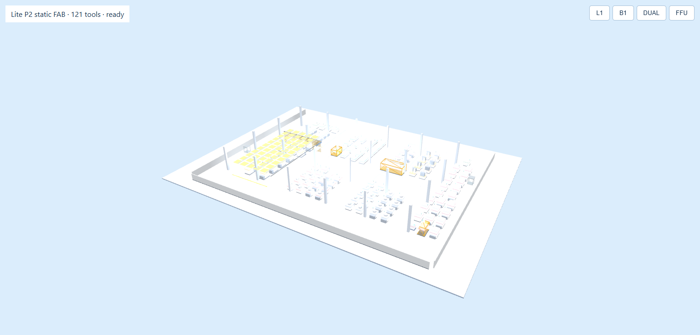
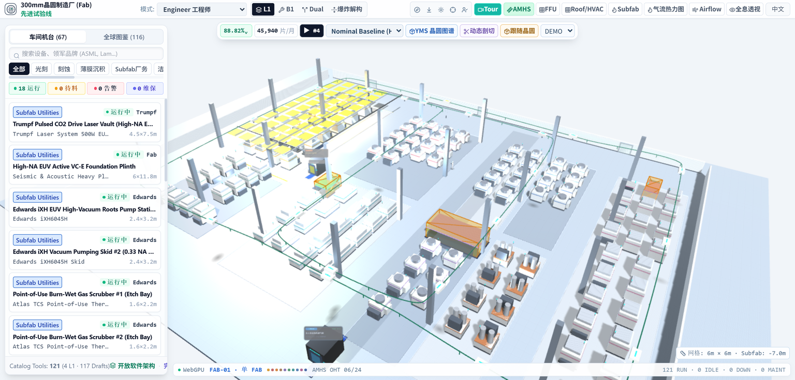
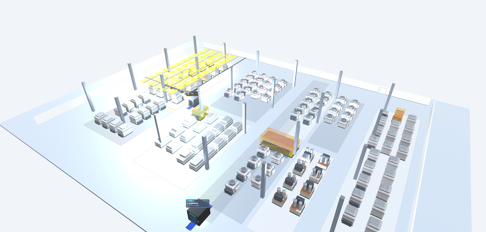
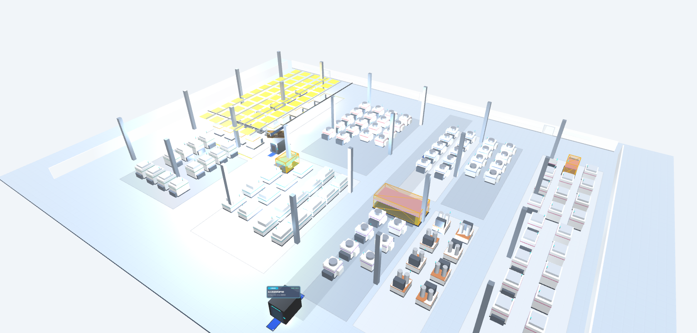
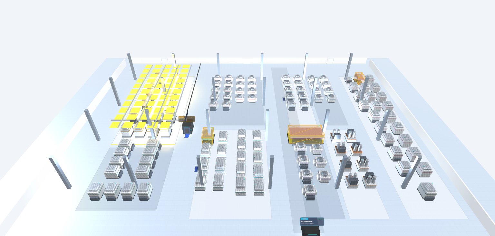
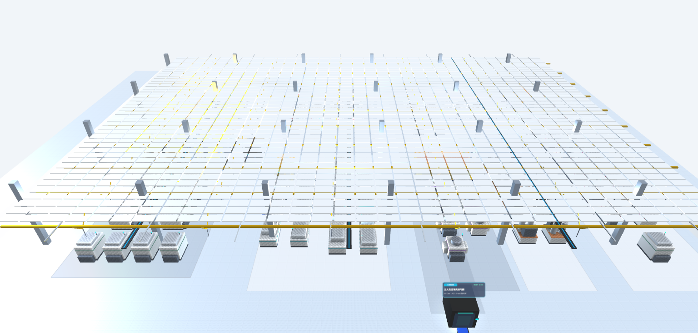

# Restored source lighting, native CSM shadows and restored facility — 2026-10-26

Status: **IMPLEMENTING / NOT_PARITY_VERIFIED**. No visual threshold is approved and no claim of
pixel/Golden parity is made. Evidence package for the increment that restored the source lighting rig,
native CSM shadows, and the source facility/airlock/ceiling systems in the Lite native preview.

- **Final revision before commit** (branch `feat/twin-babylon-lite-native`, HEAD `d25eb4f680105278907ed6d2b0ca3cffcaf6b211`).
  R01 (early procedural air-shower approximation still rendering) and R02 (procedural ceiling not
  source-disabled) were fixed by the Lead; the full canonical GPU suite matrix was rerun from the final
  state: `.local/lite-acceptance-final/` — `lite-lighting.json`, `lite-shadow.json`, `lite-static.json`,
  `lite-layout.json`, `lite-equipment.json`, `lite.json`, all **PASS**, `errors: []`.
- Source inventory: [INVENTORY_2026-10-26.md](../../INVENTORY_2026-10-26.md) and [inventory.json](inventory.json).
- The increment files are committed on this branch as one bounded evidence increment; Lite file
  hashes are recorded in [inventory.json](inventory.json) `sourceHashes.liteIncrementModules`.

## 0. 3D implementation boundary (user constraint)

User constraint: **所有 3D 效果必须由 Babylon Lite 原生能力或 WebGPU 公开 API 实现**
("All 3D effects must be implemented with Babylon Lite native capabilities or public WebGPU APIs").

| Area | Verified implementation boundary |
|---|---|
| Lighting | Official Lite directional/hemispheric/point/spot lights + official `MaterialPlugin` public WGSL slots compiled into the native Lite PBR pipeline (`enableMaterialPlugins`); source local lights ride the material UBO. No custom render pass, no private Lite API, no regex WGSL rewriter, no forked Lite shader. |
| Shadows | Native `createCsmDirectionalShadowGenerator` + `enableCsmStaticCache` + `setShadowTaskCasterMeshes` + `setShadowGeneratorEnabled` + `registerSceneWithShadowSupport`. No hand-written depth pass or `GPUTexture`. |
| Facility/geometry | Native `createMeshFromData` / `createBox` / `createCylinder` / `createPlane`, thin instances and the facing-billboard system; native `ShaderMaterial` (WGSL) for the air-shower jets. Canvas2D is used only to generate source textures/label sprites, not 3D rendering. |
| Audit result | 0 matches for `@babylonjs/core`, `@babylonjs/lite-compat`, Three.js or WebGL imports in `web_app/src/render/lite/**` and in `web_app/tests/lite-runtime/main.ts`; 0 matches for private underscore-prefixed Lite members in the new Lite render path. The old Babylon-core product renderer still powers `/twin` until P11 replaces it (documented migration state, not part of this increment). |

## 1. What changed in this increment

| Change | Files (sha256 prefix) |
|---|---|
| **Framing** — facility root, static light root and the new lighting root join the same Next RH→render frame (`attachNextCoordinateFrame`), so restored facility lights/geometry, static structure and equipment share the source coordinate frame. The frame is applied before the source-light material plugin pass. | `web_app/tests/lite-runtime/main.ts` (`e703efee…`); `render/lite/next-coordinate-frame.ts` (`f633ddd5…`) |
| **Facility restoration** — native port of `original-facility-architecture.ts`: 2 air showers (66 parts, 2 interior point lights, Canvas2D bilingual labels, animated jets/indicators), 6 sticky mats (24 parts), ceiling FFU group (1 569 parts: deck, 1 386 FFU thin instances, 8 LED aisles+lenses, 10 trusses, 100 braces, 50 drop rods, 3 cable trays+cables). Ceiling hidden by default; device-recovery hook resets thin instances. | `render/lite/geometry/facility.ts` (`66793497…`), `geometry/facility-layout.ts` (`7e50f3d7…`), `tests/lite-facility.test.ts` (`27a45637…`) |
| **Source lighting** — key 1.15 / fill 0.32 / ambient 0.48, 5 amber points + amber spot, 10 B1 source lights and 2 air-shower lights packed as 18 local lights into a material UBO (4 vec4 per light, capacity 24). Source Lambert `albedo*(1-metalness)`, per-light `pow(1-d/range, decay)` + spot smoothstep cone, ambient applied once through the plugin (native hemispheric contribution excluded from PBR meshes). | `render/lite/lighting.ts` (`2deba87e…`), `tests/lite-lighting.test.ts` (`fdc4df44…`) |
| **LinearEncoding output correction** — the frozen source renders THREE LinearEncoding with NoToneMapping: Lite's PBR template gamma-encodes, and transmissive materials retarget the pass to rgba16float and append a second gamma encode. The plugin writes the source linear value, pre-compensating only that trailing encode, and applies the source unpowered fog factor. | `render/lite/lighting.ts` (CUSTOM_FRAGMENT_BEFORE_FRAGCOLOR, lines 104-113) |
| **Native CSM shadows** — public `createCsmDirectionalShadowGenerator` with mapSize 2048, 2 cascades, `depth32float`, 2 layers, comparison sampler, `enableCsmStaticCache`, explicit caster set (`setShadowTaskCasterMeshes`) and generator ownership by key + `scene.shadowGenerators`; recovery-owned. 195 casters; floor/slab/line/transparent/status parts excluded per source caster rules. | `render/lite/shadows/native-lite-shadow.ts` (`54ee809b…`), `tests/lite-shadow.test.ts` (`e14d52b5…`) |
| **Runtime shadow registration** — `registerSceneWithShadowSupport` is awaited before first frame when a shadow generator exists; registration failure releases all scene ownership. | `render/lite/runtime.ts` (`31d378a9…`); regression tests in `tests/lite-runtime.test.ts` (`ffda084e…`) |
| **Caster/thin-instance corrections** — frozen P2b `caster:null` entries derive caster status from alpha/refraction as the source renderer does; equipment gets `receiveShadows`, caster metadata and thin-instance world bounds. | `geometry/static-structure.ts`, `geometry/tool-families.ts` (`a8dafda0…`) |
| **R01 fix** — every frozen batch whose first entity name starts with `airshower-` is parented to a hidden `static-source-disabled` root (and `setSubtreeVisible(false)`), reproducing `legacy-site.ts:406-407`; it can no longer be re-shown by `setLevel`/`setVisible`. | `render/lite/geometry/static-structure.ts` (`a954880e…`, lines 67-70, 160-164) |
| **R02 fix** — the frozen procedural ceiling layer (`ffu` = ceiling-frame/panel/fan/hub from `buildProceduralFab`) is kept source-disabled (`legacy-site.ts:412`); the preview FFU view maps to the restored original facility ceiling only. Both behaviours are asserted in every view by the browser suites. | `tests/lite-runtime/main.ts` (`e703efee…`, lines 171-176), `tests/lite-static-structure.browser.ts` (`38883a40…`), `tests/lite-lighting.browser.ts` (`6e684811…`) |
| **Local-light UBO packing (final)** - the source local-light packet is packed once per frame and reused by every material UBO writer with an allocation-free change hash (public API only; needed for animating facility lamps, pixel-neutral by intent). | render/lite/lighting.ts (2deba87e..., lines 63-129) |
| **Preview acceptance hooks** — `setShadows/setKeyLight/setFillLight/setAmbientLight/setLocalLights/setFacilityCeiling`; snapshot gained `structure.airshowerVisible`. | `tests/lite-runtime/main.ts`; `tests/lite-static-structure.browser.ts` |

## 2. Verification actually run

Local (this evidence session, repo root, final revision):

```powershell
cd web_app
npx vitest run tests/lite-facility.test.ts tests/lite-static-structure.test.ts
# PASS: 2 files, 7 tests (facility 1: every source part at exact source bounds, 2 air showers,
#       2 lights, ceiling.visible=false by default; static 6: 1648 parts, 10 lights, material inputs,
#       B1/FFU independence, texture cleanup)

npx vitest run tests/lite-lighting.test.ts tests/lite-shadow.test.ts tests/lite-equipment.test.ts tests/lite-runtime.test.ts
# PASS: 4 files, 34 tests (lighting 3, shadow 2, equipment 4, runtime 25)
# outputs: .local/evidence-tools/final-vitest-required.txt, final-vitest-focused.txt

npx tsc --noEmit
# PASS (exit 0), output: .local/evidence-tools/final-typecheck.txt
```

Final canonical GPU acceptance (executed by the GPU acceptance teammate after the fixes, Chrome 155 /
NVidia Ampere, 1536x735, real WebGPU, DOM chrome hidden; cited, not re-run here):

```powershell
$env:LITE_EVIDENCE_DIR = '.local/lite-acceptance-final'
node tools/run_twin_browser.mjs lite-lighting 9496 http://127.0.0.1:5175 .local/lite-acceptance-final/lite-lighting.json
node tools/run_twin_browser.mjs lite-shadow   9496 http://127.0.0.1:5175 .local/lite-acceptance-final/lite-shadow.json
node tools/run_twin_browser.mjs lite-static   9496 http://127.0.0.1:5175 .local/lite-acceptance-final/lite-static.json
node tools/run_twin_browser.mjs lite-layout   9496 http://127.0.0.1:5175 .local/lite-acceptance-final/lite-layout.json
node tools/run_twin_browser.mjs lite-equipment 9496 http://127.0.0.1:5175 .local/lite-acceptance-final/lite-equipment.json
node tools/run_twin_browser.mjs lite          9496 http://127.0.0.1:5175 .local/lite-acceptance-final/lite.json
```

| Final acceptance result | Evidence |
|---|---|
| lighting suite PASS, `errors: []`: 121 tools (identities mapped), 51 equipment batches, 936 instances, 1 648 static parts / 396 batches / 10 lights, facility 1 659 parts / 1 386 FFU instances / 2 lights, 721 meshes, 722 draw calls, key 1.15, 18 local lights, 195 casters; every view asserts `structure.layers.ffu.visible === false` and `structure.airshowerVisible === false` | `.local/lite-acceptance-final/lite-lighting.json` |
| shadows suite PASS, `errors: []`: CSM mapSize 2048, 2 cascades, depth32float, static cache, recoverable; 195 casters; 3 device losses recover with fresh CSM textures (final 12), remount 721 meshes; 0 GPU/console errors | `.local/lite-acceptance-final/lite-shadow.json` |
| static suite PASS, `errors: []`: initial and all views `airshowerVisible=false`, `layers.ffu.visible=false`, facility ceiling true only in FFU view; 3 recoveries; 721 meshes / 722 draw calls | `.local/lite-acceptance-final/lite-static.json` |
| layout suite PASS: 121 tools + 56 yellow objects, max projection error 2.514e-05 px (threshold 0.1 px) at ISO/TOP/L1/B1/DUAL | `.local/lite-acceptance-final/lite-layout.json` |
| shadows on/off ISO: mean channel delta 3.7338, changed 11.87% of ROI, darkened 11.67%, median delta among changed 28.67; TOP 3.6526/9.33%; B1 after layer rebuild 1.5493/6.48%; key-off collapse exact | lighting.json / shadow.json |
| KEY off: mean luminance 229.71 → 175.61 (−53.99, −23.50%); key-off shadows on/off collapses to identical bytes | lighting.json |
| AMBIENT off 26.3750 mean channel delta (+26.54 mean luminance); FILL off 12.8198; LOCAL LIGHTS off 5.8980; all restores/determinism/remount byte-identical | lighting.json |

## 3. Independent pixel comparison (Pillow)

Method and raw numbers: [comparison.json](comparison.json). Reproduce with
`.local/evidence-tools/compare_lighting_final_2026_10_26.py` (Pillow 12.3.0 / Python 3.12.14):

```powershell
python .local/evidence-tools/compare_lighting_final_2026_10_26.py (Get-Location) `
  docs/migration/babylon-lite/evidence/lighting-shadows-facility-2026-10-26/comparison.json `
  .local/evidence-tools/next-iso-1536-lanczos.png
```

- Final cross-engine captures: `.local/lite-acceptance-final/layout-next-<view>.png` vs
  `layout-lite-<view>.png`, both HUD-hidden and measured at native 1536x735, ROI **Lead final
  [360,100,1500,700]** (excludes hidden-HUD remnants in the Next left column). No colour correction,
  no alignment, no tone mapping.
- Lite-only toggle deltas use suite ROI **[76,73,1460,677]** (recorded in the final JSON, 835 936 px).
- The committed `before-next-iso-1536-lanczos.png` is the unchanged LANCZOS reference from
  `.local/material-goldens/next-iso.png` (old product frame); the committed `before-p2b-l1.png` is
  unchanged. The final cross-engine numbers use the canonical same-view `layout-*` captures.
- Luminance: Rec.709 `0.2126R + 0.7152G + 0.0722B` on raw sRGB bytes (not linearized).
- **HUD/sidebar differ**: Next retains hidden-HUD remnants in the left column (excluded by ROI) and has
  deferred dynamic systems (AMHS, roof/HVAC, personnel, HUD states); full-frame numbers are not parity
  evidence.

| View | Next vs Lite RGB MAE | Next mean RGB | Lite mean RGB | Lite mean luminance | pixels max-channel Δ>8 |
|---|---:|---|---|---:|---:|
| ISO | **9.778** | (216.36, 225.36, 230.97) | (219.16, 227.28, 232.76) | 225.95 | 25.09% |
| TOP | **13.107** | (218.42, 226.92, 227.64) | (225.32, 233.11, 233.73) | 231.50 | 26.59% |
| L1 | **12.321** | (210.28, 220.08, 225.25) | (214.96, 223.73, 228.75) | 222.23 | 28.10% |
| B1 | **16.752** | (91.69, 107.26, 121.72) | (104.86, 121.99, 139.04) | 119.58 | 33.00% |
| DUAL | **19.679** | (177.12, 188.00, 193.10) | (188.43, 197.53, 202.55) | 195.95 | 67.39% |

These match the Lead's final `compare-metrics-roi.json` (iso 9.78 / top 13.11 / l1 12.32 / b1 16.75 /
dual 19.68). Old reference vs final Lite ISO: RGB MAE 10.117. Before/after L1: RGB MAE 25.895 — **not** a
lighting-only measurement (P2b camera, lighting, shadows and facility content all changed).

Lite-only toggle deltas (suite ROI, independent Pillow reproduces the suite mean channel delta):

| Toggle | mean channel Δ | mean luminance Δ | changed >8 | identical bytes | Note |
|---|---:|---:|---:|---|---|
| shadows on vs off (ISO) | **3.7338** (suite 3.7338) | −3.712 | 11.19% | no | 2048 CSM contribution |
| key off (ISO) | 53.7163 | −54.105 (−23.55%) | 65.18% | no | key is the only shadow caster |
| key-off shadows on vs off | 0 | 0 | 0 | **yes** | exact collapse |
| ambient off | **26.3750** | +26.540 | 60.26% | no | source ambient via plugin |
| fill off | **12.8198** | +12.876 | 54.19% | no | source fill 0.32 |
| local lights off | **5.8980** | +5.952 | 11.80% | no | 18 packed locals |
| baseline repeat / restore / remount | 0 | 0 | 0 | **yes** | deterministic |
| shadow iso on a/b; DUAL capture vs view | 0 | 0 | 0 | **yes** | deterministic |
| TOP shadows on vs off | 3.6525 | −3.607 | 9.00% | no | — |
| B1 shadows on vs off | **1.5493** | −1.550 | 6.25% | no | survives B1 layer rebuild |
| remount shadow on vs off | 3.7338 | −3.712 | 11.19% | no | same contribution after remount |
| FFU view vs ISO baseline | 26.2046 | +25.304 | 70.59% | no | restored facility ceiling only |

Effect of the final-revision changes (R01/R02 fixes plus the pixel-neutral lighting UBO packing; previous canonical revision → final): ISO lights-on RGB MAE
**0.047** (0.35% of ROI px changed); ISO shadows-off 0.041; FFU view 0.932 (3.28%) — the FFU view no
longer shows the procedural ceiling under the restored facility ceiling. See
`comparison.json.previousToFinalRevisionDelta`.

## 4. Before / after images (committed copies)

Before (committed P2b Lite L1, pre-lighting, pre-facility):



Old Next reference, LANCZOS-downscaled to 1536x735 (kept unchanged; original PNG path/hash in
comparison.json):



After (final canonical Lite ISO, all source lights + native CSM shadows, DOM chrome hidden):



After with shadows disabled (same lights; compare with the previous image):



After, L1 view (final canonical; used for the before/after delta with the caveat above):



After, FFU view — only the restored original facility ceiling (deck, 1 386-instance FFU grid, trusses,
braces, drop rods, cable trays); the frozen procedural ceiling stays source-disabled:



## 5. Honest remaining differences

- Airlock billboards render zh only; source supports zh/en re-render (P7). Air-shower purge animation is
  implemented from the frozen timeline but has no unit/pixel assertion in this increment.
- Cross-engine pixel delta includes deferred scene content (AMHS/OHT, roof/HVAC, personnel, status HUD
  and other product HUD state, P6–P9), so it is **not** attributable to lighting alone; no
  exposure/brightness tuning is implied.
- HUD/sidebar differ by design (see method). No full-frame or Golden acceptance.
- Per-tool status-lamp state mapping/pulse is not restored (P9). Materials/transmission/IBL exactness is
  not pixel-verified (zero-radiance HDR only satisfies Lite transmission; no IBL/sky/ground added).
- Product `/twin` still runs the legacy renderer; the Lite path is a test-only preview (P3).
- No 60-minute soak, cross-browser matrix or performance A/B (explicitly out of scope).
- The two earlier R01/R02 gaps are fixed: the 14 frozen `airshower-*` approximation parts are hidden and
  cannot be re-shown, and the procedural ceiling layer stays source-disabled with FFU view mapped to the
  restored facility ceiling; both are asserted in every view by the final browser suites.

## 6. Committed evidence files

| File | Bytes | sha256 prefix | Source |
|---|---:|---|---|
| `before-p2b-l1.png` | 79 880 | `814710dc…` | `docs/migration/babylon-lite/evidence/p2b-l1.png` (unchanged committed pre-lighting Lite L1) |
| `before-next-iso-1536-lanczos.png` | 895 746 | `ddd8a026…` | unchanged LANCZOS 1536x735 copy of `.local/material-goldens/next-iso.png` (original sha `51cca4c4…`) |
| `after-iso-lights-on.png` | 604 275 | `3be35f0b…` | final `.local/lite-acceptance-final/lighting-iso-lights-on.png` |
| `after-iso-shadows-off.png` | 492 971 | `47a24994…` | final `.local/lite-acceptance-final/lighting-iso-shadows-off.png` |
| `after-iso-key-off-shadows-on.png` | 530 539 | `06c30576…` | final `.local/lite-acceptance-final/lighting-iso-key-off-shadows-on.png` |
| `after-iso-ambient-off.png` | 643 300 | `643be344…` | final `.local/lite-acceptance-final/lighting-iso-ambient-off.png` |
| `after-view-l1.png` | 520 118 | `e2a1f2a1…` | final `.local/lite-acceptance-final/lighting-view-l1.png` |
| `after-view-ffu.png` | 448 507 | `db1ab155…` | final `.local/lite-acceptance-final/lighting-view-ffu.png` (facility ceiling only) |

Committed total: ~4.5 MB. Exact per-file hashes and byte-identity checks against the final captures are
in [comparison.json](comparison.json) `committedCopies`. Other final captures (TOP/B1/DUAL/remount/
determinism pairs/layout captures) stay in `.local/lite-acceptance-final/` and are referenced, not
copied, to keep the committed package small.

## 7. Evidence provenance notes

- The task named `docs/migration/babylon-lite/evidence/material-lighting-2026-10-26/README.md` as the
  previous evidence style; that path does not exist in this checkout. The style was taken from
  `docs/migration/twin-parity/evidence/material-lighting-2026-10-26/README.md` instead.
- The task's original `after` set (`.local/light-probe3/...`) and the older
  `.local/lite-preview-current/p2b-l1.png` L1 capture were superseded first by `.local/lite-acceptance/`
  and finally by the final-revision `.local/lite-acceptance-final/` captures. The old debug baseline/
  shadows captures were pixel-identical to the pre-fix canonical ones over both ROIs; the current
  `previousToFinalRevisionDelta` records the fix effect.

## 8. Reproduce

```powershell
# counts + unit suites
cd web_app
npx vitest run tests/lite-facility.test.ts tests/lite-static-structure.test.ts
npx vitest run tests/lite-lighting.test.ts tests/lite-shadow.test.ts tests/lite-equipment.test.ts tests/lite-runtime.test.ts
npx tsc --noEmit

# independent pixel comparison (Pillow 12.3.0)
python .local/evidence-tools/compare_lighting_final_2026_10_26.py (Get-Location) `
  docs/migration/babylon-lite/evidence/lighting-shadows-facility-2026-10-26/comparison.json `
  .local/evidence-tools/next-iso-1536-lanczos.png

# final canonical GPU acceptance (executed by the GPU acceptance teammate; commands reused as cited evidence)
$env:LITE_EVIDENCE_DIR = '.local/lite-acceptance-final'
node tools/run_twin_browser.mjs lite-lighting 9496 http://127.0.0.1:5175 .local/lite-acceptance-final/lite-lighting.json
node tools/run_twin_browser.mjs lite-shadow   9496 http://127.0.0.1:5175 .local/lite-acceptance-final/lite-shadow.json
node tools/run_twin_browser.mjs lite-static   9496 http://127.0.0.1:5175 .local/lite-acceptance-final/lite-static.json
```

## 9. Status

`IMPLEMENTING / NOT_PARITY_VERIFIED`. The increment has unit-test evidence, real-GPU pixel deltas for
the restored light rig and native CSM shadows, final canonical PASS acceptance with zero collected
GPU/console errors, verified facility/light counts, and fixed + asserted R01/R02 source-disable
semantics. It does not establish Golden/pixel parity, product integration, or the P6–P9 dynamic systems.

