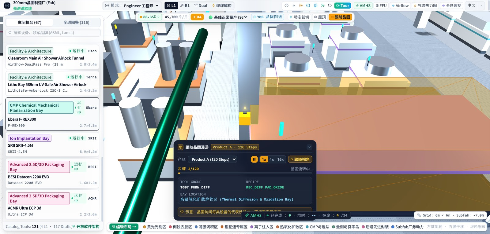
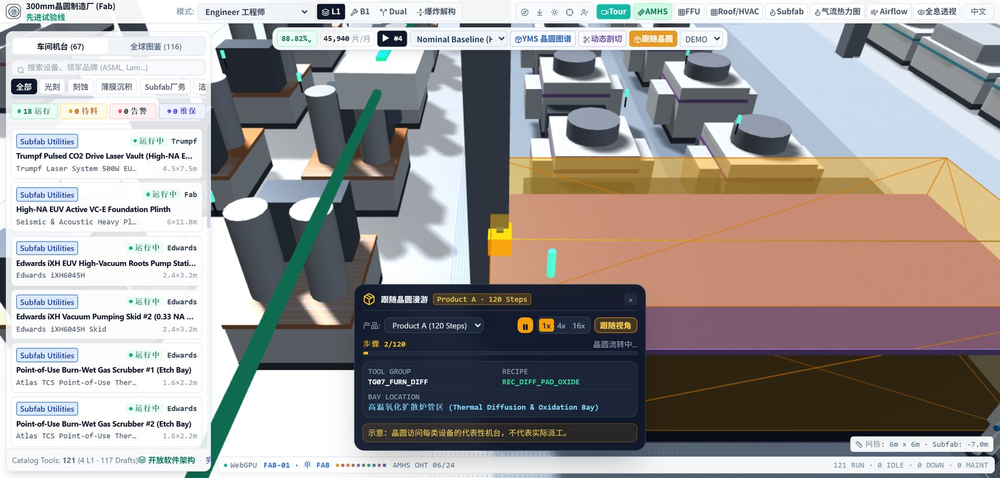
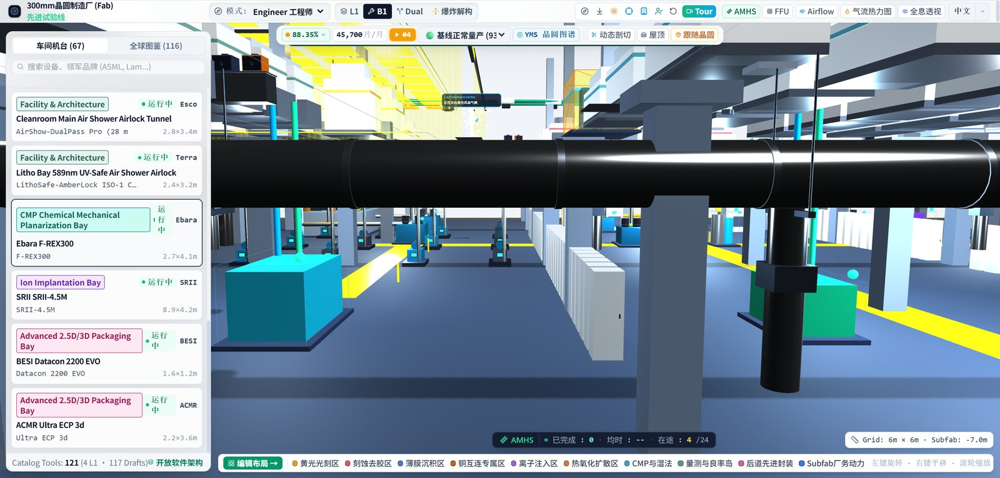
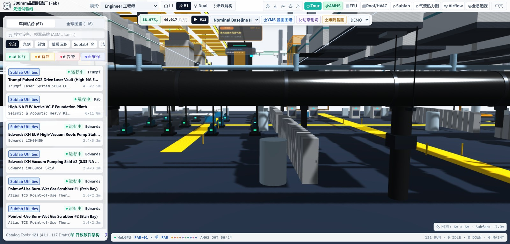
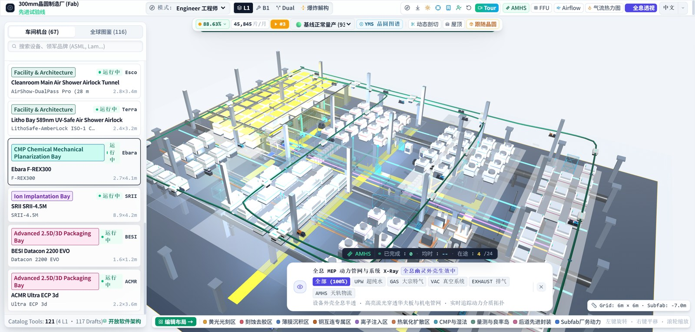
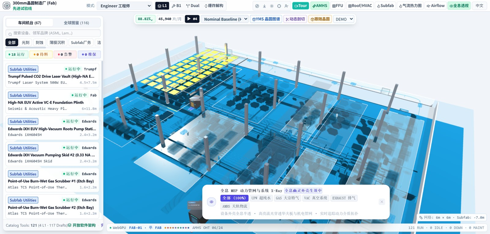

# Wafer renderer and matched Golden evidence — 2026-10-26

Status: **IMPLEMENTING / NOT_PARITY_VERIFIED**. No visual thresholds have been approved.

## Changes verified

- Full A/B/C routes (120/104/92 steps) feed the frozen controller; frozen route slices and bay names compare field-for-field. One RAF survives pause/speed/follow/language changes. Frame dt remains source-clamped to 100 ms; no Tour-style catch-up is added to Wafer.
- Renderer applies position, tangent rotation, camera offset (0,6,-8), 0.25 m / 30-point additive trail, source HUD and completion/replay behavior. Opening/product change auto-play; pause retains the interpolated pose; close/reopen retains source state. Seek and the duplicate Redux integrator are removed.
- Repairs: FOUP body was permanently invisible; trail geometry was recreated every frame; replay/product retained stale completion bookkeeping; Escape stopped Tour UI but left RAF able to reclaim the camera and reopen the next waypoint.
- B1/Dual retain source L1 equipment/architecture/personnel/OHT; the industrial floor is now the source slate PBR plane at -7 m. Slab visibility matches L1/B1/Dual/exploded/X-Ray and restores with material/shadow state. FFU/roof setters use the same visibility rule as level synchronization.
- Wafer/X-Ray panel dimensions, positioning and copy follow measured frozen DOM. Preserve the original computed 12px typography floor; correct the extra button minimum and missing dynamic pause glyph. Hold-countdown English copy is now translated.

## Validation

- `npm run typecheck`, **187/187 Vitest**, `vite build`, architecture checks, all frozen vector/translation checks, and **16/16 Python tooling tests** pass. Vite retains its existing large-chunk advisory.
- Production browser: Wafer, level/FFU combinations, Twin UI, Tour, Tour Escape interruption, Exploded and X-Ray acceptance pass with zero console/runtime errors. Wafer and GPU acceptance record zero uncaptured device errors.
- Tour: 92 samples; auto-advance 7.214 s measured from the click (the former test incorrectly subtracted the first delayed sample). Escape leaves the manual camera in control for 593 subsequent virtual frames.
- Exploded: 121 identities, 12 links, 20/-18 m hierarchy, caster counts 771 -> 969 -> 771. The old extra basement slab caster was removed. X-Ray retains the one WGSL program and verifies six filters, native shadow pixel effect and exact material/visibility/cache restoration with Demo status ticks paused during identity checks.
- Browser: Chrome 155.0.8059.86, Windows, WebGPU NVIDIA/Ampere. Acceptance viewport 1536x735 DPR 1. Evidence: [acceptance.json](acceptance.json). Reproduce with `node tools/run_twin_browser.mjs <wafer|level|ui|tour|tour-stop|exploded|xray> <cdp-port> http://127.0.0.1:4173 <output.json>`.
- **60-minute soak and device-loss matrix remain skipped by user decision.**

## Golden method and ROI correction

- Frozen original remains `SemiconFab@b3666132`; Next uses the production build. 19 pairs at 1536x735 CSS pixels / DPR 2, zh-CN except iso-en, seed 20261024, 60 Hz virtual RAF and frozen Date.now. Original and Next use their respective renderers.
- Same prior capture procedure: 180 warm-up frames, ISO reset and 180 + 180 case frames. React control settling adds 2–5 frames on Next (ordinary cases 9033 ms vs original 9000 ms; wafer 9067 ms). These are declared setup offsets, not frame-exact timeline equivalence. Random-consumption order and real timer scheduling remain non-equivalent.
- **Found and fixed a measurement bug:** old scene ROI used CSS coordinates directly on DPR-2 PNGs, accidentally including half the sidebar/HUD. New ROI is CSS [328,82,1536,687] -> PNG [656,164,3072,1374]. Old ROI percentages must not be compared to this table. Full-frame SSIM/MAE remain directly comparable.
- Gaussian luminance SSIM 11x11 sigma 1.5, float64 population covariance; RGB threshold 8. Local SciPy separable convolution was checked against the standard comparator to <1e-12 on declared random vectors; it uses the identical kernel/reflect boundary. Standard `tools/compare_twin_goldens.py` reproduces the method without SciPy.
- Full PNGs and DOM records remain in `.local/goldens-c`; committed JPEGs are 1600px previews. comparison.json hashes refer to the full PNGs. Capture console errors: 0.

## Results

| Case | Previous full SSIM | New full SSIM | Corrected scene ROI | Previous MAE | New MAE |
| --- | ---: | ---: | ---: | ---: | ---: |
| cut | 73.7% | 73.7% | 85.6% | 19.7 | 19.7 |
| tour | 71.4% | 71.4% | 82.6% | 23.4 | 23.4 |
| exploded-0 | 70.0% | 70.7% | 81.3% | 26.2 | 24.1 |
| iso-en | 69.3% | 69.3% | 79.3% | 23.0 | 23.0 |
| patrol-purge | 69.2% | 69.2% | 79.3% | 23.1 | 23.1 |
| patrol | 69.2% | 69.2% | 79.3% | 23.1 | 23.1 |
| iso | 69.2% | 69.2% | 79.3% | 23.1 | 23.1 |
| exploded-50 | 68.3% | 69.0% | 78.8% | 30.3 | 25.2 |
| exploded-100 | 67.5% | 68.5% | 79.0% | 32.2 | 24.3 |
| top | 68.2% | 68.2% | 77.3% | 23.1 | 23.1 |
| research | 65.5% | 65.4% | 68.9% | 35.9 | 36.0 |
| litho | 63.8% | 63.7% | 74.6% | 53.0 | 53.1 |
| dual | 59.9% | 63.6% | 70.9% | 38.6 | 28.5 |
| mes | 62.1% | 62.1% | 69.2% | 25.1 | 25.1 |
| spc | 61.6% | 61.7% | 68.7% | 25.8 | 25.8 |
| yms | 61.6% | 61.6% | 57.5% | 51.6 | 51.6 |
| xray | 60.6% | 61.4% | 67.4% | 39.3 | 39.0 |
| wafer | 50.0% | 58.5% | 65.8% | 74.4 | 43.6 |
| b1 | 56.6% | 56.7% | 61.8% | 65.9 | 51.1 |

## Remaining appearance gaps

Wafer camera/HUD alignment is substantially closer; the source pause icon and code font are visible in the preview. Full-frame SSIM is still limited by sidebar ordering/filters, top/footer/AMHS chrome, original PBR/light/specular response, basement detail and the X-Ray material look. B1 MAE improves substantially while its structural SSIM stays near 56.7%; this is not a pixel-parity acceptance. Full-scene random-state equivalence also remains open.

