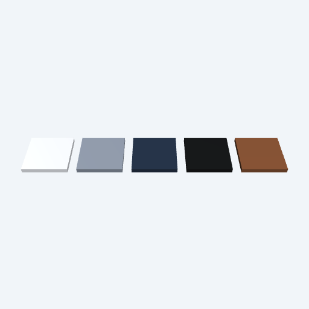
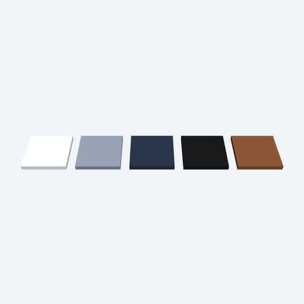
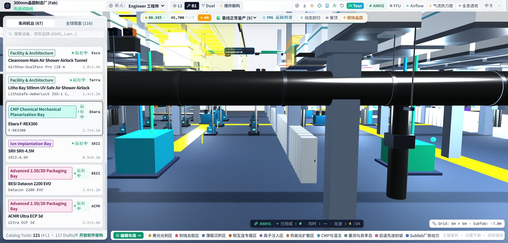
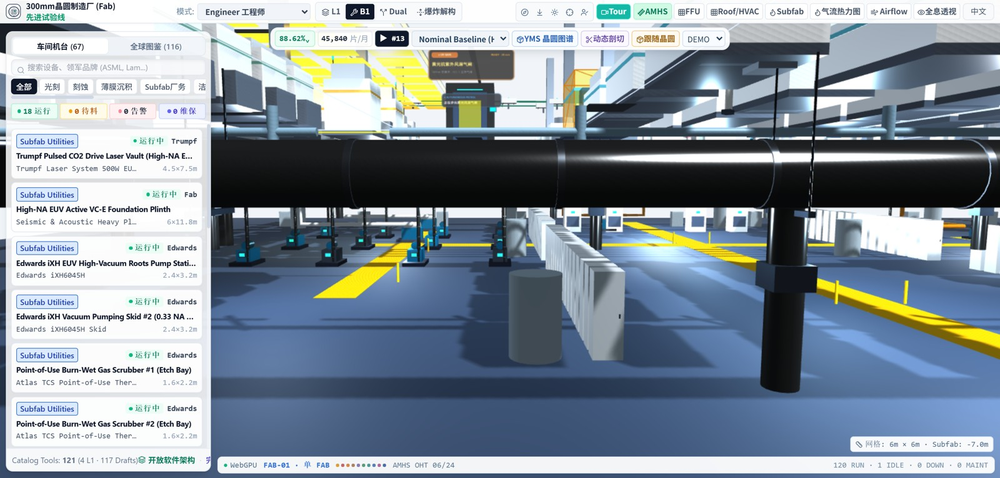
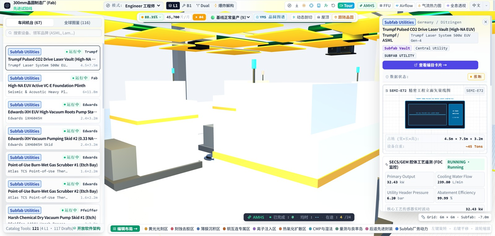
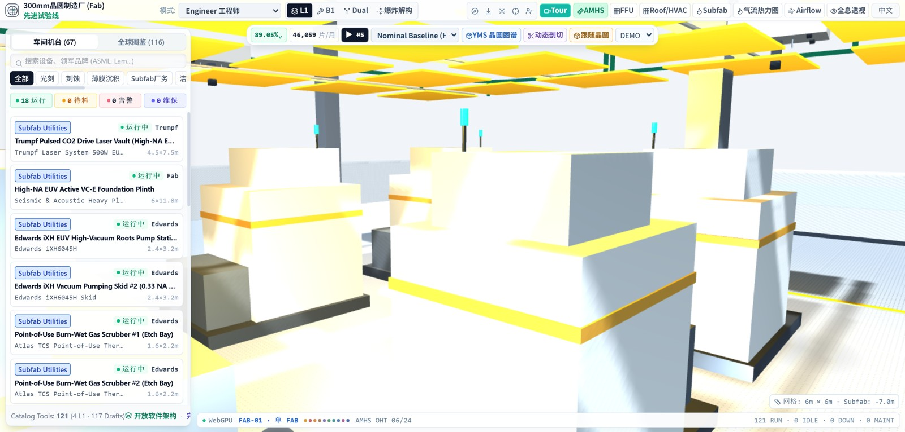
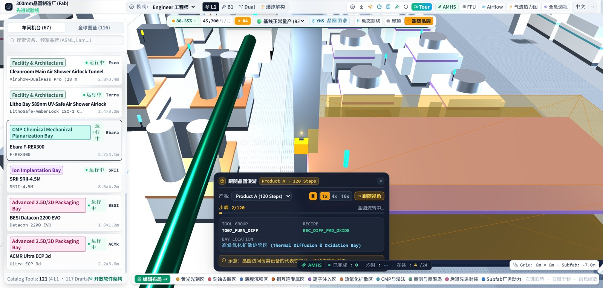
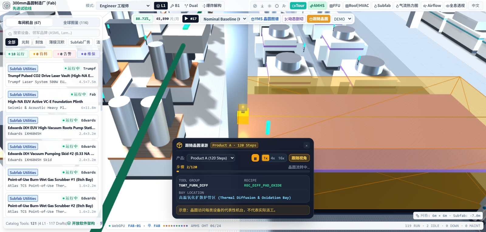

# Frozen material and lighting alignment — 2026-10-26

Status: **IMPLEMENTING / NOT_PARITY_VERIFIED**. No visual threshold is approved.
User-requested previous work was committed first as `09abdbf`; this evidence compares the new material/light increment with that baseline.

## Source corrections

- Original `MeshStandardMaterial` uses Lambert diffuse and `albedo * (1 - metalness)`. Replace Babylon's default Burley diffuse and extra dielectric-F0 diffuse subtraction for source PBR surfaces. Preserve the frozen LinearEncoding, no tone mapping, no IBL, source key/fill/ambient and source material values; no exposure/brightness fitting.
- Retain both native directional lights, with key first for the existing native depth shadow. Source local points/spots are packed into the material UBO (four vec4 per light, capacity 24). This retains lights after slot eight without allocating one GPU uniform binding per local light. A direct 32-native-slot experiment exceeded the GPU binding limit and was discarded; it is not acceptance evidence.
- Apply each source legacy range decay: amber/spot 2, six B1 high-bays 1.2, four missing fluorescent lights 1.5, default source points 1. Restore their source spot cone/penumbra. Basement lights remain enabled when basement geometry is hidden and follow exploded Y through a separate light root, matching the source renderer's light traversal.
- Restore four B1 emissive strips (90 × 0.15 × 0.3 at y=-1.5) and points (y=-2.5, range 35, intensity 1.2). Map Wafer body/flange/door to source PBR values and amber point. Apply the same source response to live status-lamp materials, including materials created after initial scene setup. Exclude new PBR meshes from the extra legacy hemispheric ambient term.
- Preserve Babylon WebGPU and the native `depth32float` / comparison-sampler shadow path.

## Independent pixel evidence

Frozen original: `SemiconFab@b3666132`, THREE r128. The reference page is read-only; the original renderer renders its own independently specified test surfaces. [material-response.json](material-response.json) records exact source hash, source settings, swatches, input lights and pixels. [source-swatches.reference.js](source-swatches.reference.js) and [source-point.reference.js](source-point.reference.js) are reference-page diagnostics only; the product does not import Three.

Five 512 × 512 center swatches (RGB, metalness, roughness) use the source ambient/key/fill, camera (0,6,6), no fog, shadows or IBL. Original and new output agree exactly at all five samples: **(255,255,255), (152,162,179), (40,54,76), (24,26,27), (140,87,55)**. Before values were (250,253,255), (146,156,172), (38,52,73), (23,25,26), (134,83,53). Four independently rendered ninth-light tests (eight out-of-range lights before the effective one) agree exactly for decay **1 / 1.2 / 1.5 / 2 → RGB 129 / 112 / 91 / 64**. This verifies local lights are not truncated at eight.

These are sampled response checks, not exhaustive BRDF/specular/transparency equivalence.

## Production validation

**190/190 Vitest (49 files), TypeScript, production build, 16/16 Python tooling tests, architecture/contracts/import and all eight frozen-source gates pass.** Vite retains the existing large-chunk advisory.

Production browser suites: **lighting, native shadow, level/FFU, Wafer, Exploded, X-Ray, Tour interruption, Twin UI and Tour**. All pass with zero collected console/runtime errors; GPU-aware suites record zero uncaptured device errors. [acceptance.json](acceptance.json) retains results and source-file hashes. The shadow suite confirms key remains first, 771 initial casters, visible shadow pixels and zero PBR response to the extra hemispheric ambient. No browser matrix or sustained-performance conclusion follows.

An initial run with two GPU pages and 49 unit workers contended for the workstation: four unit tests and an Exploded wait timed out. Unchanged code passed full Vitest and Exploded separately at the original timeout thresholds. Final browser regressions ran serially. **60-minute soak and device-loss matrix remain skipped by user decision.**

Reproduce acceptance: `node tools/run_twin_browser.mjs <lighting|shadow|level|wafer|exploded|xray|tour-stop|ui|tour> <cdp-port> http://127.0.0.1:4173 <output.json>` against the production build with the API proxy.

## Seven targeted Goldens

Frozen original PNGs are reused byte-for-byte from the preceding matched 19-case capture; every source PNG hash is checked against the committed baseline. Next is freshly captured from the production build in a new tab, **7/7 pairs and 0 capture console errors**. This is a targeted seven-case refresh, not a new 19-case run.

Unchanged method: 1536 × 735 CSS / DPR 2, seed 20261024, frozen clock, 60 Hz virtual RAF, 180 warm-up plus 180 + 180 case frames. Source clock 9000 ms, Next 9033 ms (Wafer 9067 ms) from React setup. Random-consumption order and real timers remain non-equivalent. Gaussian luminance SSIM 11 × 11 / sigma 1.5, float64 population covariance; RGB threshold 8; CSS scene ROI [328,82,1536,687] scaled to PNG [656,164,3072,1374]. No alignment or colour correction. The separable SciPy calculation was checked against the canonical comparator to <1e-12 on fixed random vectors.

| Case | Before full SSIM | New full SSIM | New scene ROI | Before RGB MAE | New RGB MAE |
| --- | ---: | ---: | ---: | ---: | ---: |
| iso | 69.2% | 72.0% | 83.6% | 23.1 | 18.9 |
| litho | 63.7% | 70.2% | 82.5% | 53.1 | 29.7 |
| b1 | 56.7% | 69.3% | 80.0% | 51.1 | 27.0 |
| dual | 63.6% | 68.1% | 77.9% | 28.5 | 20.9 |
| wafer | 58.5% | 61.9% | 70.8% | 43.6 | 32.9 |
| tour | 71.4% | 73.0% | 85.1% | 23.4 | 21.4 |
| xray | 61.4% | 61.7% | 67.9% | 39.0 | 38.2 |

Full results and PNG hashes: [comparison.json](comparison.json). Full-resolution PNGs and DOM records are retained in `.local/material-goldens`; committed scene JPEGs are 1600px previews and are not the measured files. Use `compare_pair` in `tools/compare_twin_goldens.py` to reproduce a pair's full/ROI measurements.

## Remaining differences

The sampled material response and declared light setup are closer; this does not establish pixel parity. Existing StandardMaterial approximations (including moving AMHS parts), airlock assembly differences, shadow receiver/caster coverage, transparent material composition, basement detail, camera/selection state and sidebar/top/footer/HUD layouts still differ. The port retains the existing air-shower builder's interior lights; the frozen final scene's attached light inventory differs there. These are remaining appearance work, not reasons to tune an exposure multiplier.

