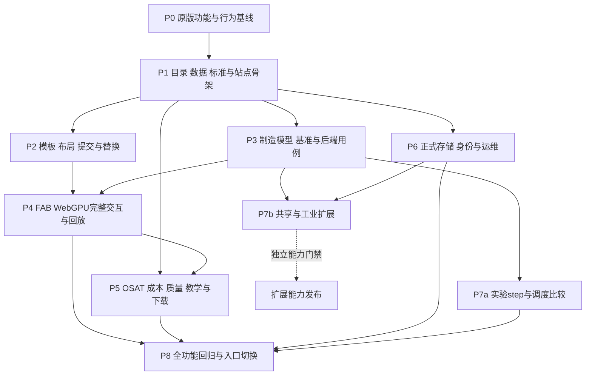

# SemiconFab-main → SemiconFab-Next 功能迁移与重构规划

> **For agentic workers:** 后续实施使用 `superpowers:subagent-driven-development` 或 `superpowers:executing-plans`，按任务检查清单执行；本文件当前仅为规划，不表示已完成迁移。
>
> 规划日期：2026-10-24。用户要求：**尽量不缺少原版功能；目标以新架构为准，该微调的微调。**

**Goal:** 将 `SemiconFab-main` 的设备数据、业务交互、仿真、三维展示、分析工具及内容页面迁入 `SemiconFab-Next`，以可追踪的功能验收避免遗漏，并按新架构解决旧版的状态、契约、渲染和部署耦合。

**Architecture:** 沿用当前已经收敛的 **`fab_shared` + `fab_app` + `fab_tests` + `web_app` 四个项目**；M01—M18 是逻辑职责，不重新拆成程序集或微服务。后端管理权威状态和仿真，前端负责表单、只读投影及 Babylon WebGPU；逐功能迁移、并行对照，最终按功能完成情况切换入口。

**Tech Stack:** 按当前项目文件与锁文件维护 .NET 11 目标、React、TypeScript、Vite、Babylon WebGPU 和 pnpm。现有锁定值见 `web_app/package.json`、各 `.csproj` 和 `global.json`；本规划不顺带升级工具链。PostgreSQL、版本化契约与执行隔离沿用 v1.1 的目标要求。

**Spec:** [v1.1 功能与架构基线](../../SemiconFab-Next-Engineering-v1.1/README.md)、[当前工程组织](../../../README.md)、[ADR-0003](../../adr/0003-single-web-app.md)、[ADR-0004](../../adr/0004-merge-shared-kernel.md)、[ADR-0005](../../adr/0005-merge-simulation-into-shared.md)、[ADR-0006](../../adr/0006-single-backend-application.md)。

**实施状态：** [持续实施记录](../../migration/progress.md)。以下静态盘点与“本轮”均指规划编写阶段，后续代码与验证以实施记录为准。前端目录已按用户要求调整为 `src/` 仅 TS/TSX、同级 `tests/` 与 `assets/`。

**配套工件：** [44 项功能迁移清单](../../migration/feature-map.csv)、[原版文件与界面静态基线](../../migration/source-baseline-2026-10-24.json)。清单中的目标路径均为**拟新增或拟调整位置**，不能据此声称文件或功能已存在。

## 1. 优先级和不可变约束

1. **最新用户要求优先**：保留原版可用功能，按新架构重构实现。不得只完成当前示例仪表盘、几何盒子和单工序 FIFO 后就宣布原版已迁移。
2. **当前 ADR 优先于历史工程拆分建议**：不恢复根目录 `src/apps/frontend/tests` 容器、总 solution、pnpm workspace、几十个空项目或多个网站。旧 bootstrap 计划中的这些布局已被 ADR-0001—0006 调整。
3. **功能保持、实现可替换**：Three.js → Babylon WebGPU，页面全局状态 → 后端用例与前端视图状态，Pyodide 权威执行 → 服务端 Worker。这些属于技术替换，必须保留相应用户操作和结果入口。
4. **原版源码是行为盘点依据**：README、MIMAC 规范、演示说明与源码冲突时分别登记，不能把文档中的“已实现”直接作为事实；也不能为贴合新规范悄悄改变业务结果。
5. **必要修正显式版本化**：统计错误、无效状态转换、占位 RL 等不应作为新产品的永久兼容行为；先固定旧输入/输出证据，再记录新行为、原因、测试及模型版本。
6. **三 FAB 与共享状态分开**：同一不可变模板实例化 N 个 FAB，当前默认 3 个；目录、模板和几何可复用，运行对象、随机流、事件、Lot、选择状态不可共享。第四个 FAB 不需改核心源码。
7. **仅 WebGPU**：不引入 WebGL fallback，不把旧 Three.js 页面嵌进 iframe 作为最终迁移成果。无 WebGPU 时目录、文档、表单和报表仍应可用，三维功能明确不可用。
8. **旧仓库暂不删除**：本轮只编写规划。实施期间保留原版源码、数据、下载包、许可、历史依据及对照能力；没有验收证据，不删除旧入口或唯一原始数据。
9. **没有默认退役项**：44 项全部进入迁移范围。确需取消或长期延期的功能，须单独记录用户确认，不能由开发者以“旧版”“演示”或“架构不同”为由静默省略。

## 2. 本次静态盘点与当前差距

### 2.1 原版资产快照

基线记录了 `SemiconFab-main` 中 **139 个文件**的路径、大小和 SHA-256，并提取 **20 个根 HTML 页面**的命名函数与元素 ID。该清单不代替浏览器行为验收；匿名事件处理、运行时生成控件、外部资源失败等仍需 P0 的交互盘点。

| 原版资产 | 本次读文件得到的数量 | 迁移含义 |
|---|---:|---|
| `catalog.json` | 253 条、24 类 | 其中按现有 `osat_` 类别识别为 86 条，其他 167 条；保留完整 `record` 与派生索引，不能只取 vendor/model |
| 目录符合度标签 | L1 9 条、draft 244 条 | 这是原文件标签，未在本轮重新验证；不得自动改成标准符合性结论 |
| `data/semiconductor_equipment_database.json` | 116 条 | OEM 原始库，不等于 253 条发布目录；需要来源映射，不能直接覆盖目录 |
| `data/osat-86-ground-truth.json` | 86 条 | 保留中英文、来源及 gap 标记；文件名不是数据真实性认证 |
| `twin/layout-default.json` | 121 个布局项 | 本次未发现缺失目录引用，但不代表放置了全部 253 条记录 |
| `data/price_estimates.json` | 167 个价格项 | 无价格项不能补零；保留区间、币种、条件、日期和来源 |
| `data/twin_bom_costs.json` | 103 行 | 是 BOM 行数，不是物理机台总数，数量字段需要另行汇总 |
| MIMAC `fab_config.json` | 18 工具组、217 台机 | 与设备编目和默认可视布局是三套不同模型，不做一对一假关联 |
| MIMAC 产品路线 | A 120、B 104、C 92 步 | `fab_config.json` 与 `benchmark/routes.json` 长度一致，但 **三个产品的工具组序列均不完全相同** |
| `twin/events-t1-fifo.jsonl` | 27,263 行、4,400,999 字节 | 包含 719 条 WIP、1,779 条 Lot 出生、24,765 条机台状态；是过滤后的展示流，不能作为完整恢复日志 |

### 2.2 新项目当前可作为起点的内容

本次目标源码基线为提交 `d436948585ddb10665c02a953f8af68e86919db6`。读取的是当前磁盘文件，不沿用此前“65 个工程”的旧描述。

- `fab_shared/src/` 已有强 ID 辅助、生成契约、固定随机数、稳定事件队列、合成单设备 FIFO、检查点与恢复代码。
- `fab_app/src/` 已有 Site 目录、开发身份、Run 文件存储、Worker、查询和基础 KPI；API/Worker 当前限定 Development。
- `web_app/src/` 已有单站点工作台、生成类型、API 客户端、轮询/作用域管理、场景 facade 和 WebGPU 启动实现。
- `fab_tests/src/` 已有仿真、编排和 API 测试源码；**本轮没有构建或运行应用测试，不复用历史通过数作为当前证据**。
- `--realtime`、`--ot` 是占位退出路径；当前没有完整设备库、布局编辑器、MIMAC 制造模型、原版全功能场景、生产 PostgreSQL 或正式身份实现。

### 2.3 总体方案

| 方案 | 取舍 | 本规划结论 |
|---|---|---|
| 复制旧 HTML/全局 JS，再慢慢拆 | 初期页面较快，但继续多份嵌入数据、浏览器权威状态及旧渲染依赖 | 不作为最终方案；旧页面仅用于隔离对照 |
| 全部重写后一次切换 | 架构容易统一，但最容易遗漏大量交互，且反馈与切换风险集中 | 不采用 |
| **功能清单驱动，数据先行，逐功能按新架构重写** | 需要维护映射和差异证据，但可逐项核对并保留现有成果 | **采用此路线**；单站点、单后端，不新增长期双写系统 |

## 3. 功能保留清单与完成状态

完整记录见 `docs/migration/feature-map.csv`。该 CSV 是任务追踪入口，规划创建时全部为 `PLANNED`；实施中的状态由 CSV 与实施记录持续更新，并不表示原版缺少这些功能。

| 范围 | 功能 ID | 必须保留的内容 |
|---|---|---|
| 首页、目录与对比 | F01—F04 | 导航、FAB/OSAT 切换、搜索/分类/详情、来源等级、完整度、缺失字段、多选对比、分享参数、本地 JSON 载入 |
| 设备提交与替换 | F05—F06 | Schema 表单、预填、验证、下载/复制、GitHub/email 出口、自定义设备批准记录、替换与恢复、替换深链 |
| 布局编辑 | F07—F08 | 拖动、旋转、移动、删除、缩放、定位、边界/碰撞校验、导入导出、自动保存、重置、打开三维、提交出口 |
| FAB 场景 | F09—F14 | 建筑/Bay/设备、检查器、OEM 库、导览、新手引导、镜头、空间/爆炸/剖切/X-Ray、楼层关联、厂务/气流、OHT/FOUP/巡检人员 |
| 模式和回放 | F15—F17 | visitor/engineer/research、历史日志、播放暂停、倍速/拖动、利用率层、A/B/C 晶圆路线、轨迹和相机跟随 |
| 制造操作与质量分析 | F18—F22 | 场景、启停、手动状态、MES TrackIn/TrackOut/Hold、Carrier/Recipe、SPC/Cp/Cpk/Nelson、Wafer Map、缺陷/Die、良率瀑布/产能/理论模型、导出 |
| OSAT | F23—F24 | 双大厅、86 条设备展示、工艺区、拾取/详情/搜索/导览、AMR 与人员推车、物流开关、tool/model 深链 |
| 两类成本工具 | F25—F26 | WSPM/节点/地区/厂务占比分析，以及 BOM/机台规模/地区系数 Capex 估算；不能只合并成一个总价卡片 |
| 基准、模型与实验 | F27—F31 | 网页运行、参数/进度/报告、18 工具组多机多工序、批处理/换型/到达、FIFO/SPT/EDD/CR、故障/PM/返工/报废、统计与 CLI、Gym 实验入口 |
| 五个工艺教学场景 | F32—F36 | FinFET、GAA、DRAM、3D NAND、HBM 分别保留模型、步骤、说明、播放、拾取、材质图例、尺寸及原有可用特效 |
| 内容、下载与横向能力 | F37—F44 | 愿景/开放架构、数据标准/验证说明、离线包/SVG、数据工具链、双语/主题、旧 URL/SEO/404、失败回退与许可/来源 |

**实施状态规则：** `PLANNED → IMPLEMENTING → VERIFIED`。有意替换实现时保留 `replacement_note` 与新验收；不能把“已建文件”“页面能打开”或“存在按钮”写成 `VERIFIED`。若需要临时 `BLOCKED/DEFERRED`，补负责人、阻塞条件、解除条件；延期不是功能完成。

每项关闭记录最少包含：原版入口/控件或输入、目标入口、旧行为、预期新行为、差异理由、测试 ID、输入数据版本、证据路径、审查人。后续执行阶段另增验收记录，不在本轮虚构签字人或执行结果。

## 4. 新架构中的落点

### 4.1 项目和职责

```text
SemiconFab-Next/
├─ fab_shared/src/       纯模型/算法、仿真、版本化契约及生成代码
├─ fab_app/src/          API、领域用例、存储适配、Worker、实时/OT 模式
├─ fab_tests/src/        模型、迁移、存储、API、跨进程测试
├─ web_app/src/          仅 TS/TSX，单 React 网站内部按功能组织
├─ web_app/tests/        前端测试，与 src 同级
├─ web_app/assets/       CSS、许可与浏览器资产，与 src 同级
├─ web_app/public/       经许可的静态资料、下载与只读发布快照
├─ contracts/            JSON Schema / OpenAPI / Protobuf 单一来源
├─ tools/                导入、基线采集、生成和架构校验工具
├─ infrastructure/       数据库迁移、配置及部署
└─ docs/migration/       来源基线、功能清单、差异与验收证据索引
```

以上除既有项目外只描述内部文件职责，不新增程序集。拟新增的类型必须有实际调用和测试，不批量生成无实现的 Service/Repository。

### 4.2 M01—M18 逻辑模块对应

| 模块 | 本轮迁移中的职责 | 落点 |
|---|---|---|
| M01 Site | Site、FAB/场景模板、布局发布、N 个实例 | `fab_app` Site/Layout 用例，`fab_shared` 不可变定义 |
| M02 MES | Lot/Wafer/Carrier、工步、TrackIn/Out/Hold、守恒 | `fab_shared` 制造模型，`fab_app` 命令与审计 |
| M03 Equipment | 编目、原始 OEM、机台实例、资格、替换与检查器 | `fab_app` Catalog/Equipment 用例；`web_app` 页面 |
| M04 Process | 产品、两份路线源、Recipe/工艺模型、五类教学内容 | `fab_shared` 版本化定义；`web_app` 教学模型 |
| M05 MaterialHandling | 先保留 OHT/AMR/推车/跟随交互，再扩展运输约束 | 纯运输模型在 `fab_shared`，动画在 `web_app` |
| M06 Maintenance | MTBF/MTTR、PM、加工中故障策略 | `fab_shared` 事件模型，`fab_app` 配置发布 |
| M07 DES | 扩展现有内核以运行完整制造模型与恢复 | `fab_shared/src/`，无数据库/HTTP/GPU 热路径 |
| M08 SiteResources | 厂务可视化的数据描述；之后实现显式共享容量 | `fab_shared` 仲裁；`fab_app` 发布与协调装配 |
| M09 Orchestration | Scenario 冻结、Run 控制、执行租约、日志/产物提交 | `fab_app`；复用现有实现并替换生产存储适配 |
| M10 Analytics | KPI、区间统计、历史比较、成本/BOM 分析 | 纯公式在 `fab_shared`，查询与数据版本在 `fab_app` |
| M11 Workbench | 全部原页面能力、主题、双语、路由与可访问性 | 唯一 `web_app` |
| M12 Renderer | 原场景的 WebGPU 重建、布局/模型/回放展示 | `web_app` facade 与 Babylon 实现保持方向隔离 |
| M13 Quality | 记录校验、SPC、WaferMap、良率、质量处置 | 算法/定义在 `fab_shared`，用例/存储在 `fab_app` |
| M14 EAP | 当前 MES 面板的语义澄清；后续 GEM300 模拟 | `fab_shared` Profile，`fab_app` 模拟适配 |
| M15 OT Gateway | 原版无已验证实机能力；未来受控独立运行模式 | `fab_app --ot`；迁移不得因此打开真实写命令 |
| M16 Identity | 用户与 Site/FAB 权限、提交/审批、审计及资产授权 | `fab_app`；正式身份替代开发密钥 |
| M17 Experiments | 基准复制、调度对照、统计、真正推进的实验 step | `fab_shared` 决策接口，`fab_app` 编排 |
| M18 Operations | 导入工具、下载/来源、部署、备份、验证和切换 | `fab_app` 模式、`tools`、`scripts`、`infrastructure` |

### 4.3 需要记录的小幅调整

- 扩展 `tools/check_architecture.py` 中的命名空间白名单，允许新逻辑模块进入现有项目；不通过新增 csproj 绕过当前布局规则。
- 当前 checker 要求 `fab_app` 无 PackageReference。接入 PostgreSQL/正式身份/协议序列化前，先提交窄范围 ADR：评估所需驱动/库、版本、许可、包体和维护成本，再调整明确的允许列表。**不自行编写 PostgreSQL 协议，不把未评估库静默加入主项目。**
- 扩展 `tools/generate_contracts.py` 的 Schema 能力时，保持 C#、TS、OpenAPI 同源；不能在前端另写同名协议。
- 必要数据模型增加、URL 重定向、控件合并、统一主题/语言存储属于可接受微调；功能和结果入口仍须对应原功能 ID。
- 纯算法在 `fab_shared`，数据库/文件/网络适配在 `fab_app`。共享项目已有 FrameworkReference 不等于允许把基础设施引入 DES 热循环。

## 5. 数据迁移设计

### 5.1 数据集及权威性

| 数据 | 迁移方式 | 强制规则 |
|---|---|---|
| 发布目录与内层 record | 导入规范化记录，同时保存原 JSON、文件 hash 与来源路径 | 外层统计可重建；内层 `record.identity/physical/...` 和字段 provenance 不能丢失 |
| 原始 OEM、OSAT 数据 | 独立导入、建立来源到目录的显式关联 | 116、86、253 不能按数量简单拼接；冲突进入报告，不静默覆盖 |
| Schema 与校验 | 将旧记录 Schema 作为独立的版本化 Schema；保留 L1/L2/L3、draft 宽松校验及双语报告语义 | 与 Run/实时协议 Schema 分开；数据记录等级不等于 SEMI/IEC 认证 |
| 布局与模板 | 导入 121 项样例、单位/旋转/坐标系、bay 与尺寸；发布不可变 Layout/Template 版本 | 单位转换只做一次，原 catalog ID 保持稳定，设备型号与物理插槽 ID 分离 |
| 价格/BOM | 独立的估算版本和公式版本 | 保留区间、数量、条件、日期/来源；空值不是零，币种不能隐式合并 |
| MIMAC 配置与路线 | 分别导入实际运行配置和公开路线文档的定义 | 先出差异报告，再决定用于新模型的发布版本；Recipe 信息不能因旧加载器简化而永久丢弃 |
| 历史 JSONL | 导入只读 `LEGACY_PROJECTION` 回放资产 | 按原行号保序；时间转换记录原精度；不能补造完整物料事实或当恢复日志 |
| 教学/图示/下载 | 提取结构化内容、步骤与模型定义；保留原素材来源和包版本 | 复制前确认材料适用许可，浏览器运行时不继续依赖旧整页全局脚本 |

### 5.2 标识与版本

- 已有 `record_id` 原样保留。旧 `make_record_id()` 的实际键包含规范化后的 `vendor||model||category`；重生成或类别变更必须通过映射表，不能用新随机 UUID 使布局、对比链接和价格全部失联。
- 目录型号标识、模板插槽标识、运行实体标识分开。记录与几何可以共享，实际设备与 Lot 仍按 `(SiteId, RunId, FabId, EntityId)` 隔离。
- 对导入分配 `ImportId`，保存输入 hash、源记录 ID、转换版本、结果 ID、错误与警告；相同输入重复导入不产生第二套记录。
- 坏记录进入隔离清单，必须满足 `输入数 = 成功数 + 拒绝数`；拒绝项有字段级原因，可修正重试，不能只打印 warning 后丢失。
- 当前 `ScenarioDefinition` 只能表达合成模型。新增完整制造输入采用独立 `ManufacturingScenarioV2` 等版本化契约；旧 v1 Run 保留对应 reader/model，不原地换算法解释历史数据。
- 小时、秒、毫秒、微秒分别记录来源单位。权威时间转换为整数微秒并固定舍入规则；原日志只有毫秒级精度，不能宣称找回微秒因果信息。TS 64 位整数仍使用字符串/BigInt。

### 5.3 用户本地数据

提供显式“导入旧版本地数据”入口，识别 `semiconfab_custom_layout`、`semiconfab_editor_layout`、`semicon_approved_equipment` 及语言/主题偏好。先预览、校验、生成备份导出，再提交新草稿；浏览器 localStorage 中的 `approved` 标记不自动获得服务端发布权限。

不读取其他站点的存储，不假设新旧域名 localStorage 可直接互通；不同 Origin 时使用旧页面导出 JSON → 新页面导入。保留导入失败后的原数据，成功前不清理旧 key。

## 6. 仿真迁移和显式行为差异

### 6.1 新引擎需要补齐的制造能力

复用现有稳定队列、时间、PRNG、检查点框架，新增工具组/多机池、产品路线、Lot/Recipe、批处理、换型、到达、故障/维修、PM、返工/报废及可插拔派工。当前 `SyntheticFifoModel` 作为小规模回归模型保留，不能冒充已迁移 MIMAC。

原版 Python/NumPy/SimPy 作为**离线参考程序和下载资产**保留至对照完成；新正式 Run 由服务端 C# 执行。网页可继续保留参数设置、进度、报告和离线下载，但不能同时有两套未经区分的权威执行器。

### 6.2 源码中必须核实和裁决的差异

| ID | 本轮源码发现 | 后续处理与验收 |
|---|---|---|
| D01 | 配置中的 A/B/C 路线与 `routes.json` 序列不一致 | 逐步 diff、记录首个差异和工具组统计；旧运行基线按实际配置，新路线另发布版本；不得只验证步数 |
| D02 | `get_dispatcher('spt')` 给所有 Lot 使用常量加工时长 | 单工具组的现有行为可退化为 FIFO；保留旧对照样例；若新 SPT 使用实际剩余工时，明确规则和版本 |
| D03 | 返工逻辑重入 `loop_ops[0]`，未在该分支重置路线位置 | 用最小固定路线复现实际执行序列；新返工用显式子路线/返回点；不能只照抄文档中的“完整返工” |
| D04 | 故障协程与加工协程可独立修改同一机器状态 | 用加工中故障/维修/PM 相遇样例确定旧表现；新模型冻结中断、继续或重做策略，禁止非法双占用 |
| D05 | 产出使用预热后完成 Lot，机台利用率分母包含总仿真时长 | 记录原计算口径，新报告显式给出观察窗和分母；不得将不同窗的数据直接比较或平均 |
| D06 | 置信区间函数按 n 使用固定 2.0/2.045，`confidence` 未参与选临界值 | 先保留旧报告对照，再实施按样本数/置信度计算的版本化统计；误差界与预期由测试给出 |
| D07 | `FabEnv.step()` 返回观察/固定奖励，但未应用 action 推进仿真 | 保留实验入口，重写为合法动作实际推进到下一个决策/终止点；非法动作不改变状态 |
| D08 | 下采样日志只保留三类事件，时间戳被舍入 | 只能验证显示回放；权威日志另建完整连续序号与持久化提交水位 |
| D09 | 浏览器 MES 状态、随机遥测/缺陷及部分 SPC 数字是本地演示逻辑 | 保留交互，分别接入后端制造命令或标记为可重现的合成分析；不足样本不能显示默认“已达标” |
| D10 | `DEVIATIONS.md`、测试名称或页面标签的完整性声明与上述实现不完全一致 | 逐项形成证据与差异记录，不能把历史声明或历史 sanity 数字直接移作新验收 |

本表是**静态发现与后续验证任务**，不是本轮已经运行复现的缺陷报告。修正不能无声改变旧基准，最终发布说明需列明接受的差异。

### 6.3 对照原则

- 先比较无随机的小模型：路由、并发、批次、换型、守恒、非法状态和时间窗。
- 随机模型比较输入分布、样本量、预热、置信区间和统计方向；NumPy 与新 PRNG 不同，不能要求同 seed 就逐事件位级相等，也不能凭单次均值接近判等价。
- 新引擎自身重复运行、检查点恢复、单成员变更隔离，要求语义事件/状态 hash 一致；排除 RunId、墙钟、租约和传输字段。
- 每种新增模型进入检查点：等待队列、活动加工/批次、RNG、故障/PM、返工子路线、统计累加及去重状态必须一致恢复。
- 动画不证明 AMHS 调度正确；教学电子/气流不证明工艺物理模拟正确；原版声称的标准状态需经正式映射后才能进入生产指标。

## 7. 页面、三维和分析的重构规则

### 7.1 单站点与旧链接

在唯一 `web_app` 中增加功能页面/路由；旧的 `.html` 入口、`/twin`、`/benchmark`、提交重定向、404 及 query/hash 逐一映射。保留 `category/domain/compare/lang/mode/layout/catalog/modal/replaceCustomId/tool/model` 等有实际入口的参数语义。

`layout`、`catalog` 等外部输入地址改为受控资产引用、上传或允许列表；不能为了保留旧 URL 而开放任意服务器抓取、未验证 JSON 或脚本注入。拒绝时给出替代导入入口。

所有 20 个根 HTML 必须在迁移证据中有去向。技术合并可以减少页面文件数，但不得让旧功能导航或分享链接失联。公开知识页与真实 Site/Run 数据分开确定可见性，不能用旧 robots/sitemap 公开索引受保护工厂信息。

### 7.2 WebGPU 场景

- 提取几何、材质、图例、动画控制和业务映射，再在 Babylon 中重建；不直接机械翻译 2 万行场景脚本。
- `fab-scene.ts` 声明引擎无关接口，`babylon-webgpu.ts` 提供实现，React 组合；同一项目也保持依赖方向。
- 清洁室/Subfab、剖切/爆炸/X-Ray、气流/厂务、导览、人员/OHT、检查器、晶圆跟随分别具有生命周期和控件验收，不只验收“有三栋楼”。
- Geometry/Material 的不可变资产可共享；设备变色、选择、可见性、Run 缓存和订阅代际独立；卸载、初始化失败、Device Lost、重复挂载和晚到加载都需测试。
- OSAT 必须保留。先作为独立展示/模板类型承载原版 86 台模型和物流交互，不把它强行塞进三个同构前道 FAB，也不隐含跨 FAB/OSAT 物料流转。
- 五类教学场景采用共同展示组件加独立的步骤/几何/材质定义；共同组件不能抹掉 HBM 数据流、DRAM 电荷、NAND 陷阱等特有演示。

### 7.3 成本、质量和教学

成本公式和数据版本分开：固定旧版参数样例检查区间、地区/规模系数、数量及舍入，新增/纠正公式另标版本。保留两套成本工具的独立入口，不将缺失价格算成零或将历史估算标成报价。

SPC、理论良率、Wafer Map 和教学内容按“合成分析/展示模型”保留；与某次 Run 或实测数据关联时写明来源和计算窗口。旧页面称作 STDF 的 JSON 导出先保留原结构及正确标签，不因此宣称已实现标准二进制 STDF。

语言和主题沿用统一偏好，并覆盖每个页面、检查器、图例、提示和导出；允许统一为新组件样式，功能完整度与信息层级优先于逐像素复刻。

## 8. 阶段路线与退出条件



图中是完整验收依赖；可基于固定输入/契约并行开发成本/教学/OSAT，不能因图中 P4→P5 而让独立内容排队。P7a 中 Gym 入口属于原功能迁移闭环，不依赖正式工业集成；P7b 的共享容量、正式工业接口等新增能力按独立门禁发布，不以其未交付状态阻止原版功能验收。

| 阶段 | 交付内容 | 退出条件 |
|---|---|---|
| P0 | 原版页面/控件/数据/CLI 的完整台账，固定输入输出，D01—D10 裁决 | 44 项继续细化至控件与场景；20 页面均有映射；发现差异有处置人和证据要求 |
| P1 | 导入管线、目录/对比/标准说明、统一路由/主题/双语 | 数据数目核对、重复导入幂等、字段来源不丢、坏记录不静默丢失 |
| P2 | 模板/布局、设备提交/批准/替换与旧本地数据导入 | 121 布局基线通过；布局往返、替换恢复、三 FAB 隔离和第四 FAB 验收 |
| P3 | 完整 MIMAC 制造模型、派工、维护/质量、Run 用例和基准报告 | 固定小模型、统计对照、恢复、状态机与物料守恒证据；旧模型差异可解释 |
| P4 | FAB 原场景全交互、模式/导览/空间层、日志回放与晶圆跟随 | F09—F19 关联用例在真实 API 与准入 GPU 上验收；无 WebGL 回退 |
| P5 | OSAT、两个成本工具、质量分析、五类教学、愿景/架构、下载 | F20—F26、F32—F39 各有页面/计算/交互证据，不以公共壳替代专有能力 |
| P6 | PostgreSQL、身份/授权、审计、持久化日志/对象、部署/恢复 | 完整 RLS、事务/租约 fencing、备份恢复、生产配置就绪；开发适配仍显式隔离 |
| P7 | Gym 真正 step、实验与调度比较；共享/工业扩展按单独范围 | 原实验入口实际可用；新增共享和工业能力只有通过各自门禁才声明支持 |
| P8 | 全功能/深链/数据/安全/GPU回归、并行试运行及切换 | 原版功能迁移清单无未解释遗漏；可回滚；生产切换所需门禁全部通过 |

不预填日历工期或承诺性能。P0 完成后按实际交互数、模型差异、GPU/存储工作量和参与人员估算；每阶段至少有前后端、数据/模型与验收责任人，人员名由项目实际分配。

## 9. 可执行工作包

以下路径与接口是拟定的实施落点。每项都按“固定样例/失败用例 → 最小实现 → 正向/负向验证 → 更新迁移证据 → 独立提交”执行；不要把整个计划一次提交成无法审查的大改。

### MIG-00：锁定源码、补齐行为与决策

**Files:** 新增 `docs/migration/behavior-cases.md`、`model-differences.md`；维护配套 CSV/基线；必要新增 ADR。

**Interfaces:** 输入为本轮 source baseline 和原版源码；输出为按 FeatureId/SourceSymbol/TestCase 关联的行为台账，以及 D01—D10 接受的模型规则。

- [ ] 不修改原版，以固定页面数据盘点全部可见控件、modal、快捷入口、查询参数、localStorage 和网络依赖。
- [ ] 为路线差异、SPT、返工、加工中故障、统计窗、RL step 建最小参考样例；先得到实际旧行为，再决定新行为。
- [ ] 记录窄范围依赖/契约/命名空间调整；明确哪些差异是 bug 修正、哪些属于技术替换。
- [ ] 退出：所有根 HTML 与 44 个 FeatureId 都能追到具体行为样例；没有无说明的删除项。

### MIG-01：数据导入与 Schema/契约

**Files:** 拟新增 `tools/migrate_legacy_data.py`、`fab_shared/src/CatalogRecord.cs`、`fab_app/src/CatalogService.cs`、`CatalogValidationService.cs`、`fab_tests/src/CatalogMigrationTests.cs`；调整 JSON Schema 与生成器。

**Interfaces:** `CatalogImportResult Import(CatalogImportRequest request)`；`CatalogImportResult` 包含 importId、源 hash、成功/拒绝计数、重复项、字段级问题；所有公开 DTO 从契约源生成。

- [ ] 先固定 253 条目录、116 条 OEM、86 条 OSAT、167 条价格、103 行 BOM 的导入/拒绝/重复样例。
- [ ] 保留旧 ID、原 record、单位和来源，建立显式关联；相同输入重复执行不增记录。
- [ ] 对齐记录校验的 L1/L2/L3/draft 与双语报告；旧 Python CLI 先作为参考保留，不立即重写所有工具。
- [ ] 退出：数据汇总能逐项核对，未知项隔离可见，契约生成无漂移。

### MIG-02：目录、对比、信息页与站点路由

**Files:** 拟新增 `web_app/src/catalog-page.tsx`、`equipment-compare.tsx`、`data-standard.tsx`、`verification-page.tsx`、`legacy-routes.ts`、`preferences.ts`、`i18n.ts`；扩展 API 客户端。

**Interfaces:** 从 MIG-01 读取已发布目录与校验元数据，输出只读页面及可分享的路由状态。

- [ ] 先测域/类别/搜索过滤、缺失价格/尺寸、对比增删、浏览器本地 JSON、双语/主题、错误提示及历史 URL。
- [ ] 目录无权威业务状态，不能通过前端选择直接改 FAB 设备。
- [ ] 退出：F01—F04/F38/F41/F42 的本阶段项闭合，旧链接不丢查询和 hash。

### MIG-03：布局、模板与提交/替换工作流

**Files:** 拟新增 `fab_app/src/LayoutService.cs`、`SubmissionService.cs`、`CustomEquipmentService.cs`、`fab_shared/src/LayoutDefinition.cs`、`web_app/src/layout-editor.tsx`、`equipment-submission.tsx`、`equipment-replacement.ts`、相应测试。

**Interfaces:** `LayoutValidationResult Validate(LayoutDocument document, CatalogSnapshot catalog)`；发布返回不可变版本/内容 hash；替换命令引用模板版本/插槽/记录，不修改正在运行的冻结输入。

- [ ] 先测 121 项基线、尺寸单位、重复插槽、边界/碰撞、无效引用、导入导出、撤销/恢复及旧 storage 导入。
- [ ] 保留拖动/旋转/删除/缩放/自动保存/打开 3D 和 JSON/GitHub/email 出口。
- [ ] 在新 Run 或新模板版本中生效；同一模板实例化 3/4 FAB 均无运行状态串扰。
- [ ] 退出：F05—F08 的数据/编辑/工作流及 N-FAB 用例闭合；F06 的三维替换与恢复交互在 MIG-07 完成后才最终标记 `VERIFIED`。

### MIG-04：完整制造输入与引擎

**Files:** 拟新增 `fab_shared/src/ManufacturingScenario.cs`、`ManufacturingSimulation.cs`、`DispatchPolicies.cs`、`MaintenanceModel.cs`、`QualityModel.cs`，扩展契约；新增 `fab_tests/src/ManufacturingSimulationTests.cs`。

**Interfaces:** `ManufacturingSimulation.Start(ManufacturingScenarioV2 scenario, string fabId)` 返回可单步、导出检查点、恢复的执行会话；仍与文件/数据库/HTTP 解耦。

- [ ] 按 MIG-00 已裁决版本加载 18 工具组/217 台机器和 A/B/C 工序，不混用两份路线源。
- [ ] 分小批完成多机池/路线 → 到达/换型/四策略 → 批处理 → 故障/PM → 返工/报废，每批先有最小确定性样例。
- [ ] 覆盖半开窗口、整数转换/溢出、物料守恒、设备互斥、同时刻因果和取消。
- [ ] 退出：F28—F29 对照结果可追踪；v1 合成 Run 的 reader 和原回归仍保留。

### MIG-05：Run 控制、制造命令和基准报告

**Files:** 调整现有 `IRunService.cs`、`FileRunStore.cs`、`SimulationWorker.cs`、`ApiHost.cs`；拟新增 `ManufacturingService.cs`、`EquipmentCommandService.cs`、`BenchmarkService.cs`、`fab_shared/src/ExperimentStatistics.cs`；扩展编排/API 测试。

**Interfaces:** 制造命令具有目标 scope、CommandId、ExpectedVersion；接收与生效回执分开。Benchmark 提交引用冻结的模型/配置/策略/种子/观察窗，结果含统计口径与版本。

- [ ] 先测重复创建/控制、过期状态版本、失租、成员级暂停与全 Run 汇总、强制终止/部分结果、日志缺口和跨域拒绝。
- [ ] TrackIn/Out/Hold、手动设备状态与模拟启停进入合法用例，不从页面直接改对象。
- [ ] 批量重复实验与报告使用固定输入协议和正确置信度；保留网页参数/进度/结果及 CLI 工作方式。
- [ ] 退出：F18/F19/F27/F30 后端闭环，不以演示面板文字代替业务效果。

### MIG-06：展示回放与权威实时流

**Files:** 拟新增 `fab_app/src/LegacyReplayImporter.cs`、`RealtimeHost.cs`，调整 `Program.cs`；扩展 Protobuf、`web_app/src/state-sync.ts`，新增 `replay-controller.ts` 和相关测试。

**Interfaces:** 旧日志进口输出 `LEGACY_PROJECTION` manifest；新服务传输 Snapshot/Delta/ACK/Resync，权威 EventSeq 与投影 streamId/sequence 分开。

- [ ] 先测同时间多行保序、未知事件、时间精度、seek、反复播放、过滤后稀疏权威序号、流缺口与背压。
- [ ] 恢复用完整 Checkpoint/日志，不读取旧下采样流作为恢复源；回放不能写回运行态。
- [ ] 退出：F16 与新运行投影都可解释数据来源；断线/切换 Run 不串缓存。

### MIG-07：FAB 场景及全部交互

**Files:** 拟新增 `web_app/src/factory-scene.ts`、`scene-tour.ts`、`spatial-controls.ts`、`facility-visuals.ts`、`transport-visuals.ts`、`wafer-follow.ts`、`equipment-inspector.tsx`、`mes-panel.tsx`；复用并扩展 facade/backend。

**Interfaces:** 输入为 MIG-03 模板/布局、MIG-05 用例状态、MIG-06 投影；输出为可丢弃的渲染状态与选择 ID。

- [ ] 按 F09—F19 逐个接入原命名功能，特别核对巡检人员、楼层连接、气流/FFU、X-Ray 过滤、导览定时器、自定义替换、晶圆尾迹。
- [ ] 每类操作覆盖加载中取消、切换 FAB/Run、卸载、重复挂载、Device Lost 和恢复；不复用失效 GPU 资源。
- [ ] 真实 GPU 做手工/自动交互录屏与帧时/资源记录；普通 CI 仅验证非 GPU 逻辑。
- [ ] 退出：与原版逐功能对照，不能仅提交静态截图或三栋占位模型。

### MIG-08：成本与质量分析工具

**Files:** 拟新增 `fab_shared/src/CostModel.cs`、`QualityStatistics.cs`，`fab_app/src/CostAnalysisService.cs`、`QualityAnalysisService.cs`、`WaferAnalysisService.cs`、`YieldAnalysisService.cs`；对应页面和测试。

**Interfaces:** 纯公式接收显式参数/数据版本，返回有单位和来源的结果；服务负责读取获授权数据，导出注明合成/实测。

- [ ] 固定 WSPM、节点、地区、占比及 BOM 规模组合，对照原版区间/数量/格式；公式修正进入差异台账。
- [ ] SPC 不足样本、零方差、缺失规格界限、缺陷模式/随机种子、Die 交互和 JSON 导出都有用例。
- [ ] 退出：F20—F22/F25—F26 的输入、图表、结果与导出完整，未冒充真实工艺预测。

### MIG-09：OSAT、工艺教学与内容资产

**Files:** 拟新增 `web_app/src/osat-page.tsx`、`osat-scene.ts`、`osat-logistics.ts`、`process-tutorial.tsx`、五个 `tutorial-*.ts`、`vision-page.tsx`、`architecture-dialog.tsx`；整理 public 下载/图示与来源索引。

**Interfaces:** 独立内容/场景定义通过公共渲染组件显示，不依赖真实 Fab Run 就可学习；公开材料与受保护工厂资产隔离。

- [ ] OSAT 双大厅、86 条设备、工艺导览、AMR/推车和工具深链接分别验收。
- [ ] 五个工艺场景逐个检查步骤、播放、镜头、拾取/图例/尺寸、特有电子/电荷/数据流，不以一套示意模型通用替代。
- [ ] 维护愿景/架构说明、SVG、离线模拟器下载、版本/校验和/来源，以及相关导航入口。
- [ ] 退出：F23—F24/F32—F39 无遗漏，英文和中文均验证。

### MIG-10：正式存储、身份与运维

**Files:** 拟新增 `fab_app/src/PostgresRunStore.cs`、`AuthorizationService.cs`、`AuditService.cs`，正式 SQL 迁移、部署配置；按 ADR 更新包和 checker 允许列表。

**Interfaces:** 既有用例通过内部存储 Port 切换适配；开发文件模式继续明确标记，生产必须满足正式身份、存储和授权条件，不直接解除 Development guard。

- [ ] 先实现生产迁移、复合外键、默认拒绝 RLS、池化连接上下文与对象/下载/订阅授权负测。
- [ ] 命令、幂等结果/墓碑、业务变更与 Outbox 同事务；执行域 epoch/lease 验证覆盖日志/检查点/完成提交。
- [ ] 编目/模板/提交/质量等在同一应用内仍有写入 Owner；单后端不等于任意 SQL 可改所有数据。
- [ ] 联合数据库与对象存储备份恢复，测试升级、前向补偿或可用回滚；旧开发数据通过导入迁移，不挂载当生产库。
- [ ] 退出：生产支持矩阵、安全与恢复证据齐全，再调整启动策略。

### MIG-11：实验入口与新架构扩展

**Files:** 拟新增 `fab_shared/src/DispatchDecisionSession.cs`、`SiteResourceCoordinator.cs`，`fab_app/src/ExperimentService.cs` 及对应实验/共享测试；后续设备 Profile 与网关适配。

**Interfaces:** `Step(action)` 必须应用合法动作并推进到下一决策或终止边界；资源授权属于每个共享 Run 的统一逻辑时序。

- [ ] 优先闭合原版 F31 的 reset/step 入口、观察/动作/奖励/终止契约与实验报告。
- [ ] 共享资源仅在确认或明确 synthetic 场景中启用；保证多资源原子授权、降容、去重和全域恢复，不把厂务动画当作容量模型。
- [ ] EAP/GEM300、AMHS 拥塞、现场 OT 是新架构扩展，单独登记 Profile、范围和证据；默认禁写真实设备。
- [ ] 退出：原实验入口有真实功能；扩展能力按实际已验收范围标记，不把所有 M14/M15 写成已完成。

### MIG-12：完整回归、发布与旧入口退役

**Files:** 完善 `fab_tests/src/`、`web_app/tests/*.test.*` 及浏览器验收材料、`scripts/verify.ps1`、路由/部署配置、发布/回滚说明；关闭迁移台账。

**Interfaces:** 输入为所有功能关闭记录、模型差异与环境/数据版本；输出为旧入口到新入口的发布清单及可执行回滚步骤。

- [ ] 全部 44 项有实现证据或用户明确接受的变更；20 个旧页面、短路径、查询/hash、下载、导出逐项验证。
- [ ] 在同一冻结基线跑新旧对照；数据和公式版本变化要区分迁移偏差与新增行为。
- [ ] 先验证新入口/预发布环境，保留旧站只读回退；切换读入口后不双写同一业务事实。
- [ ] 发生回滚时保证历史资产、Schema reader 和数据库版本兼容；不能只回退前端让 API/数据库停留在不兼容版本。
- [ ] 只有独有资料被完整迁移、引用/许可保留且观察期无遗漏后，才逐文件归档/删除旧实现；不使用整仓库删除作为收尾动作。

## 10. 验证命令与证据要求

以下前六条是当前项目已有的验证入口，**本轮没有执行**；其结果必须在实际迁移任务中重新取得：

```powershell
# 在 SemiconFab-Next 中
python tools/generate_contracts.py --check
python tools/check_architecture.py
dotnet build fab_shared/fab_shared.csproj -c Release
dotnet build fab_app/fab_app.csproj -c Release
dotnet test fab_tests/fab_tests.csproj -c Release
./scripts/verify.ps1

# 前端只在自身项目目录运行，无根 workspace
Set-Location web_app
npx --yes pnpm@12.15.0 install --frozen-lockfile
npx --yes pnpm@12.15.0 typecheck
npx --yes pnpm@12.15.0 test
npx --yes pnpm@12.15.0 build
```

迁移期间新增、目前不存在的专项检查由相应任务交付：数据核对报告、路线差异与模型对照、公式样例、旧 URL 测试、浏览器交互/GPU 验收、PostgreSQL/RLS 与恢复演练。不得在实施记录中用上述通用命令通过替代专项门禁。

每份证据保留代码 SHA、输入 hash、模型/Schema 版本、执行命令、环境、结果与限制。CPU/GPU 性能先冻结规模/硬件/分辨率/持续时间，不引用原文中 60 FPS 或历史 sanity 值作已达指标。

## 11. 发布门禁与完成定义

区分两项完成结论：

1. **原版功能迁移完成**：F01—F44 无静默遗漏；公开与受保护功能均在新架构中有正确入口；被替换实现的交互/结果保留；必要纠正已有说明与测试；原始数据、来源、许可和历史链接可追溯。
2. **新架构平台生产能力完成**：在前项之外，正式身份、PostgreSQL、执行域提交/恢复、运维安全与实际启用的共享/工业接口分别满足 v1.1 门禁。原版没有的实机/标准能力不通过迁移行为自动获得。

发布原版完整迁移版本前，任何关键旧功能缺失、目录/布局 ID 失联、原始记录或来源丢失、浏览器伪造权威状态、共享越界、未经授权读取/写入、WebGL 回退、不可恢复日志和无法回滚的生产切换均阻断发布。

规划编写阶段完成了当前源码/ADR 静态盘点、资产快照及 44 项功能清单。后续代码、验证与剩余任务见 `docs/migration/progress.md`；每项仍需按本规划的门禁关闭。
